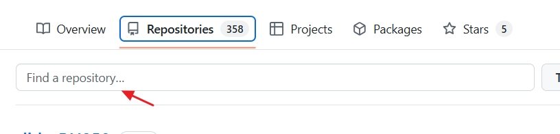
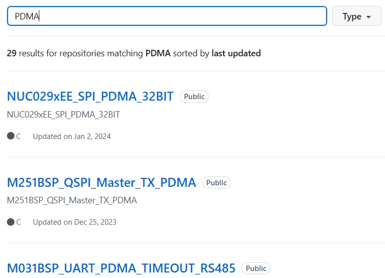
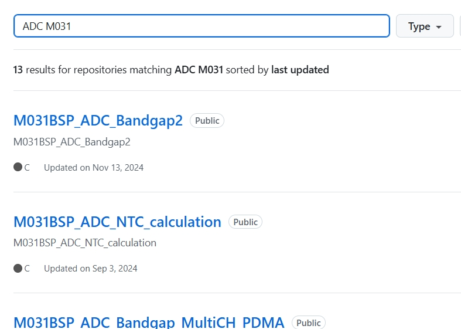
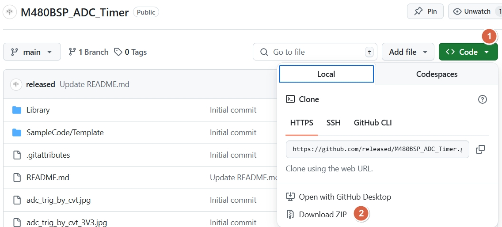

[回到知識庫總索引](https://released.github.io/)

# 嵌入式範例程式索引

> 透過 GitHub repository 搜尋 MCU、周邊與通訊介面的範例程式。下載前先核對晶片型號、toolchain、開發板與 clock / pin 設定，避免直接套用不相容的專案。

[開啟 released 的 GitHub repositories](https://github.com/released/ "Browse example code")

## 搜尋流程

## 1. 進入 repository 清單

在 GitHub 個人頁面切換到 **Repositories**，查看目前公開的範例專案。

---

## 2. 使用搜尋欄位

在 repository 搜尋欄位輸入功能或 MCU 關鍵字。

---

## 3. 使用單一關鍵字

可先搜尋 `I2C`、`ADC`、`CAN` 等周邊名稱，再從結果中核對目標平台。

---

## 4. 組合多個關鍵字

結果太多時，加入 MCU 與功能名稱，例如 `M031 ADC`，縮小專案範圍。

---

## 5. 下載與使用專案

可使用 Git clone，或在專案頁選擇 **Code → Download ZIP**。

> 導入正式產品前，請重新檢查 license、錯誤處理、timeout、interrupt priority、buffer 邊界與硬體保護條件。範例程式的主要用途是建立可工作的最小起點。

[回到頁首](#article_top)
