[回到知識庫總索引](https://released.github.io/)

<a id="article_top"></a>

# FAQ (Renesas)

> 彙整 Renesas 官方知識庫與常用工具入口，並整理 RH850 UART、RL78 PWM、RH850 / RL78 CAN 等常見計算與設定問題。套用數值前，請以目標 MCU 的 User's Manual 與實際 module clock 為準。

## 問題定位路徑


* [Knowledge Base in Renesas](#notice_Knowledge_Base)

* [Quick link](#notice_quick_link)

* [How to get RH850 RLIN3 (UART) lowest error rate](#calculate_uart_baud_rate)

* [How to get RL78 slave PWM TDR/duty value](#calculate_RL_78_pwm_duty)

* [Notice about RH850/RL78 CAN](#notice_RH850_RL78_CAN)


---

<a id="notice_Knowledge_Base"></a>

# Collect some Knowledge Base from Renesas

[RL78 Replace an L Grade device with K Grade device](https://en.na4.teamsupport.com/knowledgeBase/21153498)

[How can I issue a software reset on a RL78 device ?](https://en.na4.teamsupport.com/knowledgeBase/21633589)

[RL78/F1x compatibility to ISO26262](https://en.na4.teamsupport.com/knowledgeBase/19957730)


[back to top](#article_top)   


---

<a id="notice_quick_link"></a>


# Some common tool

### IDE

[CS+ (IDE and Coding Tool)](https://www.renesas.com/en/software-tool/cs)

[e² studio (IDE and Coding Tool)](https://www.renesas.com/en/software-tool/e2-studio)

### Compiler

[C Compiler Package for RL78 Family [CC-RL]](https://www.renesas.com/en/software-tool/c-compiler-package-rl78-family-cc-rl)

[C Compiler Package for RH850 Family [CC-RH]](https://www.renesas.com/en/software-tool/c-compiler-package-rh850-family-cc-rh)

[Compiler Licenses](https://www.renesas.com/en/software-tool/compiler-licenses)

### Emulator

[E2 emulator](https://www.renesas.com/en/software-tool/e2-emulator-rte0t00020kce00000r)

[E2 emulator Lite](https://www.renesas.com/en/software-tool/e2-emulator-lite-rte0t0002lkce00000r)

[E1 emulator](https://www.renesas.com/en/software-tool/e1-emulator-r0e000010kce00-discontinued-product?srsltid=AfmBOoqJKznog1FmVJWPU_Tjsmq14wKJFkvDvX9xyrK_vsqT1W7NWS3t)

### Flash programmer

[Renesas flash programmer](https://www.renesas.com/en/software-tool/renesas-flash-programmer-programming-gui)

# Some links for manual document

[>>>Documentation & Downloads Search<<<](https://www.renesas.com/en/support/document-search?page=0)

__Compilers__
[CC-RL compilers user’s manual](https://www.renesas.com/en/document/mat/cc-rl-compiler-users-manual)

[CC-RH Compiler User's Manual](https://www.renesas.com/document/mat/cc-rh-compiler-users-manual)

[Renesas Compilers Professional Editions](https://www.renesas.com/document/apn/renesas-compilers-professional-editions)

[How to Execute a Program in RAM(CC-RL)](https://www.renesas.com/document/mat/how-execute-program-ramcc-rl)

__Core__
[RL78 Family User's Manual: Software](https://www.renesas.com/document/mah/rl78-family-users-manual-software-rev230)

[RH850/G3KH User's Manual: Software](https://www.renesas.com/en/document/mas/rh850g3kh-users-manual-software)

[RH850G4MH User's Manual: Software](https://www.renesas.com/en/document/mas/rh850g4mh-users-manual-software)

__Programming Techniques__

[RL78 Family C compiler CC-RL Programming Techniques Rev.1.10](https://www.renesas.com/document/apn/rl78-family-c-compiler-cc-rl-programming-techniques-rev110)

[Application Guide for the CC-RH V2 C Compiler for RH850 Devices: Programming Techniques](https://www.renesas.com/document/apn/application-guide-cc-rh-v2-c-compiler-rh850-devices-programming-techniques)

[Application Guide for the CC-RH C Compiler for RH850 Devices: Programming Techniques](https://www.renesas.com/document/mat/application-guide-cc-rh-c-compiler-rh850-devices-programming-techniques)

__Smart Configurator__
[RL78 Smart Configurator User's Guide: CS+](https://www.renesas.com/en/document/man/rl78-smart-configurator-users-guide-cs)

[RH850 Smart Configurator User's Guide: CS+](https://www.renesas.com/document/mat/rh850-smart-configurator-users-guide-cs)

[RH850 Smart Configurator User's Guide: e² studio](https://www.renesas.com/document/mat/rh850-smart-configurator-users-guide-e-studio)

__Boot/application__
[RL78 Family C Compiler Package (CC-RL) How to Divide Boot and Flash Areas](https://www.renesas.com/document/mat/rl78-family-c-compiler-package-cc-rl-how-divide-boot-and-flash-areas)

[RH850 Family C Compiler Package (CC-RH) How to Divide Boot and Flash Areas](https://www.renesas.com/document/apn/rh850-family-c-compiler-package-cc-rh-how-divide-boot-and-flash-areas)

__CS+__
[CS+ Integrated Development Environment User's Manual: CC-RL Build Tool Operation](https://www.renesas.com/document/mat/cs-integrated-development-environment-users-manual-cc-rl-build-tool-operation)

[CS+ Integrated Development Environment User's Manual: CC-RH Build Tool Operation](https://www.renesas.com/document/mat/cs-integrated-development-environment-users-manual-cc-rh-build-tool-operation)

__RL78 F23/F24__
[RL78/F23, F24 Safety Function](https://www.renesas.com/document/apn/rl78f23-f24-safety-function-rev110)
[RL78/F23, F24 Option Byte Setting](https://www.renesas.com/document/apn/rl78f23-f24-option-byte-setting-rev110)
[RL78/F24 Guide for Engineer](https://www.renesas.com/document/gde/rl78f24-guide-engineer)
[RL78/F23 Guide for Engineer](https://www.renesas.com/document/gde/rl78f23-guide-engineer)
[RL78/F23, F24 Hardware Design Guide](https://www.renesas.com/document/apn/rl78f23-f24-hardware-design-guide-rev200)

__RL78 F1x__
[RL78/F13, F14, F15 Option Byte Setting](https://www.renesas.com/document/apn/rl78f13-f14-f15-option-byte-setting-rev101)
[RL78/F12 Option Byte Setting](https://www.renesas.com/document/apn/rl78f12-option-byte-setting-rev100)

__RH850__
[RH850/F1Kx, RH850/F1K Series Hardware Design Guide](https://www.renesas.com/document/apn/rh850f1kx-rh850f1k-series-hardware-design-guide)
[RH850/F1Kx Hardware Design Guide](https://www.renesas.com/document/apn/rh850f1kx-rh850f1k-series-hardware-design-guide)

__Product Part Number Guide__
[RL78 Family Product Part Number Guide](https://www.renesas.com/document/gde/rl78-family-product-part-number-guide)
[RH850 Family Product Part Number Guide](https://www.renesas.com/en/document/gde/rh850-family-product-part-number-guide)

__Simplified IIC__
[RL78/G23 Serial Array Unit (SAU) (EEPROM Control Using Simplified IIC)](https://www.renesas.com/document/apn/rl78g23-serial-array-unit-sau-eeprom-control-using-simplified-iic-rev100)


__CAN__
[CAN Controller Usage: Applications and Frequently Asked Questions](https://www.renesas.com/en/document/apn/can-controller-usage-applications-and-frequently-asked-questions-rev203)

[back to top](#article_top)   

---

<a id="calculate_uart_baud_rate"></a>

# How to get the lowest error rate according to current UART baud rate

* __RH850 RLIN3 (UART) clock max speed__

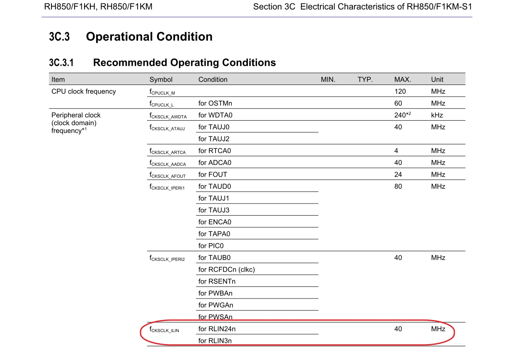

* __RH850 RLIN3 (UART) baud rate calculate formula__

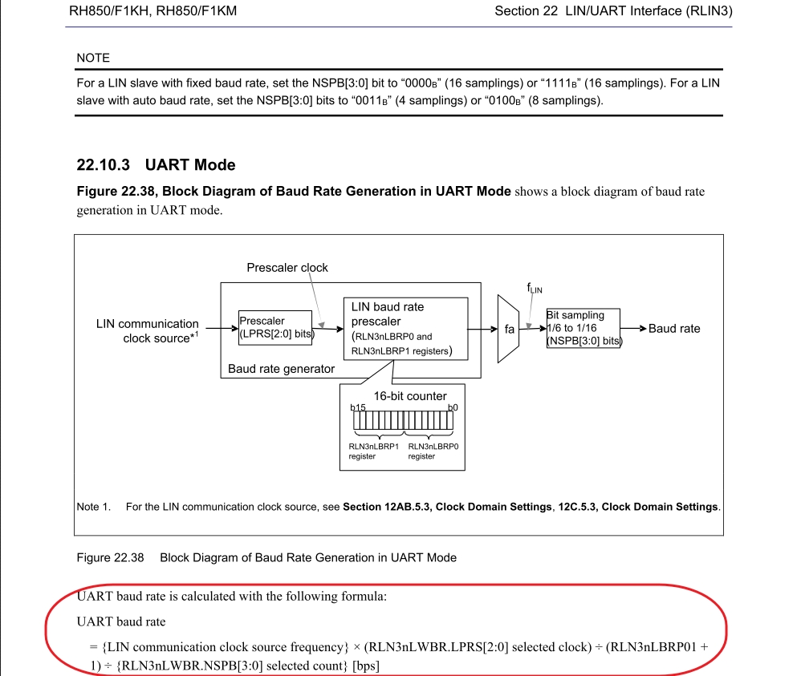


[back to top](#article_top)   

---

[download(python)](./python/RH850_uart_gui.pyw)

* __use tab 3:Best Match Finder, to get best match__

    * input target baud rate 
    * input target error rate
    * tool will try to find best match , base on freq : 
        * 8MHz,16MHz,20MHz,24MHz,40MHz,80MHz,96MHz,120MHz

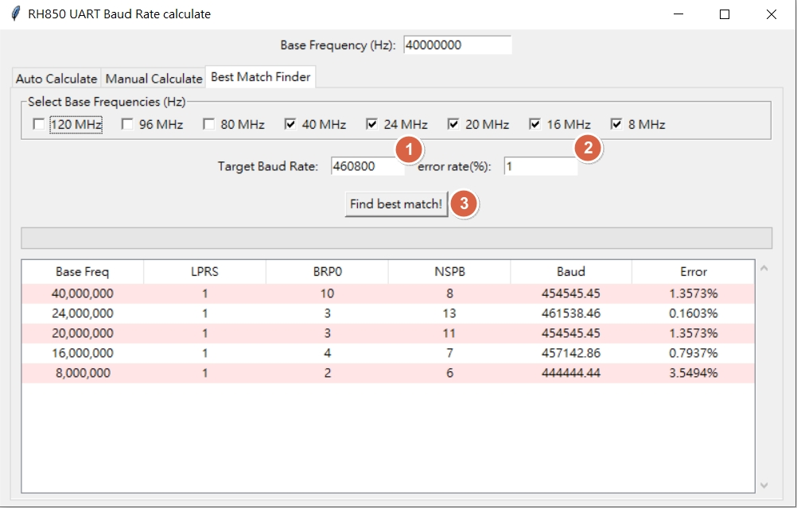

* __use tab 2:Manual Calculate, to calculate error rate__

    * input target Base Frequency 
    * input target LPRS/BRP0/NSPB 
    * input target baud rate 

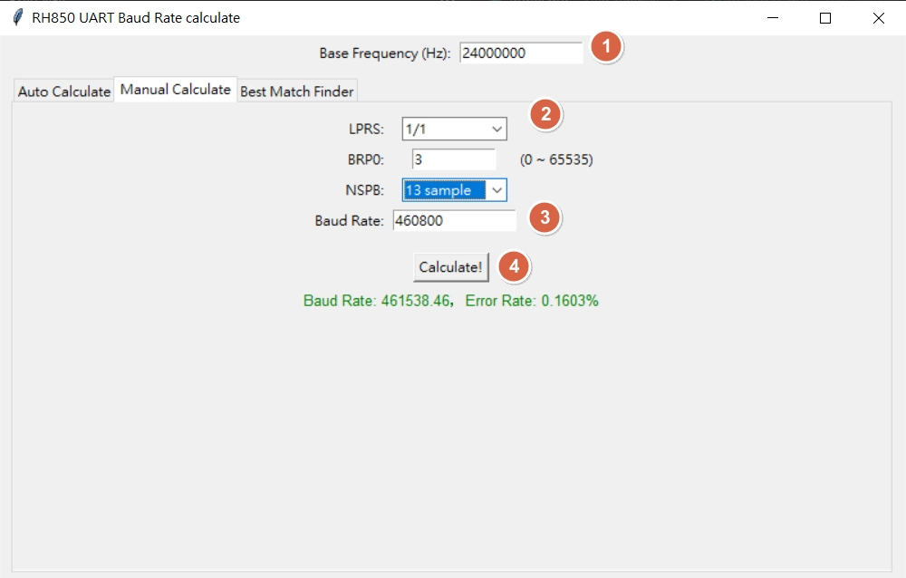


* __use tab 1:Auto Calculate, to calculate error rate__

    * input target Base Frequency 
    * input target baud rate 
    * input target display result 

below is error rate result , when Base Frequency:40MHz
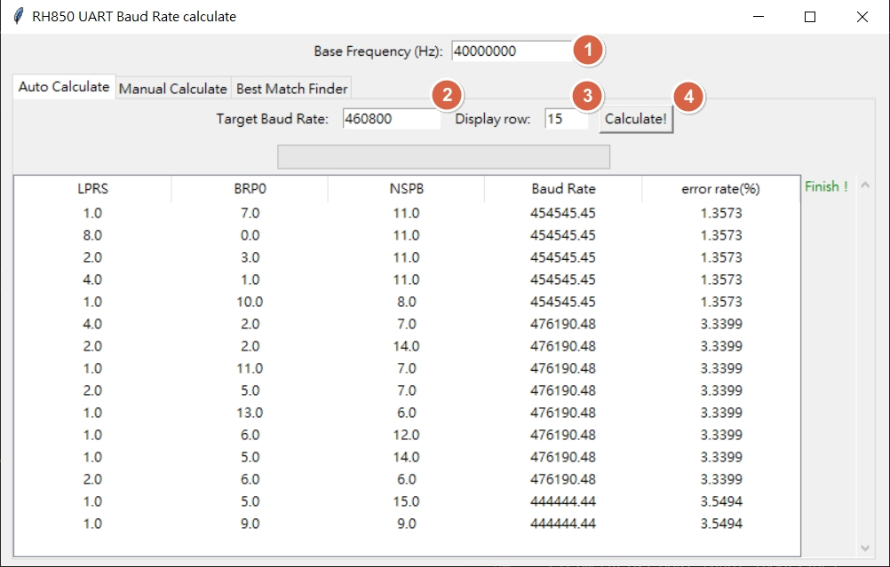

below is error rate result , when Base Frequency:24MHz
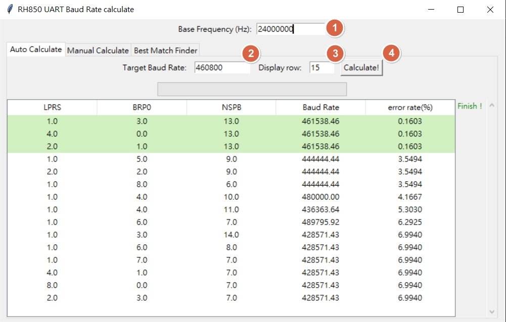

below is error rate result , when Base Frequency:16MHz
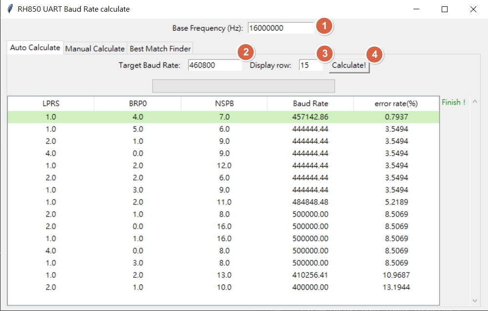

[back to top](#article_top)   

---


<a id="calculate_RL_78_pwm_duty"></a>

# How to get RL78 slave PWM TDR/duty value 

* __RL78 TDR formula__

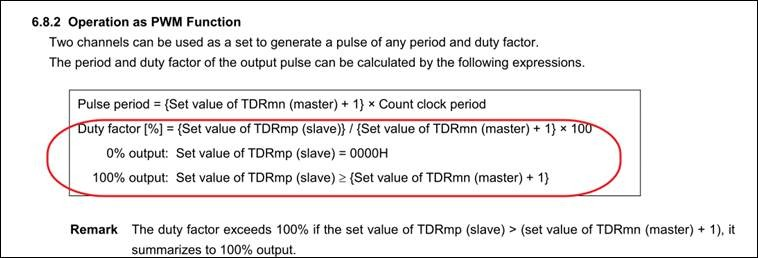


[download(python)](./python/RL78_pwm_gui.pyw)


* __use tab 1:manual input__

    * input pwm master TDR value (hex)
    * input pwm slave TDR value (hex) , to calculate duty
    * input pwm slave duty , to calculate slave TDR
    * select check box , to enable auto calculate master TDR

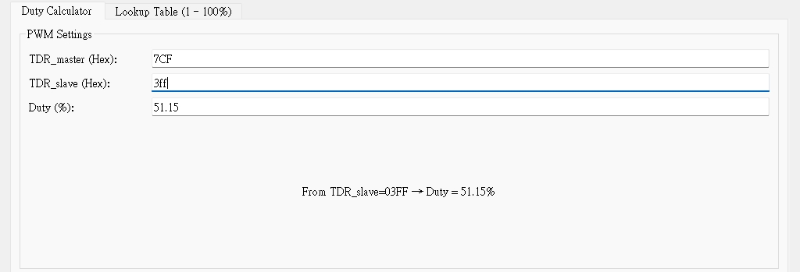
    
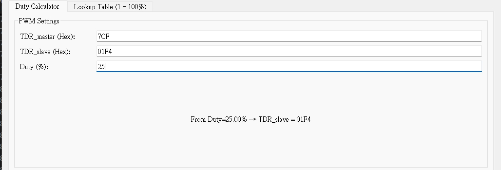
    
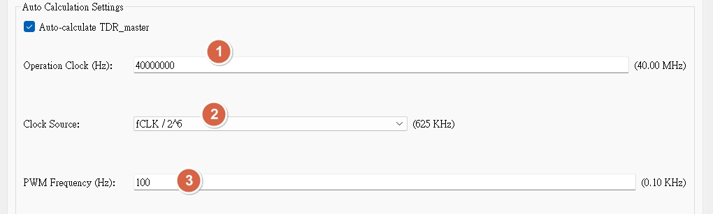


* __use tab 2:calculate all TDR/duty value__

    * input pwm master TDR value (hex)

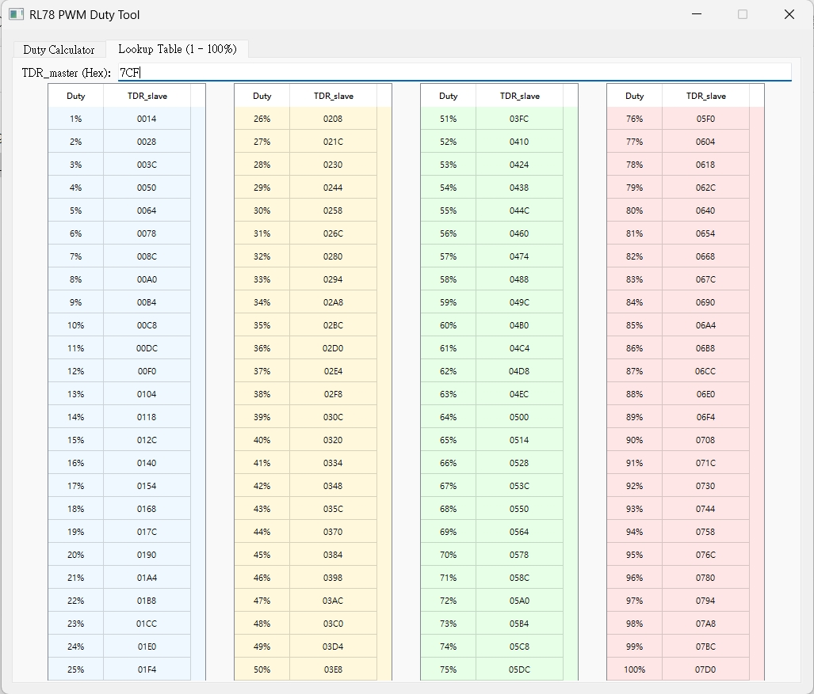

[back to top](#article_top)   

---


<a id="notice_RH850_RL78_CAN"></a>

# Notice about RH850/RL78 CAN module

<span style="color:#FF0000">
<b>* enable TDC when data phase with high baud rate</b><br><br>
</span>


* __TDC_in_RL78__

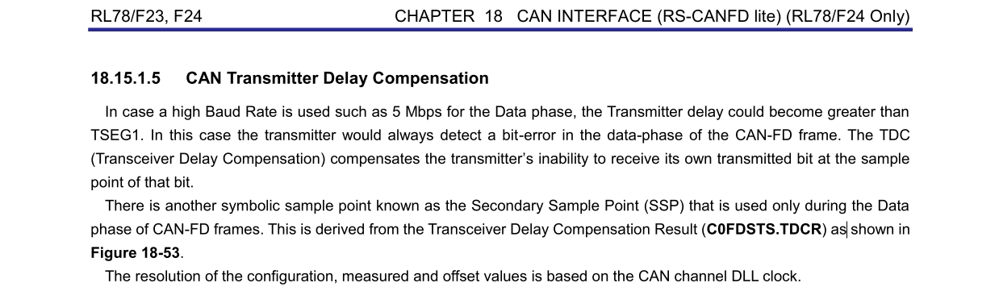

* __TDC_in_RH850__

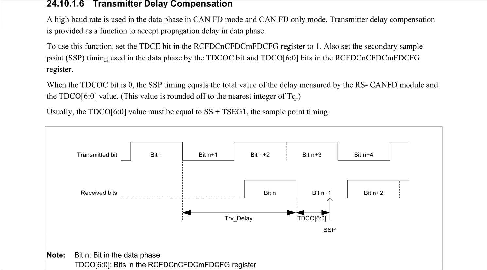


[back to top](#article_top)  

---

* __Nominal Bit Timing_in_RH850__

```
NTSEG1[6:0] Bits : 4 to 128 Tq
NTSEG2[4:0] Bits : 2 Tq to 32 Tq
NSJW[4:0] Bits : 1 to 32 Tq
```

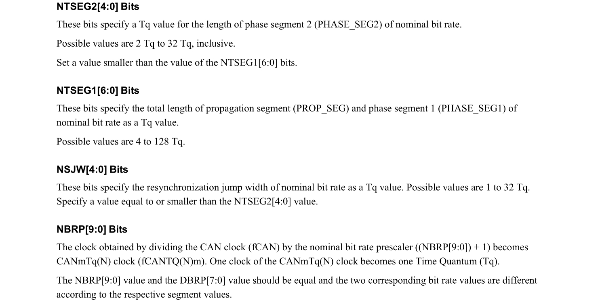
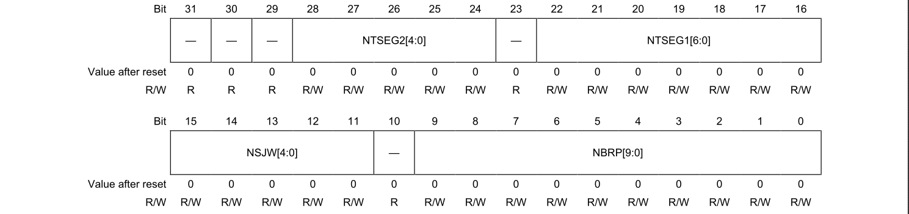


[back to top](#article_top)  

---

* __Data Bit Timing_in_RH850__

```
DTSEG1[3:0] Bits : 2 to 16 Tq
DTSEG2[2:0] Bits : 2 to 8 Tq
DSJW[2:0] Bits Bits : 1 to 8 Tq
```

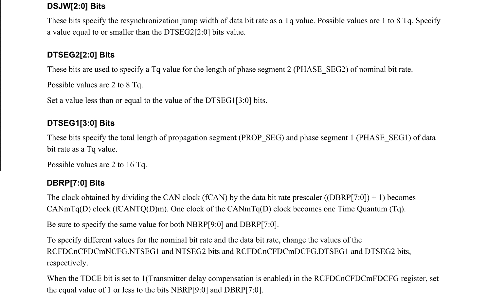
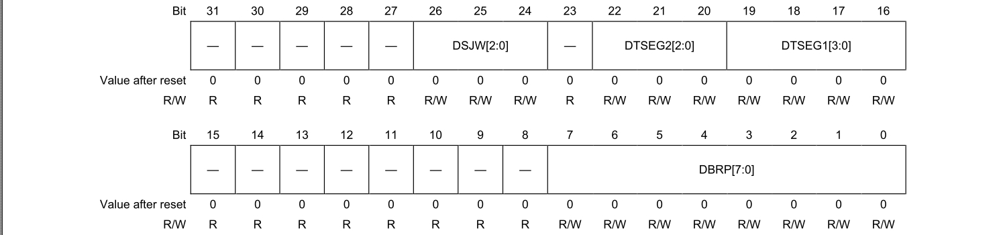

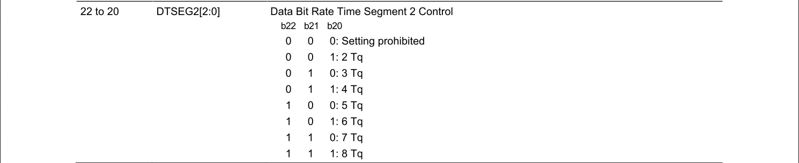
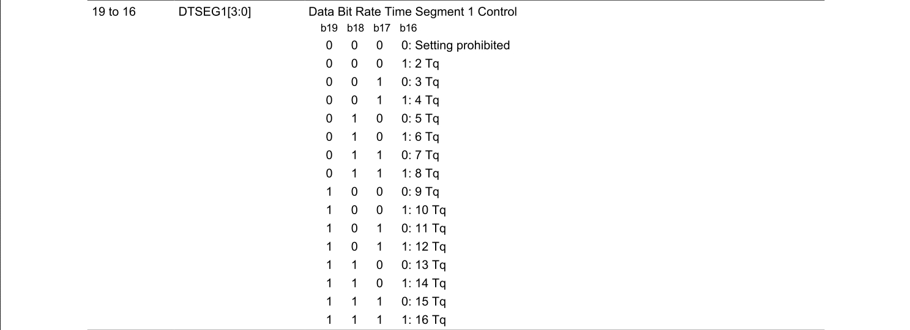


[back to top](#article_top)   

---

* __use tool to calcualte CAN FD timing__
[Bit-Rate-Calculation-Tool](https://www.peak-system.com/Bit-Rate-Calculation-Tool.496.0.html?&L=1)


* __use web site to calcualte CAN FD timing__
[bit-timing-calculator-can-fd](https://www.kvaser.cn/support/calculators/bit-timing-calculator-can-fd/)


* __Timing_setting_in_RH850__

<span style="color:#FF0000">
<b> 
* NBRP[9:0] = DBRP[7:0] </b><br>
<b> 
* when TDCE enable , NBRP[9:0] and DBRP[7:0] must equal vaule of 1 or less
</b><br><br>

</span>

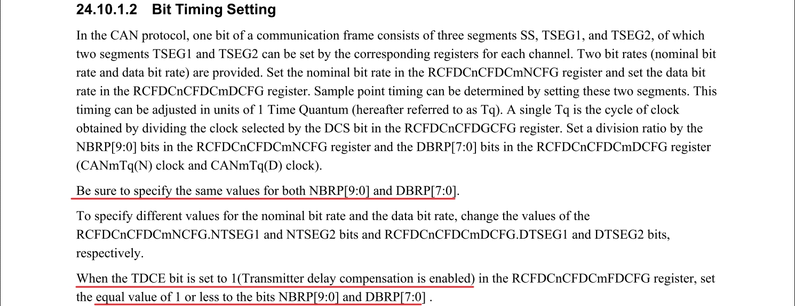

[back to top](#article_top)  

---


[Sample_Project_RH850_S1_CAN_FD_RX_Polling_No_Rule](https://github.com/released/Sample_Project_RH850_S1_CAN_FD_RX_Polling_No_Rule)


[Sample_Project_RH850_S1_CAN_FD_RX_Polling_No_Rule_5M](https://github.com/released/Sample_Project_RH850_S1_CAN_FD_RX_Polling_No_Rule_5M)


* __How_to_enable_TDC_in_RH850__

    * need to set ==__TDCE__== and ==__TDCOC__==
    * need to set ==__TDCO[6:0]__==
        * TDCO = SSP
    * add below code in ==__static void can_normal_mode_set(..)__==

```c
    CAN_REG_SET(cst2[channel].CxFDCFG.UINT32,CAN_REG_BIT9,CAN_REG_LENGTH_1);    // TDCE = 1
    CAN_REG_SET(cst2[channel].CxFDCFG.UINT32,CAN_REG_BIT8,CAN_REG_LENGTH_1);    // TDCOC = 1
    //The SSP offset value = (set value of TDCO[6:0] bits + 1). 
    CAN_REG_SET(cst2[channel].CxFDCFG.UINT32,CAN_REG_BIT16,6);   // TDCO[6:0] 
```


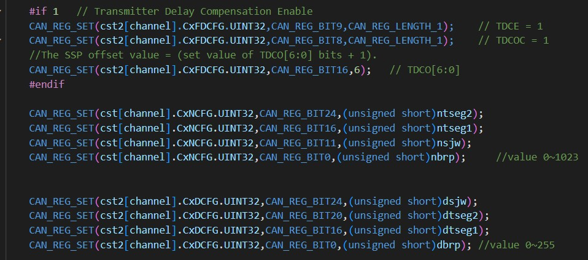

 * Below is PCAN tool setting to test 500K/5M 


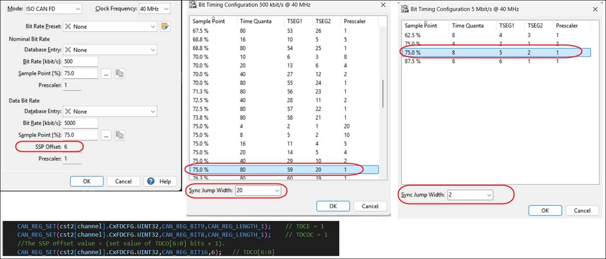


 * modify below code in ==__const CAN_BUS_PARAMETER_T can_bus_parameter_ch1__==
    
```c
    .NBRP                   = CAN_NBRP_1,
    .NTSEG1                 = CAN_NTSEG1_59TQ,
    .NTSEG2                 = CAN_NTSEG2_20TQ,
    .NSJW                   = CAN_NSJW_20TQ,

    .DBRP                   = CAN_DBRP_1,
    .DTSEG1                 = CAN_DTSEG1_5TQ,
    .DTSEG2                 = CAN_DTSEG2_2TQ,
    .DSJW                   = CAN_DSJW_2TQ,

```

```
    40MHz
    nominal : 500k
        sample rate : 75
        pre-scale : 1
        TSEG1 : 59
        TSEG2 : 20
        SJW : 20

    data : 5M
        sample rate : 75
        pre-scale : 1
        TSEG1 : 5
        TSEG2 : 2
        SJW : 5  
        
        SSP : 6

```

[back to top](#article_top)  

---

* __other Nominal Data Bit timing 1__
    * nominal : 500K , 75%
    * data : 2M , 75%

```c
    .NBRP                   = CAN_NBRP_1,
    .NTSEG1                 = CAN_NTSEG1_59TQ,
    .NTSEG2                 = CAN_NTSEG2_20TQ,
    .NSJW                   = CAN_NSJW_20TQ,

    .DBRP                   = CAN_DBRP_1,
    .DTSEG1                 = CAN_DTSEG1_14TQ,
    .DTSEG2                 = CAN_DTSEG2_5TQ,
    .DSJW                   = CAN_DSJW_5TQ,
```

```
    40MHz
    nominal : 500k
        sample rate : 75
        pre-scale : 1
        TSEG1 : 59
        TSEG2 : 20
        SJW : 20

    data : 2M
        sample rate : 75
        pre-scale : 1
        TSEG1 : 14
        TSEG2 : 5
        SJW : 5 

```


[back to top](#article_top)

---

* __other Nominal Data Bit timing 2__
    * nominal : 500K , 80%
    * data : 2M , 70%

```c
    .NBRP                   = CAN_NBRP_1,       //1U - 1U,
    .NTSEG1                 = CAN_NTSEG1_63TQ,  //63U - 1U,
    .NTSEG2                 = CAN_NTSEG2_16TQ,  //16U - 1U,
    .NSJW                   = CAN_NSJW_16TQ,    //16U - 1U,

    .DBRP                   = CAN_DBRP_1,       //1U - 1U,
    .DTSEG1                 = CAN_DTSEG1_13TQ,  //13U - 1U,
    .DTSEG2                 = CAN_DTSEG2_6TQ,   //6U - 1U,
    .DSJW                   = CAN_DSJW_6TQ,     //6U - 1U,
```

```
    40MHz
    nominal : 500k
        sample rate : 80
        pre-scale : 1
        TSEG1 : 63
        TSEG2 : 16
        SJW : 16

    data : 2M
        sample rate : 70
        pre-scale : 1
        TSEG1 : 13
        TSEG2 : 6
        SJW : 6
```


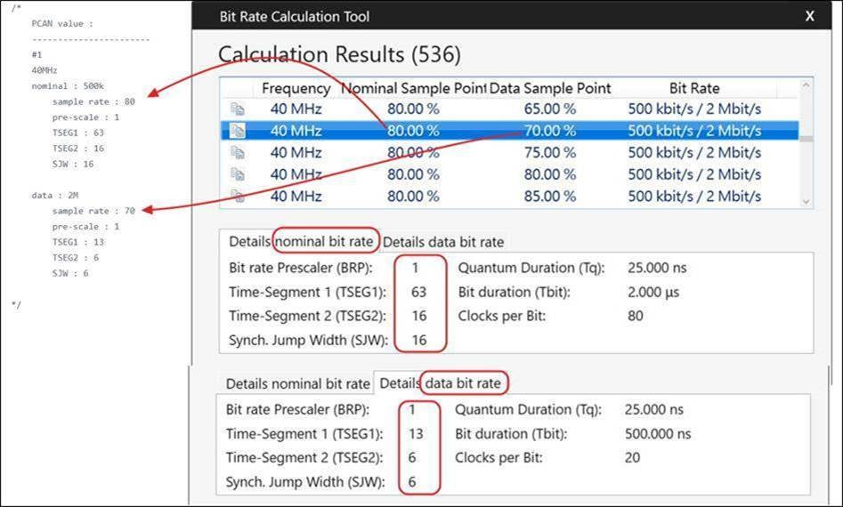

[back to top](#article_top)

---

[Sample_Project_RH850_S1_CAN_RX_Polling_No_Rule](https://github.com/released/Sample_Project_RH850_S1_CAN_RX_Polling_No_Rule)


* __How to set CAN frame or CAN FD frame__
    * modify CAN_FD_MODE_e mode to output classical CAN frame or CAN FD frame

```c
typedef enum
{
    CAN_FD_MIX_MODE=0,
    CAN_FD_ONLY_MODE=1,
    CAN_STANDARD_MODE=2
}CAN_FD_MODE_e;

```

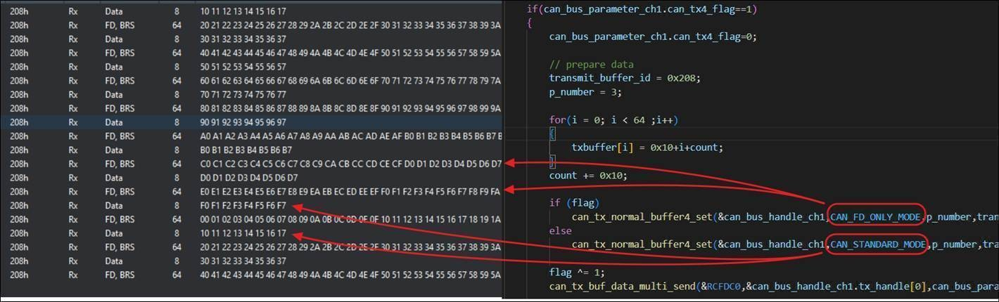

[back to top](#article_top)

---

* __Some example code__


==__RH850__==

single CH (CAN1)
[Sample_Project_RH850_S1_CAN_FD_RX_Polling_No_Rule](https://github.com/released/Sample_Project_RH850_S1_CAN_FD_RX_Polling_No_Rule)

[Sample_Project_RH850_S1_CAN_FD_RX_Polling_With_Rule](https://github.com/released/Sample_Project_RH850_S1_CAN_FD_RX_Polling_With_Rule)

[Sample_Project_RH850_S1_CAN_FD_RX_Interrupt_No_Rule](https://github.com/released/Sample_Project_RH850_S1_CAN_FD_RX_Interrupt_No_Rule)

[Sample_Project_RH850_S1_CAN_FD_RX_Interrupt_With_Rule](https://github.com/released/Sample_Project_RH850_S1_CAN_FD_RX_Interrupt_With_Rule)

single CH (CAN1 , high baud rate)
[Sample_Project_RH850_S1_CAN_FD_RX_Polling_No_Rule_5M](https://github.com/released/Sample_Project_RH850_S1_CAN_FD_RX_Polling_No_Rule_5M)

single CH (CAN4)
[Sample_Project_RH850_S1_CAN_FD_RX_No_Rule_CH4](https://github.com/released/Sample_Project_RH850_S1_CAN_FD_RX_No_Rule_CH4)

single CH (CAN1 , CAN frame)
[Sample_Project_RH850_S1_CAN_RX_Polling_No_Rule](https://github.com/released/Sample_Project_RH850_S1_CAN_RX_Polling_No_Rule)

multi CH (CAN1 , CAN4)
[Sample_Project_RH850_S1_CAN_FD_MultiCH](https://github.com/released/Sample_Project_RH850_S1_CAN_FD_MultiCH)

multi CH (CAN0 , CAN2)
[Sample_Project_RH850_S1_CAN_FD_MultiCH_CAN0_CAN2](https://github.com/released/Sample_Project_RH850_S1_CAN_FD_MultiCH_CAN0_CAN2)

multi CH (CAN0 , CAN2 , re-arrange driver structure , for easy enable multi channel)
[Sample_Project_RH850_S1_CAN_FD_MultiCHv2](https://github.com/released/Sample_Project_RH850_S1_CAN_FD_MultiCHv2)


==__RL78__==

[RL78_F24_CAN_FD](https://github.com/released/RL78_F24_CAN_FD)

[RL78_F24_CAN](https://github.com/released/RL78_F24_CAN)

[RL78_F13_CAN](https://github.com/released/RL78_F13_CAN)


[back to top](#article_top)
