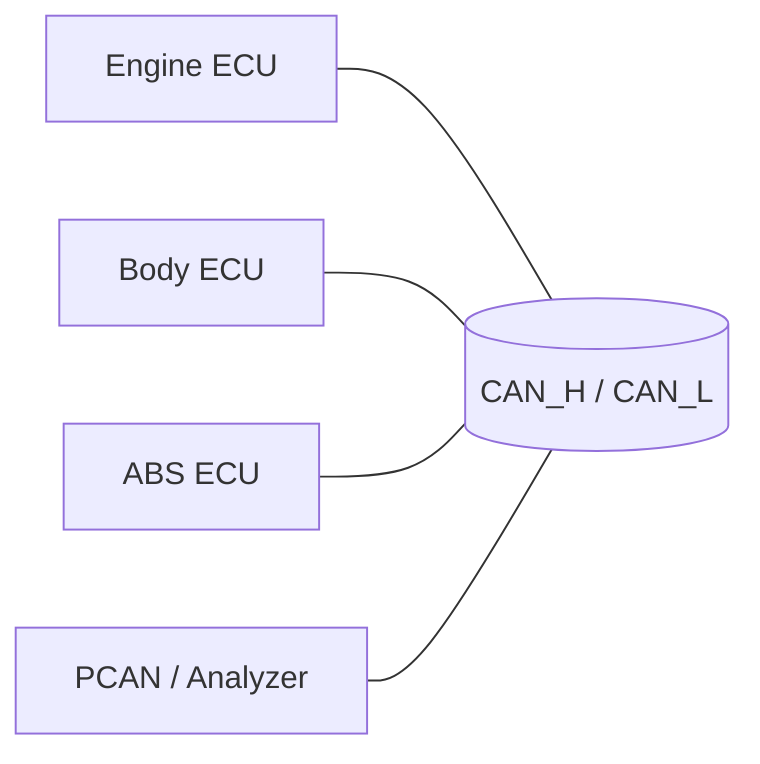
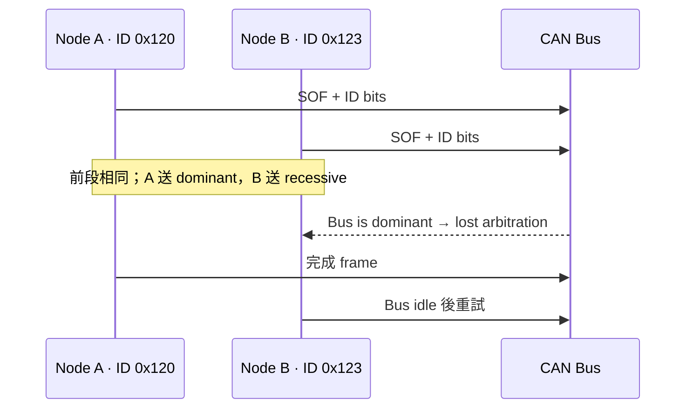
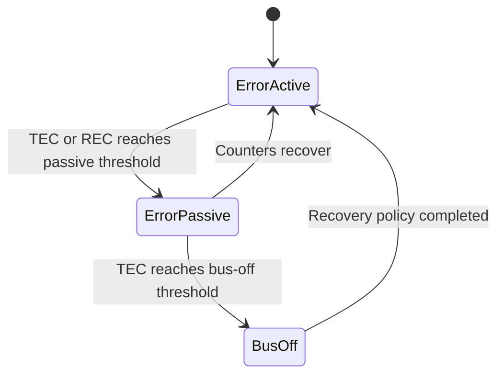
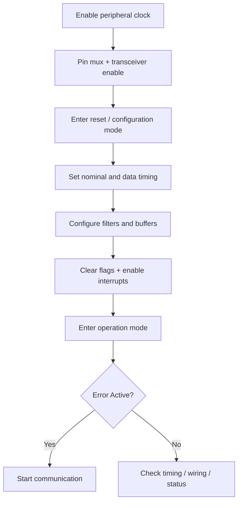
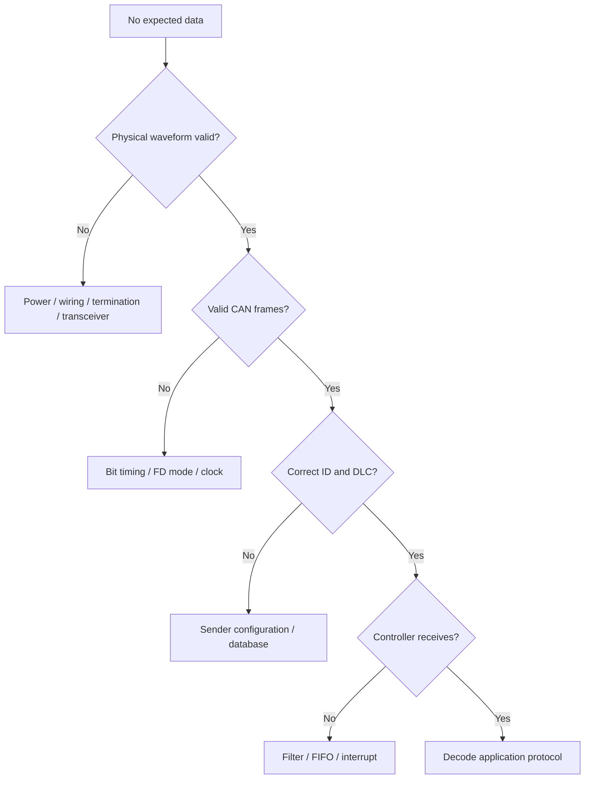

[回到總索引](https://released.github.io/)

<a id="article_top"></a>

# CAN / CAN FD 知識庫

> 整理 CAN / CAN FD 的用途、frame 傳輸、實體線路、controller 狀態與除錯資訊。最後更新：2026-07-12。

## 導覽

- [CAN 是什麼](#can-purpose)
- [Physical Layer](#physical)
- [CAN Frame](#frame)
- [Arbitration](#arbitration)
- [Bit Timing](#timing)
- [Error Handling](#error)
- [CAN FD](#canfd)
- [Controller Registers](#registers)
- [工具與除錯](#debug)
- [ISO-TP 與 UDS 的關聯](#next-uds)

---

<a id="can-purpose"></a>

## 1. CAN 是什麼

Controller Area Network（CAN）是多主機、事件觸發、以訊息 ID 為中心的差動匯流排。車上的 ECU 可共用一組 CAN_H/CAN_L，不需要每兩個 ECU 各拉一組 UART 線。

CAN 節點不在 frame 內傳送「目的位址」。Sender 發布帶有 Arbitration ID 的訊息；所有節點都看得到，再由 acceptance filter 決定是否接收。



### 1.1 CAN 解決什麼問題

- 多個 ECU 共用通訊線路。
- 高優先權訊息可以先傳。
- 硬體自動檢查 bit、stuff、CRC、form 與 ACK error。
- 故障節點可進入 Error Passive 或 Bus-Off，避免癱瘓整條網路。
- CAN controller 處理 frame、仲裁與錯誤，application 專注訊號與控制邏輯。

### 1.2 CAN 沒有處理什麼

CAN frame 本身不定義：

- ID `0x123` 代表車速還是溫度。
- 多個 frame 如何組成一個大訊息。
- 診斷 command、firmware upgrade 或 security。
- 訊號 endian、scaling、unit。

這些由上層 protocol 或專案 database 定義，例如 DBC、J1939、CANopen、ISO-TP/UDS。

<a id="physical"></a>

## 2. Physical Layer

CAN 使用 CAN_H 與 CAN_L 差動傳輸。Receiver 判斷兩條線的差，而不是只看單一線對地電壓，因此比 single-ended signal 更能抵抗共模雜訊。

| Bus state | Logic | 說明 |
|---|---:|---|
| Dominant | `0` | CAN_H/CAN_L 形成明顯差動電壓 |
| Recessive | `1` | 兩線電位較接近 |

任何節點送 dominant `0` 時，bus 就是 dominant；recessive `1` 只有在所有節點都送 recessive 時成立。這使 CAN 可以進行無破壞仲裁。

### 2.1 Termination

高速 CAN bus 通常在主幹兩端各有一顆 120 Ω termination：

```text
120 Ω                                           120 Ω
CAN_H ─────────────── twisted pair ───────────── CAN_H
CAN_L ─────────────── twisted pair ───────────── CAN_L
```

總線斷電後，CAN_H 與 CAN_L 之間常量到約 60 Ω，因為兩顆 120 Ω 並聯。實際值仍會受電路、split termination 與其他路徑影響。

### 2.2 Physical checklist

- 兩端 termination 是否存在，是否誤放第三顆。
- CAN_H/CAN_L 是否接反、短路或對地漏電。
- Transceiver standby/silent pin 是否正確。
- ECU 間是否有共同 ground reference。
- Stub 是否過長、connector 是否造成反射。
- Transceiver 是否支援使用中的 bit rate / CAN FD data rate。

<a id="frame"></a>

## 3. Classical CAN Frame

| 欄位 | 作用 |
|---|---|
| SOF | 一個 dominant bit，宣告 frame 開始並同步 |
| Arbitration | 11-bit standard ID 或 29-bit extended ID，以及 RTR/IDE 等控制位元 |
| Control | DLC 與 frame control information |
| Data | Classical CAN 為 0–8 bytes |
| CRC | 傳輸錯誤偵測 |
| ACK | 任一正確接收節點送 dominant ACK |
| EOF | 七個 recessive bits 結束 frame |

```text
SOF | Arbitration | Control | Data 0..8 B | CRC | ACK | EOF
```

ACK 只表示至少有一個節點正確收到 frame，不表示 application 已處理，也不表示該訊息有特定目的 ECU。

### 3.1 Standard 與 Extended ID

| 類型 | ID bits | 常見表示 |
|---|---:|---|
| Standard | 11 | `0x000`–`0x7FF` |
| Extended | 29 | `0x00000000`–`0x1FFFFFFF` |

兩者在 arbitration field 的格式不同。Controller filter 與 analyzer 必須知道 frame 是 standard 還是 extended；數值相同不代表同一種 frame。

### 3.2 DLC 與 payload

Classical CAN DLC `0..8` 對應相同 data bytes。應用程式要驗證預期 DLC，不應在 data 太短時仍解碼固定 offset。

### 3.3 Bit stuffing

從 SOF 到 CRC sequence，連續五個相同位元後 transmitter 會插入一個反相 stuff bit。Receiver 自動移除。應用程式看不到 stuff bit，但它會影響 frame 實際占用 bus 的時間。

<a id="arbitration"></a>

## 4. 無破壞仲裁

多個節點可在 bus idle 後同時開始傳送。每個 transmitter 一邊送、一邊讀 bus：

- 自己送 recessive `1`，卻讀到 dominant `0`：代表輸掉 arbitration。
- 輸掉者停止傳送，不產生 error，等待 bus idle 後重試。
- 勝出者的 frame 不會被破壞。



數值較小的 ID 通常具有較高優先權。ID 設計要考慮 frequency、deadline、worst-case latency 與 bus load，不能只依功能名稱排列。

### 4.1 Priority starvation

若高優先權訊息發送太頻繁，低優先權 frame 可能長時間無法取得 bus。設計時應量測：

- Peak/average bus load。
- 最壞 blocking time。
- 每個 periodic message 的 deadline。
- Diagnostic 或低優先權 traffic 是否仍有傳送機會。

<a id="timing"></a>

## 5. Bit Timing

一個 nominal bit time 通常由 `Sync_Seg + Time_Seg1 + Time_Seg2` 組成。

```text
Tq clock = fCAN / BRP
Bit rate = fCAN / (BRP × (1 + TSEG1 + TSEG2))
Sample point = (1 + TSEG1) / (1 + TSEG1 + TSEG2)
```

| 參數 | 用途 |
|---|---|
| BRP | 將 CAN module clock 分頻成 Time Quantum |
| TSEG1 | Propagation + phase segment before sample point |
| TSEG2 | Segment after sample point |
| SJW | Resynchronization 可調整的最大 Tq |

Register 欄位常使用 value-minus-one encoding，例如設定 8 Tq 可能寫 `7`。一定要確認 MCU User's Manual，不能直接複製另一顆 MCU 的 register value。

### 5.1 設定步驟

1. 確認 CAN module clock 的實際頻率與來源。
2. 找出符合目標 bit rate 的 BRP/TSEG 組合。
3. 選擇符合網路長度與 oscillator tolerance 的 sample point。
4. 確認 SJW、TSEG2 與 controller legal range。
5. 用 analyzer/oscilloscope 驗證，不只看計算結果。

<a id="error"></a>

## 6. Error Detection 與 Error Confinement

CAN controller 可偵測：

| Error | 說明 |
|---|---|
| Bit error | 送出的位元與讀到的 bus state 不符（仲裁/ACK 例外） |
| Stuff error | 違反 bit stuffing 規則 |
| CRC error | Receiver 計算 CRC 不符 |
| Form error | 固定格式欄位出現非法位元 |
| ACK error | Transmitter 未看到任何 receiver ACK |

Transmit Error Counter（TEC）與 Receive Error Counter（REC）控制節點狀態：



| 狀態 | 行為 |
|---|---|
| Error Active | 可送 active error flag |
| Error Passive | 送 passive error flag，傳送行為受限制 |
| Bus-Off | 停止參與 bus，避免故障節點持續破壞網路 |

### 6.1 常見症狀

| 現象 | 優先檢查 |
|---|---|
| 一直 ACK error | 是否只有一個 active node、對端 bit rate、silent mode |
| Stuff/form error 多 | timing、clock、termination、反射、雜訊 |
| 快速 bus-off | CAN_H/L 接線、baud mismatch、FD/non-FD 不相容 |
| Analyzer 看得到，MCU 收不到 | ID type、acceptance filter、FIFO routing |

Bus-off recovery 由 controller 與 vehicle safety policy 決定。不要用無限快速重新初始化掩蓋 wiring/timing 根因。

<a id="canfd"></a>

## 7. CAN FD

CAN FD 的主要改進：

- Data field 最多 64 bytes。
- 可用 BRS 在 data phase 切換較高 bit rate。
- 使用對應較長 payload 的 CRC 規則。
- Arbitration phase 仍需所有節點在 nominal bit rate 下協調。

| DLC | 0–8 | 9 | 10 | 11 | 12 | 13 | 14 | 15 |
|---|---:|---:|---:|---:|---:|---:|---:|---:|
| Bytes | 0–8 | 12 | 16 | 20 | 24 | 32 | 48 | 64 |

### 7.1 CAN FD control bits

| Bit | 意義 |
|---|---|
| FDF | CAN FD frame format |
| BRS | Data phase 是否切換高速 bit rate |
| ESI | Transmitter error state indicator |

CAN FD 需要分別設定 nominal bit timing 與 data bit timing。高速 data phase 還可能需要 Transceiver Delay Compensation（TDC）。

### 7.2 CAN FD 不等於上層自動變快

上層 protocol 必須知道 link-layer data length，才能使用較大的 payload。若工具仍固定用 8-byte frame，換成 CAN FD hardware 也不會自動減少分段數量。

<a id="registers"></a>

## 8. CAN Controller Register 分類

不同 MCU 名稱與位址不同，但常見功能如下：

| Register group | 常見名稱 | 用途 |
|---|---|---|
| Control | `CCCR`, `GCTRL`, `CCTRL`, `CTL` | reset/config/operation/sleep/test |
| Nominal timing | `NBTP`, `BTR`, `NCFG` | BRP、TSEG1/2、SJW |
| Data timing | `DBTP`, `DCFG` | CAN FD data phase |
| TDC | `TDCR`, `TDCE` | 高速 data phase delay compensation |
| Filter | `GAFL`, `RXF`, `SIDFC`, `XIDFC` | ID/mask/range 與 destination |
| Buffer/FIFO | `TXBC`, `RXBC`, `FIFO`, `MB` | message element 與 indices |
| Error/status | `PSR`, `ECR`, `STS` | TEC、REC、LEC、passive、bus-off |
| Interrupt | `IE`, `IR`, `INT`, `IF` | RX/TX/error/bus-off flag |

### 8.1 初始化順序



注意 write-one-to-clear、reserved bits、protected register、mode transition timeout 與 message RAM initialization。

<a id="debug"></a>

## 9. 工具與除錯流程

### 9.1 工具

- Multimeter：termination、short、supply。
- Oscilloscope：CAN_H/CAN_L 波形、reflection、bit timing。
- PCAN-View / CAN analyzer：ID、DLC、data、error frame、bus load。
- MCU debugger：register、FIFO、interrupt、TEC/REC。
- DBC decoder：把 raw bytes 轉成 signal。

### 9.2 由下往上除錯



每次只改一個變因，保存 timestamped raw trace、register status 與 physical measurement，避免只靠 UI 顯示推測。

<a id="next-uds"></a>

## 10. ISO-TP 與 UDS 的關聯

UDS／ISO-TP 會使用以下 CAN / CAN FD 概念：

- Standard/Extended ID 差在哪裡？
- 為什麼數值較小的 ID 優先？
- DLC 與 payload length 如何對應？
- ACK error 與 Bus-Off 代表什麼？
- Classical CAN 與 CAN FD 的 payload/timing 差異？

協定層次關係：

```text
CAN / CAN FD frame
        ↓
ISO-TP segmentation and flow control
        ↓
UDS request / response / services
        ↓
ECU Bootloader firmware upgrade
```

前往：[UDS / ISO-TP / ECU Bootloader 知識庫](https://released.github.io/notices_can_uds/)

## 11. 網路參考來源

- [CAN in Automation — CAN Knowledge](https://www.can-cia.org/can-knowledge)：CAN CC、CAN FD、lower layer 與標準術語入口。
- [Bosch — CAN FD Protocol](https://www.bosch-semiconductors.com/products/ip-modules/can-protocols/can-fd/)：CAN FD 的 frame、payload 與 bit-rate switch 技術背景。
- [ISO 11898 Standards Catalogue](https://www.iso.org/ics/43.040.15/x/)：CAN data-link 與 physical-layer 標準狀態。
- [PEAK PCAN-View](https://www.peak-system.com/products/software/analysis-software/pcan-view/?L=1)：PCAN monitor、transmit、trace 與 CAN FD 支援。
- [PEAK PCAN-Basic](https://www.peak-system.com/products/software/development-packages/pcan-basic/)：PCAN hardware 的 CAN/CAN FD programming API。

本頁文字、表格與 Mermaid 圖均依本站內容架構重新撰寫／繪製，沒有複製上述網站段落或付費標準內容。ISO 頁面用於確認 scope 與版本；完整 normative requirements 仍須取得正式標準。

---

## English Summary

This site covers CAN and CAN FD from the physical bus through frames, arbitration, bit timing, error confinement, controller registers, and practical debugging. ISO-TP and diagnostic-service material is collected in the separate [UDS knowledge base](https://released.github.io/notices_can_uds/).

[回到頁首](#article_top)
