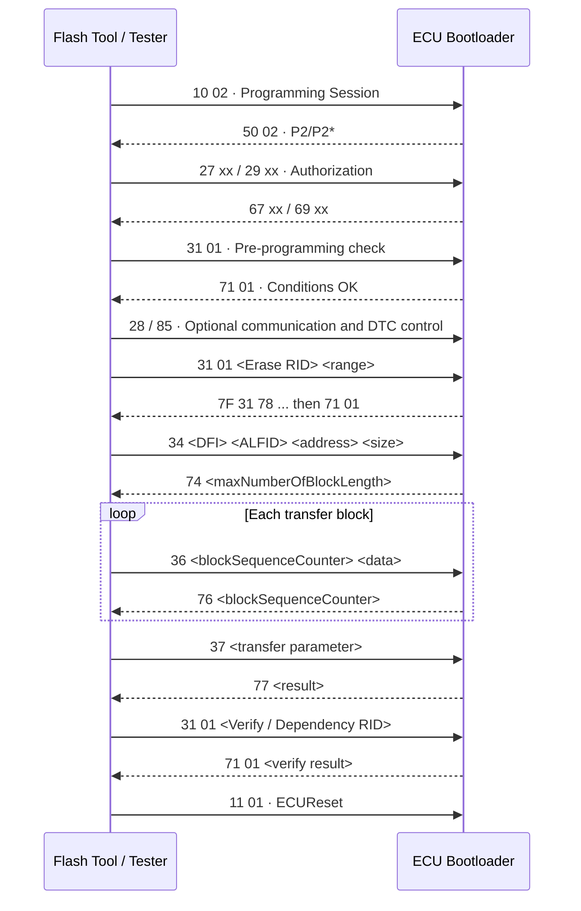
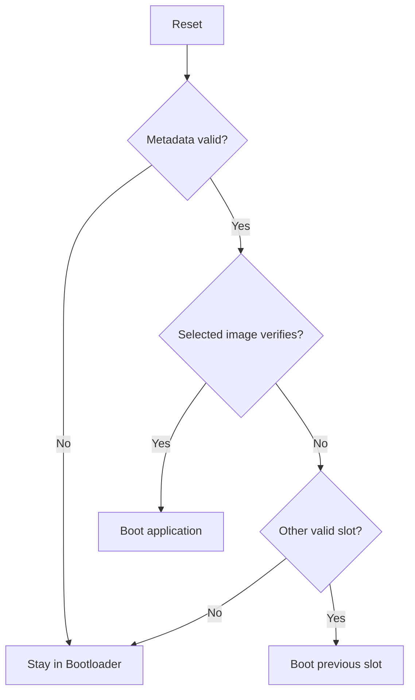

[UDS 首頁](../) · [上一頁：UDS Services](../services/) · [下一頁：實作與測試](../implementation/)

<a id="article_top"></a>

# UDS Bootloader 與 ECU Firmware Upgrade

## 1. UDS Bootloader 是什麼

UDS Bootloader 是 ECU 中可在 application 無法或不應正常執行時，仍提供受控診斷與 firmware programming 的軟體。它負責：

- 判斷 boot/application 有效性與啟動模式。
- 接受 Programming Session 與授權。
- Erase/program/verify Flash。
- 管理 image metadata、validity marker 與 rollback policy。
- 刷寫失敗時保留重新 programming 的路徑。

UDS 只定義通訊服務；Flash driver、memory map、crypto、boot policy 與 power-loss recovery 是 ECU 系統設計。

## 2. 典型記憶體配置

```text
Flash
├─ Bootloader code / immutable recovery
├─ Boot metadata / active slot / rollback counter
├─ Application Slot A
├─ Application Slot B (optional)
├─ Calibration / configuration
└─ NVM / diagnostic data
```

| 區域 | 保護原則 |
|---|---|
| Bootloader | 一般 UDS download 不得覆寫；必要時使用獨立 secure update |
| Metadata | atomic update、redundancy、CRC/MAC、version counter |
| Application | range/alignment/sector whitelist |
| Calibration | 與 application 分開定義 dependency |
| NVM | 刷寫時保留或明確 migration |

## 3. 完整 Upgrade Flow



這是常見主鏈，不是所有 ECU 的固定 command sequence。Session transition、security level、RID、DFI、ALFID、reset type 與 optional service 由 OEM/ECU specification 定義。

## 4. Step-by-Step

### 4.1 進入 Programming Session

```text
10 02
50 02 <P2ServerMax> <P2StarServerMax>
```

ECU 可能直接切換，也可能先由 application 設 boot request、reset，再由 bootloader 回覆。Tester 要容忍 transport reconnect 與不同 response ID policy。

### 4.2 SecurityAccess / Authentication

```text
27 01            Request seed
67 01 <seed>
27 02 <key>
67 02
```

高安全系統可要求 `0x29`、secure channel、signed authorization token 或 HSM-backed role。授權成功不代表任意 address 都可寫，server 仍需 range policy。

### 4.3 Pre-Programming Conditions

典型檢查：

- Supply voltage 在允許範圍。
- Vehicle speed 為 0、drive state 安全。
- Programming dependency 與 ECU variant 正確。
- Application image target/part number 相符。
- Watchdog、communication、DTC policy 已準備。
- 目前沒有會與 Flash programming 衝突的 job。

### 4.4 Erase Memory

常以 `0x31 startRoutine` 執行：

```text
31 01 <EraseRID> <address/size or partition>
71 01 <EraseRID> <status>
```

Erase 可能超過 P2，因此 ECU 可先回 `7F 31 78`。Tester 應等待 final response；ECU 要持續服務 watchdog 與必要的 transport/timing。

### 4.5 RequestDownload `0x34`

```text
34 <DataFormatIdentifier> <ALFID> <memoryAddress> <memorySize>
74 <lengthFormatIdentifier> <maxNumberOfBlockLength>
```

ECU 建立 transfer context，包含 target range、remaining length、expected counter、decompression/encryption mode 與 writer state。

`maxNumberOfBlockLength` 通常描述完整 `TransferData` request 的最大長度，包含 SID 與 block counter；Tester 必須依採用的標準 edition/ECU specification 算可用 data bytes，不能直接全部當 payload。

### 4.6 TransferData `0x36`

```text
36 01 <block data...>  → 76 01
36 02 <block data...>  → 76 02
...
```

Block sequence counter 一般由 `0x01` 開始，經 `0xFF` 後循環。Retry policy 必須明確：相同 counter 的重送是回覆上次結果、重複寫入，還是拒絕，不能由 Tester 自行猜測。

ECU 每 block 應檢查：

- Transfer context active。
- Counter 是否為 expected 或允許的 retry。
- Block length 與 remaining size。
- Address overflow、alignment、Flash minimum write unit。
- Flash driver result、ECC、watchdog 與 voltage monitor。

### 4.7 RequestTransferExit `0x37`

```text
37 <optional transferExitParameterRecord>
77 <optional response record>
```

TransferExit 代表 transport block phase 結束，不等於 image 已可開機。Server 仍要確認 exact byte count、flush pending writes、finalize decompression/decryption，並準備 verification。

### 4.8 Verify / Dependency Check

常以 `0x31` 執行 CRC、hash、digital signature、target identity、version/rollback 與 dependency 檢查。

| 機制 | 提供能力 |
|---|---|
| CRC32 | 偵測傳輸／儲存損壞，不驗證來源 |
| Cryptographic hash | 強完整性摘要，本身不提供 signer identity |
| Digital signature | 驗證 image authenticity 與完整性 |
| Rollback counter | 防止載入已知有漏洞的舊版 |

### 4.9 Activate and Reset

只有在完整 verification 成功後，才原子更新 validity marker/active slot。Reset 後 boot code 應重新驗證 metadata 與 image，而不是盲目信任 RAM 中的 programming result。

## 5. Firmware Image Container

Raw BIN 沒有 target、version、length、hash 或 signature。Firmware container 的欄位包括：

```text
magic + format_version
target_ecu + partition
header_length + payload_length
software_version + rollback_counter
hash_algorithm + payload_hash
signature_algorithm + signer_id + signature
payload
```

自訂 image format 在定版前至少要通過下列設計審查：

- Header、signature/TLV 與 payload offset 不得重疊，且要有可演進的 format version。
- Length 加總需防 integer overflow，並與檔案實際大小完全一致。
- Signature coverage 應包含不可變 metadata 與 payload/hash，避免 target/version 被替換。
- Parser 必須先完成 bounds check，再讀取 variable-length metadata。
- Hash、signature 與 rollback counter 的演算法、儲存位置及 key ownership 必須寫入 security design。

可參考 [MCUboot Design](https://docs.mcuboot.com/design.html) 的 image/TLV、swap 與 downgrade prevention 設計，以及 [NIST SP 800-193](https://csrc.nist.gov/pubs/sp/800/193/final) 對 firmware protection、detection 與 recovery 的分類。若討論整車 OTA update trust chain，可再對照 [Uptane Standard](https://uptane.org/docs/latest/all-versions)。

## 6. Power-Loss Recovery



安全策略：

- Erase 前不要先把唯一有效 application 標成新 image。
- Programming 中斷時維持可重新連線的 boot path。
- Metadata 使用 copy-on-write、雙份記錄或 journal。
- A/B slot 可降低 brick 風險，但仍需要 dependency/rollback policy。
- Brownout、watchdog reset 與突然斷電必須納入實機測試。

## 7. 常見失敗與 NRC

| 問題 | 常見 response | 處理 |
|---|---|---|
| 未進 Programming Session | `7F 34 7F` 或 project NRC | 重新建立 session sequence |
| 未解鎖 | `7F 34 33` | 完成 security/authentication |
| Range/format 錯 | `7F 34 31` / `70` | 檢查 DFI、ALFID、address、size |
| Counter 錯 | `7F 36 73` | 依 retry policy 修正，不盲目重頭寫 |
| Flash write failure | `7F 36 72` | 停止 transfer、讀 ECU log、保留 recovery |
| 長 job | `7F xx 78` | 使用 P2* 等 final response |
| Verify failure | Routine negative/result failure | 不更新 valid flag；留在 bootloader |

## 8. Bootloader Test Checklist

- [ ] 正常完整 programming、多 segment、多 block counter wrap。
- [ ] Wrong key、attempt limit、delay timer、session timeout。
- [ ] 非法 address、跨 partition、overflow、unaligned size。
- [ ] Lost/repeated block、wrong counter、ISO-TP timeout。
- [ ] Erase/write/verify 每個階段斷電與 reset。
- [ ] CRC/hash/signature/target/version 各類錯誤。
- [ ] A/B rollback、無有效 slot、metadata corruption。
- [ ] Application boot 成功後的版本 DID 與 DTC 狀態。

[下一頁：實作與測試](../implementation/) · [回到頁首](#article_top)
