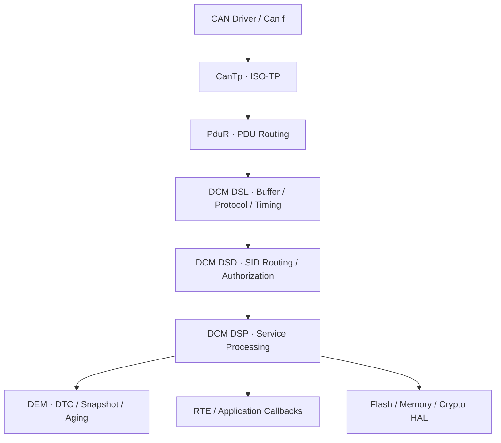
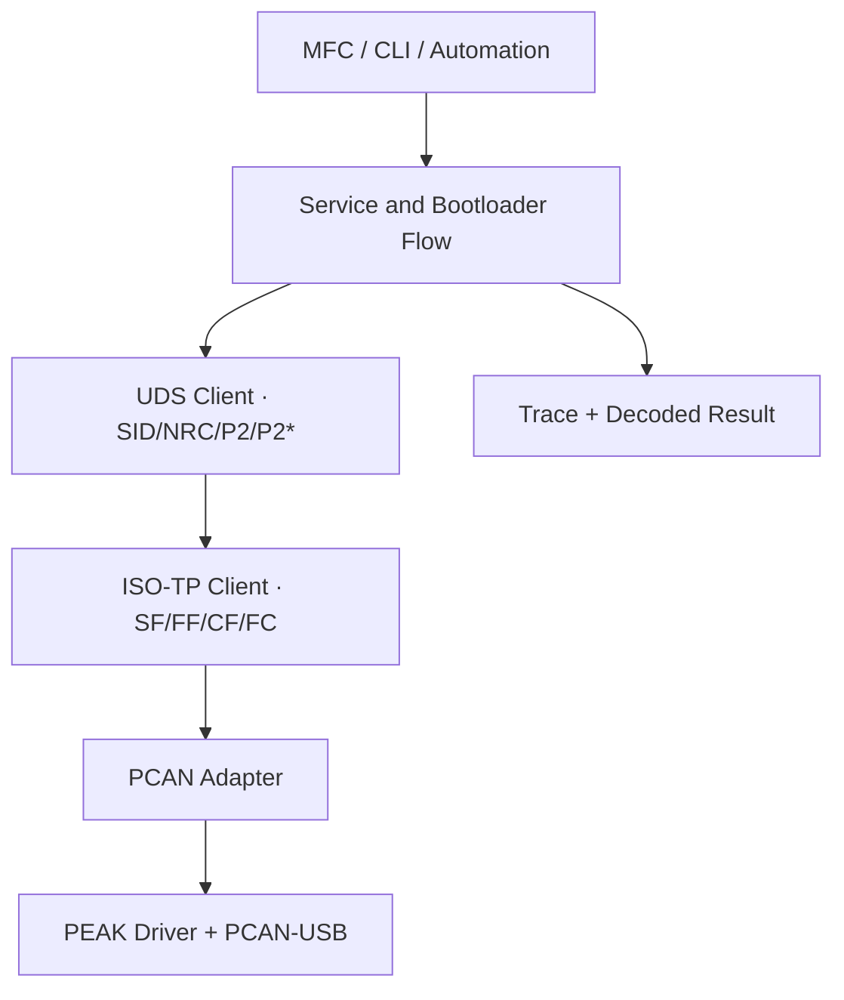
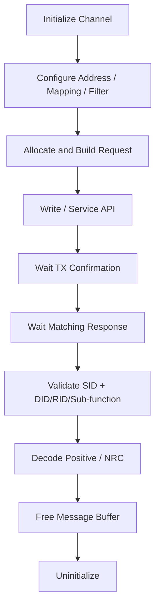

[UDS 首頁](../) · [上一頁：Bootloader](../bootloader/) · [來源與授權](../references/)

<a id="article_top"></a>

# ECU / Tester 實作與驗證

## 1. ECU Software Architecture



| 模組 | 核心責任 | 不應承擔 |
|---|---|---|
| CanTp | segmentation、FC、SN、N_* timers | SID/DID/security policy |
| PduR | PDU route 與上/下層 callback | Flash programming |
| DSL | Rx/Tx buffer、protocol、P2/S3、session | MCU register 細節 |
| DSD | SID/sub-function table、session/security authorization | 寫 Flash |
| DSP | UDS service state machine、application callback | raw CAN driver |
| DEM | event、debounce、DTC status、snapshot、aging | ISO-TP framing |
| HAL | range/alignment、Flash/Crypto/NVM 操作 | UI command format |

`uds-lite` 使用 static table 與 `switch(SID)`，用途是協定示範與 unit test。量產 ECU 仍要補 asynchronous job、S3/P2 timer、reentrancy、NVM、watchdog、power-loss recovery、secure key handling 與 memory protection。

## 2. Tester Architecture



應用層不要直接依賴 vendor DLL export。以 adapter/interface 隔離 PCANBasic、PCAN-ISO-TP 或 PCAN-UDS，可讓 service flow 與 UI 測試不依賴真實 hardware。

## 3. PCAN API 選型

| API | Library 負責 | Application 負責 |
|---|---|---|
| PCANBasic | raw CAN/CAN FD read/write | ISO-TP、UDS、mapping、timing、matching |
| PCAN-ISO-TP | segmentation、address mapping、transport timing | UDS SID、session、NRC、workflow |
| PCAN-UDS | network address、service request、wait workflow | ECU-specific data、sequence、business validation |

目前 `simple_can_uds_tool` 的 MFC architecture 採 PCANBasic adapter，自行實作 Classical CAN normal addressing 的 ISO-TP 與 UDS client，原因是原始 repository 沒有完整的官方 C/C++ SDK header/import library。未來切換官方 SDK 時，應只替換 transport adapter。

### 3.1 Current MFC scope

- Classical CAN 8-byte frame。
- 11-bit 或 29-bit normal addressing。
- 12-bit ISO-TP length，最多 4095 bytes。
- FC CTS、Block Size、STmin。
- UDS NRC `0x78` 與 P2* timeout。
- CAN FD、extended/mixed addressing 與 >4095-byte transport 尚不在第一版範圍。

## 4. PCAN-UDS Mapping

Mapping 不只是 request CAN ID。它通常同時綁定：

```text
CAN ID
Flow Control / reverse CAN ID
Standard or Extended CAN frame
Default TX DLC
UDS / ISO-TP protocol format
Source address
Target address
Physical or Functional target type
Extension address
```

Physical request/response 通常需要成對 mapping。Functional request 需要一筆 transmit mapping，以及每個可能 response ECU 的 receive mapping。

PCAN-UDS 的常見預設包括：

| 用途 | CAN ID | Network address 概念 |
|---|---:|---|
| OBD functional request | `0x7DF` | Tester `F1` → Functional `33` |
| ECU #1 physical request | `0x7E0` | Tester `F1` → ECU `01` |
| ECU #1 physical response | `0x7E8` | ECU `01` → Tester `F1` |

這些是常用 standardized mapping，不是所有 OEM ECU 的固定 ID。非標準 ID 需要明確加入 mapping，且要同步處理 reverse/FC ID。

## 5. PCAN-UDS Client Flow



PCAN-UDS 的 wait matching 主要依 network address information 與 SID。同一 SID 若同時發多個 DID/RID request，application 還要比對 response parameter，避免將 response 配錯 request。

不要讓 event-driven reader 與 `WaitForService*` 同時消費同一 channel receive queue，否則兩個 consumer 會互相搶訊息。選擇單一 receive owner，或在同步 wait 期間暫停背景 reader。

## 6. PCAN-View XMT Profile

XMT 是 transmit list，不是 diagnostic scripting engine。

| 可以做 | 無法自動完成 |
|---|---|
| 手動送 `0x10/0x11/0x22/0x3E` 單幀 | 解析 response 與 pass/fail |
| 送預填的 negative-test key | 由 seed 計算 `0x27` key |
| 人工送 FF，看到 FC 後再送 CF | 自動遵守 BS/STmin/SN/timer |
| 在正確 context 下送固定 `0x36` | 從 BIN 分 block、更新 counter、retry |

因此 `can_uds.xmt` 的用途限於 smoke test 與 raw frame 示範。完整 programming 應由有 state machine、timeout、response validation、file parser 與 log 的工具執行。

## 7. State Ownership

Tester 至少要追蹤：

| State | 例子 |
|---|---|
| Channel | open/closed、baud、CAN FD mode、bus-off |
| ISO-TP | idle、wait FC、wait STmin、send CF、wait CF |
| UDS | session、security、P2/P2*、S3 keep-alive |
| Programming | erase、download active、counter、remaining bytes、verify |
| UI | operation cancellation、progress、log、user controls |

取消 programming 不等於立即中止任意 Flash operation。UI 應發 cancellation request，由 flow 在安全 checkpoint 停止，並清楚告知 ECU 可能仍處於 erased/incomplete state。

## 8. Logging

Trace 欄位包括：

```text
timestamp
channel / baud / frame type
direction
CAN ID / DLC / raw bytes
ISO-TP direction and PDU length
UDS SID / sub-function / DID / RID / NRC
session / security / transfer state
operation result and elapsed time
```

Log 不應輸出 production secret、private key、完整 authentication material 或未遮蔽的敏感識別資料。

## 9. Validation Matrix

### 9.1 CAN / ISO-TP

- [ ] 11/29-bit、standard/extended mapping、wrong response ID。
- [ ] SF、FF/CF、BS=0/非零、STmin 毫秒/微秒 encoding。
- [ ] Wrong SN、lost CF、duplicate CF、FC WAIT/OVFLW。
- [ ] N_As/N_Bs/N_Cr timeout、bus-off、reconnect。
- [ ] Padding、DLC、Classical CAN/CAN FD mismatch。

### 9.2 UDS Services

- [ ] 每個 SID 的 positive response 與所有適用 NRC。
- [ ] Session × security × addressing permission matrix。
- [ ] Suppress positive response bit。
- [ ] Malformed length、unsupported SID/sub-function、out-of-range DID/RID。
- [ ] P2、P2*、多次 `0x78` 與 S3 timeout。

### 9.3 Programming

- [ ] Wrong DFI/ALFID/address/size、range overflow、unaligned data。
- [ ] Block length 0/max/over max、counter wrap、retry。
- [ ] Erase/write/verify failure mapping 到正確 NRC。
- [ ] 每個 Flash 階段斷電與 watchdog reset。
- [ ] Invalid target/version/hash/signature/rollback counter。
- [ ] Application 啟動失敗與 recovery mode。

## 10. Definition of Done

一個 UDS/Bootloader implementation 至少需要：

1. ECU diagnostic specification 與權限矩陣。
2. Transport timing/mapping specification。
3. Memory/Flash/crypto design review。
4. Tester 與 ECU unit/integration tests。
5. Fault injection 與 power-loss evidence。
6. 可追溯 raw trace、decoded result 與版本資訊。

## 11. 官方延伸閱讀

- [PEAK PCAN-UDS API](https://www.peak-system.com/PCAN-UDS-API.370.0.html) 與 [PCAN-UDS User Manual](https://www.peak-system.com/produktcd/Pdf/English/PCAN-UDS-API_UserMan_eng.pdf)
- [PEAK PCAN-Basic](https://www.peak-system.com/products/software/development-packages/pcan-basic/)
- [PEAK PCAN-View](https://www.peak-system.com/products/software/analysis-software/pcan-view/?L=1)
- [AUTOSAR Diagnostic Communication Manager](https://www.autosar.org/fileadmin/standards/R22-11/CP/AUTOSAR_SWS_DiagnosticCommunicationManager.pdf)
- [AUTOSAR Diagnostic Event Manager](https://www.autosar.org/fileadmin/standards/R20-11/CP/AUTOSAR_SWS_DiagnosticEventManager.pdf)

[來源與授權](../references/) · [回到頁首](#article_top)
