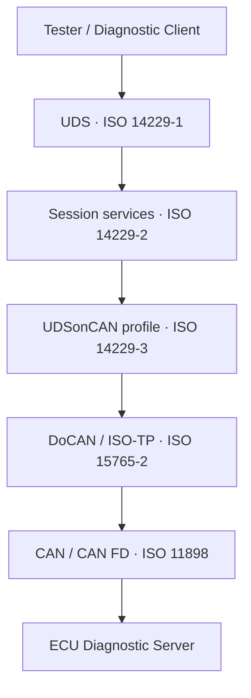
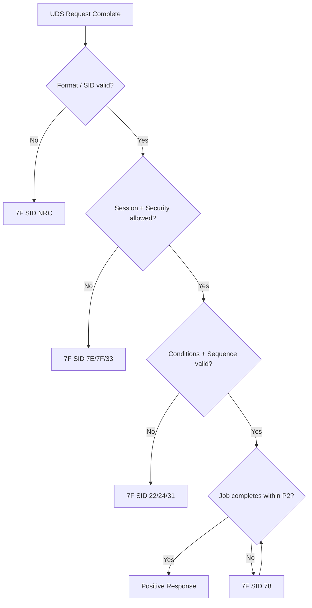

[回到總索引](https://released.github.io/) · [CAN / CAN FD 知識庫](https://released.github.io/notices_can/)

<a id="article_top"></a>

# UDS / ISO-TP / ECU Bootloader 知識庫

> 整理 UDS、ISO-TP、診斷服務、ECU Bootloader 與實作驗證內容。最後更新：2026-07-12。

本知識庫整理 **UDS 元件角色、協定分層、診斷服務，以及 ECU firmware upgrade 的整合方式**。各頁可依主題獨立查閱。

## 內容分類

| 類別 | 頁面 | 內容說明 |
|---|---|---|
| 元件角色 | [Diagnostic Tester、CAN Interface 與 ECU](roles/) | EcuBus Pro、PCAN-USB、MCU／ECU 與 standalone programmer 的責任邊界 |
| 協定與實作分層 | [UDS、ISO-TP、CAN/CAN FD 與 Driver](layers/) | Application、Transport、Data Link、Physical 與軟硬體介面 |
| 診斷服務 | 本頁、[UDS Services](services/) | Request/Response、SID、NRC、Session、DID、DTC |
| 規範與 transport | [ISO 標準與 ISO-TP](iso/) | ISO 14229-1/-2/-3、ISO 15765-2、SF/FF/CF/FC、timing |
| Firmware update | [UDS Bootloader](bootloader/) | Programming Session、下載、寫入、驗證與復原 |
| 實作與驗證 | [ECU/Tester 實作與測試](implementation/) | DCM/DEM/CanTp、PCAN mapping、測試矩陣 |


## 1. UDS 是什麼

Unified Diagnostic Services（UDS）是 tester/client 與 ECU/server 之間的診斷應用層協定。它描述「要 ECU 做什麼」以及 request/response 的語意，但不綁定單一實體網路。

UDS 可透過不同 transport 使用：

- CAN／CAN FD：通常搭配 ISO-TP（ISO 15765-2）。
- Automotive Ethernet：通常搭配 DoIP（ISO 13400）。
- 其他 transport：依 ISO 14229 對應的 implementation part 與專案規範。



## 2. UDS 可以做什麼

| 能力 | 常見服務 | 實際用途 |
|---|---|---|
| 會話與 ECU 控制 | `0x10`, `0x11`, `0x3E` | 切換診斷模式、reset、保持 session |
| ECU 資料 | `0x22`, `0x2E`, `0x2F` | 讀版本/VIN/量測值、寫設定、控制 actuator |
| 故障診斷 | `0x19`, `0x14`, `0x85` | 讀 DTC、snapshot、extended data、清除或暫停紀錄 |
| 安全與身份 | `0x27`, `0x29` | Seed/Key 解鎖、憑證或 challenge-based authentication |
| Routine | `0x31` | erase、checksum、dependency check、硬體自測 |
| 記憶體與檔案 | `0x23`, `0x3D`, `0x38` | 受控 memory access、file transfer |
| Firmware transfer | `0x34`–`0x37` | RequestDownload、TransferData、TransferExit |
| 通訊管理 | `0x28`, `0x83`, `0x87` | 控制訊息收送、timing、link transition |

UDS **不會**自動定義專案的 CAN ID、DID/RID 意義、Flash layout、SecurityAccess 演算法或每個 service 的權限。這些必須由 ECU diagnostic specification、ODX 與 OEM safety/security policy 補足。

## 3. 最小訊息模型

```text
Request:           [SID] [parameters...] [data...]
Positive response: [SID + 0x40] [response parameters...] [data...]
Negative response: [0x7F] [request SID] [NRC]
```

範例：讀取 DID `F190`。

```text
Request:   22 F1 90
Positive:  62 F1 90 <VIN bytes...>
Negative:  7F 22 31
```

這裡的 UDS PDU 還不是 CAN frame。若 PDU 放不進一個 CAN/CAN FD frame，ISO-TP 會以 First Frame、Flow Control 與 Consecutive Frame 完成 segmentation/reassembly。

## 4. 三條核心狀態線

UDS communication 可分別觀察三種狀態：

1. **Transport state**：目前是 SF 還是 multi-frame？是否正在等 FC、CF 或 timeout？
2. **Diagnostic state**：目前 session、安全層級、S3 timer 與 service sequence 為何？
3. **ECU job state**：Flash erase、write、verify 或 routine 是否仍在執行？



## 5. UDS Bootloader 的位置

UDS Bootloader 是 ECU 在 boot/programming environment 中提供的一組診斷服務。它接收 tester 傳來的 firmware，控制 Flash erase/program，驗證 image，再決定是否啟動新 application。

典型主鏈：

```text
10 02 → 27 xx → 31 Erase → 34 Download
      → 36 Blocks → 37 Exit → 31 Verify → 11 Reset
```

詳細流程、封包、失敗復原與 firmware container 安全設計請見 [UDS Bootloader Upgrade](bootloader/)。

## 6. 本站頁面

- [Diagnostic Tester、CAN Interface 與 ECU](roles/)：EcuBus Pro、PCAN-USB、MCU／ECU 與 standalone programmer 的角色。
- [UDS、ISO-TP、CAN/CAN FD 與 Driver](layers/)：OSI 對照、資料單位與軟硬體責任邊界。
- [ISO 14229 與 ISO 15765-2](iso/)：四份核心標準如何分工。
- [UDS Services](services/)：SID、command、NRC、DID、DTC 與 Routine。
- [UDS Bootloader](bootloader/)：完整 ECU upgrade flow。
- [實作與測試](implementation/)：AUTOSAR DCM、PCAN、XMT、測試矩陣。
- [來源與授權](references/)：官方標準、原作者資源、網路來源與改寫原則。

---

## English Summary

UDS is a transport-independent diagnostic application protocol. ISO 14229 defines diagnostic service semantics and session behavior; ISO 15765-2 provides DoCAN transport and network-layer services for CAN/CAN FD. This site separates service semantics, standards, programming flow, and implementation/testing so that each topic can be referenced independently.

[回到頁首](#article_top)
