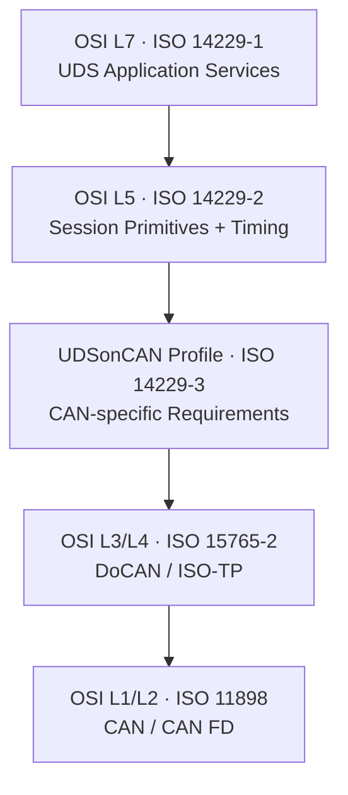
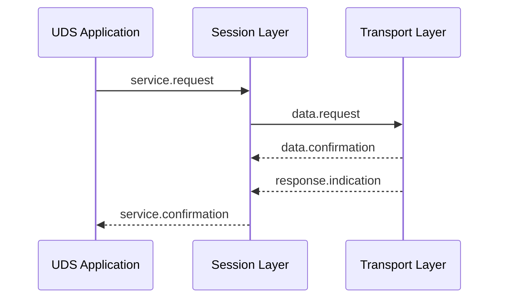
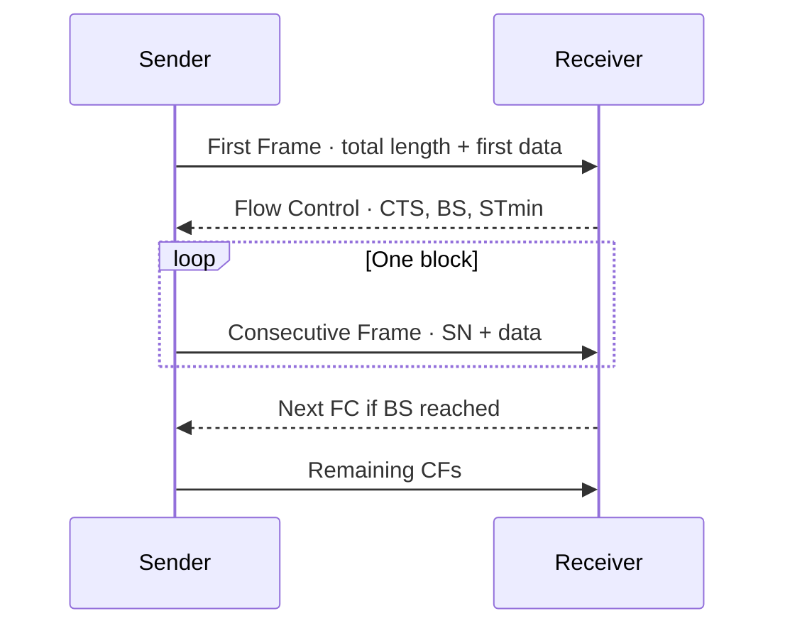

[UDS 首頁](../) · [CAN / CAN FD](https://released.github.io/notices_can/) · [UDS Services](../services/)

<a id="article_top"></a>

# ISO 14229 與 ISO 15765-2 完整分層

> 本頁說明標準的責任邊界，而非重製付費標準內容。實作時以所購買的正確 edition 與 OEM specification 為準。

## 1. 四份核心標準的關係

| 標準 | 目前公開 edition | 核心責任 | 不負責 |
|---|---|---|---|
| ISO 14229-1 | 2026 | UDS application-layer services、request/response、NRC | CAN frame 與 transport segmentation |
| ISO 14229-2 | 2021 | Session-layer services 與 transport-independent primitives | 特定 CAN ID 與 ECU service data |
| ISO 14229-3 | 2022 | UDS on CAN implementation profile、額外要求與限制 | CAN physical-layer 電氣設計 |
| ISO 15765-2 | 2024 | DoCAN transport/network layer、ISO-TP | UDS SID 的業務語意 |

既有 ECU 可能依循 ISO 14229-1:2013、14229-2:2013 或 14229-3:2012 等舊版；新專案則應從 ISO 官方頁面確認現行 edition，再由 OEM/ECU specification 明確指定採用基線。不要因為手邊有舊 PDF 就假設它仍是專案適用版本。



## 2. ISO 14229-1：Application Layer

ISO 14229-1 定義 tester/client 如何要求 ECU/server 執行診斷功能。其設計為 data-link independent，因此相同 SID 可在 CAN、DoIP 等 transport 上使用。

### 2.1 主要內容

- Request、positive response、negative response 的 PDU 格式。
- Service Identifier（SID）、sub-function 與 parameter 語意。
- DiagnosticSessionControl、SecurityAccess、DID、DTC、Routine 等服務。
- NRC 的適用條件與處理順序。
- Physical/functional request 的應用層行為。
- Programming/download 服務語意。

### 2.2 Application layer 不等於 ECU specification

標準只定義通用 service framework。下列項目仍為專案資料：

| 專案項目 | 例子 |
|---|---|
| Network address | Request `0x7E0`、Response `0x7E8` 或其他 ID |
| DID/RID/DTC | `F190`、Erase RID、OEM DTC mapping |
| Authorization | 哪個 session/security level 允許哪個 service |
| Data encoding | endian、scaling、unit、length、valid range |
| Programming | Flash range、erase unit、block size、signature policy |

## 3. ISO 14229-2：Session Layer Services

ISO 14229-2 的目的，是在 UDS application 與不同 transport/network 之間建立共同 session service interface。它使用 request、indication、response、confirmation 類 service primitives 描述上下層互動。



### 3.1 P2、P2* 與 S3

| Timing | 起訖概念 | Tester/ECU 行為 |
|---|---|---|
| P2 server max | ECU 收完 request 到開始 response | 一般 response deadline |
| P2* server max | NRC `0x78` 後到下一個 response | 長時間 job 的延伸 deadline |
| S3 server | non-default session 無有效 activity | 到期通常回 Default Session |
| TesterPresent period | Tester 的 keep-alive 週期 | 小於 S3 並保留 scheduling margin |

`0x50` session response、ODX 或 ECU specification 的 timing 優先於工具 library 的 default。Tester 必須分開管理 transport timeout 與 UDS P2/P2*。

## 4. ISO 14229-3：UDSonCAN Profile

ISO 14229-3 連接 application/session requirements 與 CAN implementation。它針對 UDS on CAN 增加要求或限制，但不取代 ISO 15765-2。

可把它理解為：

```text
ISO 14229-1 說「服務是什麼」
ISO 14229-2 說「session 與 transport 如何銜接」
ISO 14229-3 說「在 CAN 上使用 UDS 時的 profile」
ISO 15765-2 說「UDS PDU 如何用 CAN frame 傳送」
```

閱讀時應特別確認：

- Physical 與 functional addressing 的允許行為。
- CAN/CAN FD transport 所帶來的長度與 timing 限制。
- Response suppression 與 multi-response scenario。
- Implementation profile 對 individual UDS service 的限制。

## 5. ISO 15765-2 / ISO-TP

ISO 15765-2 定義 DoCAN transport protocol 與 network-layer services。它不限於 UDS，但常用來承載 UDS PDU。

### 5.1 四種 PCI frame

| Frame | PCI high nibble | 作用 |
|---|---:|---|
| Single Frame（SF） | `0x0` | 一個 network frame 完成短 PDU |
| First Frame（FF） | `0x1` | 宣告總長度並帶第一段資料 |
| Consecutive Frame（CF） | `0x2` | 以 sequence number 傳後續資料 |
| Flow Control（FC） | `0x3` | 以 FS、BS、STmin 控制 sender |



### 5.2 Flow Control

- `FS=CTS`：Continue To Send。
- `FS=WAIT`：receiver 暫時未準備好；WAIT 次數需有上限。
- `FS=OVFLW`：receiver 無足夠 buffer，transfer 終止。
- `BS=0`：通常允許 sender 持續送到完成。
- `STmin`：相鄰 CF 的最小 separation；毫秒與微秒 encoding 要分開解析。

### 5.3 Sequence Number

CF 的 SN 由 `1` 開始，經 `15` 後回到 `0`。收到錯誤、遺失或不連續 SN 時，receiver 通常中止整個 N-SDU；ISO-TP 沒有 TCP 式的單一 CF retransmission。

### 5.4 Transport timers

| Timer | 監督內容 |
|---|---|
| `N_As` | data frame transmission completion |
| `N_Ar` | Flow Control transmission completion |
| `N_Bs` | sender 等待 FC |
| `N_Br` | receiver 準備 FC 的內部時間 |
| `N_Cs` | sender 準備下一個 CF |
| `N_Cr` | receiver 等待下一個 CF |

### 5.5 Addressing format

| Format | Address 所在位置 | 每 frame payload 影響 |
|---|---|---|
| Normal | 由 CAN-ID mapping 辨識 connection | 無額外 address byte |
| Normal Fixed | source/target 編入 29-bit ID | 無額外 address byte |
| Extended | data field 先放 target address | 少一 byte |
| Mixed | CAN ID 與 address extension 共同辨識 | 少一 byte |

Addressing format 與 physical/functional target type 是兩個獨立維度。Functional request 通常限制在 Single Frame；各 ECU 的 response 則使用自己的 physical response connection。

## 6. Classical CAN 與 CAN FD

ISO-TP 可用於 Classical CAN 與 CAN FD。CAN FD 提供較大的 frame payload 與可選 BRS，能降低 FF/CF 數量，但不會消除 UDS 的 session、安全、block counter 或 Flash programming state machine。

實作時要明確設定：

- CAN CC 或 CAN FD frame type。
- Nominal/Data bit rate 與 BRS。
- CAN DLC 與 ISO-TP link-layer data length。
- Padding policy。
- 最大 N-SDU 長度與 buffer policy。

## 7. 標準閱讀順序

1. 先讀 ISO 14229-1 的 message model、session 與常用 services。
2. 再讀 ISO 14229-2 的 primitives 與 P2/P2*/S3。
3. 以 ISO 14229-3 確認 UDSonCAN profile。
4. 用 ISO 15765-2 實作 segmentation、flow control、timers 與 addressing。
5. 最後套用 ECU specification/ODX 的 CAN ID、DID、RID、security 與 timing。

[下一頁：UDS Services](../services/) · [回到頁首](#article_top)
