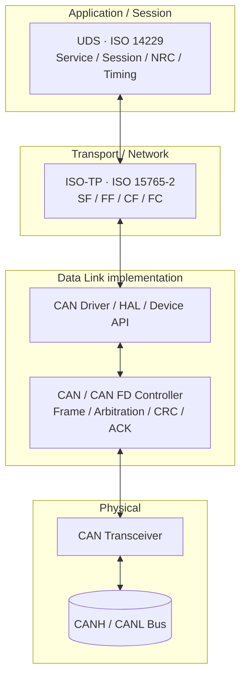
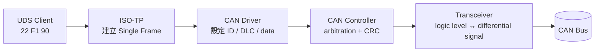
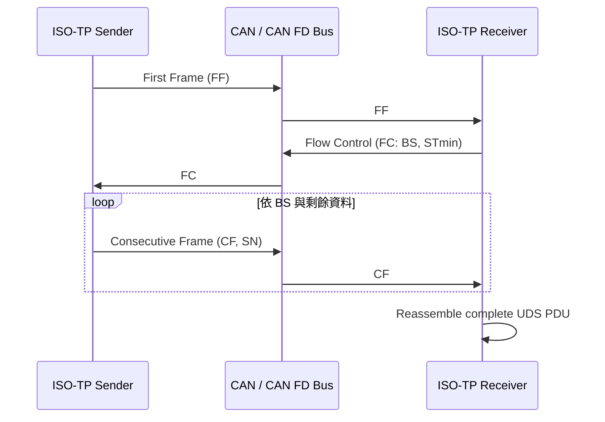
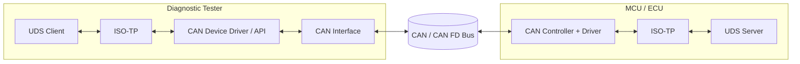

[UDS 首頁](../) · [元件角色](../roles/) · [ISO 標準](../iso/) · [回到總索引](https://released.github.io/)

<a id="article_top"></a>

# UDS、ISO-TP、CAN/CAN FD 與 Driver 分層

> 本頁以工程實作與 OSI 對照說明 UDS PDU 如何經過 ISO-TP、CAN driver、CAN controller 與 transceiver，在 Diagnostic Tester 與 ECU 之間傳送。

## 1. 分層的核心關係

UDS、ISO-TP 與 CAN/CAN FD 解決不同問題：

| 分層 | 對應規範或元件 | 主要責任 | 典型資料單位 |
|---|---|---|---|
| Application／Session | UDS，ISO 14229-1/-2/-3 | Service、SID、parameter、session、NRC 與 diagnostic timing | UDS PDU |
| Transport／Network | ISO-TP／DoCAN，ISO 15765-2 | Addressing、segmentation、reassembly、flow control 與 transport timeout | N-PDU、SF／FF／CF／FC |
| Data Link | CAN／CAN FD，ISO 11898-1 | Arbitration、frame format、DLC、CRC、ACK 與 controller error handling | CAN frame／CAN FD frame |
| Physical | CAN transceiver、bus，ISO 11898-2 等 | Differential signaling、bit timing 的實體傳輸與 network electrical characteristics | Bus signal |
| Implementation interface | CAN driver／HAL、device API | 在 software stack 與 CAN controller／interface 之間搬移 frame、管理 mailbox、FIFO、interrupt 與 channel state | Driver structure／buffer |

CAN driver 是實作介面，不是另一種 on-wire diagnostic protocol。它可位於 OSI Data Link implementation 的一部分，具體邊界依 MCU SDK、AUTOSAR stack 或 PC device API 而不同。

## 2. OSI 對照圖

以下是工程上的責任對照，並非把所有 OSI 七層逐一建立獨立 module：



在 PC tester 中，`CAN Driver / HAL / Device API` 可能是 PCAN driver、PCAN-Basic 或其他 vendor API；在 MCU 中則可能是 vendor BSP、MCAL Can Driver 或自訂 driver。

## 3. 傳送方向：UDS PDU 到 bus

以 `ReadDataByIdentifier` request `22 F1 90` 為例：



接收方向執行相反的責任鏈：transceiver 與 controller 收到 frame，driver 取出 ID／DLC／data，ISO-TP 依 addressing 與 PCI 重組完整 PDU，UDS Server 才解析 SID 與 parameters。

| 階段 | 可觀察內容 | 不在此階段決定的內容 |
|---|---|---|
| UDS | `0x22`、DID `0xF190`、positive／negative response | CAN arbitration 與 frame CRC |
| ISO-TP | SF／FF／CF／FC、sequence number、block size、STmin | DID 的業務意義 |
| Driver | CAN ID、DLC、data buffer、timestamp、Tx/Rx status | UDS service sequence |
| Controller | arbitration、ACK、error counter、bus state | SecurityAccess policy |
| Transceiver／bus | dominant／recessive signal、physical connectivity | ISO-TP reassembly |

## 4. Single Frame 與 Multi-frame

UDS PDU 較短且符合 ISO-TP Single Frame 容量時，可由一個 CAN/CAN FD frame 承載。較長的 response 或 firmware block 則由 ISO-TP 切分。



分層後的責任可清楚區分：

- UDS 決定 RequestDownload 或 TransferData 的 service semantics。
- ISO-TP 決定同一個 UDS PDU 需要多少 frame，以及 FC、BS、STmin 與 timeout 行為。
- CAN/CAN FD 負責每一個 frame 的 arbitration 與可靠傳輸機制。
- Driver 將 stack 的 Tx/Rx request 映射到 controller 或 PC interface。

## 5. CAN 與 CAN FD 對上層的影響

CAN FD frame 可承載比 Classical CAN 更大的 payload，並可在 data phase 使用不同 bit rate。這會改變 ISO-TP 每個 frame 可承載的資料量與 transfer performance，但不會改變 UDS SID 或 Client／Server service semantics。

| 項目 | Classical CAN | CAN FD |
|---|---|---|
| Link-layer payload | 最多 8 bytes | 最多 64 bytes |
| ISO-TP frame 數量 | 相同 PDU 通常需要較多 frame | 相同 PDU 通常可減少 frame 數 |
| Bit rate | 單一 nominal bit rate | 可選 bit-rate switching；nominal 與 data phase 分開設定 |
| UDS service | 不因 link type 改變 SID | 不因 link type 改變 SID |

實際可用 payload 仍會受到 ISO-TP addressing format、PCI、padding、CAN FD DLC 編碼與 stack profile 影響。Tester 與 ECU 必須使用一致的 CAN type、bit timing、addressing 與 ISO-TP parameters。

## 6. Tester 與 ECU 的對稱 stack



兩端都有 transport 與 CAN access mechanism，但 UDS application role 不同：Tester 端建立 request，ECU 端處理 request 並建立 response。PC 端可能由 EcuBus Pro 內建 stack 或 vendor API 提供部分功能；MCU 端可能由 AUTOSAR DCM／PduR／CanTp／Can、vendor library 或自訂 module 組成。

## 7. Driver 與 protocol stack 的介面

Driver interface 至少需要讓上層辨識以下資訊：

| 方向 | 典型輸入／輸出 |
|---|---|
| ISO-TP → Driver | channel、CAN ID、frame type、DLC／length、payload、Tx confirmation requirement |
| Driver → ISO-TP | Rx CAN ID、frame type、length、payload、timestamp／status |
| Driver → System | bus-off、error passive、queue full、controller state |
| System → Driver | initialization、bit timing、filter、start／stop、recovery policy |

UDS timeout 與 ISO-TP timeout 需分開定位。例如：

| 現象 | 優先觀察層次 |
|---|---|
| 完全沒有 CAN frame | Device channel、driver、controller、transceiver、wiring |
| 有 FF，但沒有 FC | ISO-TP addressing、Rx routing、FC timing |
| CF sequence 中斷 | ISO-TP SN、BS、STmin、queue 或 frame loss |
| 收到 `7F SID 78` | UDS Server job 仍在處理；檢查 P2* 與 response handling |
| 收到其他 `7F SID NRC` | UDS session、security、format、sequence 或 execution condition |
| firmware block 被接受但 image 無法啟動 | Bootloader verify、metadata、vector、rollback／boot policy |

## 8. 與 EcuBus Pro／PCAN topology 的銜接

在 EcuBus Pro + PCAN-USB + MCU 的配置中：

```text
EcuBus Pro UDS Client
        ↓
ISO-TP implementation / device integration
        ↓
PCAN driver + PCAN-USB interface
        ↓
CAN / CAN FD bus
        ↓
MCU CAN driver + ISO-TP + UDS Server
```

PCAN-USB hardware 位於 CAN access 與實體連線的一側；它不取代 EcuBus Pro 的 diagnostic sequence，也不取代 MCU 端的 UDS Server。若 PC application 直接使用 PCAN-ISO-TP 或 PCAN-UDS API，則相應 protocol responsibility 由該 software API 承擔。

## 9. 官方資料

- [ISO 14229-1 — Road vehicles — Unified diagnostic services](https://www.iso.org/standard/87962.html)
- [ISO 14229-2 — Session layer services](https://www.iso.org/standard/77322.html)
- [ISO 14229-3 — UDS on CAN implementation requirements](https://www.iso.org/standard/77323.html)
- [ISO 15765-2 — Diagnostic communication over CAN](https://www.iso.org/standard/84211.html)
- [PEAK-System — PCAN-USB](https://www.peak-system.com/products/hardware/external-pc-interfaces/pcan-usb/)
- [PEAK-System — PCAN-UDS API User Manual](https://www.peak-system.com/produktcd/Pdf/English/PCAN-UDS-API_UserMan_eng.pdf)
- [EcuBus Pro — UDS Bootloader Implementation Guide](https://app.whyengineer.com/docs/um/uds/example/example.html)

[元件角色](../roles/) · [ISO 標準](../iso/) · [回到 UDS 首頁](../) · [回到頁首](#article_top)
