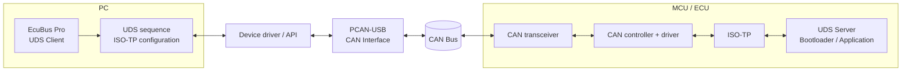
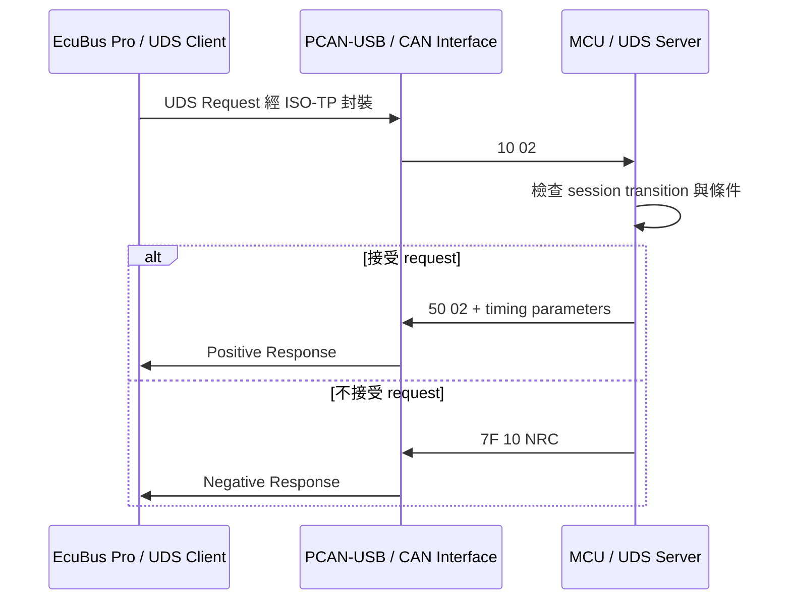
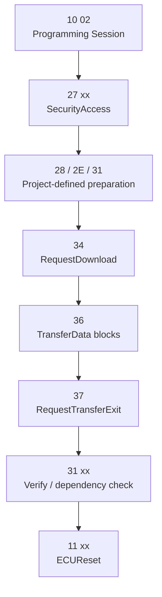

[UDS 首頁](../) · [協定分層](../layers/) · [UDS Bootloader](../bootloader/) · [回到總索引](https://released.github.io/)

<a id="article_top"></a>

# EcuBus Pro、PCAN 與 MCU 的角色關係

> 本頁以 PC 上的 diagnostic application、USB-CAN interface 與 MCU／ECU 所組成的 UDS topology 為例，區分 Client、Interface 與 Server 的責任。

## 1. 名稱與角色邊界

UDS 採用 **Client／Server** request-response 模型。這組名稱描述診斷協定中的行為，不等同於硬體匯流排的 Master／Slave，也不代表任一端具有不受限制的控制權。

「Host」在不同工具與 driver 文件中可能指 PC、application 或 USB host，無法精確表示 UDS 角色。描述診斷流程時，使用 **UDS Client（Diagnostic Tester）**、**CAN Interface** 與 **UDS Server（ECU）** 較能區分責任。

| 元件 | 本拓撲中的角色 | 責任範圍 |
|---|---|---|
| EcuBus Pro | UDS Client／Diagnostic Tester application | 建立 UDS request、管理 sequence、處理 response，並依設定使用 ISO-TP 與 CAN device |
| PCAN-USB | USB-CAN hardware interface | 在 PC driver 與 CAN bus 之間收送 CAN frame；硬體本身不決定診斷服務順序 |
| PCAN driver／API | PC 端軟體介面 | 提供 channel、bit rate、frame Tx/Rx；若採用 PCAN-ISO-TP 或 PCAN-UDS API，還可由該軟體層提供對應協定功能 |
| MCU（ECU／Bootloader） | UDS Server | 接收 request、檢查條件、執行服務，並回覆 positive 或 negative response |
| Standalone programmer | UDS Client／Diagnostic Tester device | 不依賴 PC application，直接對另一個 ECU 排定並發送診斷 request |

角色取決於當下的 communication topology，而不是元件名稱。例如，同一顆 MCU 在產品中可以是 UDS Server；當它被製作成 standalone programmer 時，也可以在另一條連線上實作 UDS Client。

## 2. PC、CAN Interface 與 ECU 拓撲



上圖以 PCAN-USB 為 interface 範例。EcuBus Pro 官方 Bootloader guide 使用的是 Kvaser Leaf V3；換用其他受工具與 driver 支援的 CAN interface 時，Client／Interface／Server 的責任劃分相同，但 device 設定與 API 會不同。

## 3. 一次 UDS transaction

以下以進入 Programming Session 為例。ISO 14229 定義的標準 sub-function 為 `0x02`；`0x03` 代表 Extended Diagnostic Session。



Client 發起 service request；Server 決定 request 是否符合目前 session、安全狀態、執行條件與資源限制。兩端各有責任：Client 排定流程，Server 保留驗證、拒絕與安全處理的權限。

CAN interface 在這個 transaction 中傳送 frame。它不會單憑 `10 02` 自行決定下一個 request，也不會判斷 firmware image 是否有效；這些行為位於 diagnostic application 或 ECU implementation。

## 4. PCAN 名稱涵蓋的不同層次

「PCAN」可能指硬體、driver、API 或工具，內容需分開判讀：

| 名稱 | 所在位置 | 提供的能力 |
|---|---|---|
| PCAN-USB | Hardware | USB 與 CAN bus 的實體介面 |
| PCAN-Basic | Software API | Raw CAN／CAN FD frame channel access（依 device 能力） |
| PCAN-ISO-TP | Software API | ISO 15765-2 segmentation、reassembly 與 addressing |
| PCAN-UDS | Software API | 建立 UDS client application 所需的 UDS service API |
| PCAN-View | PC application | CAN frame monitor、transmit 與基本 channel 操作 |

因此，「PCAN-USB hardware 不負責 UDS sequence」與「PEAK 提供 UDS API」可以同時成立。判斷責任時需確認討論的是哪個產品層次。

## 5. Firmware Download 的角色分工

Firmware download 通常由 Client 依 ECU diagnostic specification 排定 request；Server 對每一步執行條件檢查與資料處理。以下是常見結構，不是所有 ECU 都採用完全相同的 SID、sub-function、RID 或順序。



| Client（Tester） | Server（ECU／Bootloader） |
|---|---|
| 選擇目標與 image | 驗證目標 address、length 與 image policy |
| 發送 session 與 security request | 管理 session、安全層級與失敗計數 |
| 依 response 決定下一個 request | 回報允許的 block size、timing 與 NRC |
| 依 block counter 傳送 firmware | 寫入 Flash、維護 transfer state |
| 發起 verify、reset 或 recovery action | 驗證 image，並依 boot policy 決定是否啟動 application |

EcuBus Pro 官方 S32K144 guide 將流程分為 pre-programming、programming 與 post-programming 三個階段，並透過 sequence 與 script 組合 `0x10`、`0x27`、`0x31`、`0x34`、`0x36`、`0x37`、`0x11` 等服務。該 guide 的 CAN device、DID、RID、address 與 security algorithm 是範例配置，不是 UDS 對所有 ECU 的固定值。

## 6. MCU 主動發送 CAN 與 UDS response

MCU 可以主動發送 application-defined CAN message，例如 sensor data、heartbeat、motor status 或 battery status。這些 frame 的觸發條件與 payload 由應用通訊規格定義，不會因 MCU 同時提供 UDS Server 就自動成為 UDS message。

UDS Server 的一般服務交換由 Client request 觸發：

```text
UDS Client  -- Request -->  UDS Server
UDS Client  <-- Response -- UDS Server
```

以下機制仍屬於此模型中的特定行為：

- `0x78 ResponsePending` 是 Server 對既有 request 的 negative response，表示處理尚未完成；它不是新的診斷 service request。
- Periodic data 或 ResponseOnEvent 類型的傳送需先由 Client request 建立對應行為，後續傳送條件仍由標準與 ECU specification 約束。
- Gateway 可轉送 request／response，但 gateway 的存在不會把 UDS application role 改寫成 Master／Slave。

## 7. 角色判讀摘要

| 判讀問題 | 對應角色 |
|---|---|
| 誰建立並排定 diagnostic request？ | UDS Client／Diagnostic Tester |
| 誰承載 PC 與 bus 之間的 CAN frame？ | CAN hardware interface 與 driver |
| 誰解析 service、執行工作並產生 response？ | UDS Server／ECU |
| 誰決定 Flash 是否可寫入或 image 是否有效？ | ECU Bootloader policy；Client 也可在傳送前進行工具端檢查 |
| 誰主導 standalone programming sequence？ | 實作 UDS Client 的 programmer device |

## 8. 官方資料

- [EcuBus Pro — UDS Bootloader Implementation Guide](https://app.whyengineer.com/docs/um/uds/example/example.html)
- [EcuBus Pro — NXP Bootloader Example](https://app.whyengineer.com/examples/nxp_bootloader/readme.html)
- [PEAK-System — PCAN-USB](https://www.peak-system.com/products/hardware/external-pc-interfaces/pcan-usb/)
- [PEAK-System — PCAN-UDS API User Manual](https://www.peak-system.com/produktcd/Pdf/English/PCAN-UDS-API_UserMan_eng.pdf)

[協定分層](../layers/) · [UDS Bootloader](../bootloader/) · [回到 UDS 首頁](../) · [回到頁首](#article_top)
