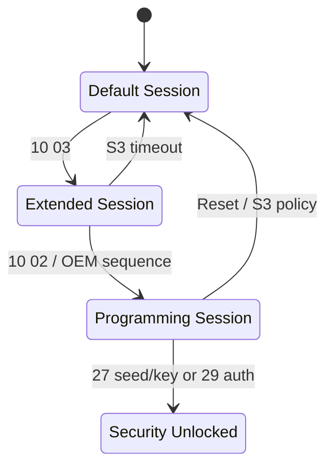
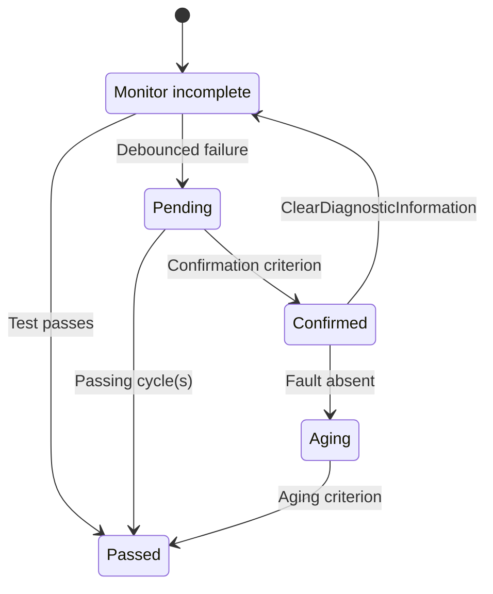
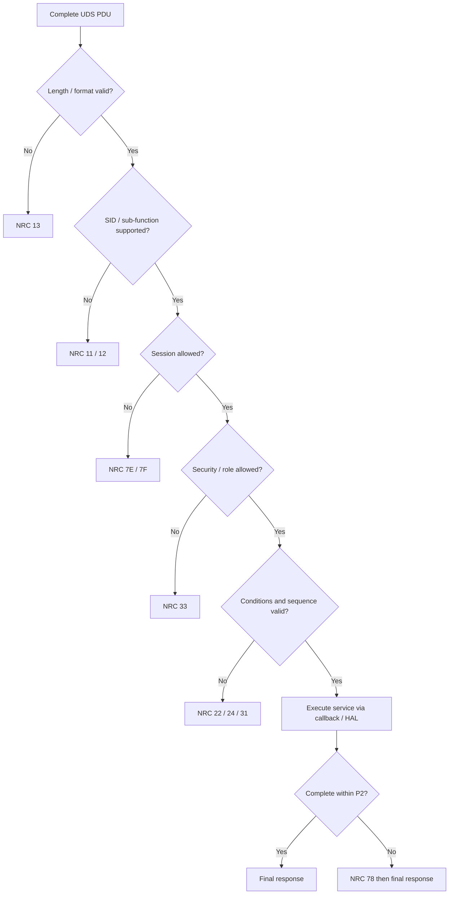

[UDS 首頁](../) · [上一頁：ISO 標準](../iso/) · [下一頁：Bootloader](../bootloader/)

<a id="article_top"></a>

# UDS Services、Command 與 NRC

## 1. Request / Response 規則

```text
Request:           SID | parameters | data
Positive response: SID + 0x40 | response parameters | data
Negative response: 7F | requested SID | NRC
```

| Request | Positive | 意義 |
|---|---|---|
| `10 03` | `50 03 ...` | 進入 Extended Session |
| `22 F1 90` | `62 F1 90 ...` | 讀 VIN DID |
| `31 01 FF 00 ...` | `71 01 FF 00 ...` | 啟動 project-defined routine |
| `3E 00` | `7E 00` | TesterPresent |

Sub-function byte 的 bit 7 常作為 `suppressPosRspMsgIndicationBit`。例如 `3E 80` 成功時通常不回 positive response，但 server 仍可能回 negative response。

## 2. Session 與 Security

常見 session：Default `0x01`、Programming `0x02`、Extended `0x03`。其他值可能由標準或供應商定義。



### 2.1 SecurityAccess `0x27`

奇數 sub-function 通常用來 request seed，下一個偶數 sub-function 用來 send key。

```text
27 01             Request seed for level 1
67 01 <seed>      Seed response
27 02 <key>       Send key
67 02             Level unlocked
```

可能錯誤：`0x24` sequence error、`0x35` invalid key、`0x36` attempts exceeded、`0x37` delay not expired。

Demo XOR/AES 演算法僅用於 interoperability test。量產設計要處理 secret storage、seed freshness、attempt counter、delay timer、key diversification 與 diagnostic role。

### 2.2 Authentication `0x29`

`0x29` 可支援更完整的 tester/ECU 身份與角色驗證。封包與流程依 ISO edition/configuration 而異，可能包含 certificate exchange、proof of ownership、challenge 與 session key material。不可把它簡化成固定格式的 `0x27` 替代品。

## 3. Service Catalog

| SID | Service | 分類與用途 |
|---:|---|---|
| `0x10` | DiagnosticSessionControl | 切換診斷 session |
| `0x11` | ECUReset | hard/soft/key-off-on 類 reset |
| `0x14` | ClearDiagnosticInformation | 清除 DTC group 與關聯記錄 |
| `0x19` | ReadDTCInformation | 讀 DTC count/list/status/snapshot/extended data |
| `0x22` | ReadDataByIdentifier | 讀 VIN、版本、狀態、量測值 |
| `0x23` | ReadMemoryByAddress | 受限的 address/size memory read |
| `0x24` | ReadScalingDataByIdentifier | 讀 DID scaling data |
| `0x27` | SecurityAccess | Seed/Key 安全層級 |
| `0x28` | CommunicationControl | 控制 normal/NM communication |
| `0x29` | Authentication | 身份與角色驗證 |
| `0x2A` | ReadDataByPeriodicIdentifier | ECU 週期回報資料 |
| `0x2C` | DynamicallyDefineDataIdentifier | 動態組合 DID |
| `0x2E` | WriteDataByIdentifier | 寫設定、識別或校正值 |
| `0x2F` | InputOutputControlByIdentifier | 暫時控制 actuator/input/output |
| `0x31` | RoutineControl | start/stop/read routine result |
| `0x34` | RequestDownload | 協商 tester → ECU transfer |
| `0x35` | RequestUpload | 協商 ECU → tester transfer |
| `0x36` | TransferData | 傳送有 sequence counter 的 block |
| `0x37` | RequestTransferExit | 結束 transfer |
| `0x38` | RequestFileTransfer | 以 filename/path 操作檔案 |
| `0x3D` | WriteMemoryByAddress | 受限的 memory write |
| `0x3E` | TesterPresent | 保持 non-default session |
| `0x83` | AccessTimingParameter | timing parameter access |
| `0x84` | SecuredDataTransmission | protected diagnostic data |
| `0x85` | ControlDTCSetting | 暫停／恢復 DTC setting |
| `0x86` | ResponseOnEvent | event-triggered response |
| `0x87` | LinkControl | link transition control |

ECU 不需要支援所有 SID。真正的 service/sub-function、session/security 與 response data 必須以 ECU diagnostic specification 為準。

## 4. DID Services

### 4.1 ReadDataByIdentifier `0x22`

```text
22 F1 87                    Read software part number
62 F1 87 <data...>          Positive response
```

Request 可帶多個 DID，但 server 的 response ordering、最大長度與「部分 DID 不支援」策略需依標準及 ECU specification。

### 4.2 WriteDataByIdentifier `0x2E`

```text
2E F1 99 <data...>          Write project DID F199
6E F1 99                    Positive response
```

Server 要檢查 fixed/variable length、range、endian、NVM failure、session/security 與寫入是否需要 atomic commit。

### 4.3 InputOutputControl `0x2F`

```text
2F 12 34 03 <control...>    Short-term adjustment
6F 12 34 03 <status...>
```

Actuator control 必須有 safety interlock、timeout、returnControlToECU 與 session 結束 cleanup。

### 4.4 DID 與 Register 的差異

| 名稱 | 層級 | 可否直接公開 address |
|---|---|---|
| DID | 診斷資料 contract | 不應等同任意 register address |
| Memory service | 受控 address/size access | 僅允許白名單範圍 |
| MCU register | Hardware implementation | 由 driver/HAL 管理 |

若 DID 需要回報 register 狀態，callback 應透過 HAL 讀取，再轉為定義好的 endian、scaling 與 unit。

## 5. DTC Services

```text
19 01 FF                  Report number by status mask
19 02 FF                  Report DTC list by status mask
19 04 <DTC3> <record>     Read snapshot record
19 06 <DTC3> <record>     Read extended data
14 FF FF FF               Clear DTC group example
85 01 / 85 02             DTC setting ON / OFF
```

### 5.1 DTC status byte

| Bit | Mask | 名稱 |
|---:|---:|---|
| 0 | `01` | testFailed |
| 1 | `02` | testFailedThisOperationCycle |
| 2 | `04` | pendingDTC |
| 3 | `08` | confirmedDTC |
| 4 | `10` | testNotCompletedSinceLastClear |
| 5 | `20` | testFailedSinceLastClear |
| 6 | `40` | testNotCompletedThisOperationCycle |
| 7 | `80` | warningIndicatorRequested |

`DTCStatusMask` 通常以 `(status & mask) != 0` 篩選。Response 中的 availability mask 表示 ECU 支援哪些 status bits。Debounce、confirmation、operation cycle、aging、snapshot 與 extended data 通常由 DEM 管理。



## 6. RoutineControl `0x31`

```text
31 01 <RID_H> <RID_L> <option...>   startRoutine
31 02 <RID_H> <RID_L> <option...>   stopRoutine
31 03 <RID_H> <RID_L>               requestRoutineResults
71 <sub> <RID_H> <RID_L> <result...>
```

RID、option record、result record 與 asynchronous behavior 都由專案定義。Erase/checksum/dependency check 可能使用不同 RID；長任務可先回 NRC `0x78`，完成後再回 final positive/negative response。

## 7. Memory、Download 與 File Transfer

### 7.1 AddressAndLengthFormatIdentifier

`0x23/0x34/0x35/0x3D` 常使用 ALFID。高半 byte 與低半 byte分別編碼 size/address 欄位長度；確切定義與 byte order 以 service specification 為準。

```text
23 44 <4-byte address> <4-byte size>
34 <DFI> 44 <4-byte address> <4-byte size>
```

Server 必須檢查 address + size overflow、range、alignment、partition、bootloader 區與安全條件，不能直接 cast 為 pointer。

### 7.2 Additional data services

| SID | 重點 |
|---:|---|
| `0x2A` | 管理 periodic transmission，需控制 bus load 與 stop cleanup |
| `0x2C` | `0x01` by DID、`0x02` by memory、`0x03` clear dynamic DID |
| `0x86` | Event window、event type、response storm 與 disconnect cleanup |
| `0x38` | Add/Delete/Replace/ReadFile/ReadDirectory；防 path traversal 與非原子替換 |

## 8. NRC Reference

| NRC | 名稱 | 優先檢查 |
|---:|---|---|
| `10` | generalReject | ECU log 與內部狀態 |
| `11` | serviceNotSupported | SID 是否實作 |
| `12` | subFunctionNotSupported | sub-function / suppress bit |
| `13` | incorrectMessageLengthOrInvalidFormat | 長度與 encoding |
| `21` | busyRepeatRequest | 依規格延遲重試 |
| `22` | conditionsNotCorrect | voltage、speed、temperature、state |
| `24` | requestSequenceError | service state machine |
| `31` | requestOutOfRange | DID/RID/address/range |
| `33` | securityAccessDenied | security/authentication |
| `35` | invalidKey | key calculation |
| `36` | exceedNumberOfAttempts | attempt counter |
| `37` | requiredTimeDelayNotExpired | security delay |
| `70` | uploadDownloadNotAccepted | transfer parameter/state |
| `71` | transferDataSuspended | transfer interruption |
| `72` | generalProgrammingFailure | erase/write/verify |
| `73` | wrongBlockSequenceCounter | counter/retry policy |
| `78` | responsePending | 改用 P2* 等 final response |
| `7E` | subFunctionNotSupportedInActiveSession | session 不允許 sub-function |
| `7F` | serviceNotSupportedInActiveSession | session 不允許 SID |

## 9. ECU Server Validation Flow



[下一頁：Bootloader](../bootloader/) · [回到頁首](#article_top)
