[回到知識庫總索引](https://released.github.io/)

<section lang="en">

# Nuvoton AEC / NR operation flow

[English](#article_top) · [繁體中文](#article_top_zh)

> This bilingual guide describes a repeatable USB Audio AEC / NR recording, playback, and validation flow. Comparable results use consistent device enumeration, channel mode, and test signals.

## Content map

- The English section records setup, capture, playback, and troubleshooting.
- The Traditional Chinese section records the same workflow.
- Preserve the original recording files and settings when comparing AEC / NR on and off.

## Agenda

* Test objective and environment checklist
* USB audio device enumeration
* GoldWave / Audacity device and recording settings
* AEC / NR operation and capture flow
* Playback analysis (Stereo / Mono channel behavior)
* Pass criteria and troubleshooting notes

---

## 1. Test objective and setup

### Test objective

* Verify that `AEC / NR` works correctly when EVB runs in USB UAC mode.
* Build a repeatable recording flow for before/after comparison.
* Account for the channel configuration when interpreting results (`AEC / NR` supports `MONO` only).

### Lab setup checklist

| Item | Value | Note |
|------|-------|------|
| EVB | `I94124_NAU88C22_MB_REVC` | Test board |
| FW | AEC / NR library + USB UAC enable | Firmware must enable the algorithm |
| Audio tool | GoldWave or Audacity | Recording / playback / channel check |

* GoldWave release page: <https://goldwave.com/release.php>
* Audacity download page: <https://www.audacityteam.org/download/>

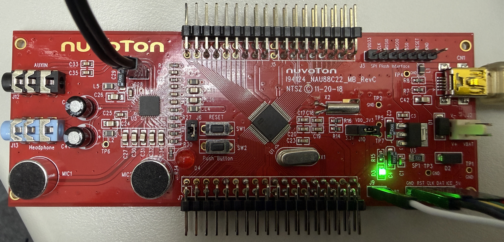

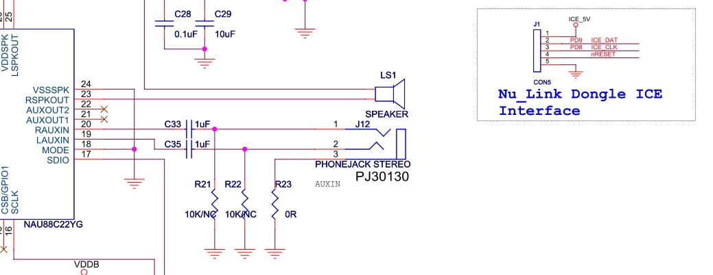

---

## 2. USB connection and device check

1. Connect EVB to the PC through USB.
2. Confirm that the OS enumerates:
   * `Speaker Nuvoton UAC`
   * `Microphone Nuvoton UAC`
3. Confirm speaker and microphone paths are both active before recording.

> **Operating condition**
> AEC / NR recording starts after both `Speaker` and `Microphone` are enumerated. Missing devices indicate that the USB cable, driver, or power state requires checking.

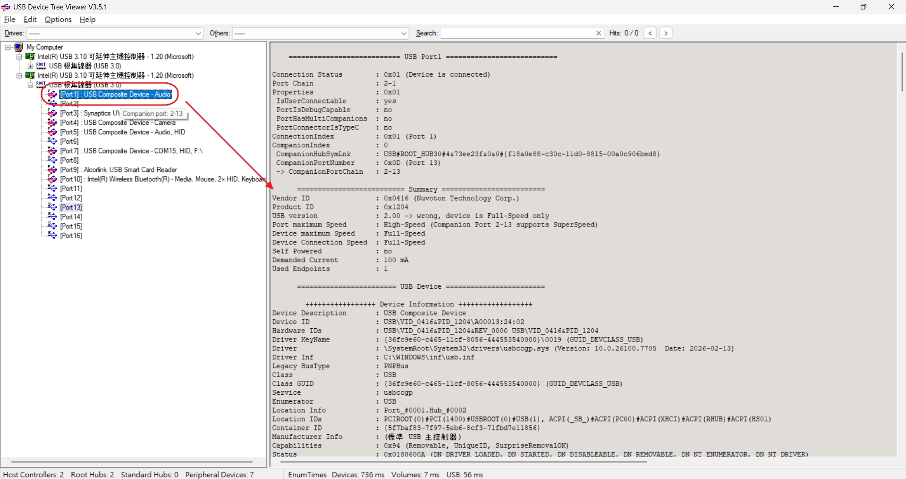

---

## 3. GoldWave settings

In GoldWave, open `Control related properties > Devices` and set:

* `Playback Device` : `Speaker Nuvoton UAC`
* `Record Device` : `Microphone Nuvoton UAC`

This ensures both record and playback use the EVB audio path so AEC / NR behavior can be observed correctly.

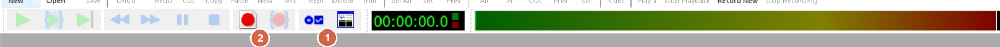

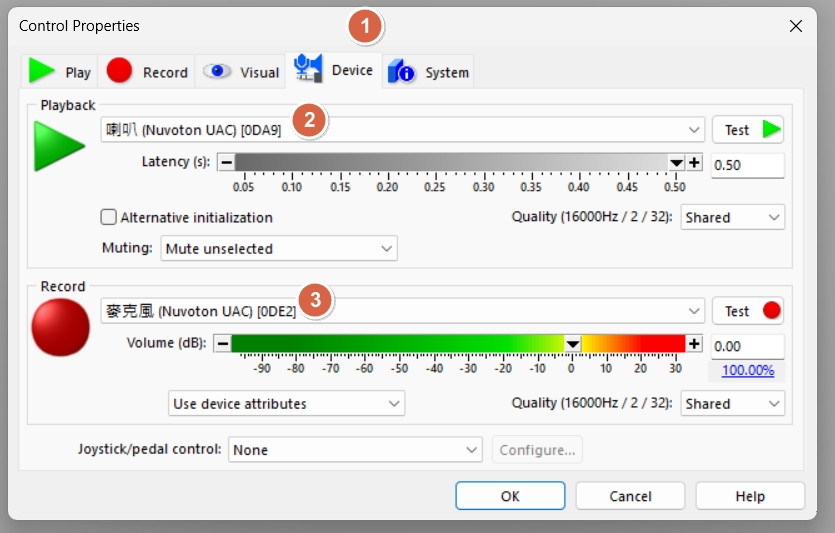

---

## 4. Audacity settings

### Device selection

1. Open `Audio Setup` and select `Rescan Audio Devices` after the EVB is connected.
2. Set `Playback Device` to `Speakers (Nuvoton UAC)`.
3. Set `Recording Device` to `Microphone (Nuvoton UAC)`.
4. Set `Recording Channels` to `2 (Stereo)` so both captured channels remain available for comparison.

The two-channel recording preserves both UAC channels for analysis. It does not change the AEC / NR library's `MONO` processing limitation.

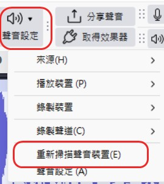

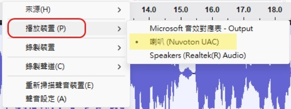

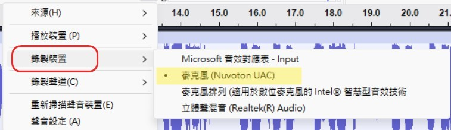

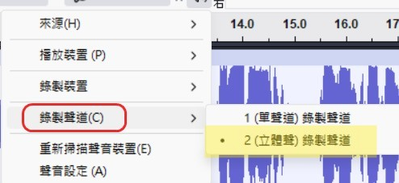

Reference: [Audacity Audio Setup Toolbar](https://manual.audacityteam.org/man/audio_setup_toolbar.html).

---

## 5. AEC / NR recording flow

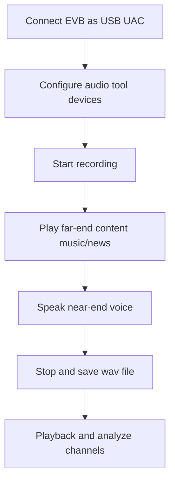

### Recording procedure

1. Start recording.
2. Play background content (music, speech, or news) to simulate far-end audio.
3. Add near-end speech at the same time and observe echo/noise suppression in the recorded file.
4. Stop recording and save the WAV file.

### GoldWave recording view

GoldWave displays the captured signal in the recording window.

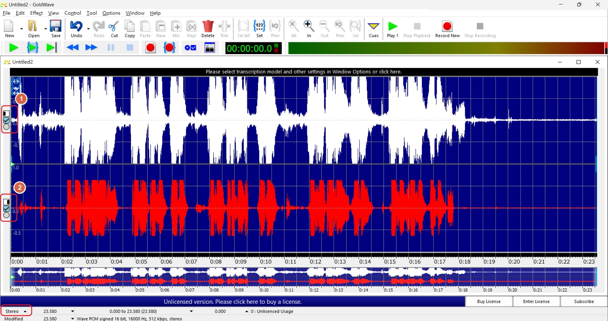

### Audacity recording view

With `Recording Channels` set to `2 (Stereo)`, Audacity displays the two captured channels in one track. The waveform provides the input for the channel review in the next section.

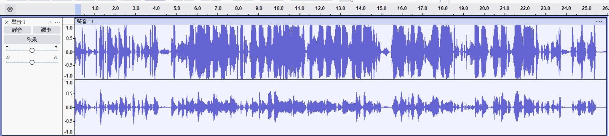

---

## 6. Sample files and playback interpretation

### Sample files

| File | Content | Usage |
|------|---------|------|
| [test1.wav](img/test1.wav) | Music (English) | Background-audio scenario |
| [test2.wav](img/test2.wav) | News broadcast | Speech-interference scenario |
| [test3.wav](img/test3.wav) | Music (Chinese) | Mixed-content scenario |

These files are stimulus/background inputs, not paired processed-output recordings. All three contain PCM 16-bit, 16 kHz, two-channel audio; the file format does not identify the firmware's processed channel.

| Input | Duration |
| --- | --- |
| test1.wav | 18.947 s |
| test2.wav | 23.600 s |
| test3.wav | 30.000 s |

<audio controls preload="none" aria-label="test1.wav input audio"><source src="img/test1.wav" type="audio/wav"><a href="img/test1.wav">Download test1.wav</a></audio>
<audio controls preload="none" aria-label="test2.wav input audio"><source src="img/test2.wav" type="audio/wav"><a href="img/test2.wav">Download test2.wav</a></audio>
<audio controls preload="none" aria-label="test3.wav input audio"><source src="img/test3.wav" type="audio/wav"><a href="img/test3.wav">Download test3.wav</a></audio>

### Capture conditions and channel mapping

| Record field | Information retained for a comparison |
| --- | --- |
| Device / firmware | Board revision, firmware build and AEC / NR state |
| Capture | Tool version, sample rate, bit depth and channel count |
| UAC routing | Left/right source, raw/processed meaning and firmware definition |
| Acoustic setup | Stimulus, speaker level, microphone gain, distance and noise source |
| Output | Use a name such as `capture_AEC-on_NR-on_16k_stereo.wav`; distinguish capture from stimulus |

No fixed left/right-to-processing mapping is specified here. A single known input and the firmware routing definition establish the association before comparing isolated channels. Listening and waveform comparison describe observations, not a quantified cancellation guarantee.

### Playback observation

1. In default `Stereo` playback, background audio and voice can both be heard.
2. Monitor each captured channel separately. The processed AEC / NR channel is identified by the firmware's UAC routing and a known input signal, not by a fixed left/right assumption.
3. Use channel switching to verify whether the algorithm output path matches expectation.

### GoldWave channel review

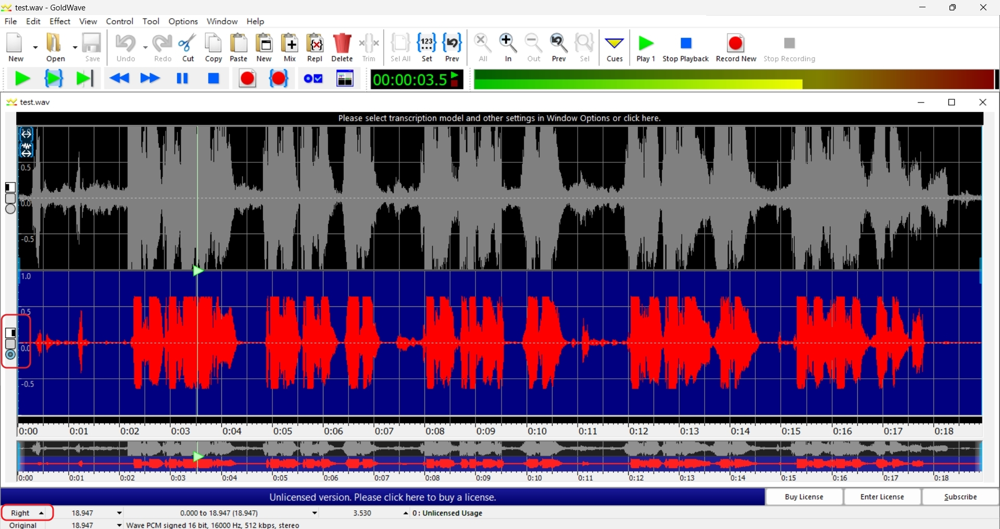

### Audacity channel review

1. Open the track menu (`...`) and select `Split Stereo to Mono`.
2. Use the pan controls when left/right spatial separation is useful; the screenshot places the upper track at left and the lower track at right.
3. Use `Mute` and `Solo` to monitor one track at a time. The illustrated state mutes the upper track and solos the lower track; reverse the selection to monitor the other channel.

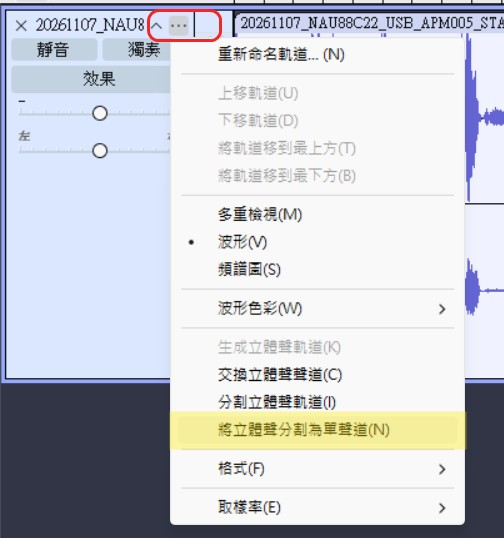

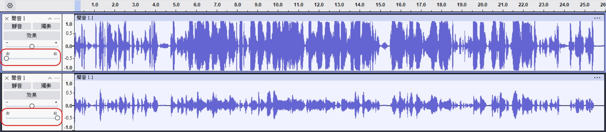

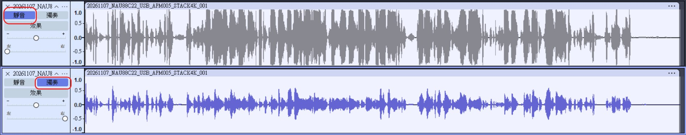

The upper and lower tracks retain the captured channel order. Channel meaning is determined from the firmware definition and a known test signal; waveform amplitude alone does not identify the AEC / NR output.

Reference: [Audacity Splitting and Joining Stereo Tracks](https://manual.audacityteam.org/man/splitting_and_joining_stereo_tracks.html).

---

## 7. Validation points and troubleshooting

| Symptom | Possible cause | Action |
|------|------|------|
| No recorded audio | Wrong record device | Re-select `Microphone Nuvoton UAC` |
| No playback audio | Wrong playback device | Re-select `Speaker Nuvoton UAC` |
| Nuvoton UAC is missing in Audacity | Device list was opened before enumeration completed | Select `Audio Setup > Rescan Audio Devices` |
| Channels cannot be reviewed separately | Recording was captured as one channel | Select `2 (Stereo)` before recording, then use `Split Stereo to Mono` |
| Weak AEC effect | Far-end level too low / unstable mic distance | Increase background level and keep fixed mic distance |
| Listening result does not match expectation | Using Stereo result to judge MONO algorithm | Switch channel first, then compare |

> **Validation note**
> Keep test conditions fixed (volume, distance, noise source) to compare AEC / NR performance across firmware versions fairly.

---

## 8. Summary

* Complete USB UAC enumeration and bind the selected GoldWave or Audacity devices before capture.
* Inject both far-end and near-end signals during recording to validate AEC / NR.
* Account for `MONO` support limitation during playback analysis.
* Audacity can preserve a Stereo capture and split it into two Mono tracks for isolated monitoring.
* Keep one fixed sample set for regression comparison across firmware versions.

[back to top](#article_top)

---

</section>

<section lang="zh-Hant">

# Nuvoton AEC / NR 操作流程

[English](#article_top) · [繁體中文](#article_top_zh)

## 議程

* 測試目標與環境檢查
* USB 音訊裝置列舉確認
* GoldWave／Audacity 裝置與錄音設定
* AEC / NR 操作與錄製流程
* 回放分析（Stereo / Mono 聲道行為）
* 驗收條件與除錯資訊

---

## 1. 測試目標與環境

### 測試目標

* 驗證 EVB 在 USB UAC 模式下，`AEC / NR` 是否可正常運作。
* 建立可重現的錄音流程，便於比較啟用前後差異。
* 將聲道設定納入結果判讀（`AEC / NR` 僅支援 `MONO`）。

### 實驗室環境檢查表

| 項目 | 設定值 | 說明 |
|------|-------|------|
| EVB | `I94124_NAU88C22_MB_REVC` | 測試板 |
| FW | AEC / NR library + USB UAC enable | 韌體需啟用演算法 |
| 音訊工具 | GoldWave 或 Audacity | 錄音 / 回放 / 聲道檢查 |

* GoldWave 下載頁：<https://goldwave.com/release.php>
* Audacity 下載頁：<https://www.audacityteam.org/download/>

---

## 2. USB 連線與裝置確認

1. 使用 USB 將 EVB 連接到 PC。
2. 確認作業系統已列舉出：
   * `Speaker Nuvoton UAC`
   * `Microphone Nuvoton UAC`
3. 確認喇叭與麥克風路徑都可正常使用，再進行錄音。

> **操作條件**
> `Speaker` 與 `Microphone` 均完成列舉後再開始 AEC / NR 錄音。裝置缺少時，可檢查 USB 線材、驅動及供電狀態。

---

## 3. GoldWave 設定

在 GoldWave 開啟 `Control related properties > Devices`，設定如下：

* `Playback Device` : `Speaker Nuvoton UAC`
* `Record Device` : `Microphone Nuvoton UAC`

此設定可確保錄音與回放都走 EVB 音訊路徑，才能正確觀察 AEC / NR 行為。

---

## 4. Audacity 設定

### 裝置選擇

1. EVB 完成連線後，開啟 `聲音設定`，選擇 `重新掃描聲音裝置`。
2. `播放裝置` 選擇 `喇叭 (Nuvoton UAC)`。
3. `錄製裝置` 選擇 `麥克風 (Nuvoton UAC)`。
4. `錄製聲道` 選擇 `2 (立體聲)`，保留兩個擷取聲道供後續比較。

雙聲道錄音用於保留 UAC 的兩個擷取聲道，不會改變 AEC / NR library 僅處理 `MONO` 的限制。

參考資料：[Audacity Audio Setup Toolbar](https://manual.audacityteam.org/man/audio_setup_toolbar.html)。

---

## 5. AEC / NR 錄音流程

### 錄音步驟

1. 開始錄音。
2. 播放背景內容（音樂、語音或新聞）模擬 far-end 音訊。
3. 同時加入 near-end 人聲，觀察錄音檔中的回音/噪音抑制效果。
4. 停止錄音並儲存 WAV 檔。

### GoldWave 錄音畫面

GoldWave 會在錄音視窗顯示擷取到的訊號。

### Audacity 錄音畫面

`錄製聲道` 設為 `2 (立體聲)` 時，Audacity 會在同一條音軌顯示兩個擷取聲道。這份波形可接續用於下一章的聲道判讀。

---

## 6. 測試檔案與回放判讀

### 測試檔案

| 檔案 | 內容 | 用途 |
|------|------|------|
| [test1.wav](img/test1.wav) | 音樂（英文） | 背景音情境測試 |
| [test2.wav](img/test2.wav) | 新聞播報 | 語音干擾情境測試 |
| [test3.wav](img/test3.wav) | 音樂（中文） | 混合內容情境測試 |

這三份檔案是播放刺激／背景輸入，不是成對的演算法處理結果。檔頭皆為 PCM 16-bit、16 kHz、雙聲道；音訊檔格式不代表韌體處理後聲道的位置。

| 輸入 | 長度 |
| --- | --- |
| test1.wav | 18.947 秒 |
| test2.wav | 23.600 秒 |
| test3.wav | 30.000 秒 |

<audio controls preload="none" aria-label="test1.wav 輸入音訊"><source src="img/test1.wav" type="audio/wav"><a href="img/test1.wav">下載 test1.wav</a></audio>
<audio controls preload="none" aria-label="test2.wav 輸入音訊"><source src="img/test2.wav" type="audio/wav"><a href="img/test2.wav">下載 test2.wav</a></audio>
<audio controls preload="none" aria-label="test3.wav 輸入音訊"><source src="img/test3.wav" type="audio/wav"><a href="img/test3.wav">下載 test3.wav</a></audio>

### 錄音條件與聲道對照

| 紀錄欄位 | 比較時保留的資訊 |
| --- | --- |
| 裝置／韌體 | 板卡版本、韌體 build、AEC／NR 開關 |
| 擷取 | 工具版本、sample rate、bit depth 與聲道數 |
| UAC routing | 左右聲道來源、raw／processed 意義及對應韌體定義 |
| 聲學配置 | 刺激檔、播放音量、麥克風增益、距離與噪音來源 |
| 輸出 | 例如 `capture_AEC-on_NR-on_16k_stereo.wav`；與刺激檔分開命名 |

目前未指定左右聲道與演算法輸出的固定對應。以單一已知輸入及韌體 routing 定義建立對照後，再比較個別聲道。聽感與波形比較用於描述觀察，不代表量化的回音消除保證。

### 回放觀察重點

1. 預設 `Stereo` 回放時，通常可同時聽到背景音與人聲。
2. 分別監聽兩個擷取聲道。AEC / NR 處理後的聲道依韌體 UAC routing 與已知輸入訊號識別，不固定指定為左聲道或右聲道。
3. 透過聲道切換，確認演算法輸出路徑是否符合預期。

### GoldWave 聲道判讀

### Audacity 聲道判讀

1. 開啟音軌選單（`...`），選擇 `將立體聲分割為單聲道`。
2. 需要左右空間分離時，可調整聲像；截圖將上方音軌設於左側、下方音軌設於右側。
3. 使用 `靜音` 與 `獨奏` 逐一監聽音軌。截圖狀態為上方音軌靜音、下方音軌獨奏；對調設定即可監聽另一個聲道。

上、下音軌保留原始擷取聲道的順序。聲道意義應依韌體定義及已知測試訊號判定，不能只由波形振幅辨識 AEC / NR 輸出。

參考資料：[Audacity Splitting and Joining Stereo Tracks](https://manual.audacityteam.org/man/splitting_and_joining_stereo_tracks.html)。

---

## 7. 驗收重點與除錯資訊

| 現象 | 可能原因 | 處理方式 |
|------|----------|----------|
| 錄不到聲音 | 錄音裝置選錯 | 重新選擇 `Microphone Nuvoton UAC` |
| 回放無聲 | 播放裝置選錯 | 重新選擇 `Speaker Nuvoton UAC` |
| Audacity 未顯示 Nuvoton UAC | 開啟裝置清單時列舉尚未完成 | 選擇 `聲音設定 > 重新掃描聲音裝置` |
| 無法分別檢視兩個聲道 | 錄音時只擷取單聲道 | 錄音前選擇 `2 (立體聲)`，完成後執行 `將立體聲分割為單聲道` |
| AEC 效果不明顯 | far-end 音量太小 / 麥克風距離不穩定 | 提高背景音量並固定收音距離 |
| 聽感與預期不一致 | 用 Stereo 結果判讀 MONO 演算法 | 先切換聲道再比較 |

> **Validation note**
> 不同韌體版本的 AEC / NR 表現，需要在相同音量、距離與噪音來源等測試條件下比較。

---

## 8. 摘要

* 錄音前完成 USB UAC 列舉，並設定選用的 GoldWave 或 Audacity 裝置。
* 錄音時同時注入 far-end 與 near-end 訊號，才能有效驗證 AEC / NR。
* 回放分析需考慮 `MONO` 支援限制，並核對韌體聲道定義。
* Audacity 可保留 Stereo 錄音，再拆成兩條 Mono 音軌進行單獨監聽。
* 固定測試樣本可作為韌體版本回歸比較基準。

[back to Chinese top](#article_top_zh)

</section>
