[回到知識庫總索引](https://released.github.io/)

<a id="article_top"></a>

# I94124 DSpotter 國語／台語語音操作指南

I94124 與 NAU88C22 語音控制範例同時辨識國語及台語。命令辨識成功後，播放國語回覆、觸發 LED，並由 UART 輸出功能與參數；實際冷氣通訊或 GPIO 控制由應用層整合。

本指南包含 INI、DSMT、Audio Tool 與燒錄流程的介面截圖。圖片可點擊放大；圖中的帳號與本機路徑已裁除或遮蔽。

| 操作目的 | 入口 |
| --- | --- |
| 新增、修改、刪除辨識詞條 | [編輯 INI](#ini) → [DSMT 載入與匯入](#dsmt-open) |
| 調整台語發音或增加口音候選 | [台語音素與試聽](#phoneme) |
| 修改回覆文字或錄音 | [回覆來源](#reply) → [Audio Tool 編碼](#encode) |
| 產生最新 BIN | [一鍵合併與燒錄](#merge) |
| 核對每一項命令 | [語音、LED 與 UART 測試](#test) |

範例工程：[I94100BSP_VR_DSpotter](https://github.com/released/I94100BSP_VR_DSpotter)。完整欄位與操作定義見工程內的 [DSMT 指南](https://github.com/released/I94100BSP_VR_DSpotter/blob/main/DSMT_OPERATION_GUIDE.md)及 [Audio Tool 指南](https://github.com/released/I94100BSP_VR_DSpotter/blob/main/AUDIO_TOOL_GUIDE.md)。

<a id="pipeline"></a>

## 1. 工具分工與整體流程

| 工具／來源 | 負責內容 | 完成結果 |
| --- | --- | --- |
| `DSMT/VoiceCommands.ini` | 語系、GROUP、詞條、參數、MapID、音素 | 辨識規格與匯入資料 |
| Cyberon DSMT V2 | 取得發音、試聽、儲存模型 | 兩語原生工程與模型 |
| 回覆 Profile／WAV | 回覆文字或真人錄音 | 16 kHz、16-bit PCM、單聲道 WAV |
| Nuvoton Audio Tool | UID 與 F7 編碼 | ROM 與音訊索引標頭 |
| `BuildLatestModel.cmd` | 核對來源、模型、音訊與容量，封裝整合 | `AirconDataFlash.bin`、容量報告與測試表 |

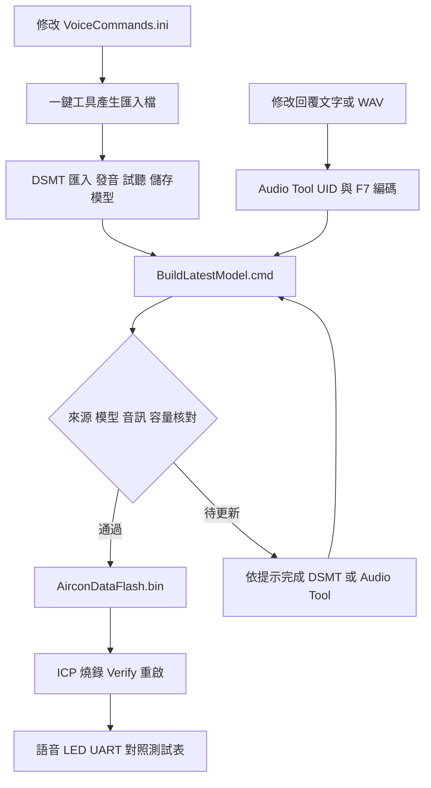

一鍵產生使用 Windows PowerShell 5.1 與隨工程提供的 .NET 執行檔，不需安裝 Python。DSMT 需可用帳號；回覆文字自動合成使用已安裝的 Windows 桌面語音，自錄 WAV 可直接交由 Audio Tool 編碼。

<a id="ini"></a>

## 2. 在 INI 新增、修改或刪除說法

範例：新增國語「開啟冷氣」，沿用開機功能 `MapID=1`。

1. 以 UTF-8 編輯 `DSMT/VoiceCommands.ini`。
2. 找到 `[ChineseTWN.Group_2_Power]`，使用未占用的 No；隨附範例可使用 6。
3. 加入新詞。Phoneme 留白時保留最後一個 `|`，由 DSMT 取得發音。
4. 執行根目錄 `BuildLatestModel.cmd`，依提示更新待套用群組。

```ini
[ChineseTWN.Group_2_Power]
; No=Command|Reward|SGReward|ExtEnd|MapID|FastSpeech|Phoneme
6=開啟冷氣|0|0|0|1|N|
```

| 修改內容 | 維護方式 |
| --- | --- |
| 調整詞條或辨識參數 | 修改該語系、GROUP 與 No 的原列，再由 DSMT 重新匯入及儲存模型 |
| 同 MapID 增加別名 | 新增未占用 No，沿用功能 MapID，共用原有回覆 |
| 同句增加發音候選 | 使用新 No、相同 Command／MapID 與另一組完整 Phoneme |
| 刪除別名 | 刪除該句全部候選列，保留功能的其他說法，再更新該群組 |
| 全新功能或移除整個功能 | 同步韌體解碼、回覆、播放索引與封裝配置，見[工程維護](https://github.com/released/I94100BSP_VR_DSpotter/blob/main/docs/DEVELOPMENT.md) |

`No` 用於排序，`MapID` 對應 UART 功能。各列保留七欄，語系、群組與實際工程一致。

<a id="dsmt-open"></a>

## 3. DSMT 登入與載入工程

1. 啟動 Cyberon DSpotter Modeling Tool V2，完成登入。
2. 選擇「檔案 → 載入專案」。
3. 依修改語系選擇下列工程。兩語分開編輯，整合後由韌體同時啟用。

| 語系 | 工程相對路徑 |
| --- | --- |
| 國語 | `DSMT/Combine/Working/ChineseTWN/AirconZHTW.dsmt` |
| 台語 | `DSMT/Combine/Working/Taiwanese/Taiwanese.dsmt` |

[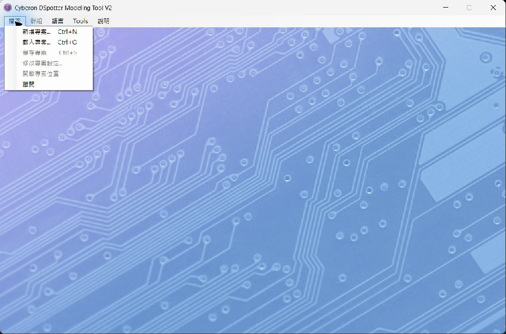](img/dsmt-open-project.png)

<a id="groups"></a>

## 4. 依功能選擇群組

上方頁籤對應九個分類。只更新工具列出的待套用群組，保留其他群組、順序與 Global 設定。

| 群組 | 功能 |
| --- | --- |
| `Group_1_Wake` | 房間、客廳等喚醒詞；位於第一組 |
| `Group_2_Power` | 開機、關機 |
| `Group_3_Mode`／`Group_4_Temperature` | 模式、溫度 |
| `Group_5_Fan`／`Group_6_Swing` | 風量、風向 |
| `Group_7_Health`／`Group_8_Volume`／`Group_9_Timer` | 健康、音量、定時 |

[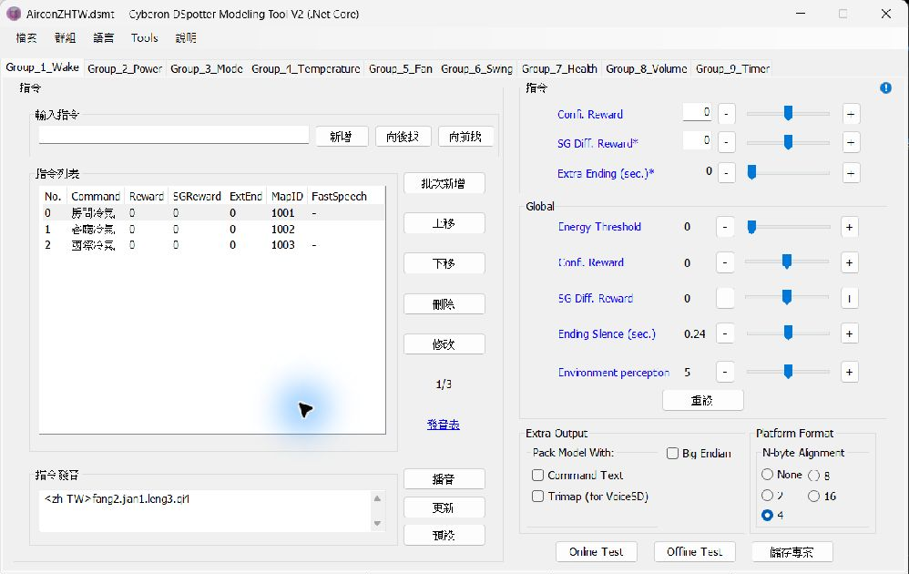](img/dsmt-groups.png)

韌體在喚醒階段啟用第一組；喚醒成功後，同時啟用其餘八組。

<a id="batch"></a>

## 5. 批次套用完整群組

以國語 `Group_2_Power` 為例：

1. 在 DSMT 選取 `Group_2_Power`。
2. 在指令列表選第一列，按住 Shift 選最後一列，再按「刪除」清空該組詞條，保留群組及 Global 設定。
3. 按「批次新增」，讀取 `DSMT/Import/ChineseTWN/Group_2_Power.BatchAdd.txt`。
4. 核對保留說法、新詞、MapID 與參數。匯入檔包含該群組全部詞條。

[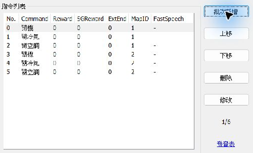](img/dsmt-batch-entry.png)

- `.BatchAdd.txt`：詞條資料，供現有群組的「批次新增」使用。
- `.txt`：含官方 XML 設定，供「匯入群組」使用。
- 台語使用 `DSMT/Import/Taiwanese/` 的對應檔案。

<a id="mapid"></a>

## 6. 共用 MapID 與參數核對

同功能的兩語說法、別名及口音候選使用相同 MapID。例如「開機／開冷氣／開啟冷氣」均對應 `1`，由韌體解碼為 `POWER_ON`。

[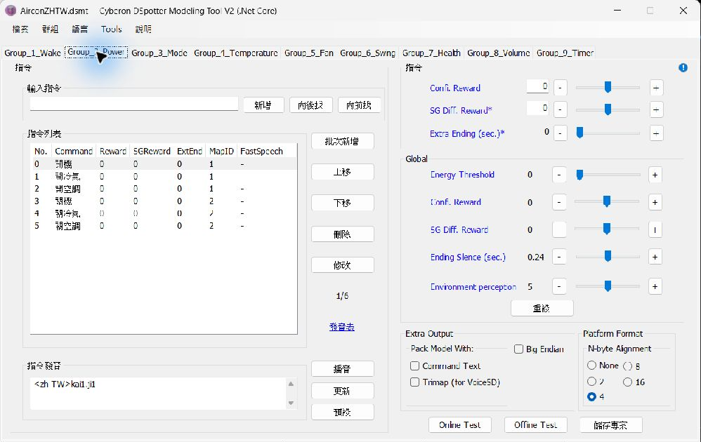](img/dsmt-mapid.png)

選取詞條後按「修改」，可核對 CmdMapID 與 Fast speech enhancement。畫面設定與 INI 保持一致。

[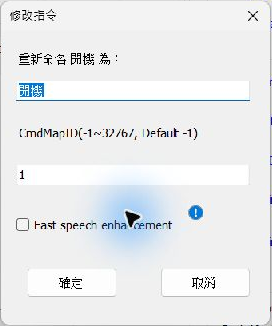](img/dsmt-edit-mapid.png)

| INI 欄位 | DSMT 對應／用途 |
| --- | --- |
| Reward | Confi. Reward，詞條調整值 |
| SGReward | SG Diff. Reward，詞條調整值 |
| ExtEnd | Extra Ending，單位秒；每格 0.03 秒，範圍 0～0.48 |
| FastSpeech | `Y` 啟用、`N` 停用 |
| Phoneme | 包含語系前綴的完整音素；新詞可留白 |

參數變更也需要重新產生模型。調整後測試原命令、相近說法、背景對話及兩語交叉辨識。

<a id="phoneme"></a>

## 7. 台語發音、候選與試聽

1. 選擇台語工程的對應群組與詞條。
2. 核對下方「指令發音」；例：「溫度攑懸」使用 `<zh-NAN>un7.too7.gia3.kuan5`，MapID 為 `7`。
3. 按「播音」試聽。修改完整音素後按「更新」，再試聽。
4. 儲存工程與模型，再完成一鍵產生。

[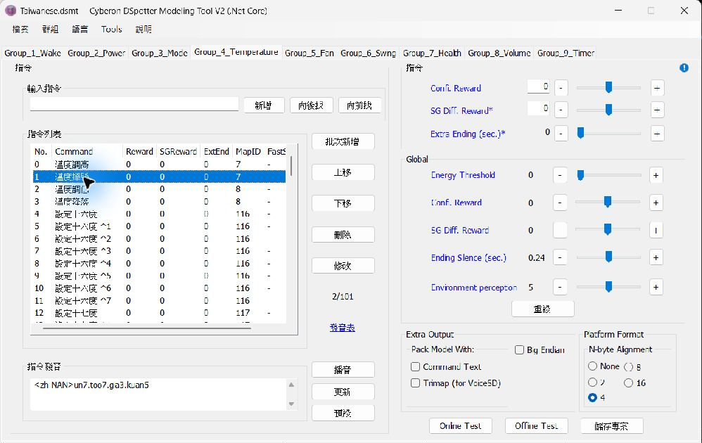](img/dsmt-taiwanese-phoneme.png)

- `gia3` 為第三調低降；音節後方數字表示聲調。
- 畫面上的 `^1`、`^2` 表示候選序號，口說仍使用原詞條。
- 已知音素可直接修改 INI。先在 DSMT 試音時，依完整指南將該句 Phoneme 留白；成功產生時，工具將實際候選寫回 INI。
- 同句不同口音可增加候選，沿用相同 MapID。

完整讀法見[台語音素與全部候選](https://github.com/released/I94100BSP_VR_DSpotter/blob/main/DSMT/Test/TaiwanesePronunciation.md)。

<a id="model"></a>

## 8. 聲學與平台格式

從「檔案 → 修改專案設定」核對聲學條件，沿用本範例的 SDK 與韌體配置。

| 設定 | 範例值 |
| --- | --- |
| Sample Rate | 16 kHz |
| Feature Dimension | 23d |
| Frame Rate | 100 fps |
| Model Size Level | 1 |
| 平台配置 | 32-bit、4-byte alignment；Alignment 在工程主畫面核對 |

[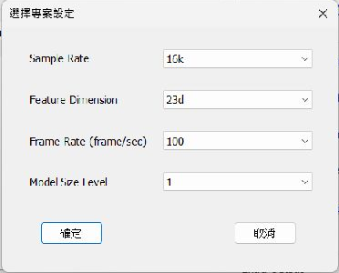](img/dsmt-project-settings.png)

INI 的 ExtEnd 以 0.03 秒為一格，與此處聲學 Frame Rate 為不同設定。完整欄位與匯入格式見 [Cyberon DSMT 操作指南](https://tool.cyberon.com.tw/DSMT_V2/index.php?lang=en)。

<a id="dsmt-save"></a>

## 9. 儲存工程並更新模型

1. 核對文字、發音、MapID、Reward、SGReward、ExtEnd 與 FastSpeech。
2. 選擇「檔案 → 儲存專案」或按 Ctrl+S，等待模型產生完成。
3. 回到一鍵工具按 Enter；視窗已關閉時，再次執行 `BuildLatestModel.cmd`。

[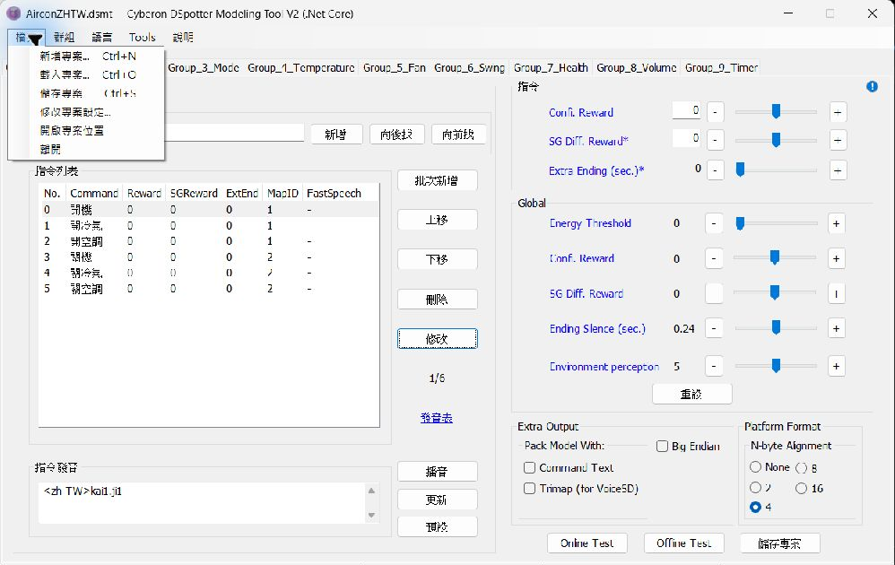](img/dsmt-save-menu.png)

若仍列出待套用群組，核對載入工程、匯入檔、發音與儲存狀態。顯示「模型尚未更新」時，在 DSMT 完成儲存及建模後再執行同一入口。

<a id="reply"></a>

## 10. 修改回覆文字或錄音

國語與台語命令共用國語回覆，以前綴「好的，」加功能主句組成。主句 WAV 只包含主句。

| 來源 | 操作 |
| --- | --- |
| Windows 文字合成 | 修改 `AudioRes/ReplyPhrases/ReplyProfile.json` 的既有 `text`，保留檔名、索引與 MapID；執行一鍵工具產生 WAV，再依提示完成 F7 |
| 自錄或匯入 WAV | 替換 `WavSrc/` 的同名 WAV，使用 16 kHz、16-bit PCM、單聲道，並同步 Profile 的主句文字，再由 Audio Tool 編碼 |

例如將開機回覆主句改為「冷氣已開機」：

```json
{
  "file": "reply_power_on.wav",
  "text": "冷氣已開機",
  "map_ids": [1]
}
```

此片段表示修改欄位；編輯既有 Profile 時保留其餘欄位與合法逗號。合成聲音使用該電腦已安裝的桌面語音，自錄來源由工具保留。

新增同 MapID 的辨識別名時共用原回覆。增加獨立音訊片段或移除整個功能時，同步 UID、Profile、播放索引、片段數與封裝配置，見 [Audio Tool 完整指南](https://github.com/released/I94100BSP_VR_DSpotter/blob/main/AUDIO_TOOL_GUIDE.md)。

<a id="audio-open"></a>

## 11. Audio Tool 開啟 WBA 與 UID

1. 選擇 File → Open，開啟 `AudioRes/ReplyPhrases/AirconReplies.wba`。
2. 在左側 Project Workspace 展開工程，雙擊 `AirconReplies.uid`。

[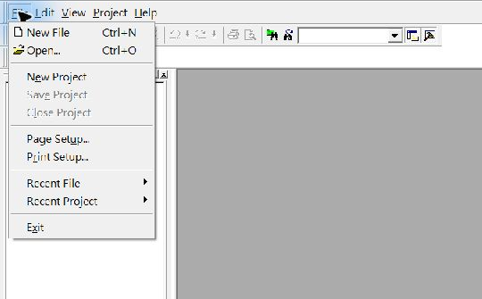](img/audio-open-project.png)

[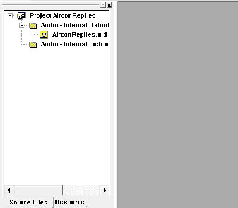](img/audio-workspace.png)

<a id="uid"></a>

## 12. UID 的檔名、順序與編碼

UID 的 `[Audio]` 每列對應一個 WAV，檔名不含 `.wav`：

```text
[Audio]
defaud wake_ok <ext=0, format=NUO, bitrate=1.0>
defaud reply_prefix <ext=0, format=NUO, bitrate=1.0>
defaud reply_power_on <ext=0, format=NUO, bitrate=1.0>
```

[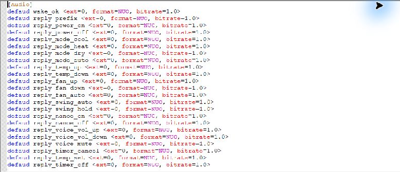](img/audio-uid.png)

- `format=NUO`：NuOne 編碼。
- `bitrate=1.0`：1.0 bits/sample；來源 WAV 維持 16 kHz。
- 既有順序對應韌體播放索引；增減片段時同步韌體與封裝配置。

音檔名稱、主句、索引及 MapID 見[完整回覆對照表](https://github.com/released/I94100BSP_VR_DSpotter/blob/main/AUDIO_TOOL_GUIDE.md#5-回覆音檔對照)。

<a id="directories"></a>

## 13. 搜尋目錄與輸出目錄

1. 選擇 Project → Options，進入 Directories。
2. Output file Directory 指向本音訊工程的 `Output` 資料夾。
3. 若找不到 WAV，在 Resource files 的 Directories 加入本工程 `WavSrc`。

| 用途 | 專案相對路徑 |
| --- | --- |
| WAV 與 UID 來源 | `AudioRes/ReplyPhrases/WavSrc/` |
| ROM 與索引標頭輸出 | `AudioRes/ReplyPhrases/Output/` |

[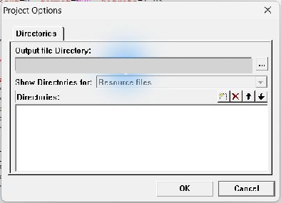](img/audio-options.png)

圖中灰色區域為已遮蔽的本機輸出路徑；依實際工程位置設定。圖中的搜尋列表為空，缺少來源時可加入 WavSrc。

<a id="encode"></a>

## 14. F7 編碼

1. 完成回覆文字、WAV 與 UID 修改，核對功能一致。
2. 選擇 Project → Build 或按 F7；完整重建使用 Rebuild All。
3. 查看下方輸出視窗。有錯誤時先處理來源檔、搜尋路徑或格式，再重新編碼。

[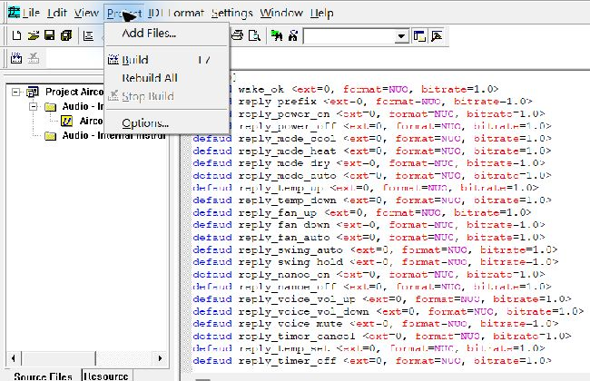](img/audio-build-menu.png)

若一鍵工具正在等待 Audio Tool 編碼，完成 F7 後回原視窗按 Enter，即可接續核對與封裝。

<a id="audio-result"></a>

## 15. 核對編碼結果與產物

[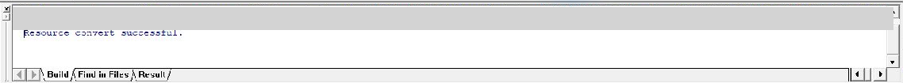](img/audio-build-result.png)

此工具畫面的完成訊息為 `Resource convert successfully.`。完成訊息與下列產物一併核對：

| Output 內的檔案 | 核對內容 |
| --- | --- |
| `AirconReplies_AudioInfoMerge.ROM` | 音訊與索引的編碼產物，更新時間對應該次編碼 |
| `AirconReplies_AudioInfo.h` | 音檔名稱與實際索引；增減片段時核對韌體對應 |

執行 `BuildLatestModel.cmd` 後，工具核對 Profile、WAV、UID、標頭、ROM 及容量，中間封裝檔由工具處理。

<a id="merge"></a>

## 16. 一鍵合併與燒錄

完成 DSMT 儲存與 Audio Tool 編碼後，執行根目錄 `BuildLatestModel.cmd`。最新產物位於 `CMDSet/ReleaseV005/`。

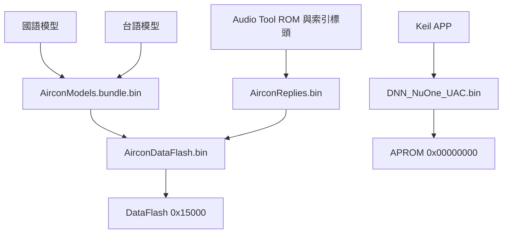

| 燒錄區域 | 起點 | 發布目錄中的檔案 |
| --- | --- | --- |
| APROM | `0x00000000` | `DNN_NuOne_UAC.bin` |
| DataFlash | `0x00015000` | `AirconDataFlash.bin` |

1. 在 NuMicro ICP 選擇 I94124，核對板卡與 Config，DataFlash 起點為 `0x15000`。
2. 首次使用或韌體有變動時更新 APROM 與 DataFlash；板上已有相容韌體、僅變更模型或回覆時，可只更新 DataFlash。
3. 完成燒錄、Verify 與重啟。
4. 依 [BuildReport.md](https://github.com/released/I94100BSP_VR_DSpotter/blob/main/CMDSet/ReleaseV005/BuildReport.md)核對容量與檔案指紋。

模型使用 `0x15000` 起的區域，回覆音訊位於 `0x70000`。DataFlash 整合檔不含 APROM；程式有修改時，先由 Keil 產生 APP，再由一鍵工具更新發布目錄。

<a id="test"></a>

## 17. 語音、LED 與 UART 測試

1. UART 設為 115200、8N1，核對兩語及音訊就緒訊息。
2. 說國語「房間冷氣」，等待喚醒提示音與 LED 短閃。
3. 說「開機」，核對回覆「好的，為您開機」、LED 短閃與 UART 的功能。
4. 等回覆播完再說下一句，依台語音素表測試台語命令。
5. 完成全部別名、16～30 度、1～12 小時及兩語喚醒／命令交叉組合。

UART 對照範例摘錄：

```text
map_id=1 category=Power command=POWER_ON
```

- 控制視窗預設 60 秒。一般漏辨可直接重說；回到等待喚醒後重新說喚醒詞。
- 回覆播放期間等待整句結束，再說下一句。
- 範例以 UART 輸出解碼結果；冷氣通訊、GPIO、定時及音量狀態由應用層整合。

| 文件 | 內容 |
| --- | --- |
| [逐句測試表](https://github.com/released/I94100BSP_VR_DSpotter/blob/main/DSMT/Test/UserCommandTestGuide.txt) | 全部別名、溫度、定時與兩語組合 |
| [MapID 快速對照](https://github.com/released/I94100BSP_VR_DSpotter/blob/main/DSMT/Test/CommandMapIDQuickReference.md) | 命令、功能與回覆 |
| [台語發音表](https://github.com/released/I94100BSP_VR_DSpotter/blob/main/DSMT/Test/TaiwanesePronunciation.md) | 實際音素與完整候選 |

<a id="references"></a>

## 18. 來源與完整操作定義

- [範例工程與 README](https://github.com/released/I94100BSP_VR_DSpotter)：環境、硬體、程式流程與燒錄條件。
- [INI／DSMT 操作指南](https://github.com/released/I94100BSP_VR_DSpotter/blob/main/DSMT_OPERATION_GUIDE.md)：欄位、候選、參數與完整修改流程。
- [Audio Tool 操作指南](https://github.com/released/I94100BSP_VR_DSpotter/blob/main/AUDIO_TOOL_GUIDE.md)：文字合成、自錄、音檔對照與新增／刪除回覆。
- [工程維護](https://github.com/released/I94100BSP_VR_DSpotter/blob/main/docs/DEVELOPMENT.md)：新功能、MapID、播放索引及韌體修改位置。
- [第三方元件告知](https://github.com/released/I94100BSP_VR_DSpotter/blob/main/THIRD_PARTY_NOTICES.md)：SDK、模型、NuOne 與音訊來源。

[回到頁首](#article_top)
