[回到知識庫總索引](https://released.github.io/)

<a id="article_top"></a>

# Nuvoton M031 PWM Register 與 Keil / NuEclipse Peripheral View

> 記錄 M031LE3AE 的 PWM0 CH2 設定，對照 PWM clock path、`PWM_ConfigOutputChannel()` 的計算方式、register mapping，以及 Keil 與 NuEclipse Debug Mode 中的 PWM frequency／duty 觀察結果。

## 內容範圍

| 項目 | 設定條件 |
|---|---|
| MCU | Nuvoton `M031LE3AE` |
| PWM module／channel | `PWM0`／`CH2` |
| Output pin | `PB.3`／`PWM0_CH2` |
| Target waveform | `30 Hz`、`50% duty` |
| PWM clock source | `PCLK0` |
| Clock condition | HIRC = HCLK = PCLK0 = `48 MHz` |
| IDE | Keil MDK / µVision、Nuvoton NuEclipse for Windows |
| 官方 BSP | [OpenNuvoton/M031BSP](https://github.com/OpenNuvoton/M031BSP) |
| 參考範例 | [`SampleCode/StdDriver/PWM_OutputWaveform`](https://github.com/OpenNuvoton/M031BSP/tree/master/SampleCode/StdDriver/PWM_OutputWaveform) |

操作內容由官方六通道範例整理為單一 CH2 configuration，driver calculation 與 System Viewer 的 register value 也一併納入對照。

### 文件與程式碼依據

硬體規格與 register 定義以 Nuvoton 於 2026-04-20 發布的 Rev 2.03 文件為準；API 行為則對照 M031BSP 原始碼。不同晶片型號、BSP 版本或 clock configuration 可能產生不同數值。

| 核對項目 | 依據 |
|---|---|
| `M031LE3AE`、48 MHz HIRC、PWM 通道特性 | [M031 Series Datasheet Rev 2.03，第 15～22 頁](https://www.nuvoton.com/resource-download.jsp?tp_GUID=DA00-M031) |
| PB.3 的 `PWM0_CH2` multi-function | [M031 Series Datasheet Rev 2.03，第 36、58～60 頁](https://www.nuvoton.com/resource-download.jsp?tp_GUID=DA00-M031#page=59) |
| HCLK、PCLK0 與 PWM0 clock path | [M031/M032 Series TRM Rev 2.03，第 197～210、549～552 頁](https://www.nuvoton.com/resource-download.jsp?tp_GUID=DA05-M031#page=549) |
| Prescaler、counter、period、compare 與 output control | [M031/M032 Series TRM Rev 2.03，第 553～555、574～599 頁](https://www.nuvoton.com/resource-download.jsp?tp_GUID=DA05-M031#page=553) |
| Prescaler 搜尋、`PERIOD` 與 `CMPDAT` 計算 | [`PWM_ConfigOutputChannel()` 原始碼](https://github.com/OpenNuvoton/M031BSP/blob/master/Library/StdDriver/src/pwm.c#L125-L204) |
| PB.3 function code 與 PWM register index mapping | [`sys.h` 的 PB3MFP 定義](https://github.com/OpenNuvoton/M031BSP/blob/master/Library/StdDriver/inc/sys.h#L295-L307)、[`pwm.h` helper macros](https://github.com/OpenNuvoton/M031BSP/blob/master/Library/StdDriver/inc/pwm.h#L271-L338) |

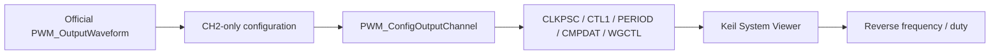

## 1. 單一 CH2 configuration

與 PWM 相關的核心設定可整理為：

```c
CLK_EnableModuleClock(PWM0_MODULE);
CLK_SetModuleClock(PWM0_MODULE, CLK_CLKSEL2_PWM0SEL_PCLK0, 0);

SYS->GPB_MFPL = (SYS->GPB_MFPL & ~SYS_GPB_MFPL_PB3MFP_Msk) |
                  SYS_GPB_MFPL_PB3MFP_PWM0_CH2;

PWM_ConfigOutputChannel(PWM0, 2, 30, 50);
PWM_EnableOutput(PWM0, PWM_CH_2_MASK);
PWM_Start(PWM0, PWM_CH_2_MASK);
```

這段 configuration 涉及四個設定面向：

1. `CLK_EnableModuleClock()` 開啟 PWM0 peripheral clock gate。
2. `CLK_SetModuleClock()` 選擇 PWM0 input clock 為 PCLK0。
3. `GPB_MFPL.PB3MFP` 將 PB.3 連到 PWM0_CH2。
4. 三個 PWM API 分別設定 waveform、開啟 pin output、啟動 counter。

## 2. PWM clock path

```mermaid
flowchart LR
    HIRC[HIRC<br/>48 MHz] --> HSEL[CLKSEL0.HCLKSEL<br/>HIRC]
    HSEL --> HDIV[CLKDIV0.HCLKDIV<br/>divide by 1]
    HDIV --> HCLK[HCLK<br/>48 MHz]
    HCLK --> PDIV[PCLKDIV.APB0DIV<br/>divide by 1]
    PDIV --> PCLK[PCLK0<br/>48 MHz]
    PCLK --> PSEL[CLKSEL2.PWM0SEL<br/>PCLK0]
    PSEL --> GATE[APBCLK1.PWM0CKEN<br/>enabled]
    GATE --> PSC[CLKPSC 2/3<br/>divide by 25]
    PSC --> CNTCLK[CH2/CH3 counter clock<br/>1.92 MHz]
    CNTCLK --> PERIOD[PERIOD2 + 1<br/>64000 counts]
    PERIOD --> PWM[PWM0_CH2<br/>30 Hz]
    PWM --> PIN[PB.3]
```

clock chain 整理如下：

```text
HIRC 48 MHz
  → HCLK divider /1
  → HCLK 48 MHz
  → APB0 divider /1
  → PCLK0 48 MHz
  → PWM0 clock source
```

`CLK_GetPCLK0Freq()` 會讀取 `PCLKDIV.APB0DIV`，並以 `SystemCoreClock >> APB0DIV` 取得 PCLK0。當 field value 為 `0` 時，實際 divider 為 `/1`。

## 3. `PWM_ConfigOutputChannel()` 實際演算法

官方 [`Library/StdDriver/src/pwm.c`](https://github.com/OpenNuvoton/M031BSP/blob/master/Library/StdDriver/src/pwm.c#L125-L204) 的流程可整理為：

```text
1. 由 CLKSEL2 判斷 PWM clock 來自 PLL 或 PCLK。
2. PWM0 選擇 PCLK 時，以 CLK_GetPCLK0Freq() 取得 input clock。
3. Actual Prescaler Divider 從 1 開始遞增。
4. 計算 floor((PWM_CLK / Target Frequency) / Divider)。
5. 第一個不超過 65536 counts 的 Divider 即停止搜尋。
6. 寫入 CLKPSC = Divider - 1。
7. 寫入 PERIOD = Counts - 1。
8. 依 duty percentage 寫入 CMPDAT。
9. 設定 edge-aligned down-count 與 period／compare output action。
```

對應的核心關係：

```text
Counts candidate = floor((PWM_CLK / Target Frequency) / Divider)

CLKPSC register  = Divider - 1
PERIOD register  = Counts - 1
```

### 30 Hz 的 prescaler 搜尋

```text
PWM_CLK = 48,000,000 Hz
Target  = 30 Hz

48,000,000 / 30 = 1,600,000 counts before prescaling
```

| Actual divider | Counts candidate | 是否符合 16-bit period |
|---:|---:|---|
| 1 | 1,600,000 | 否 |
| 24 | 66,666 | 否，仍大於 65,536 |
| 25 | 64,000 | 是，driver 在此停止 |

因此：

```text
Actual Prescaler Divider = 25
CLKPSC register          = 25 - 1 = 24 = 0x18
PERIOD + 1               = 64000
PERIOD register          = 63999 = 0xF9FF
```

Frequency 驗證：

```text
PWM Frequency
= 48,000,000 / ((24 + 1) × (63999 + 1))
= 48,000,000 / (25 × 64000)
= 30 Hz
```

## 4. Duty 與 waveform action

當 `Duty = 50%`，且未進入 driver 對 `0%` 或 `>= 100%` 的特殊分支時，compare calculation 為：

```text
CMPDAT
= Duty × (PERIOD + 1) / 100
= 50 × 64000 / 100
= 32000
= 0x7D00
```

由 register 反推：

```text
Duty
= CMPDAT2 / (PERIOD2 + 1) × 100%
= 32000 / 64000 × 100%
= 50%
```

`PWM_ConfigOutputChannel()` 同時設定 edge-aligned down-count，以及 period point output low、compare-down point output high。上述 duty 換算對應這組 waveform action；`WGCTL0`、`WGCTL1` 或 `POLCTL` 改變時，physical pin 的 high／low duty 需連同 output action 與 polarity 一起判讀。

## 5. API 與 register 寫入關係

### `PWM_ConfigOutputChannel(PWM0, 2, 30, 50)` 寫入

| Register／field | CH2 expected value | 作用 |
|---|---:|---|
| `PWM0->CLKPSC[1]` | `24` (`0x18`) | CH2／CH3 counter clock divider = 25 |
| `PWM0->CTL1` CH2/3 counter type | down-count；raw value `0x00000010` | Edge-aligned counter mode |
| `PWM0->PERIOD[2]` | `63999` (`0xF9FF`) | 64000 counter clocks per PWM cycle |
| `PWM0->CMPDAT[2]` | `32000` (`0x7D00`) | CH2 compare point |
| `PWM0->WGCTL0` CH2 period action | output low；raw value `0x00100000` | Period point waveform action |
| `PWM0->WGCTL1` CH2 compare-down action | output high；raw value `0x00200000` | Compare point waveform action |

### 其他 initialization API 寫入

| 設定面向 | API／設定 | Register／field | 畫面結果 |
|---|---|---|---|
| HCLK source | `CLK_SetHCLK()` | `CLK->CLKSEL0.HCLKSEL` | HIRC |
| HCLK divider | `CLK_SetHCLK()` | `CLK->CLKDIV0.HCLKDIV` | field `0`，actual `/1` |
| PCLK0 divider | Default clock condition | `CLK->PCLKDIV.APB0DIV` | field `0`，actual `/1` |
| PWM0 clock source | `CLK_SetModuleClock()` | `CLK->CLKSEL2.PWM0SEL` | PCLK0 |
| PWM0 clock gate | `CLK_EnableModuleClock()` | `CLK->APBCLK1.PWM0CKEN` | `1` |
| Pin function | `SYS->GPB_MFPL` assignment | `SYS->GPB_MFPL.PB3MFP` | `PWM0_CH2`；field `0x0B` |
| CH2 output enable | `PWM_EnableOutput()` | `PWM0->POEN` | bit 2 = `1`；raw `0x00000004` |
| CH2/3 counter start | `PWM_Start()` | `PWM0->CNTEN` | pair bit 2 = `1`；raw `0x00000004` |

> **CH2 與 CH3 共用 `PWM0->CLKPSC[1]`、`PWM0->PERIOD[2]` 與同一組 counter enable。** `CMPDAT[2]`／`CMPDAT[3]` 與 `POEN` 則保留各 channel 的設定。若 CH3 之後用不同 frequency 再呼叫 `PWM_ConfigOutputChannel()`，會改動 CH2/CH3 共用的 prescaler 與 period。

## 6. 由 register 反推 PWM

### Frequency

```text
Actual Divider = CLKPSC[1] + 1
Period Counts  = PERIOD[2] + 1

PWM Frequency
= PWM Source Clock / (Actual Divider × Period Counts)
```

System Viewer 的 register value 為：

```text
PWM Source Clock = 48,000,000 Hz
CLKPSC[1]        = 24
PERIOD[2]        = 63999

PWM Frequency = 48,000,000 / (25 × 64000) = 30 Hz
```

### Duty

```text
Duty = CMPDAT[2] / (PERIOD[2] + 1) × 100%
     = 32000 / 64000 × 100%
     = 50%
```

### Register consistency chain

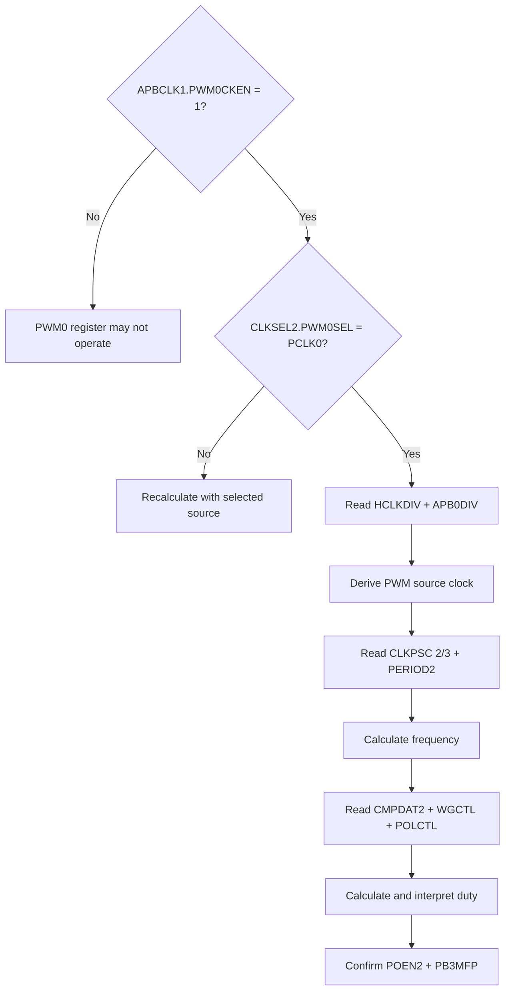

## 7. Keil Debug Mode 操作

### 7.1 Build、Download 與進入 Debug Mode


進入 Debug Mode 的 toolbar 位置如下：

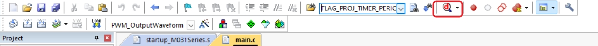

完整 initialization 後的 register snapshot，可在 `PWM_ConfigOutputChannel()`、`PWM_EnableOutput()` 與 `PWM_Start()` 都執行完成後讀取。停在 initialization 之前時，PWM0 Viewer 顯示 `0` 反映的是當下程式狀態，不代表 configuration 失效。

### 7.2 開啟 PWM0 System Viewer

操作畫面中的選單路徑為：

```text
Peripherals → System Viewer → PWM → PWM0
```

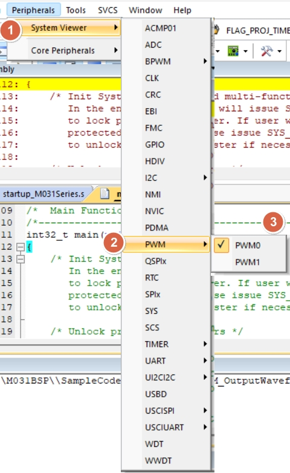

Viewer 開啟後可展開 individual register／field：

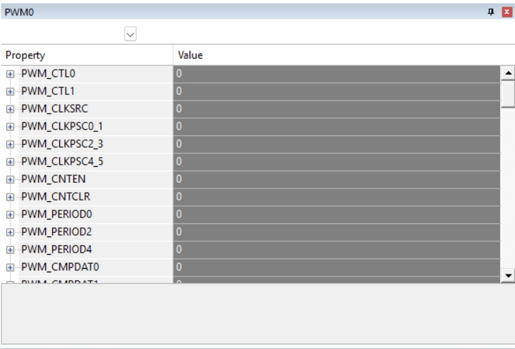

### 7.3 同時開啟 CLK、SYS 與 PWM0

```text
Peripherals → System Viewer → CLK
Peripherals → System Viewer → SYS
Peripherals → System Viewer → PWM → PWM0
```

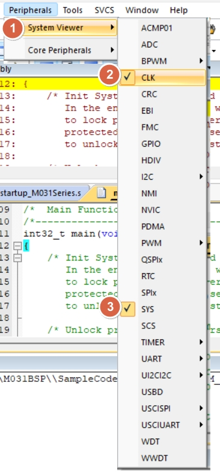

三個 Viewer 的用途：

```text
System Viewer
├─ CLK
│  ├─ CLKSEL0      HCLK source
│  ├─ CLKSEL2      PWM0 source
│  ├─ CLKDIV0      HCLK divider
│  ├─ PCLKDIV      PCLK0 divider
│  └─ APBCLK1      PWM0 clock enable
│
├─ PWM0
│  ├─ CLKPSC       CH2/CH3 prescaler
│  ├─ PERIOD2      CH2/CH3 period
│  ├─ CMPDAT2      CH2 compare
│  ├─ CTL1         counter type
│  ├─ WGCTL0/1     waveform action
│  ├─ CNTEN        counter running state
│  └─ POEN         pin output enable
│
└─ SYS
   └─ GPB_MFPL     PB.3 = PWM0_CH2
```

## 8. Keil register screenshots

### CLK

CLK Viewer 可確認：

- `APBCLK1.PWM0CKEN = 1`
- `CLKSEL0.HCLKSEL = HIRC`
- `CLKSEL2.PWM0SEL = PCLK0`
- `CLKDIV0.HCLKDIV = 0`，actual divider `/1`
- `PCLKDIV.APB0DIV = 0`，actual divider `/1`

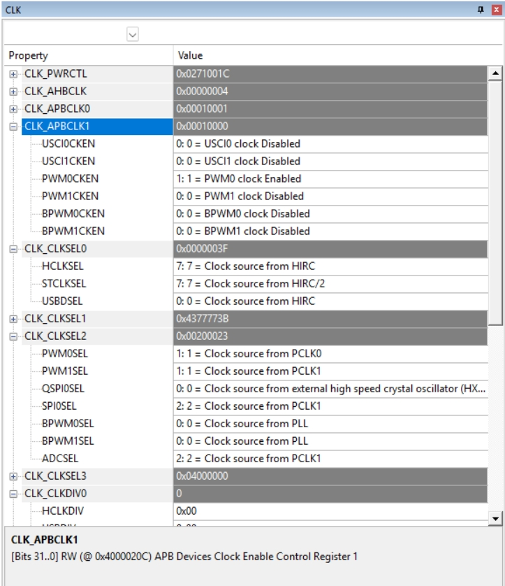

### SYS pin function

`SYS_GPB_MFPL.PB3MFP = 0x0B` 對應 `PWM0_CH2`。畫面中的 `SYS_GPB_MFPL` raw value 為 `0x0000B000`。

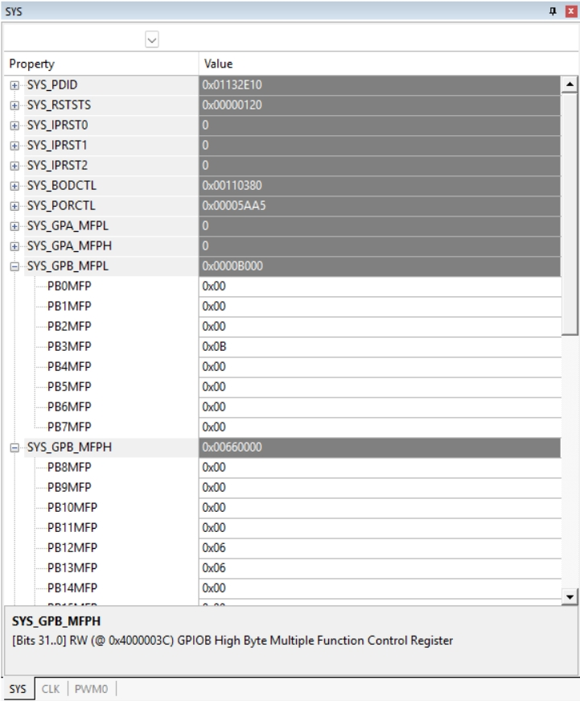

### PWM0 calculation registers

畫面中的主要值：

| Keil label | Raw value | Decimal／meaning |
|---|---:|---|
| `PWM_CLKPSC2_3` | `0x00000018` | register 24，actual divider 25 |
| `PWM_CTL1` | `0x00000010` | CH2/3 down-count configuration |
| `PWM_PERIOD2` | `0x0000F9FF` | 63999 |
| `PWM_CMPDAT2` | `0x00007D00` | 32000 |
| `PWM_CNTEN` | `0x00000004` | CH2/3 counter running |

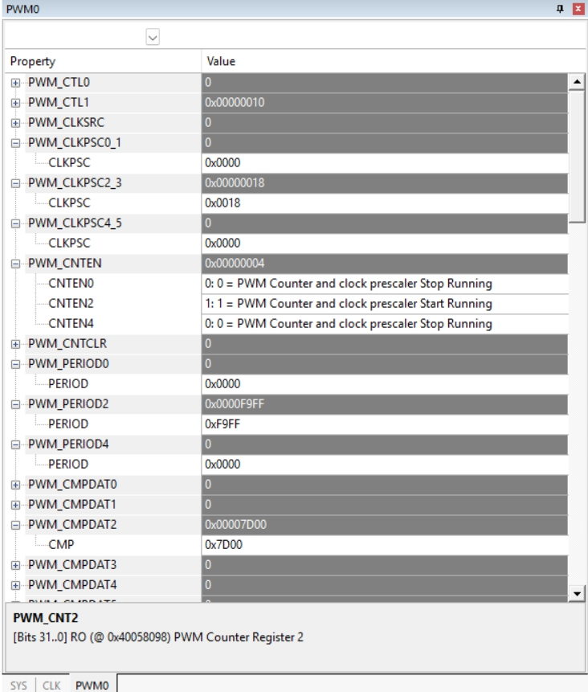

### PWM0 output state

`PWM_POEN = 0x00000004` 表示 CH2 output enabled。`PWM_CNT2` 是執行中的 counter snapshot，CPU／peripheral 持續運行時數值會變動。

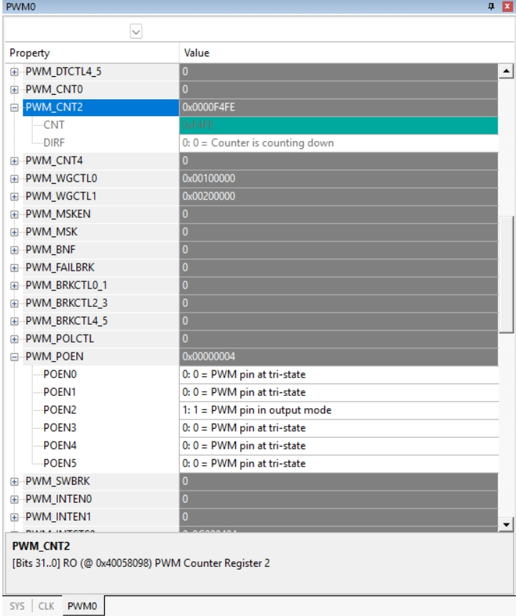

### Periodic Window Update

CPU running 時要持續刷新 Viewer，可開啟：

```text
View → Periodic Window Update
```

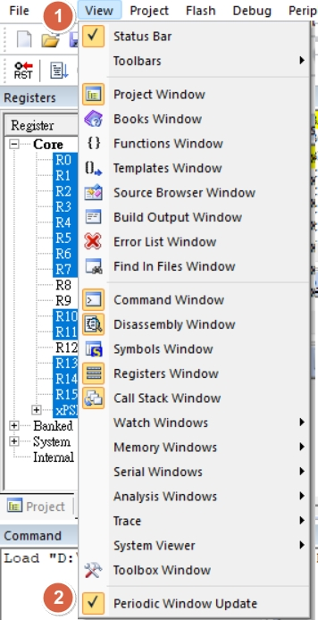

一致的 static snapshot 可在 PWM initialization 完成後停止 CPU 再讀取；dynamic counter 則可透過 periodic update 觀察。

## 9. Viewer 顯示與程式狀態的關係

| 現象 | 可核對內容 |
|---|---|
| PWM0 Viewer 全部為 0 | 程式是否已執行到 PWM configuration、target device／pack 是否正確 |
| `PWM0CKEN = 0` | `CLK_EnableModuleClock(PWM0_MODULE)` 是否已執行 |
| Prescaler／period 正確但 PB.3 無波形 | `POEN2`、`PB3MFP`、pin wiring 與量測點 |
| Frequency 不符 | PWM source、HCLKDIV、APB0DIV、CLKPSC 與 PERIOD 是否用 actual divider 解碼 |
| CH2 frequency 被其他設定改變 | CH3 是否再次設定共用的 CLKPSC／PERIOD |
| Duty 計算與 pin high time 相反 | `WGCTL0`、`WGCTL1`、`POLCTL` 與量測定義 |
| `CNT2` 持續變動 | Counter 正常運行；frequency 應由 clock、prescaler 與 PERIOD 計算 |

## 10. NuEclipse Peripheral Registers View

NuEclipse 使用 **Packs** 機制取得 special function register（SFR）描述，並依專案選擇的 device 建立 Peripheral Registers View。官方 User Manual Rev 1.02.027 的 4.6.4 節將流程分為 Packs Perspective、package definition 更新、SFR 安裝、device selection 與 debug register monitoring。

### 10.1 官方資源與操作條件

| 項目 | 內容 |
|---|---|
| NuEclipse Windows | [Nuvoton 官方下載頁](https://www.nuvoton.com/resource-download.jsp?tp_GUID=SW132022111608043510) |
| User Manual | [NuEclipse User Manual](https://www.nuvoton.com/resource-download.jsp?tp_GUID=UG1320211217144816) |
| 手冊對應章節 | `4.6.4 Peripheral Registers View`，PDF 第 24～29 頁 |
| Target device | `M031LE3AE` |
| Pack 更新紀錄 | 更新全部 package definitions 約 10 分鐘；這不是固定時間，會隨網路與 repository 狀態變動 |

> **Windows 操作注意：** 進行 Packs 更新時，以滑鼠右鍵選擇「__以系統管理員身分執行__」開啟 NuEclipse，再執行後續操作，以避免安裝目錄或 pack cache 寫入權限不足。

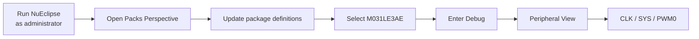

### 10.2 開啟 Packs Perspective

選單路徑：

```text
Window → Perspective → Open Perspective → Other… → Packs
```

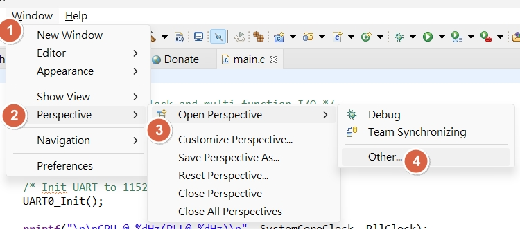

在 Open Perspective 對話框選擇 `Packs`：

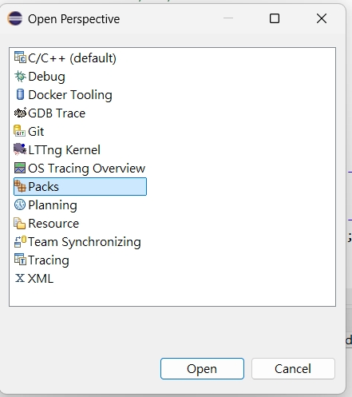

### 10.3 更新 package definitions

Packs Perspective 右上角的按鈕名稱為：

```text
Update the packages definitions from all repositories
```

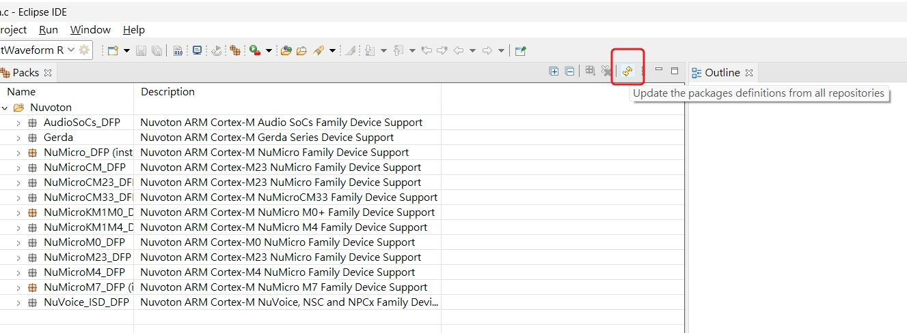

按下後，NuEclipse 會從 online repository 下載 package 與 SFR 資訊。實際操作的更新時間約為 10 分鐘，過程中 NuEclipse 維持執行，直到進度完成。

官方手冊補充兩項狀態資訊：

- Packs Perspective 初始內容由 NuEclipse installer 提供；若預設內容完全缺少，可使用新的 workspace 交叉確認。
- Repository 位置可在 `Window → Preferences → C/C++ → Packages → Repositories` 查看；手冊所示預設來源為 Keil CMSIS Pack repository。

下載完成後，Nuvoton device family 的 SFR package 會出現在 Packs 清單，對應版本也可由清單安裝。

### 10.4 指定專案 Device

開啟專案 Properties，進入：

```text
C/C++ Build → Settings → Devices
```

選擇與實體 MCU 相同的 `M031LE3AE`，再套用設定。Device 選擇決定 Peripheral View 使用哪一份 SFR register map；畫面中的 memory map 僅供這個 device selection 頁面參考，並不取代 linker script。

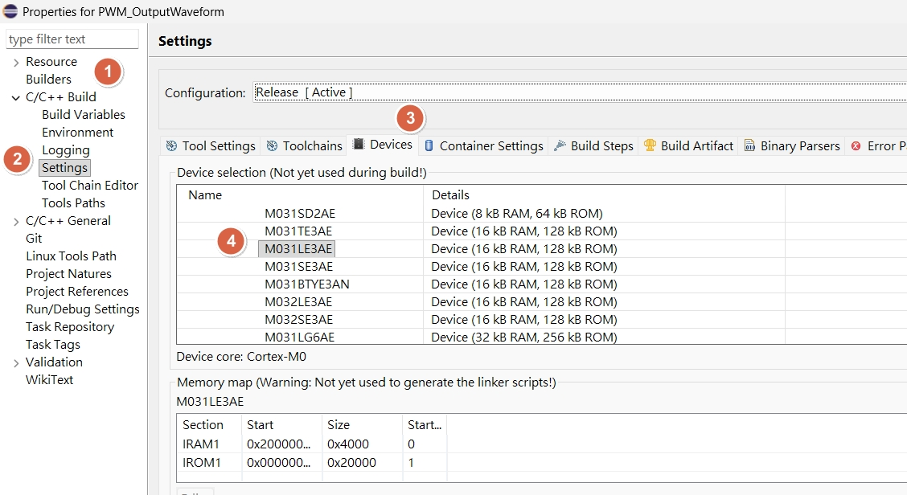

### 10.5 在 Debug Mode 加入 Peripheral Monitors

Debug Mode 中，程式執行到 PWM initialization 後暫停 CPU。Peripheral pane 選取的觀察 module 為：

- `CLK`
- `PWM0`
- `SYS`

勾選後，對應項目會出現在下方 `Monitors`，點選 module 即可切換 register rendering。

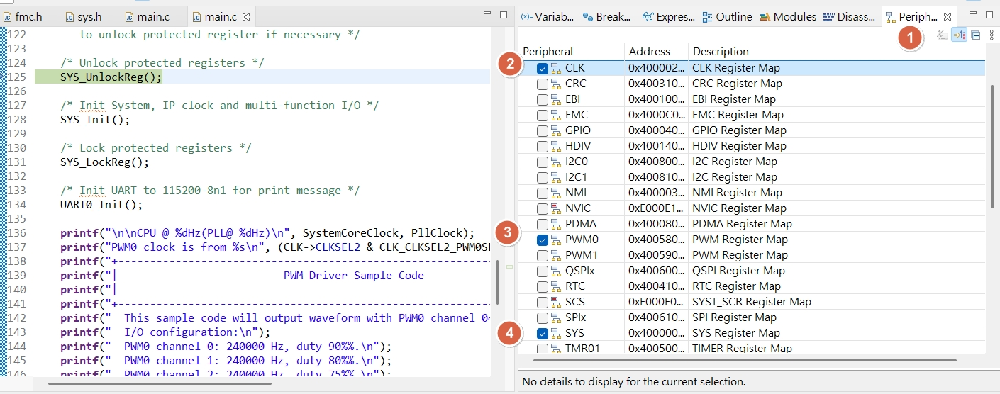

### 10.6 CLK register 對照

NuEclipse 顯示的是 pack 內的 SFR 名稱；與 C code 的對照如下：

| NuEclipse label | C register／field | 畫面值 | 解讀 |
|---|---|---:|---|
| `CLK_APBCLK1.PWM0CKEN` | `CLK->APBCLK1.PWM0CKEN` | bit 16 = `1` | PWM0 module clock enabled |
| `CLK_CLKSEL0.HCLKSEL` | `CLK->CLKSEL0.HCLKSEL` | `0x7` | HCLK source = HIRC |
| `CLK_CLKSEL2.PWM0SEL` | `CLK->CLKSEL2.PWM0SEL` | `1` | PWM0 source = PCLK0 |
| `CLK_CLKDIV0` | `CLK->CLKDIV0.HCLKDIV` | `0` | actual HCLK divider `/1` |
| `CLK_PCLKDIV` | `CLK->PCLKDIV.APB0DIV` | `0` | actual PCLK0 divider `/1` |
| `CLK_PWRCTL.HIRCEN` | `CLK->PWRCTL.HIRCEN` | `1` | HIRC enabled |
| `CLK_STATUS.HIRCSTB` | `CLK->STATUS.HIRCSTB` | `1` | HIRC stable |

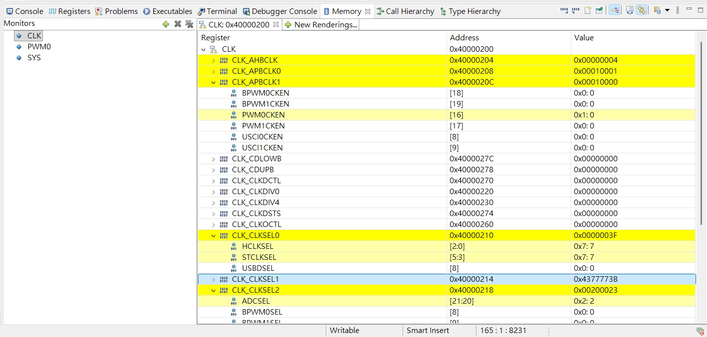

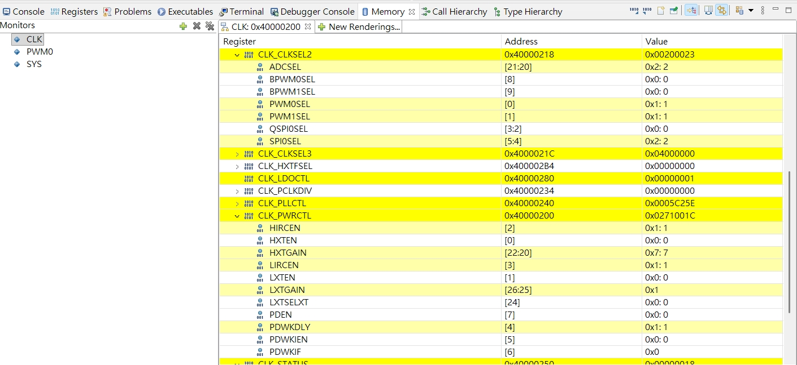

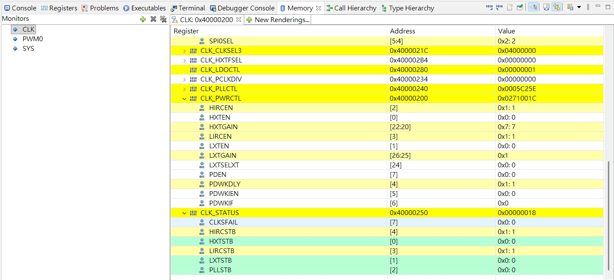

### 10.7 SYS pin function 對照

`SYS_GPB_MFPL = 0x0000B000`，其中 `PB3MFP = 0xB`，對應 PB.3 的 `PWM0_CH2` pin function。這與 Keil System Viewer 讀到的 register value 相同。

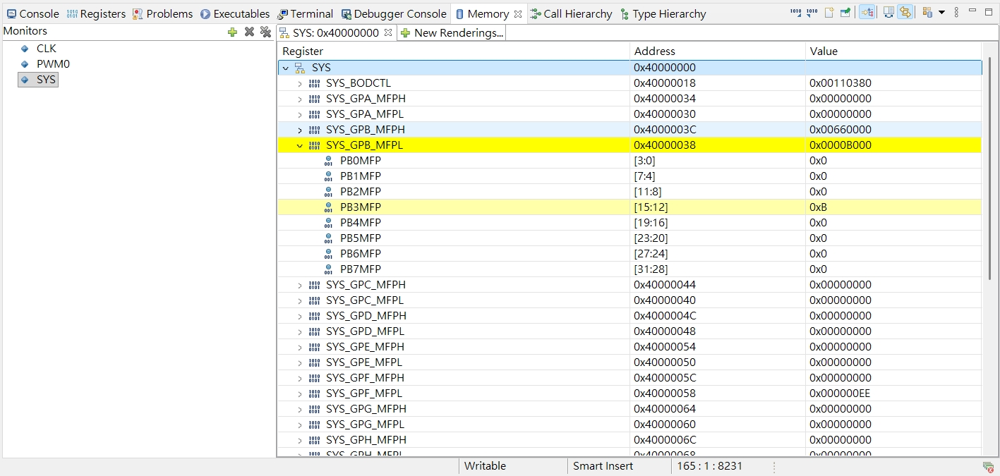

### 10.8 PWM0 register 對照

| NuEclipse label | C register | 畫面值 | 解讀 |
|---|---|---:|---|
| `PWM_CLKPSC2_3` | `PWM0->CLKPSC[1]` | `0x18` | register 24，actual divider 25 |
| `PWM_CMPDAT2` | `PWM0->CMPDAT[2]` | `0x7D00` | 32000，CH2 compare |
| `PWM_CTL1.CNTTYPE2` | `PWM0->CTL1` | raw `0x10` | CH2/3 down-count |
| `PWM_PERIOD2` | `PWM0->PERIOD[2]` | `0xF9FF` | 63999，period counts = 64000 |
| `PWM_POEN.POEN2` | `PWM0->POEN` | raw `0x4` | CH2 output enabled |
| `PWM_WGCTL0` | `PWM0->WGCTL0` | `0x00100000` | CH2 period action = low |
| `PWM_WGCTL1` | `PWM0->WGCTL1` | `0x00200000` | CH2 compare-down action = high |

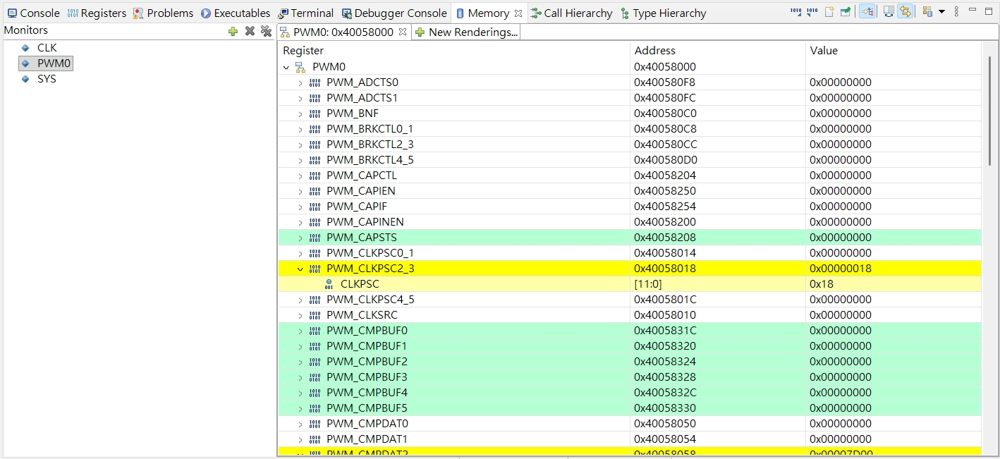

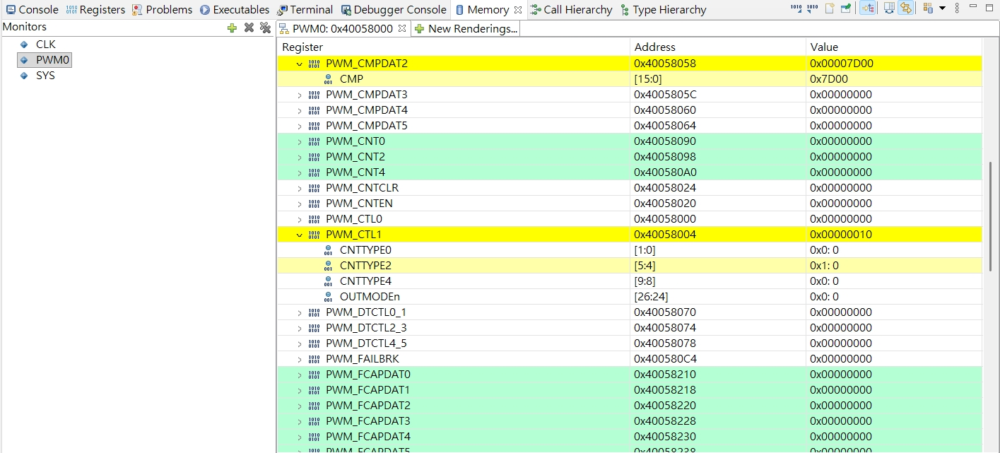

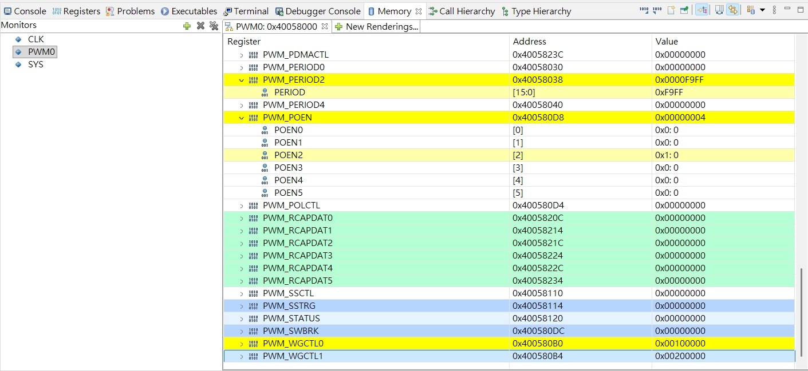

NuEclipse 畫面中的 `PWM_CNTEN` snapshot 為 `0x00000000`，表示擷取畫面時未呈現 counter enabled。`PWM_Start(PWM0, PWM_CH_2_MASK)` 執行完成後，對應的 `PWM0->CNTEN` bit 2 為 `1`、raw value 為 `0x00000004`。重新暫停並刷新後若仍為 `0`，可由 breakpoint／program counter 對照程式是否已越過 `PWM_Start()`。

### 10.9 Keil 與 NuEclipse 名稱對照

| 觀察項目 | Keil System Viewer | NuEclipse Peripheral View |
|---|---|---|
| PWM0 clock gate | `CLK_APBCLK1.PWM0CKEN` | `CLK_APBCLK1.PWM0CKEN` |
| PWM0 source | `CLK_CLKSEL2.PWM0SEL` | `CLK_CLKSEL2.PWM0SEL` |
| CH2/3 prescaler | `PWM_CLKPSC2_3` | `PWM_CLKPSC2_3` |
| CH2/3 period | `PWM_PERIOD2` | `PWM_PERIOD2` |
| CH2 compare | `PWM_CMPDAT2` | `PWM_CMPDAT2` |
| PB.3 pin function | `SYS_GPB_MFPL.PB3MFP` | `SYS_GPB_MFPL.PB3MFP` |

兩套 IDE 的 UI 位置不同，但 register address、raw value 與 frequency／duty 反推公式相同。

### 10.10 常見狀態核對

| 現象 | 可核對內容 |
|---|---|
| Packs Perspective 沒有初始內容 | 使用新的 workspace 交叉確認 installer 提供的預設內容 |
| 清單沒有 M031LE3AE | package definitions 是否更新完成、Nuvoton SFR pack 是否已安裝 |
| Peripheral panel 沒有正確 register map | Project Properties 的 Device 是否為 `M031LE3AE`，設定是否已 Apply |
| CLK／PWM0／SYS 沒有出現在 Monitors | Peripheral pane 的 module checkbox 是否已勾選 |
| Register 顯示舊值 | CPU 暫停時點與 rendering refresh 狀態 |
| `CNTEN = 0` | 程式是否已執行 `PWM_Start()`，以及 snapshot 是否已重新整理 |

## 11. 官方來源

- [OpenNuvoton M031BSP](https://github.com/OpenNuvoton/M031BSP)
- [M031 Series Datasheet Rev 2.03](https://www.nuvoton.com/resource-download.jsp?tp_GUID=DA00-M031)
- [M031/M032 Series Technical Reference Manual Rev 2.03](https://www.nuvoton.com/resource-download.jsp?tp_GUID=DA05-M031)
- [PWM_OutputWaveform `main.c`](https://github.com/OpenNuvoton/M031BSP/blob/master/SampleCode/StdDriver/PWM_OutputWaveform/main.c)
- [`PWM_ConfigOutputChannel()` — `pwm.c`](https://github.com/OpenNuvoton/M031BSP/blob/master/Library/StdDriver/src/pwm.c#L125-L204)
- [PWM register helper macros — `pwm.h`](https://github.com/OpenNuvoton/M031BSP/blob/master/Library/StdDriver/inc/pwm.h#L271-L338)
- [PB.3 multi-function definition — `sys.h`](https://github.com/OpenNuvoton/M031BSP/blob/master/Library/StdDriver/inc/sys.h#L295-L307)
- [`CLK_GetPCLK0Freq()` — `clk.c`](https://github.com/OpenNuvoton/M031BSP/blob/master/Library/StdDriver/src/clk.c#L147-L159)
- [NuEclipse Windows — Nuvoton download](https://www.nuvoton.com/resource-download.jsp?tp_GUID=SW132022111608043510)
- [NuEclipse User Manual — 4.6.4 Peripheral Registers View](https://www.nuvoton.com/export/resource-files/en-us--UM_NuEclipse_EN.pdf#page=24)

`30 Hz`、`50%` 與單一 CH2 configuration 是由官方範例整理出的操作條件；register value 以列出的 clock condition 為前提。

---

## English Summary

This page maps a single M031LE3AE PWM0 CH2 configuration to the clock tree, BSP driver algorithm, peripheral registers, Keil System Viewer, and NuEclipse Peripheral Registers View. With PCLK0 at 48 MHz, the driver selects an actual prescaler divider of 25, writes `CLKPSC = 24`, `PERIOD2 = 63999`, and `CMPDAT2 = 32000`, producing 30 Hz at 50% duty on PB.3.

[回到知識庫總索引](https://released.github.io/) · [回到頁首](#article_top)
