[回到知識庫總索引](https://released.github.io/)

# M480 Secure Boot ISP 更新流程

> 使用 Secure Boot 驗證 firmware 的合法性與完整性，透過 Secure ISP 完成授權更新。先用 ICP 配置開機選項與金鑰，再以 HSUSB SecureBootTool 部署韌體；APROM 保留 SW2／UART `1` 入口，供後續更新使用。

Secure Boot 的信任根、Hash／驗章、金鑰角色與更新回復，見[原理與金鑰指南](../slide_secure_boot_fundamentals/)。本頁提供 M480 工具與範例的實際操作。

## 適用範圍與閱讀順序

參考環境為 **M487JIDAE、NuMaker-PFM-M487 V3.0、ICP Programming Tool 3.23** 與 **`[0213 0921] SecureBootTool.exe`**。其他 M480 型號、工具版本及客製板須核對其 ROM API、記憶體與 USB 條件。

| 專案情況 | 閱讀位置 | 狀態 |
| --- | --- | --- |
| 使用專用 LDROM 作為 Secure ISP 入口 | [LDROM 範例](#ldrom-example) → [ICP 配置](#icp-setup) → [首次部署](#first-programming) → [重複更新](#repeat-update) | SW2 更新循環有實機測試回報 |
| 使用 APROM／SRAM 入口，不部署專用 LDROM | [SRAM 範例](#sram-example) → [ICP 配置](#icp-setup) → [SRAM 部署與更新](#sram-operation) | SRAM 範例有實機測試回報 |
| USB 連線或更新後啟動失敗 | [分階段排查](#troubleshooting) | 依目前可觀察狀態確認 |

**範例金鑰：** 截圖中顯示的 Secure Boot key 與 KPROM key 為公開教學範例，用來對照兩套工具的輸入。實際產品使用專案自己的金鑰與匯出紀錄；圖片中的個人路徑已遮蔽。

## 兩份範例的功能與檔案

兩份範例都使用晶片內建的 Mask ROM Secure Boot／Secure ISP、相同的 `[0213 0921] SecureBootTool.exe` 與 CON1 HSUSB。SW2 或 KEY1 是進入更新模式的要求；UART0 本身不傳送韌體。

| 範例與操作連結 | 更新執行位置 | 使用映像 | 部署與更新方式 |
| --- | --- | --- | --- |
| [M480BSP_ISP_HID_20_SecureBoot](#ldrom-example) | 專用 LDROM 入口轉接 Mask ROM API | `secure_boot_loader.bin`、`template.bin`；路徑見[建置對照](#build-examples) | 首次部署 LDROM＋APROM；後續只勾 APROM |
| [M480BSP_ISP_HID_20_SecureBoot_SRAM](#sram-example) | SRAM 向量、wrapper、USB ISR 與 stack 轉接 Mask ROM API | `secure_boot_sram.bin`；路徑見[建置對照](#build-examples) | 更新模組隨 APROM 部署；工具只勾 APROM，不需部署專用 LDROM |

原始碼：[專用 LDROM 範例 GitHub repository](https://github.com/released/M480BSP_ISP_HID_20_SecureBoot)、[APROM／SRAM 範例 GitHub repository](https://github.com/released/M480BSP_ISP_HID_20_SecureBoot_SRAM)。兩份範例以 Keil 直接建置；下方提供其功能與完整操作流程。

### 專用 LDROM 範例

`M480BSP_ISP_HID_20_SecureBoot` 的 APROM 處理正常功能及更新要求。SW2／KEY1 觸發後，主迴圈檢查 IAP 與 LDROM 向量，再以 VECMAP＋CPU-only reset 切至 LDROM；LDROM 初始化 HSUSB 並呼叫 `HSUSBD_ISP()`。

使用 Keil 開啟 `SampleCode/AP/Keil/Template.uvprojx` 與 `SampleCode/LDROM/Keil/SecureBootLoader.uvprojx` 建置兩份 BIN，完整路徑見[建置對照](#build-examples)。首次操作見 [第 5 節](#first-programming)，日常更新見 [第 6 節](#repeat-update)。

### APROM／SRAM 範例

`M480BSP_ISP_HID_20_SecureBoot_SRAM` 在 APROM 保留更新模組的載入映像。

- 啟動時：C runtime 初始化 SRAM 內的向量、ROM API wrapper、USB ISR、資料與專用 stack。
- 觸發時：SW2／KEY1 提出要求，切至 SRAM 後呼叫 `HSUSBD_ISP()`。
- 更新期間：不依賴 LDROM，也不返回已被改寫的 APROM。

- 建置：開啟 `SampleCode/AP/Keil/SecureBootSRAM.uvprojx`，target 為 `SecureBootSRAM`；產生 `secure_boot_sram.bin`，完整路徑見[建置對照](#build-examples)。
- 開機配置：此例不產生 LDROM BIN，正常開機目的地須為 APROM（`CONFIG0[7]=1`）。
- 操作：完整部署、觸發與更新步驟見[第 7 節](#sram-operation)。

### 建置環境與輸出

兩份範例均使用 **Keil uVision 5、Arm Compiler 6.22**，沿用專案內 BSP 與 `BootIspLib_Keil.lib`。以 Keil 直接建置：

1. 開啟下表的 `.uvprojx`，選擇對應 target，確認使用 Arm Compiler 6.22。
2. 按 **F7（Build）**；需要完整重建時，使用 **Rebuild all target files**。
3. 確認 Build Output 為 **0 Error(s), 0 Warning(s)**。專案的 After Build 會透過 `fromelf` 產生 BIN，位置如下。
4. 在 SecureBootTool 的 Load File 選擇該 BIN。F7 僅建置，不會執行 ICP 配置或下載韌體。

專案檔與 BIN 路徑皆相對該列的 Keil 目錄；目錄則相對各範例根目錄。

| 範例／用途 | 專案與產物 |
| --- | --- |
| 專用 LDROM 版 APROM | 目錄：`SampleCode/AP/Keil/` 專案：`Template.uvprojx` Target：`Template` BIN：`obj/template.bin` |
| 專用 LDROM 版 LDROM | 目錄：`SampleCode/LDROM/Keil/` 專案：`SecureBootLoader.uvprojx` Target：`SecureBootLoader` BIN：`obj/secure_boot_loader.bin` |
| SRAM 版 APROM | 目錄：`SampleCode/AP/Keil/` 專案：`SecureBootSRAM.uvprojx` Target：`SecureBootSRAM` BIN：`obj/secure_boot_sram.bin` |

保留各專案使用的 `.sct` 與啟動程式。建置錯誤時先處理工具鏈、BSP／library 位置與 linker 訊息，待成功後再進行更新。

驗證版本切換時，在應用程式 UART 訊息加入可辨識的版號，再重新建置。

- 每份新版都保留其更新入口與 linker 配置。
- 專用 LDROM 版保留 `secure_update.c/.h`。
- SRAM 版還須包含 `secure_isp_ram.c/.h`、`secure_isp_transfer.s`，以及 SRAM 的 ROM wrapper／向量／stack 配置。

## 1. 工具、記憶體與金鑰分工

### Secure Boot 與 Secure ISP

**Secure Boot** 用來確認 MCU 即將執行的 firmware 符合已配置的驗證資訊，且內容未遭竄改。驗證範圍可以包含 LDROM、APROM 或其他支援的程式區域，依 IB／保護配置決定。

**Secure ISP** 用來限制 firmware 更新的授權，並執行擦除、寫入與相關驗證資料更新。授權效果取決於認證及寫入保護是否有正確配置；本範例使用 KPROM 認證，並由相同 SBK 產生映像的驗證資訊。

| 項目 | Secure Boot | Secure ISP |
| --- | --- | --- |
| 主要目的 | 驗證 firmware 合法性與完整性 | 安全更新 firmware |
| 執行時機 | MCU Power On／Reset | 需要更新 firmware 時 |
| 主要操作 | Firmware Authentication | Firmware Erase／Program |
| 驗證對象 | Firmware Image | 更新端授權、更新資料，依更新架構實作 |
| 使用者 | MCU 自動執行 | PC Tool、維修工具或更新系統 |
| 是否需要 PC | 不需要 | 不一定，取決於更新架構；本範例使用 PC 工具 |
| 是否修改 Flash | 驗證流程通常不修改 | 更新時會修改 |
| 是否每次開機執行 | 啟用對應驗證機制後通常會 | 不需要 |

### 開機時：Secure Boot 驗證什麼

1. 首次以 ICP 配置 Boot Loader、Secure Boot 驗證設定、SBK 及保護選項，決定此裝置的開機與保護條件。
2. MCU 上電或完整重置後，由 **Mask ROM** 的安全開機流程，依 Information Block（IB）內的驗證資訊與實際保護配置，檢查指定區域的 firmware。
3. 受保護映像通過驗證後，才依開機配置執行程式；本頁兩份範例的正常目的地皆為 APROM。驗證失敗時，後續處理由該型號 ROM 與安全配置決定。

這個階段的目的，是檢查即將執行的 firmware；不需要每次連 PC、輸入 KPROM key 或重新燒錄。驗證哪些區域取決於 IB／配置，不能僅由「IB 放在 APROM」推論只有 APROM 受驗證。[原廠說明與 AN0039](#references)

### 更新時：SecureBootTool 與 MCU 各做什麼

`[0213 0921] SecureBootTool.exe` 是 PC 端操作工具；目標 MCU 必須先執行 ROM command mode，或由本頁的 LDROM／SRAM 入口呼叫 ROM Secure ISP API，工具才能與其連線。

1. **建立通訊：** PC 經 CON1 HSUSB 連線，等待 Waiting／Loading。SW2／KEY1 只提出切換到此模式的要求。
2. **授權解鎖：** 工具取得輸入的 KPROM Key0／Key1／Key2，與 MCU 完成認證及所需的寫入解鎖。出現輸入視窗尚未代表認證通過。
3. **準備驗證資訊：** Key Options 提供與 ICP 配置相符的 SBK；工具依所選映像與部署設定產生相應的 IB 驗證資訊。SBK 和 KPROM 的用途不同。
4. **更新 Flash：** 工具傳送所選 LDROM／APROM 資料及更新命令；MCU 的 ROM Secure ISP 服務執行擦除、寫入與相關驗證資料更新，再將結果回傳工具。
5. **驗證啟動與再次更新：** 工具回報成功後 Disconnect，使用板上 RESET 或重新上電，讓 Mask ROM 重新驗證，再確認 APP 執行及更新入口。

| 可觀察狀態 | 代表完成的工作 | 接著核對 |
| --- | --- | --- |
| 出現 KPROM 視窗 | 已到達認證入口 | 相符金鑰通過認證並進入 Connected |
| Programming flash, OK | 工具回報本次寫入流程完成 | 完整重置後，預期 APP 能執行 |
| 新版 APP 正常執行 | 已進入預期的應用程式 | SW2／KEY1 可再次連線，保留下一次更新能力 |

APROM → LDROM 所用的 **CPU-only reset** 是受控執行切換，並不代表重新執行整個開機驗證。更新完成後，以板上 RESET 或重新上電檢查 Secure Boot 啟動流程。

| 項目 | 負責工作 | 本參考流程的輸入 |
| --- | --- | --- |
| ICP Tool＋Nu-Link | 首次寫入 CONFIG、KPROM、Secure Boot key | Boot Loader、Security Lock、Boot Option、兩類金鑰 |
| MCU Mask ROM Secure Bootloader | 開機驗證、Secure ISP command mode、更新 API | 晶片內建，不佔用使用者 LDROM 程式空間 |
| 專用 LDROM 入口 | LDROM 範例收到要求後，初始化 HSUSB 並呼叫 ROM API | `secure_boot_loader.bin`；更新 wrapper 的橋接程式 |
| SRAM 更新入口 | SRAM 範例接管向量、USB ISR 與 stack，再呼叫 ROM API | 隨 `secure_boot_sram.bin` 載入，不需專用 LDROM |
| APROM 應用程式 | 正常功能與 SW2／KEY1 更新要求 | `template.bin` 或 `secure_boot_sram.bin`；每個版本均保留對應入口 |
| SecureBootTool | KPROM 認證、韌體傳輸與驗證資訊更新 | Key0／Key1／Key2、Key Options 的 SBK、目標 BIN |

### 兩類金鑰的用途

| 金鑰 | 內容 | 設定位置 | 更新時如何使用 |
| --- | --- | --- | --- |
| KPROM key | 96-bit；三個 32-bit word | ICP 的 KPROM Options | 工具連線時，在認證視窗依序輸入 Key0、Key1、Key2，解除所需寫入保護 |
| Secure Boot key（SBK） | 256-bit | ICP 的 Secure Key；可匯出為 key BIN | 在 SecureBootTool 的 **Key Options** 提供同一把 key，產生對應映像驗證資訊 |

KPROM key 與 SBK 不能互相代用。SBK 與 Information Block（IB）參與開機驗證；載入 SBK 檔案與勾選韌體更新區是不同操作。

### LDROM 內的 library 與 ROM API

LDROM 使用 `BootIspLib.h`，並連結原廠 `BootIspLib_Keil.lib`。此 library 提供呼叫 Mask ROM 的 API wrapper；本範例呼叫 `HSUSBD_ISP()`，並由 `USBD20_IRQHandler()` 轉接至 `HSUSBD_ISR()`。HSUSB 初始化、向量及精簡停等程式也包含在 `secure_boot_loader.bin` 中。

完整的 Secure Boot／ISP 引擎位於晶片出廠 Mask ROM；LDROM 不是該引擎的原始碼副本。本 M487 路徑的 `BootIspLib.h` 列出 HSUSBD 與 UART1 的四個 API；其他型號或 FSUSB 是否有相同 ROM 服務，需依該型號文件核對。

UART0 terminal 的 `1` 只觸發入口，並未增加 UART0 的 Secure ISP 傳輸協定。

### HSUSB 接線與首次狀態

- PC 資料線接 **CON1（MCU HSUSB）**；CON2 為另一組 USB，Nu-Link USB 則供 ICP／除錯使用。
- Nu-Link 可維持原有供電連接；切至 SecureBootTool 前，ICP 須 **Disconnect**，並結束會保持 MCU reset／halt 的 debug session。
- 兩份範例的 HSUSB 均使用板上 **12 MHz HXT**，系統準備 192 MHz 時鐘。其他電路板的時鐘與 HSUSB 接法須另外核對。
- 首次 APROM／LDROM 尚未安裝時，不依賴 SW2。SW2 是 APROM 程式執行後才提供的入口。

## 2. 專用 LDROM 範例的操作總覽

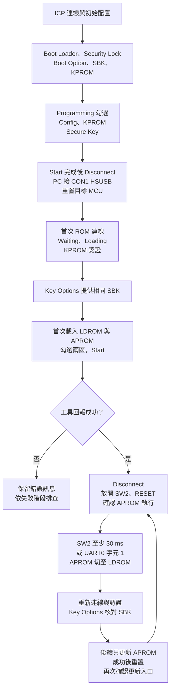

此圖對應 [專用 LDROM 範例](#ldrom-example)；後續 APROM 更新仍使用相同入口與 SecureBootTool。[SRAM 範例流程](#sram-operation) 不經過這個 LDROM 切換步驟。

[開啟完整尺寸的操作總覽圖](assets/diagrams/operation-overview.svg)。

## 3. ICP：CONFIG、Secure Boot key 與 KPROM

### 3.1 連線並開啟 Config Bits

1. 用 Nu-Link 連接目標 MCU，ICP 選擇對應 M480 型號並 Connect。
2. 確認 Part No. 為預期晶片。
3. 在 **Config Bits → Setting** 開啟 Chip Settings。

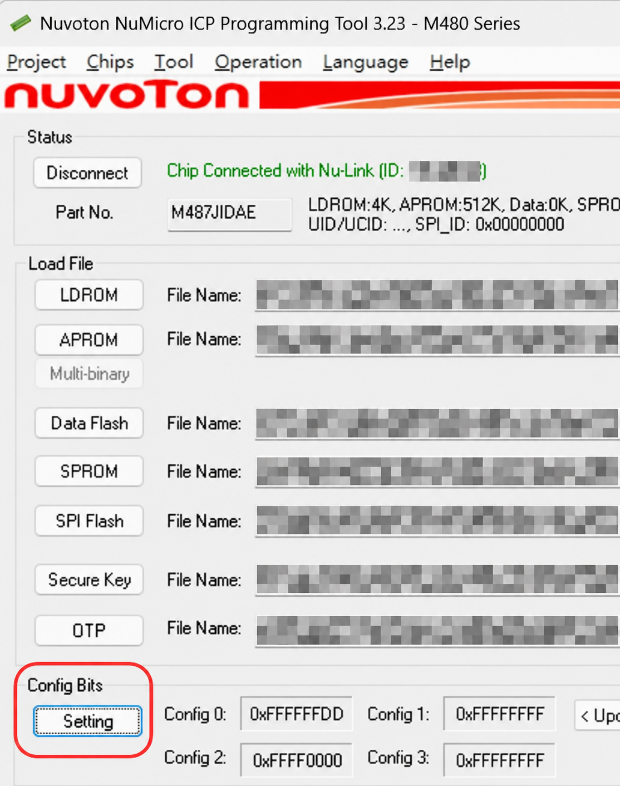

畫面中的韌體檔案欄位可能保留先前載入項目；實際寫入範圍由下方 Programming 勾選決定。

### 3.2 Boot Loader、Security Lock 與 Boot Option

1. 勾選 **Boot Loader**。
2. 勾選 **Security Lock**。
3. 選擇產品需要的 **Boot Option**；本已驗證範例的正常目的地為 **APROM**。
4. 確認後按 OK，回到 ICP 主畫面。

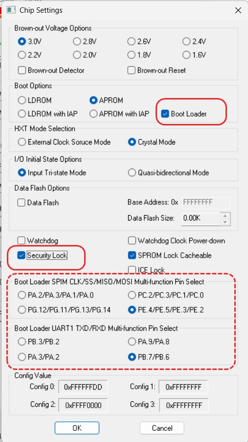

**ICP 3.23 介面行為：** 勾選 Boot Loader 後，工具會將 Secure Boot key 的寫入項目強制勾選並反灰，要求提供相關 key。Programming 中 Secure Key 為灰色勾選，仍代表該項目需要寫入。

Security Lock 與 Secure Boot 驗證的底層設定屬不同欄位。核對實際 CONFIG 與工具流程，才能確認完整安全配置。本範例的設定紀錄如下，僅適用此參考環境：

| 項目 | 參考值／意義 |
| --- | --- |
| CONFIG0 | `0xFFFFFFDD`；MBS=0、CBS=3，GUI 為 APROM＋Boot Loader |
| CONFIG2 | `0xFFFF0000`；SBLOCK=0，啟用此型號的 Secure Boot 驗證 |
| 正常開機目的地 | CONFIG0[7]=1；驗證後進入 APROM |
| IAP | 此 Mask ROM／Secure Boot 路徑會啟用 IAP；直接開機模式則須另核對 IAP 選項 |

Boot Option 可選 APROM、LDROM、APROM with IAP 或 LDROM with IAP；本頁兩份範例均以 APROM 為正常開機目的地。另需符合實際 IAP／安全保護條件；設定值不能跨型號直接套用。SRAM 範例會檢查 `CONFIG0[7]=1`，條件不符時回報 `-5`。

### 3.3 建立、匯出並載入 Secure Boot key

1. 開啟 **Tool → Create Secure Boot Key File (M480 Only)**。

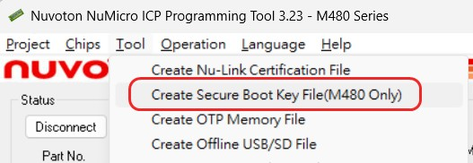

2. 使用專案既有 key，或於首次建立時按 **Generate** 產生 256-bit key。

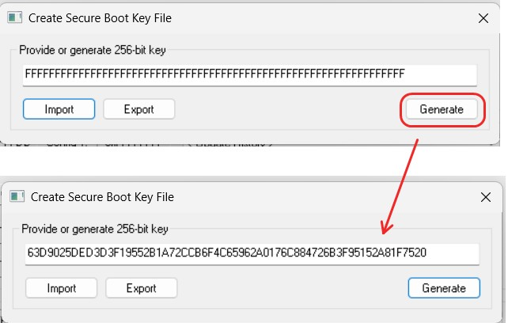

3. 按 **Export** 儲存 key BIN，例如 `secure_boot_key.bin`，並保管其對應產品／批次紀錄。

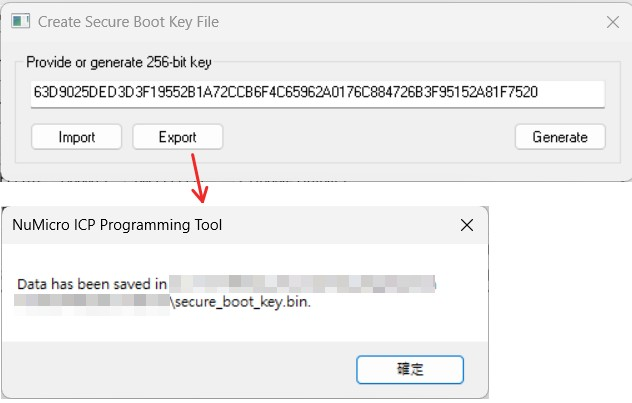

4. 回到 ICP 主畫面，按 **Secure Key** 載入該 key BIN。後續 SecureBootTool 的 Key Options 使用相同 SBK 內容。

已配置 SBK 的晶片後續更新沿用原 key；重新產生另一把 key 不會改變晶片中既有的 SBK。

### 3.4 填寫 KPROM key

1. 開啟 **KPROM Options**。
2. 依產品金鑰紀錄填入 **Key0、Key1、Key2**，三個欄位各為一個 32-bit word。
3. 依產品需求設定寫入保護範圍與錯誤認證次數限制。
4. 使用 Export 保管對應紀錄，再按 OK。後續認證視窗維持相同 word 順序。

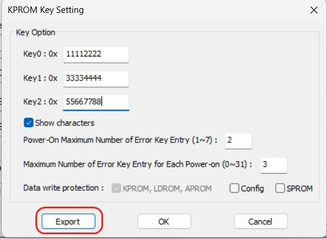

錯誤次數限制與保護範圍由產品決定；圖中數值屬範例配置，不是所有專案的固定要求。

### 3.5 勾選寫入項目並 Start

本參考流程由 ICP 寫入安全配置，再由 SecureBootTool 部署 LDROM／APROM：

| ICP Programming 項目 | 本次首次配置 |
| --- | --- |
| Config（Option Bytes／CONFIG） | 勾選 |
| KPROM | 勾選 |
| Secure Key | 勾選；此介面會因 Boot Loader 設定而強制勾選並反灰 |
| APROM、LDROM | 此階段不勾選；兩份韌體在 SecureBootTool 階段部署 |
| 其他記憶體區 | 依產品需求；本參考流程不更新 |

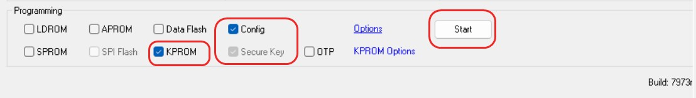

1. 核對已載入的 SBK、KPROM 設定及 Programming 勾選。
2. 按 **Start**，等待工具回報完成。
3. 按 **Disconnect**，結束 ICP 連線，再重置或重新上電，進入下一節。

**首次狀態條件：** 本流程以僅配置金鑰／CONFIG、APROM 與 LDROM 均空白的測試板開始，再由 SecureBootTool 部署映像。先單獨燒入 LDROM、APROM 仍空白的狀態，不在此首次連線條件內；已有韌體時，先確認其實際可用的更新入口。

### 3.6 安全鎖定後的 ICP 提示

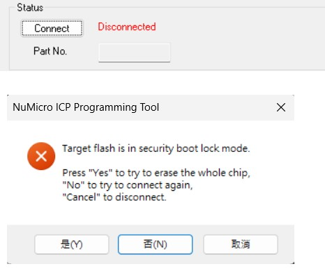

若 ICP 顯示 **Target flash is in security boot lock mode** 並詢問 whole-chip erase，代表這次 ICP 連線受到安全配置限制。維護既有產品時依核准的恢復程序處理；日常 Secure ISP 更新直接使用後續流程。整片擦除會涉及既有韌體與金鑰，不作為一般更新的連線步驟。

## 4. SecureBootTool：連線、認證與 Key Options

本節是首次部署與後續更新共用的連線流程。依目前狀態先使用 [首次入口](#first-programming) 或 [SW2 入口](#repeat-update)，再進行下列操作。

### 4.1 選 USB，依序等待 Waiting 與 Loading

1. 開啟 **`[0213 0921] SecureBootTool.exe`**。
2. Connection Interface 選 **USB**，按 **Connect**。
3. 等待工具取得 MCU HSUSB 裝置。此時按鈕顯示 Stop check，狀態為 **Waiting for usb connection ...**。

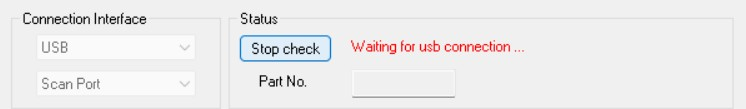

4. 取得裝置後會進入 **Loading ...**，等待通訊建立完成。

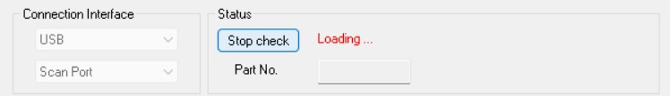

5. 接著狀態進入 **Verifying KPROM Key ...**，並顯示金鑰視窗。

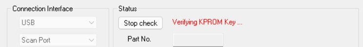

停在 Waiting 與已出現 KPROM 視窗是不同階段；處理方式見 [排查表](#troubleshooting)。

### 4.2 輸入 ICP 配置的 KPROM key

1. 在 **Input Key of KPROM to Unlock** 視窗，依 ICP 匯出紀錄填入 Key0、Key1、Key2。
2. 按 **OK**，等待驗證及晶片資訊讀取。

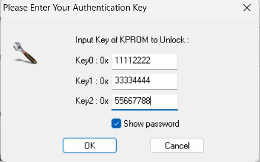

3. 確認狀態為 **Connected**，Part No. 與 APROM／LDROM 容量符合目標晶片。

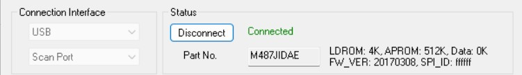

金鑰驗證失敗時，先核對原始紀錄與 word 順序；KPROM 可能配置錯誤次數限制，不使用猜測方式重試。

### 4.3 從 Key Options 提供同一把 Secure Boot key

1. 點 Programming 區的 **Key Options**。

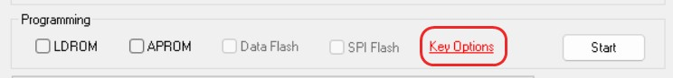

2. 在 **Provide 256-bit key** 欄位提供 ICP 寫入的相同 SBK 內容，與保管的 `secure_boot_key.bin` 對應。本教學截圖以可見的 key 內容示範對照。
3. 按 **OK**，回到主畫面。

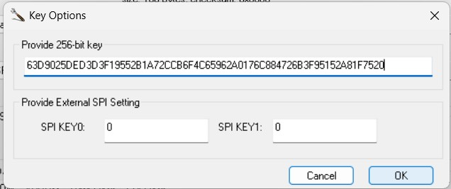

此工具介面使用 **Key Options**，Programming 列沒有獨立的 Signature 勾選框。SBK 由工具用於映像驗證資訊；KPROM 認證成功後仍須完成此項設定。

## 5. 首次部署：寫入專用 LDROM 入口與 APROM

**適用範例：** [M480BSP_ISP_HID_20_SecureBoot](#ldrom-example)。SRAM 範例依 [第 7 節](#sram-operation) 部署。

**前置條件：** 完成第 3 節的首次 ICP 配置，使用已確認可連線的空白 APROM／LDROM 基準。APROM 尚未執行，因此首次連線使用 ROM 入口，不需要 SW2。

1. 接妥 CON1，ICP Disconnect 後重置或重新上電。
2. 依 [第 4 節](#secure-tool-connection) 等待 Waiting → Loading → KPROM 視窗，完成認證及 Key Options。
3. 在 **Load File → LDROM** 載入含 BootIspLib wrapper、HSUSB 初始化及 ISR 轉接的專用入口 `SampleCode/LDROM/Keil/obj/secure_boot_loader.bin`。
4. 在 **Load File → APROM** 載入含 SW2／KEY1 入口的 `SampleCode/AP/Keil/obj/template.bin`。

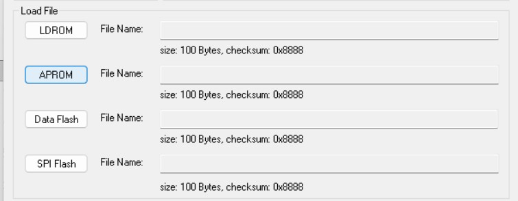

5. Programming **同時勾選 LDROM 與 APROM**；確認兩份映像均已載入，按 **Start**。
6. 等待工具明確回報成功，再 Disconnect。放開 SW2，按板上 RESET 或重新上電。
7. 確認 APROM 正常輸出 log，且可使用下一節的 SW2／KEY1 入口。

此 Load File 圖用於辨識欄位；實際檔案大小依建置產物而定。LDROM 使用本方案呼叫原廠 ROM API 的專用入口。

## 6. 後續更新：SW2／UART 進入、只更新 APROM

**適用範例：** [專用 LDROM 版](#ldrom-example)。SRAM 版的共用按鍵／terminal 設定見下表，執行切換與更新步驟見 [第 7 節](#sram-operation)。

**前置條件：** 專用 LDROM 入口與可運行的 APROM 已部署完成；目前及新版 APROM 均保留更新功能。

### SW2 與 KEY1：兩份範例共用的觸發方式

| 入口 | 操作 | 程式行為 |
| --- | --- | --- |
| SW2 | M487 PFM EVB 的 PG.15 按住至少 30 ms，進入後放開 | 消抖後由主迴圈處理更新要求 |
| KEY1（UART0 terminal） | PB.12 RX／PB.13 TX、115200、8-N-1，按數字 `1`（ASCII `0x31`） | UART ISR 呼叫 `SecureUpdate_Request()`，主迴圈執行切換 |

接線與 terminal 設定適用於兩份範例。KEY1 用於觸發與 log；接著在 SecureBootTool 選 **USB**，韌體經 CON1 HSUSB 傳輸，並依序完成 Loading、KPROM 認證與 Key Options。

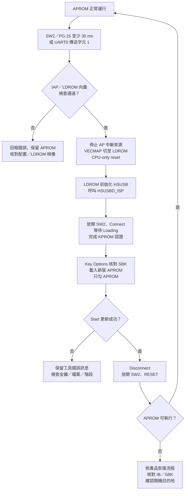

[開啟完整尺寸的 SW2 更新流程圖](assets/diagrams/repeat-update.svg)。

1. APROM 執行時，按住 **SW2（PG.15）至少 30 ms** 再放開，或用 **UART0 terminal，115200、8-N-1，傳送 ASCII `1`**。
2. UART ISR 只呼叫 `SecureUpdate_Request()`。主迴圈處理要求、檢查 IAP／向量、停止現有中斷來源，再以 VECMAP＋CPU-only reset 切至 LDROM。SW2 也使用相同的檢查與切換流程。
3. 使用 SecureBootTool Connect，完成 [認證與 Key Options](#secure-tool-connection)。
4. 載入新版 APROM。Programming **只勾 APROM**，保留既有 LDROM 入口，按 Start。

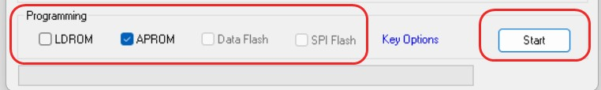

5. 等待 **Programming flash, OK** 及進度完成，再 Disconnect。

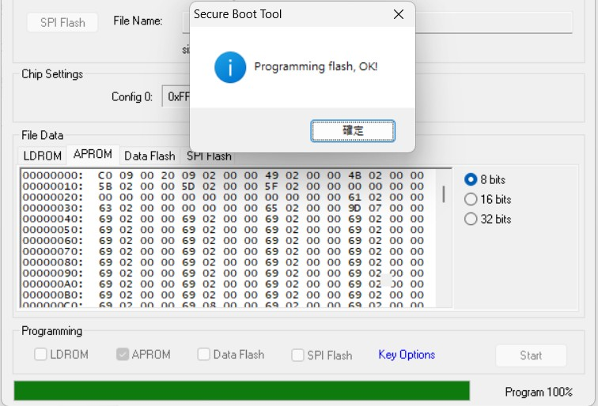

6. 放開 SW2，再 RESET 或重新上電，確認應用程式正常運行。

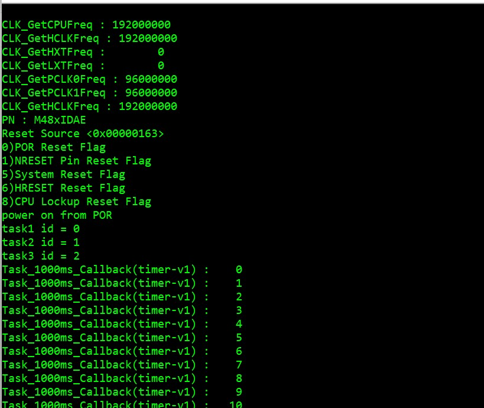

7. 再用 SW2 或 UART `1`、重新 Connect，確認仍能進入 KPROM 視窗，保有下一次更新入口。

本參考實作在 UART 回報 `-1` 時表示 IAP 條件不符，`-2` 表示 LDROM 初始 MSP／reset vector 不符合入口配置。此行為屬目前範例；移植到其他 APROM 時，需調整周邊停止、RTOS／DMA 及向量配置。

### 範例 APP 的更新入口

`M480BSP_ISP_HID_20_SecureBoot` 為專用 LDROM 方案。APP 加入 `secure_update.c/.h`，include `secure_update.h`，並連結所需的 FMC／BSP driver；APP 本身不直接呼叫 BootIspLib 的 ROM 更新 API。

| APP 修改位置 | 呼叫／設定 | 用途 |
| --- | --- | --- |
| include | `#include "secure_update.h"` | 使用更新要求介面 |
| 初始化 | `SecureUpdate_Init()` | 設定範例按鍵與要求狀態 |
| 按鍵、UART ISR 或通訊事件 | `SecureUpdate_Request()` | 只排入要求，由主迴圈處理更新切換 |
| main loop／privileged thread | `SecureUpdate_Poll(now_ms)` | 以毫秒 timestamp 輪詢並執行安全切換，處理負值錯誤碼 |
| linker 與 startup | 向量區、切換程式位置、IB 與 RAM 配置 | 確保重映射及更新期間執行位置有效 |

在相同 M487JIDAE、12 MHz HXT、CON1 及記憶體／啟動配置下，可重用此範例建置的 `secure_boot_loader.bin`，並在 APP 保留上述更新入口。

APP 移植的配置與停止條件：

- 保留第一個 512-byte 向量區，讓重映射後、CPU reset 前的切換指令位於該區之外。
- 保留 APROM IB，核對 LDROM 的 MSP／reset vector。
- 停止實際使用的 DMA、RTOS、watchdog、USB stack 及周邊；目前範例只處理自身的 Timer1、UART0、SysTick 與 NVIC。
- 每個後續 APROM 映像都保留初始化、輪詢與觸發入口。

### 驗證範圍

| 項目 | 目前證據 |
| --- | --- |
| ICP 配置 Boot Loader、Security Lock、KPROM、SBK；SecureBootTool 寫入 LDROM／APROM | 既有操作回報與指定工具畫面支持此流程 |
| KPROM 認證、Key Options、APROM-only 更新、重置運行、再次 SW2 連線 | 核心更新循環有實機測試回報；逐項覆蓋範圍以下列限制為準 |
| APROM／SRAM 範例 | 有實機測試回報；不代表所有入口、版本與故障情境均已涵蓋 |
| SW2 與 KEY1 個別入口、不同版本往返 | 程式提供兩種入口；目前回報未逐項列出所有入口／版本組合的測試紀錄 |
| LDROM／CONFIG 逐 byte 保留、不同映像反覆切換、斷電恢復 | 尚未驗證 |

出現 KPROM 視窗代表到達認證入口；工具回報寫入成功、重置後可執行及再次進入更新，分別是後續驗收步驟。

## 7. SRAM 範例：只更新 APROM

**適用範例：** [M480BSP_ISP_HID_20_SecureBoot_SRAM](#sram-example)。使用相同 ICP／金鑰配置與 SecureBootTool；更新入口的程式、向量及 stack 改由 SRAM 接管。此範例有實機測試回報；證據涵蓋範圍見[驗證範圍](#verification)。

### 7.1 載入 SRAM 版 APROM

1. 完成 [ICP 配置](#icp-setup)，確認正常目的地為 APROM、`CONFIG0[7]=1`，且具備本部署所需的 IAP 條件。金鑰沿用本裝置已配置的 KPROM／SBK。
2. 先使用板上已可用的 Secure ISP 入口連線；若目前執行專用 LDROM 範例，可依 [SW2／KEY1](#entry-triggers) 提出更新要求。首次空白狀態使用已確認可連線的 ROM 基準，不依賴尚未存在的 APP 按鍵入口。
3. 接妥 CON1 HSUSB，依 [第 4 節](#secure-tool-connection) 完成 Loading、KPROM 認證與 Key Options，提供同一把 SBK。
4. Load File → APROM 選擇 SRAM 範例的 **`SampleCode/AP/Keil/obj/secure_boot_sram.bin`**。Programming **只勾 APROM**；此步不部署 LDROM，也不改 CONFIG／金鑰。
5. 按 Start，等待工具明確回報 **Programming flash, OK**。Disconnect，放開 SW2，再按板上 RESET 或重新上電。
6. 確認 UART 出現 **`Secure update SRAM`** 提示及應用程式輸出，表示目前執行 SRAM 版 APROM。

### 7.2 觸發 Secure Bootloader 並再次更新

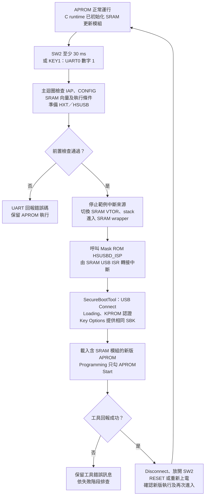

[開啟完整尺寸的 SRAM 更新流程圖](assets/diagrams/sram-update.svg)。

1. SRAM 版 APROM 正常運行時，用 [SW2 或 KEY1](#entry-triggers) 提出要求。主迴圈先檢查配置並準備 HSUSB，再切換 SRAM 向量、wrapper、USB ISR 與 stack。
2. 用 SecureBootTool USB Connect，完成 [Loading／KPROM／Key Options](#secure-tool-connection)。APP 的一般 log 會在交接後停止，後續狀態以工具畫面觀察。
3. 載入**同樣包含 SRAM 更新模組及觸發入口**的新版 APROM，Programming **只勾 APROM**，按 Start。
4. 等工具回報成功後 Disconnect，放開 SW2，以 RESET 或重新上電回到 Mask ROM 開機驗證，再確認新版 APROM 輸出。
5. 分別使用 SW2、KEY1 再次連線，確認新版仍保留更新入口。只重寫同一檔案不等於已驗證不同版本切換，版本往返與故障恢復需另留紀錄。

### 7.3 SRAM 入口的配置與錯誤處理

- 初始化與交接：SRAM 更新模組由 APROM 的載入映像初始化；更新開始後不返回被替換的 APROM。
- ROM 服務：`BootIspLib_Keil.lib` 提供 ROM API wrapper，完整安全更新引擎仍在 Mask ROM。
- 記憶體：模組避開 ROM 使用的 `0x2000C000..0x2000FFFF` 工作區，一般 APP RAM 由 `0x20010000` 起配置。

| UART 錯誤碼 | 核對項目 |
| --- | --- |
| `-1` | IAP／開機條件 |
| `-2` | SRAM 向量、初始堆疊及 scatter 載入配置 |
| `-3` | 實際切換須在 privileged main loop／thread，ISR 僅排入要求 |
| `-4` | 12 MHz HXT 與 192 MHz clock／HSUSB 準備 |
| `-5` | CONFIG 讀取結果及正常 APROM 目的地（`CONFIG0[7]=1`） |

- 入口條件：APP 仍需能執行更新要求與主迴圈；SW2／KEY1 不提供對已卡死 APP 的獨立救援保證。
- IB 配置：位於 APROM 最後 144 bytes（`0x0007FF70..0x0007FFFF`）；其儲存位置與驗證區域分別核對。
- LDROM 驗證範圍：不依賴 LDROM 執行，不代表實際 IB 一定未驗證 LDROM。
- 寫入範圍：日常更新不另寫 LDROM 檔案。

## 8. 依狀態排查連線與更新

| 現象 | 所在階段 | 核對項目與處理方向 |
| --- | --- | --- |
| Waiting for usb connection，尚無 key 視窗 | USB 裝置／入口 | CON1 資料線、供電、ICP Disconnect、debug halt；依範例核對目前是否已切至專用 LDROM 或 SRAM／ROM 更新入口 |
| Loading 後未繼續 | 通訊建立 | 工具版本、裝置是否重置或被占用；保留完整狀態與 Windows 裝置資訊 |
| Verifying KPROM Key，已出現視窗 | 認證入口已到達 | 輸入對應 Key0／Key1／Key2；尚未代表認證成功 |
| KPROM 驗證錯誤 | 金鑰／保護設定 | 核對原始紀錄及順序，留意錯誤次數限制；不以 SBK 代替 |
| Connected，Start 失敗 | 寫入／驗證資訊 | 目標區、BIN、Key Options 的 SBK、保護範圍及完整錯誤訊息 |
| Programming OK，重置後未執行 APROM | 開機／驗證 | 正常目的地、IB、SBK、映像與向量；依產品恢復流程處理 |
| 更新後 APROM 正常，但 SW2／KEY1 無反應 | 軟體入口 | 新版是否保留對應入口與更新模組；核對按鍵消抖、UART 設定、主迴圈／工作執行緒及前置檢查錯誤碼 |
| 僅寫 LDROM、APROM 空白時無法連線 | 首次映像與配置組合 | 與已可連線的空白基準比對；IB／開機目的地是調查方向，根因未經 IB 讀回證實 |

錯誤紀錄保留工具版本、晶片型號、失敗階段、CONFIG／部署範圍與完整訊息。實際產品的金鑰內容不列入一般診斷資料。

## 9. 操作指南的驗收項目

| 流程 | 可觀察的完成條件 |
| --- | --- |
| ICP 首次配置 | 正確型號；CONFIG、KPROM、Secure Key 完成，保存對應部署紀錄 |
| SecureBootTool 連線 | Loading 完成，KPROM 認證通過，Connected 與晶片資訊正確 |
| 韌體更新 | 正確 SBK、映像與目標區；工具明確回報成功 |
| 更新後啟動 | 重置後進入預期開機流程，APROM 執行，原有功能可用 |
| 再次更新 | 新版仍可進入 Secure ISP；不同版本循環更新可重現 |
| SRAM 範例 | 執行 SRAM 版 APROM，SW2／KEY1 能提出更新要求；工具只更新含相同 SRAM 模組的 APROM，重置後可再次進入 |
| 故障恢復 | APROM 空白／卡死與斷電中斷，均有經測試的對應處理流程 |

依實際部署的更新入口、Boot Option、目標區、映像檔與恢復方式，逐項核對上表結果。每個發佈的 APROM 映像都應保留相應更新入口，並驗證更新後仍可再次連線。

## 參考依據

- [Nuvoton Secure Boot 解決方案](https://www.nuvoton.com.cn/support/technical-support/technical-articles/TSNuvotonTechBlog-000086/?_t=20732)：Secure Boot、映像驗證與授權更新的關係。
- [M480 Trust Boot：每次開機驗證程式](https://www.nuvoton.com.cn/support/technical-support/technical-articles/TSNuvotonTechBlog-000124/?_t=20736)：M480 的保護區驗證與 Secure ISP 更新。

- 使用者提供的 ICP／SecureBootTool 操作截圖與硬體回報；範例使用的 Boot Loader／Secure Key 強制勾選行為依此版本介面記錄。
- [Nuvoton AN0039：M480 Secure Bootloader](https://www.nuvoton.com/resource-files/AN_0039_M480_SecureBootloader_TC_Rev1.00.pdf)：第 5～9 頁的 ROM／RAM、IB 與金鑰；第 10～14 頁的 API 與使用範例。其其他版本工具畫面需與本頁 Key Options 介面區分。
- [Nuvoton ICP Programmer User Guide Rev2.06](https://www.nuvoton.com/resource-files/UM_ICP_Programming_Tool_EN_Rev2.06.pdf)：8.2.3 KPROM、8.2.4 Secure Boot Key 與 IB Programming。
- [Nuvoton M480 TRM Rev2.02](https://www.nuvoton.com/export/resource-files/TRM_M480_Series_EN_Rev2.02.pdf)：Boot Selection、IAP 與 FMC flash 配置；具體條件依完整晶片型號核對。
- Nuvoton BSP 的 `SampleCode/SecureBoot/HSUSBD_IAP`、`HSUSBD_FWUpdate` 與 `Library/FWUpdate/BootIspLib.h`；本參考採 Mask ROM API 路徑。
- `M480_SecureBoot_Demo.pdf` 第 11～14 頁：連線階段、KPROM 認證及 Key Options；`NUMAKER-PFM-M487_V3_0.pdf` 第 2～3 頁：SW2／PG.15、12 MHz HXT 與 CON1 HSUSB。
