[主題索引](index.html) · [知識庫總索引](https://released.github.io/)

# 建置與中斷設定

<!-- CHAPTER_SCOPE -->
建置與中斷設定 整理設定位置、操作畫面與對應程式／文件連結。

- 圖中型號、clock、pin、位址與工具介面屬於各參考工程的條件，不延伸為所有型號的固定配置。
- 實際設定與結果以所選 MCU 手冊、工程設定、linker map 及量測為準；原始文件與範例連結保留在各節。


---

<a id="add-root-path-in-path-edit"></a>

## Add root path in Path Edit


<span style="color:#FF0000">
After generate driver code , compile project under CS+ , if meet compile error (not open iodefine.h) , save and close CS+ project and re-open<br><br>
</span>

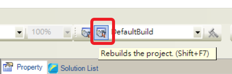

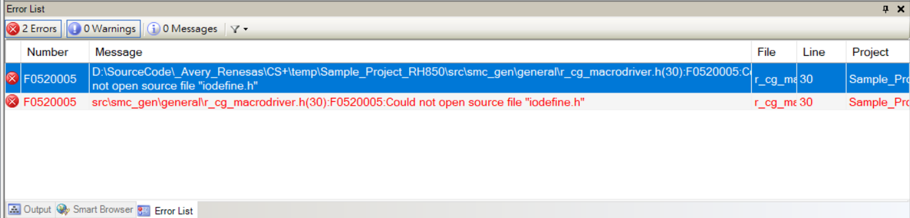


<span style="color:#FF0000">
Check CC-RH (Build Tool) > Common Options > Additional include paths , make sure already include the new add driver path (ex : TAUJ0_0 )<br><br>
</span>

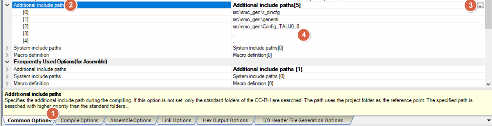


<span style="color:#FF0000">
add root path under project to fix compile error issue<br><br>
</span>

```
.\
.
```

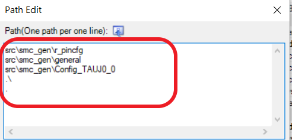


<u>RH850 Smart Configurator User's Guide: CS+</u>
[back to top](index.html#article_top)    

---

<a id="add-main-loop"></a>

## Add main loop

<span style="color:#FF0000">
Need to manual add main loop , ex : <br><br>
</span>

```
while(1)
{
}
```

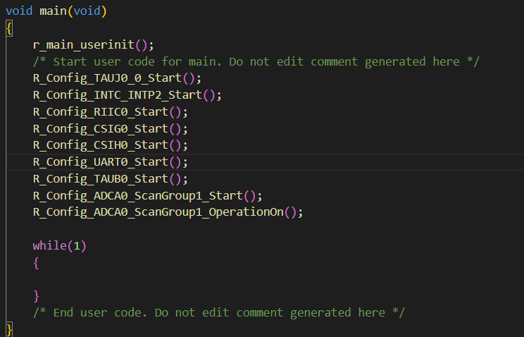

<u>RH850 Smart Configurator User's Guide: CS+</u>
[back to top](index.html#article_top)    

---

<span style="color:#FF0000">
If not add while loop under main code , program will <b>stop</b> at exit in csstart.asm<br><br>
</span> 

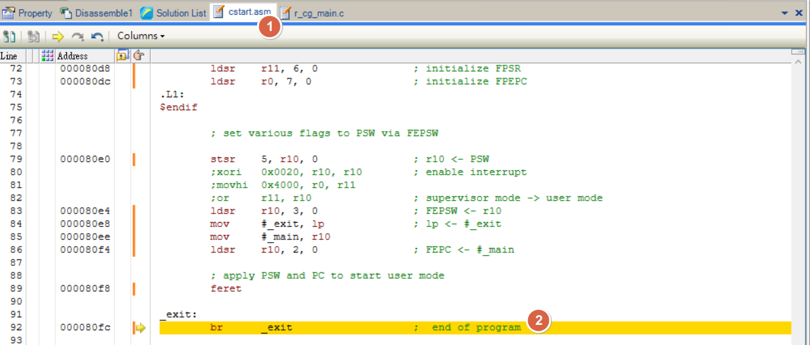


<u>RH850 Smart Configurator User's Guide: CS+</u>
[back to top](index.html#article_top)    

---

<a id="to-fix-interrupt-not-work-issue"></a>

## 中斷設定與觸發條件

<span style="color:#FF0000">
Remove [ ; ] , to enable table reference method<br><br>
</span>

```
USE_TABLE_REFERENCE_METHOD .set 1
```

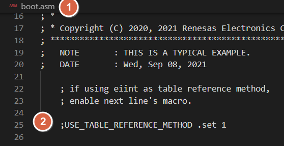


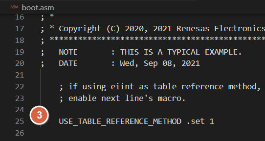

<u>RH850 Smart Configurator User's Guide: CS+</u>
[back to top](index.html#article_top)    

---

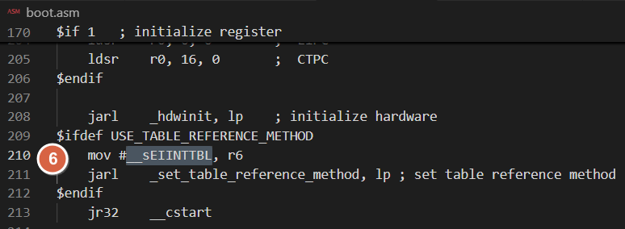

<span style="color:#FF0000">
Add [ .const ]<br><br>   
</span>

```
mov #__sEIINTTBL.const , r6 
```

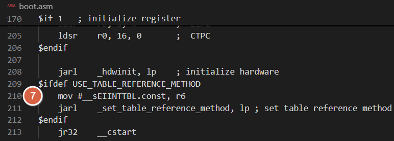

<u>RH850 Smart Configurator User's Guide: CS+</u>
[back to top](index.html#article_top)    

---

<span style="color:#FF0000">
Add [ ; ] , to disable default interrupt<br><br> 
</span>

```
;.section "EIINTTBL", const
;.align 512
;.dw #_Dummy_EI ; INT0
;.dw #_Dummy_EI ; INT1
;.dw #_Dummy_EI ; INT2
;.rept 512 - 3
;.dw #_Dummy_EI ; INTn
;.endm
```

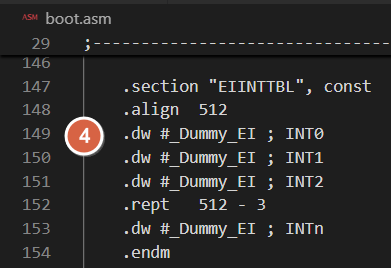

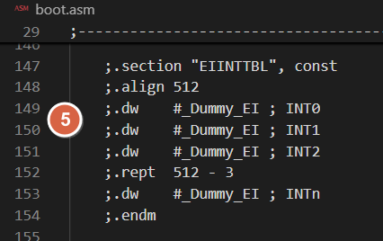

<u>RH850 Smart Configurator User's Guide: CS+</u>
[back to top](index.html#article_top)    

---


<span style="color:#FF0000">
Open [<b>Section</b>] modify under [<b>Link Options</b>] in [<b>CC-RH Property</b>]<br><br>
</span>

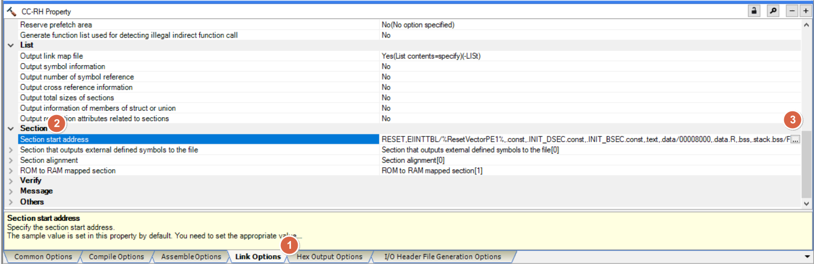

<u>RH850 Smart Configurator User's Guide: CS+</u>
[back to top](index.html#article_top)    

---

<span style="color:#FF0000">
REMOVE [<b>EIINTTBL</b>] in Section Settings<br>

1. Select [on Section : EIINTTBL]<br>

2. Select [Remove]<br>

</span>

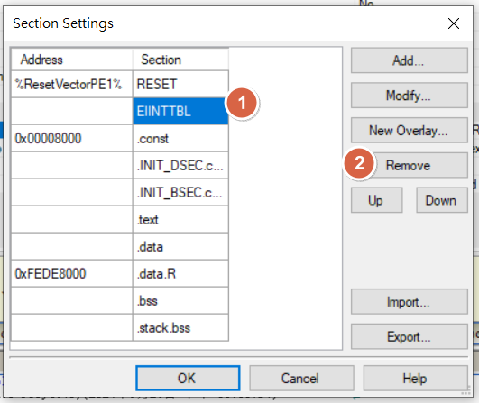


<span style="color:#FF0000">
ADD [address 0x200] in Section Settings<br>

1. Select on [blank in Address]<br>

2. Select [Add]<br>

3. Key in [200]<br><br>

</span>

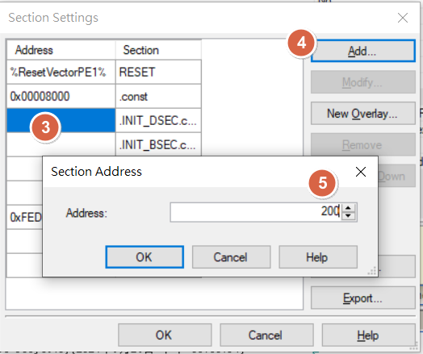


<span style="color:#FF0000">
ADD [<b>EIINTTBL.const</b>] in Section Settings<br>

1. Select on [blank in Section] (addr : 0x200)<br> 

2. Select [Add]<br>

3. Key in [EIINTTBL.const]<br><br>

</span>

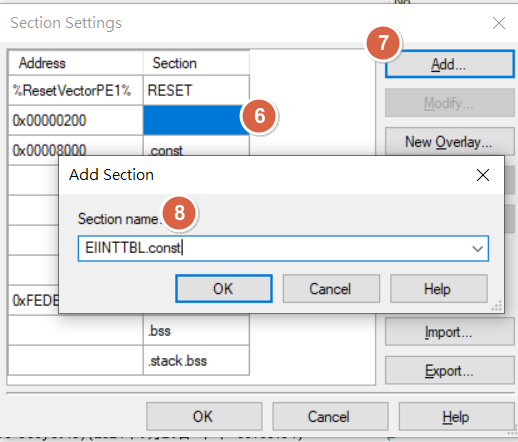


<span style="color:#FF0000">
Final section table result<br><br>
</span>

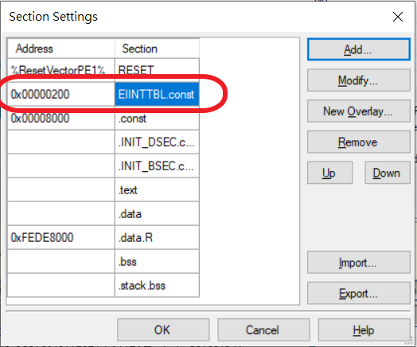


section : 0x200 in map file , must be reserved (SECTION:RESET)

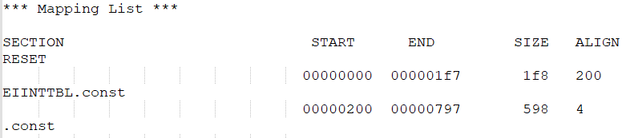

[reference link](https://community.renesas.com/cfs-file/__key/communityserver-discussions-components-files/259/8867.Interrupt--setting.pdf)

<u>RH850 Smart Configurator User's Guide: CS+</u>
[back to top](index.html#article_top)    

---

* __Another method__ 

<span style="color:#FF0000">
Add [ ; ] , to disable default interrupt<br><br> 
</span>

```
.section "EIINTTBL", const
.align 512
;.dw #_Dummy_EI ; INT0
;.dw #_Dummy_EI ; INT1
;.dw #_Dummy_EI ; INT2
;.rept 512 - 3
;.dw #_Dummy_EI ; INTn
;.endm
```

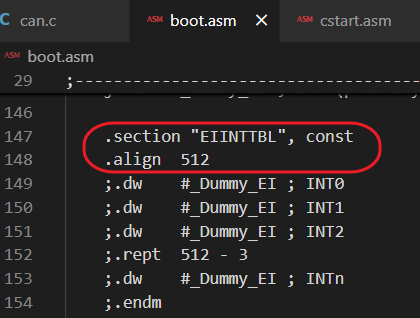

<span style="color:#FF0000">
Open [<b>Section</b>] modify under [<b>Link Options</b>] in [<b>CC-RH Property</b>]<br><br>
</span>

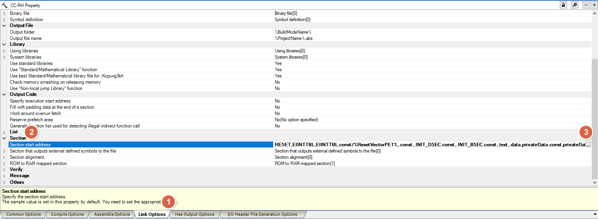

<span style="color:#FF0000">
ADD [<b>EIINTTBL.const</b>] in Section Settings<br>

1. Select on [blank in Section]<br>

2. Select [Add]<br>

3. Key in [EIINTTBL.const]<br><br>

</span>

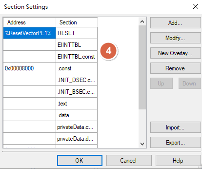


section : 0x200 in map file , must be reserved (SECTION:RESET)

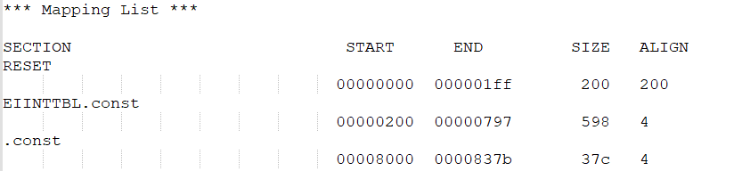

[reference link](https://blog.csdn.net/laifengyuan1/article/details/125165618)

<u>RH850 Smart Configurator User's Guide: CS+</u>
[back to top](index.html#article_top)    

[主題索引](index.html) · [上一主題](flash-can.html) · [下一主題](debug.html)
