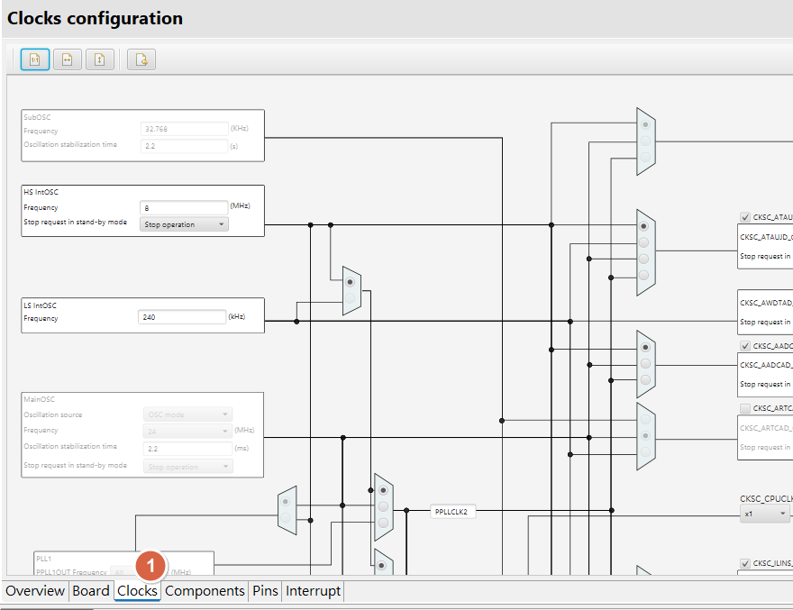
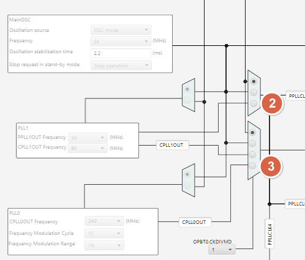
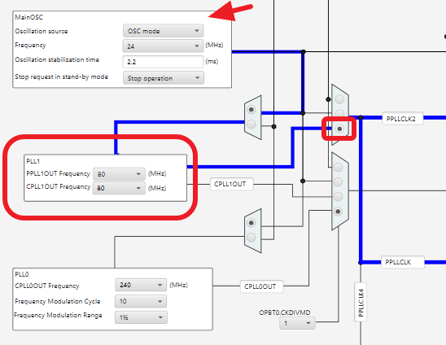
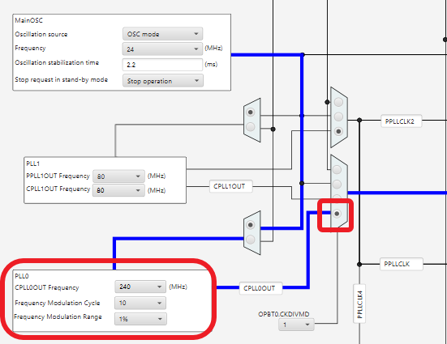
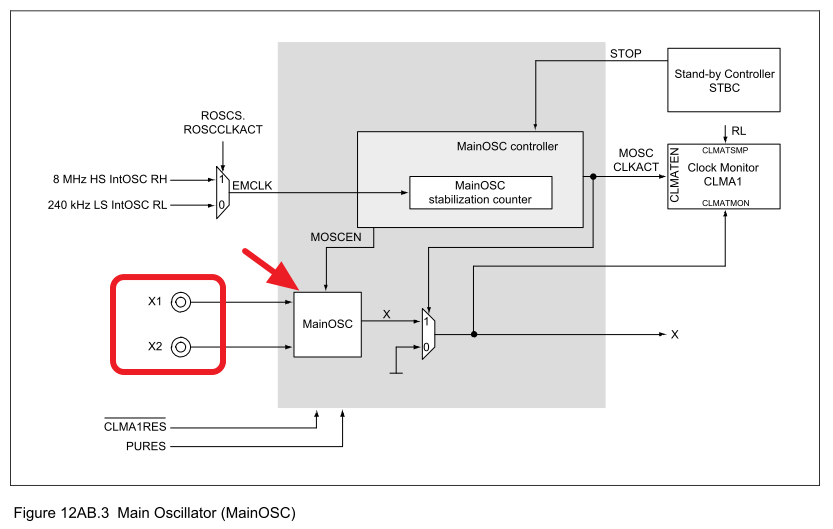
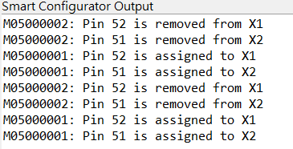
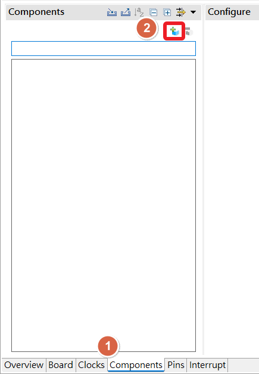
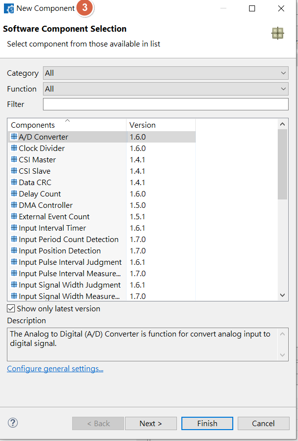

[主題索引](index.html) · [知識庫總索引](https://released.github.io/)

# 時脈與元件

<!-- CHAPTER_SCOPE -->
時脈與元件 整理設定位置、操作畫面與對應程式／文件連結。

- 圖中型號、clock、pin、位址與工具介面屬於各參考工程的條件，不延伸為所有型號的固定配置。
- 實際設定與結果以所選 MCU 手冊、工程設定、linker map 及量測為準；原始文件與範例連結保留在各節。

---

## Smart Configurator：Clock

Select clock for PLL0 , PLL1   

<u>RH850 Smart Configurator User's Guide: CS+</u>
[back to top](index.html#article_top)    

---

use MainOSC (external osc) will enable X1 , X2 pin  
 

<u>RH850 Smart Configurator User's Guide: CS+</u>
[back to top](index.html#article_top)    

---

## Smart Configurator：add component

<u>RH850 Smart Configurator User's Guide: CS+</u>
[back to top](index.html#article_top)    

[主題索引](index.html) · [上一主題](tools.html) · [下一主題](timer.html)
