[主題索引](index.html) · [知識庫總索引](https://released.github.io/)

# 燒錄、除錯與記憶體配置

<!-- CHAPTER_SCOPE -->
燒錄、除錯與記憶體配置 整理設定位置、操作畫面與對應程式／文件連結。

- 圖中型號、clock、pin、位址與工具介面屬於各參考工程的條件，不延伸為所有型號的固定配置。
- 實際設定與結果以所選 MCU 手冊、工程設定、linker map 及量測為準；原始文件與範例連結保留在各節。


---

<a id="cs---entry-debug-mode"></a>

## CS+：entry debug mode


<span style="color:#FF0000">
Make sure <u><b>[DISCONNECT]</b></u> CS+ project before REMOVE DEBUGGER tool <br><br>
</span> 

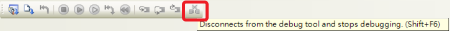

download program after rebuild
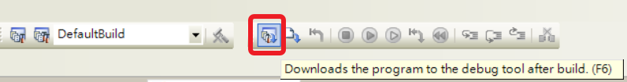


debug function
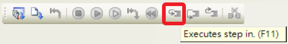
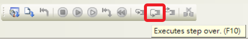
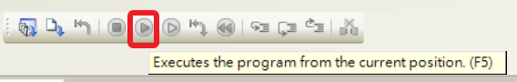
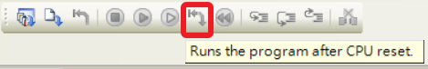

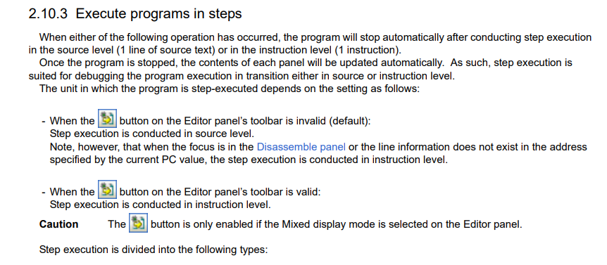


<u>Integrated Development Environment User's Manual: RH850 Debug Tool</u>
[back to top](index.html#article_top)    

---

<a id="renesas-flash-programmer-2"></a>

## Renesas Flash Programmer

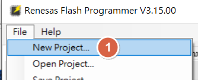

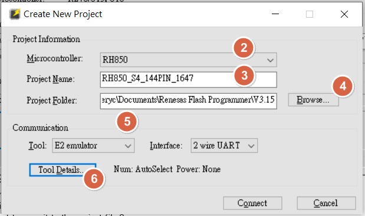

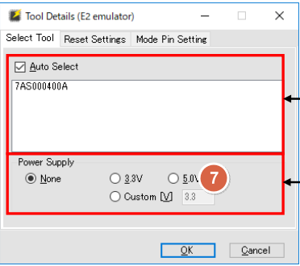

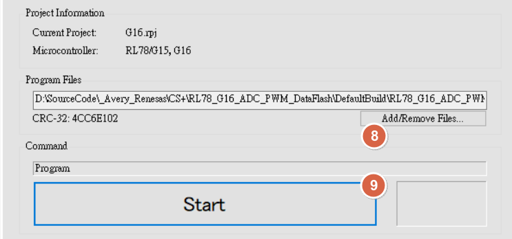

<u>Renesas Flash Programmer V*.** Flash memory programming softwareUser's Manual </u>
[back to top](index.html#article_top)   

---

<a id="article_tips"></a>

## Convert to Hex


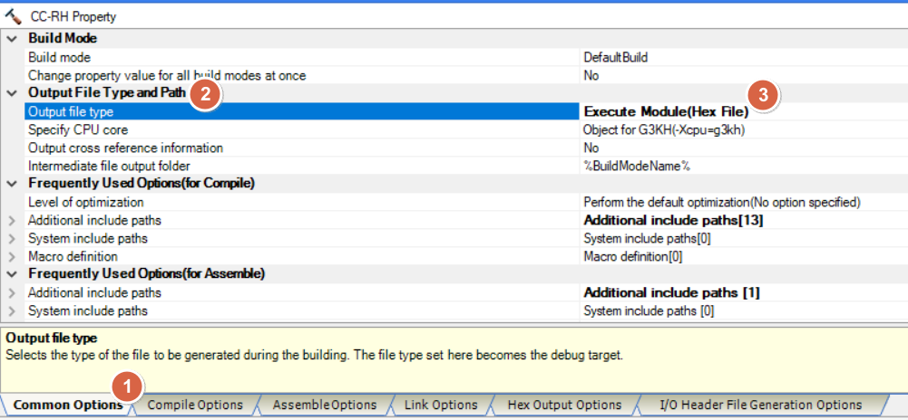

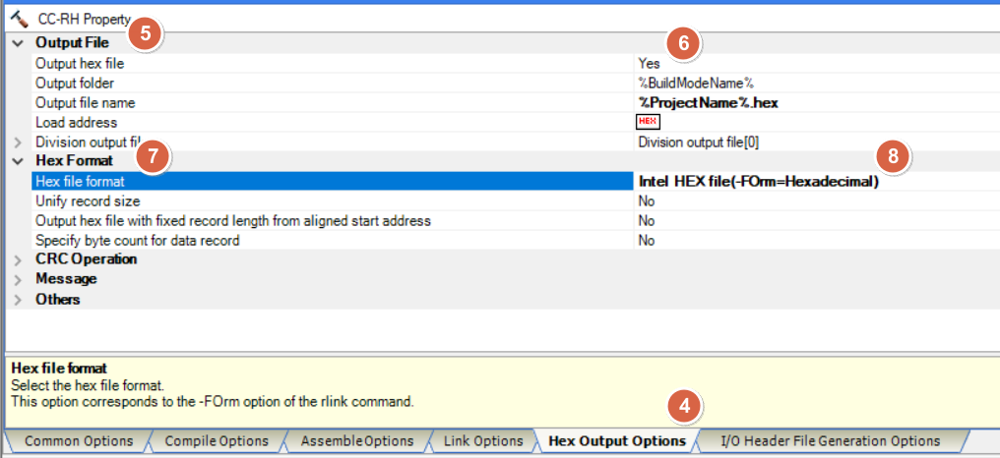


---

<a id="tips-emulator-power-on-mcu"></a>

## Emulator power on MCU

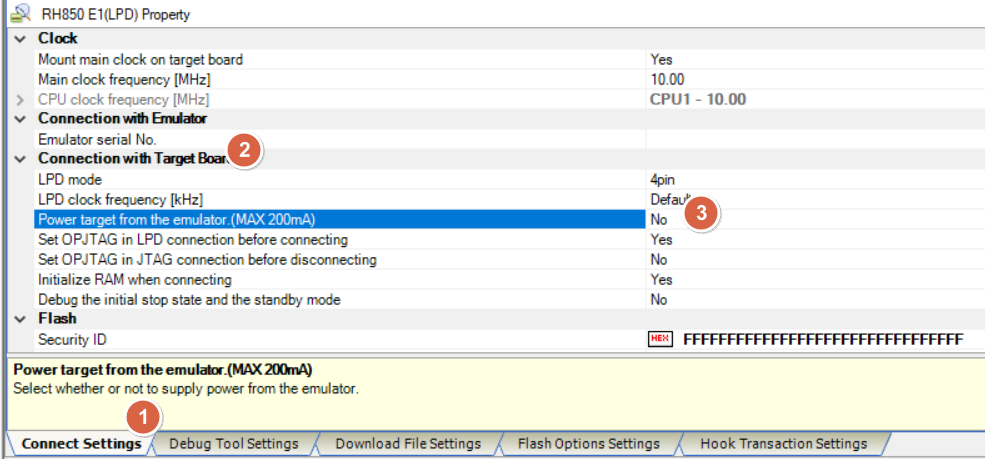

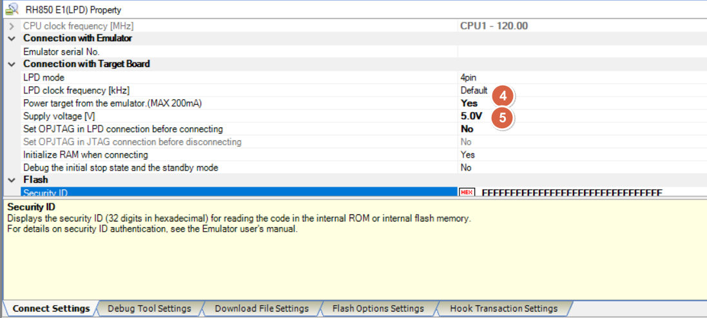


---

<a id="tips-set-clock-f1km-s1"></a>

## Set CLOCK (F1KM-S1)

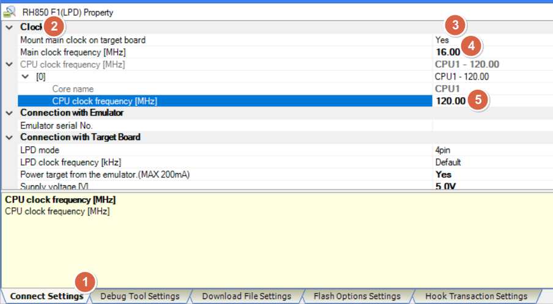

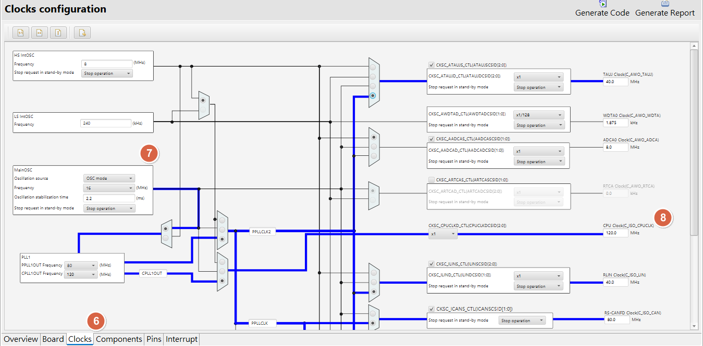


---

<a id="tips-map-file-display"></a>

## map file display


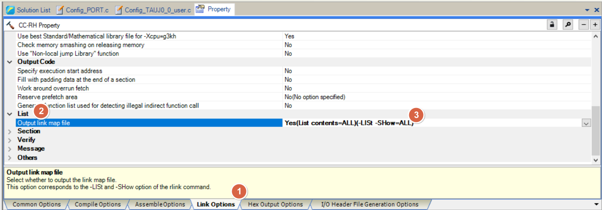

<span style="color:#FF0000">
Function address<br>
size display<br>
location assignment<br>
Code size <br>
RAM size display<br><br>
</span>

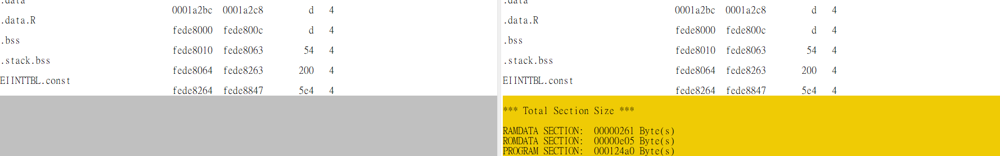


---

<a id="tips-section-message-display"></a>

## section message display

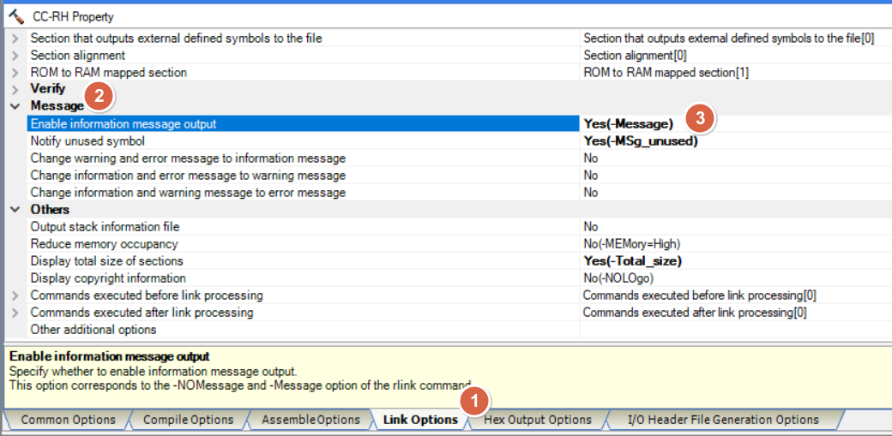

Display section message

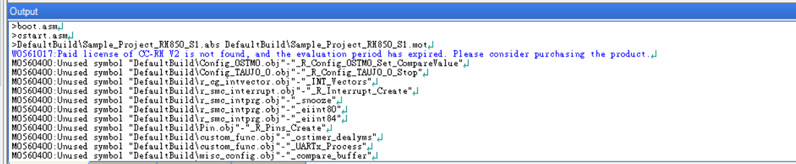


---

<a id="tips-size-display-display-in-output-window"></a>

## size display display in output window

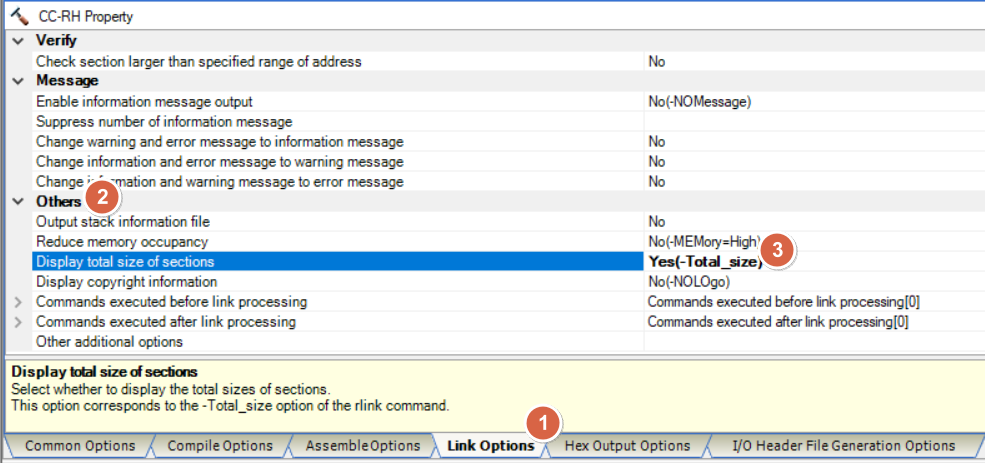


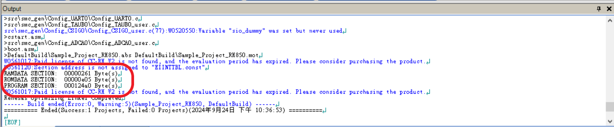


---

<a id="tips-backup-times-generate-code"></a>

## Backup times (generate code)

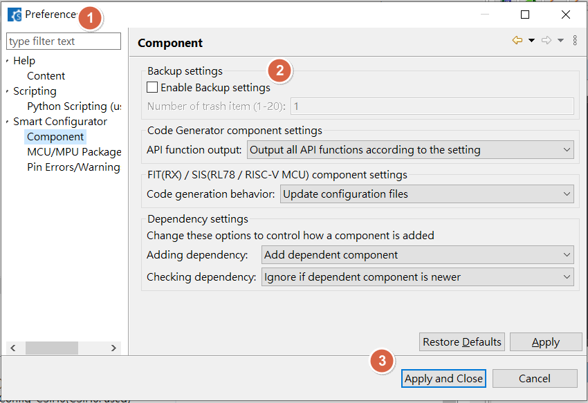


---

<a id="tips-section-define-modify"></a>

## section define modify

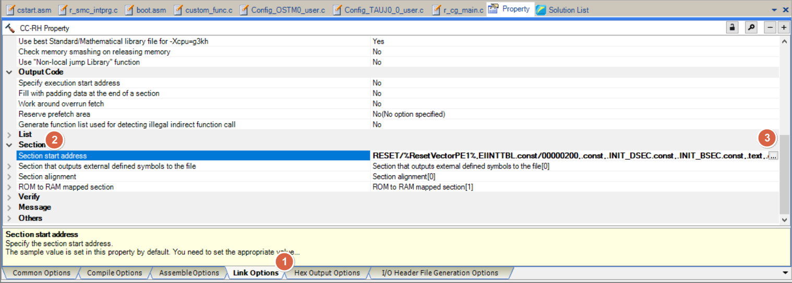

<u>CC-RH Compiler User's Manual</u>
[back to top](index.html#article_top)    

---

<a id="tips-section-define-const"></a>

## section define (const)


<span style="color:#FF0000">
ADD [<b>privateData.const</b>] in Section Settings<br>

1. Select on [.data] in Section<br>

2. Select [Add]<br>

3. Key in [<b>privateData.const</b>] <br><br>

</span>  

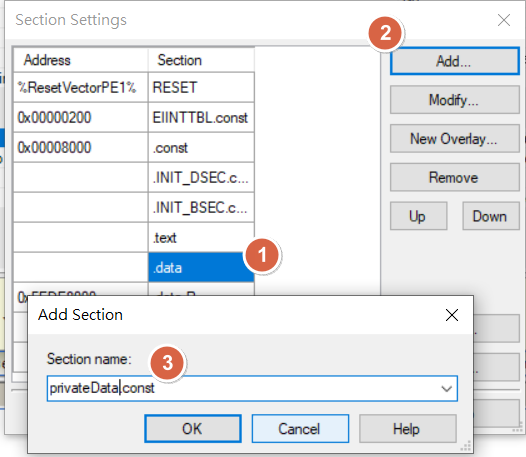


| item | note |
|:--:|:--:|
| data  | variables with initial value  |
| bss  | variables with no initial value  |
| text  | program code  |
|<span style="color:#FF0000"><b>const</b></span>   | <span style="color:#FF0000"><b>constant data</b></span>  |

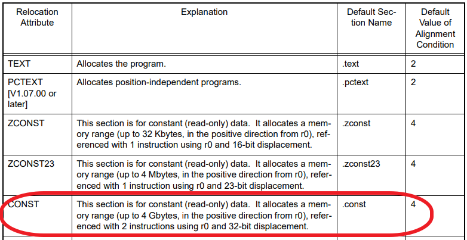

Code assignment example
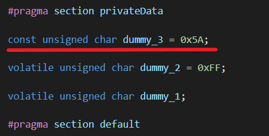

<u>CC-RH Compiler User's Manual</u>
[back to top](index.html#article_top)    

---

<a id="tips-section-define-data"></a>

## section define (data)

<span style="color:#FF0000">
ADD [<b>privateData.data</b>] in Section Settings<br>

1. Select on [.data] in Section<br>

2. Select [Add]<br>

3. Key in [<b>privateData.data</b>] <br><br>

</span>

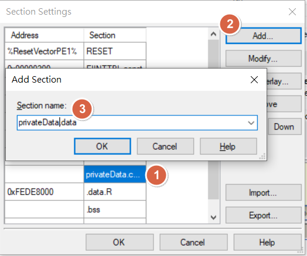


| item | note |
|:--:|:--:|
| <span style="color:#FF0000"><b>data</b></span>  | <span style="color:#FF0000"><b>variables with initial value</b></span>  |
| bss  | variables with no initial value  |
| text  | program code  |
|const   | constant data  |


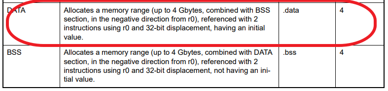

Code assignment example
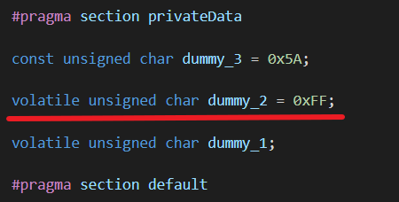


<u>CC-RH Compiler User's Manual</u>
[back to top](index.html#article_top)    

---

<a id="tips-section-define-bss"></a>

## section define (bss)

<span style="color:#FF0000">
ADD [<b>privateData.bss</b>] in Section Settings<br>

1. Select on [.bss] in Section<br>

2. Select [Add]<br>

3. Key in [<b>privateData.bss</b>] <br><br>

</span>

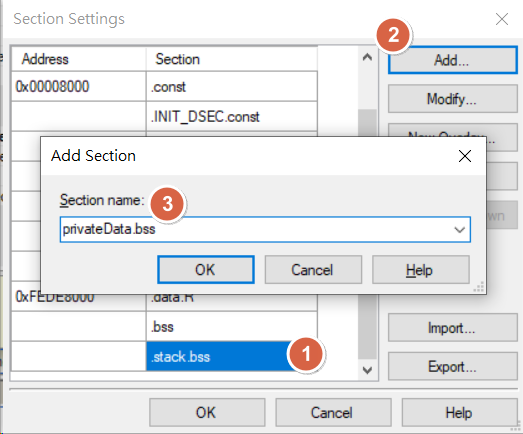


| item | note |
|:--:|:--:|
| data  | variables with initial value  |
| <span style="color:#FF0000"><b>bss</b></span>  | <span style="color:#FF0000"><b>variables with no initial value</b></span>  |
| text  | program code  |
|const   | constant data  |

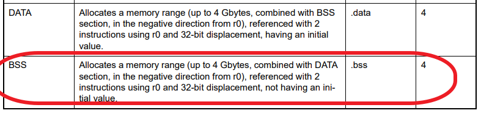

Code assignment example


<u>CC-RH Compiler User's Manual</u>
[back to top](index.html#article_top)    

---

<a id="tips-section-define-not-assigned-address"></a>

## section define (not assigned address)

<span style="color:#FF0000">
New add custom define section as below <br>
Also able to define the address base on application<br><br>
</span>


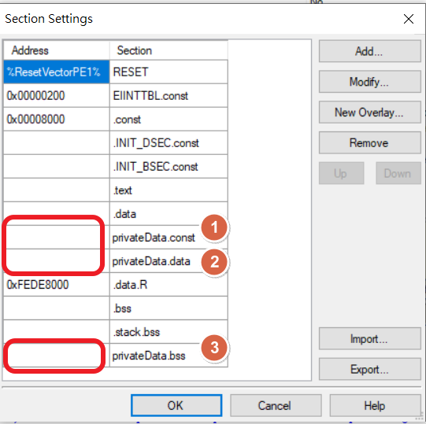

Code assignment example
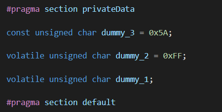

check the address in map file
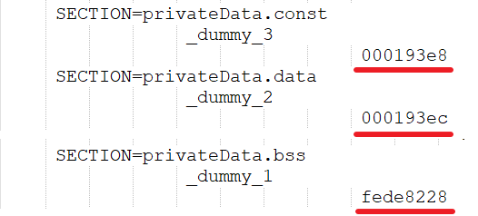


<u>CC-RH Compiler User's Manual</u>
[back to top](index.html#article_top)    

---

<a id="tips-section-define-assigned-address"></a>

## section define (assigned address)

<span style="color:#FF0000">
New add custom define section as the capture<br>
Also able to define the address base on application<br><br>
</span>

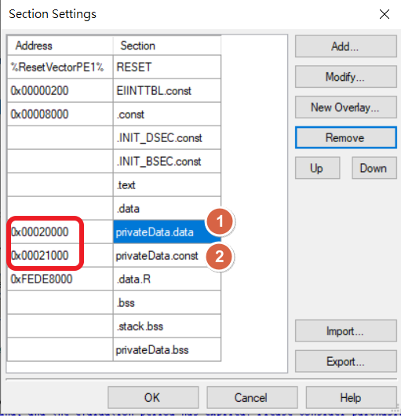

Code assignment example


check the address in map file
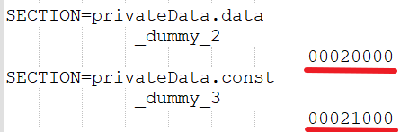

<u>CC-RH Compiler User's Manual</u>
[back to top](index.html#article_top)    

---

<a id="tips-section-allocation-size"></a>

## section allocation , size

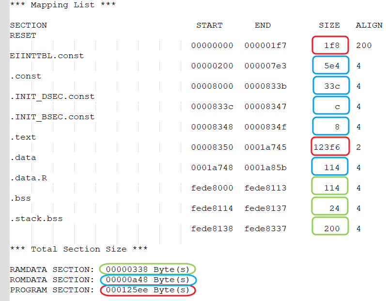

<u>CC-RH Compiler User's Manual</u>
[back to top](index.html#article_top)

---

<a id="tips-project-split"></a>

## project split


<span style="color:#FF0000">
Use [<b> Build Mode Setting </b>] , to split different macro in different project setting if necessary<br><br>
</span>

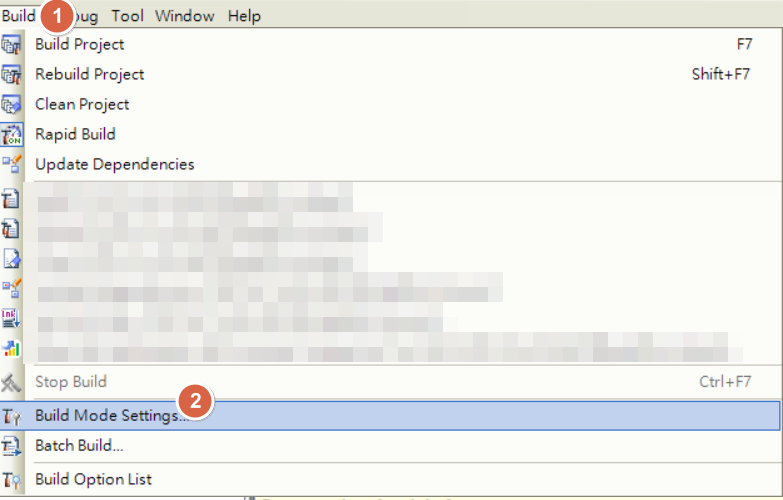

Project split example , modify the projec name
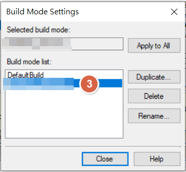

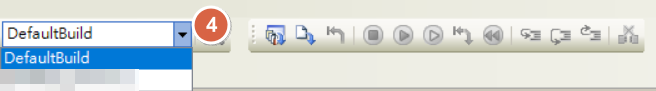

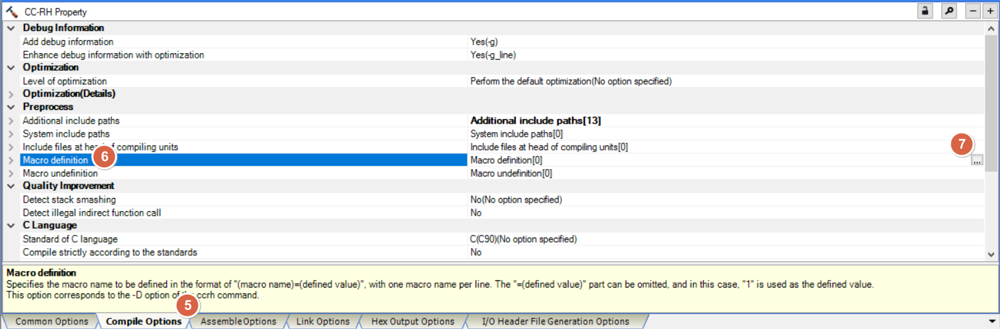

Add the macro define for extra project 
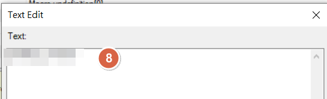

<u>CC-RH Compiler User's Manual</u>
[back to top](index.html#article_top)    

---

<a id="tips-add-global-variable-into-watch-window-with-real-time-update"></a>

## add global variable into watch window with real time update

[display value real time under watch windows](https://en-support.renesas.com/knowledgeBase/16979169)

<span style="color:#FF0000">
enable [<b>Access during the execution</b>] at Debugger Property > Debug Tool Settings tab<br>
</span>

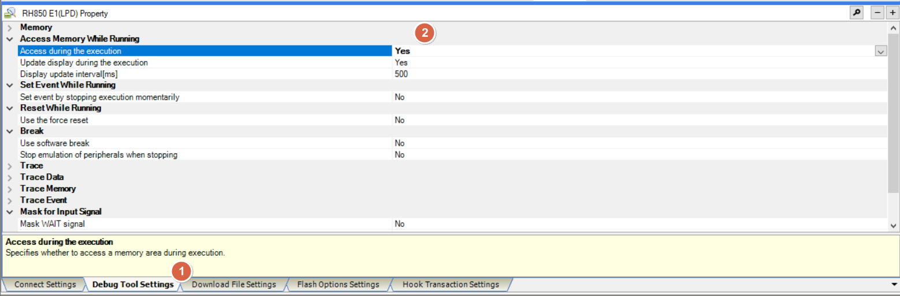

<span style="color:#FF0000">
Add global variable into watch window , by [<b>Register to Watch1</b>] and verify the variable in window<br>
</span>

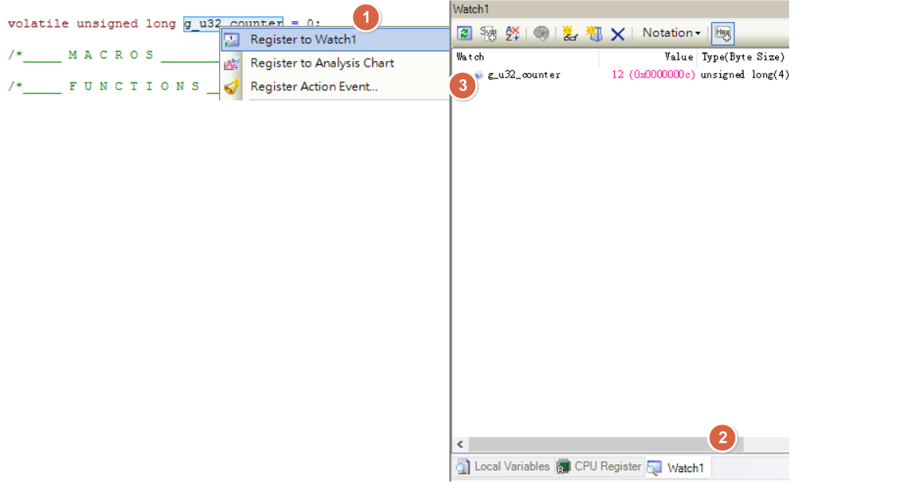


<b>WHY watch window NOT change periodicity</b>


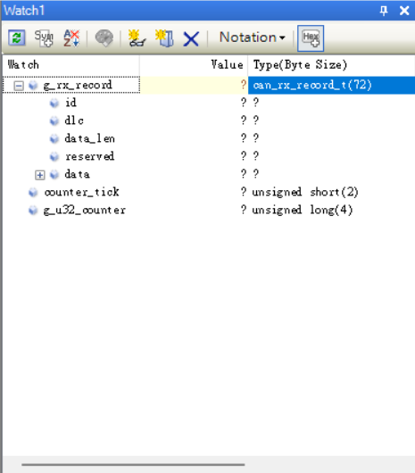


* check target MCU , RAM address in memory map

ex : RH850/F1KM-S1 , 

flash size 512K : Local RAM (Self) will be start at FEDF 0000

flash size 1MB : Local RAM (Self) will be start at FEDE 0000


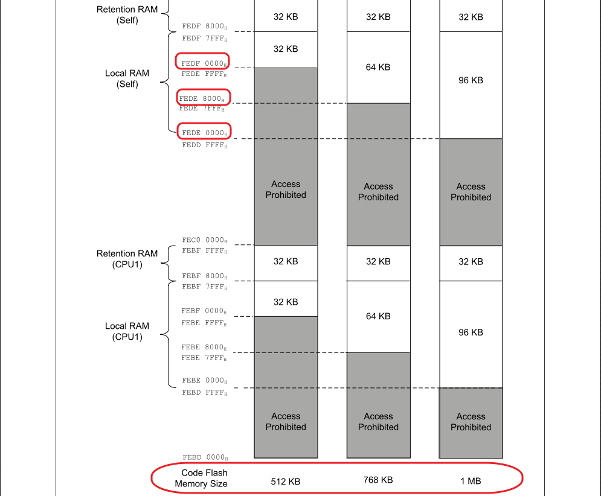


* modify Seciton Settings , make sure RAM allocation is correct

for example , below is for RH850/F1KM-S1 flash size 512K setting

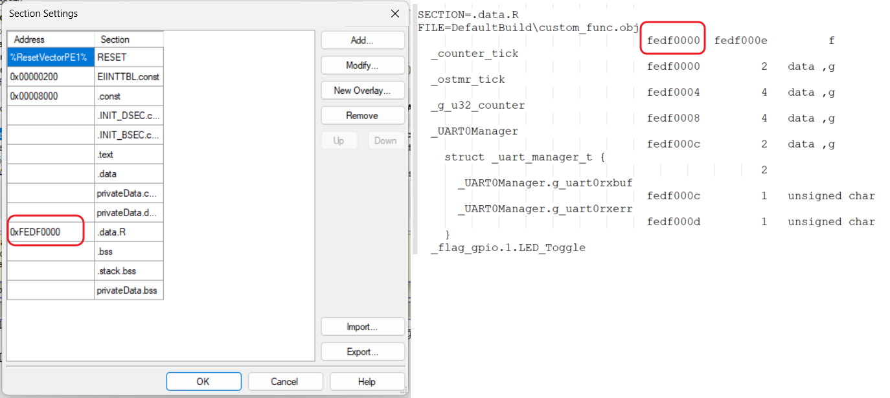


* after modify , variable in watch windows will display normal

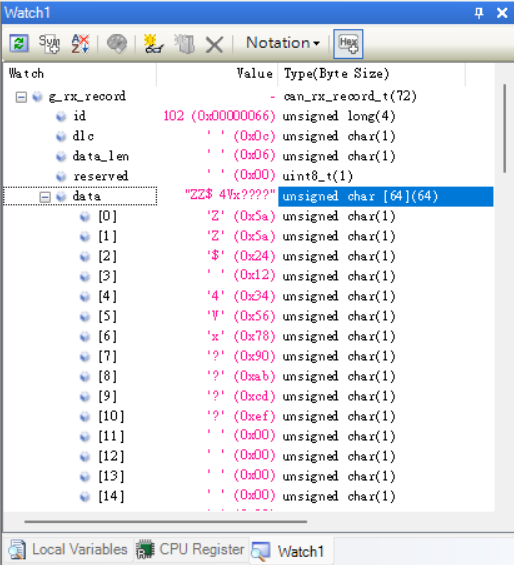


<u>CC-RH Compiler User's Manual</u>
[back to top](index.html#article_top)


---

<a id="tips-how-to-create-library-for-co-work-purpose"></a>

## How to create library for co-work purpose

[Sample_Project_RH850_S1_static_library](https://github.com/released/Sample_Project_RH850_S1_static_library)


<span style="color:#FF0000">
1. create new project and select [<b> Library(CC-RH) </b>] <br><br>
</span>


2. modify CC-RH Property


3. add custom C code , for example 


under __custom_lib.c__
```c
unsigned char function_2(unsigned char a,unsigned char b)
{
	return ( (a-b)>0 ? (a-b) : (b-a));
}

unsigned char function_1(unsigned char a,unsigned char b)
{
	return (a+b);
}
```

under __library_test_01.c__
```c
unsigned long library_test_001(void)
{
    static unsigned long cnt = 0x1000;
	return ( cnt+= 0x100 );
}
```

under __library_test_02.c__
```c
unsigned long library_test_002(void)
{
    static unsigned long cnt = 0x100;
	return ( cnt+= 0x10 );
}
```

4. compile and generate *.lib under \DefaultBuild folder
```
DefaultBuild\generate_lib.lib
```

5. __under target application project__

  - add this lib. into project , refer to below operation

method 1


method 2 
draw the lib into project


  - under c code in application project , add header and call the library function

```c

#include "custom_lib.h"
```

```c
    tiny_printf("function_1 : %d\r\n" , function_1(5,2));
    tiny_printf("function_2 : %d\r\n" , function_2(9,1));
    tiny_printf("function_2 : %d\r\n" , function_2(7,16));
    tiny_printf("library_test_001 : 0x%08X\r\n" , library_test_001());
    tiny_printf("library_test_002 : 0x%08X\r\n" , library_test_002());
```


  - when execute the function call in application project


<u>CC-RH Compiler User's Manual</u>
[back to top](index.html#article_top)    


---

<a id="tips-how-to-link-object-into-library"></a>

## How to link object into library

<a id="prepare-2-files"></a>

## prepare 2 files 


<span style="color:#FF0000">
1. add <b>target object file</b> that need to combine as library
<br>
ex : custom_func.obj , misc_config.obj , Pin.obj
<br>
2. output library will will be <b>lib_custom.lib</b>
<br>
<br>
</span>


__add_lib.rlc__
```c
-form library
-output lib_custom.lib
-input .\DefaultBuild\custom_func.obj
-input .\DefaultBuild\misc_config.obj
-input .\DefaultBuild\Pin.obj
```

<span style="color:#FF0000">
3. use rlink: Optimizing linker start command , to generate library
<br>
4. modify the file path if nessary
<br>
ex : 
...\CC\CC-RH\V2.07.00
<br>
<br>
</span>

__add_lib.bat__
```c

set "CCRH=C:\Program Files (x86)\Renesas Electronics\CS+\CC\CC-RH\V2.07.00"

set PATH=%CCRH%\bin;%PATH%

rlink -subcommand=add_lib.rlc

```

<span style="color:#FF0000">
5. put add_lib.bat and add_lib.rlc under project folder 


<br>
6. add <b> add_lib.bat</b> to project post build command


7.build the project , library will auto generate after build complete


<br>
<br>
</span>

<u>CC-RH Compiler User's Manual</u>
[back to top](index.html#article_top)    


---


[主題索引](index.html) · [上一主題](build.html)
