[主題索引](index.html) · [知識庫總索引](https://released.github.io/)

# GPIO 與範例

<!-- CHAPTER_SCOPE -->
GPIO 與範例 整理設定位置、操作畫面與對應程式／文件連結。

- 圖中型號、clock、pin、位址與工具介面屬於各參考工程的條件，不延伸為所有型號的固定配置。
- 實際設定與結果以所選 MCU 手冊、工程設定、linker map 及量測為準；原始文件與範例連結保留在各節。


---

<a id="article_gpio"></a>

## Smart Configurator：GPIO

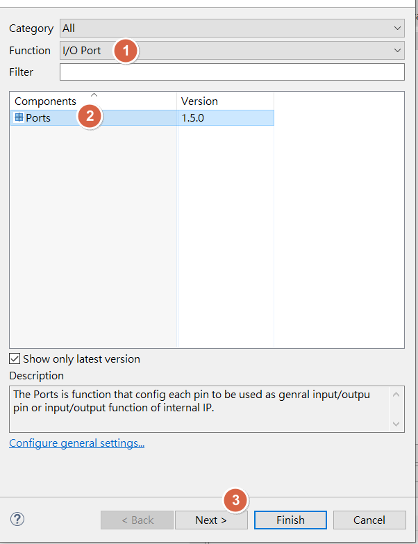

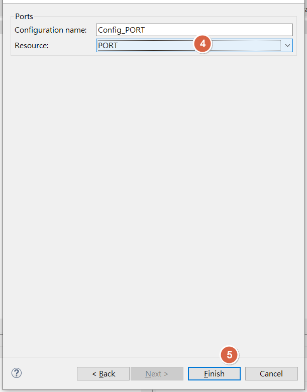

<u>RH850 Smart Configurator User's Guide: CS+</u>
[back to top](index.html#article_top)    

---

<span style="color:#FF0000">
Select target GPIO port , to set GPIO input , output<br><br>
</span>>

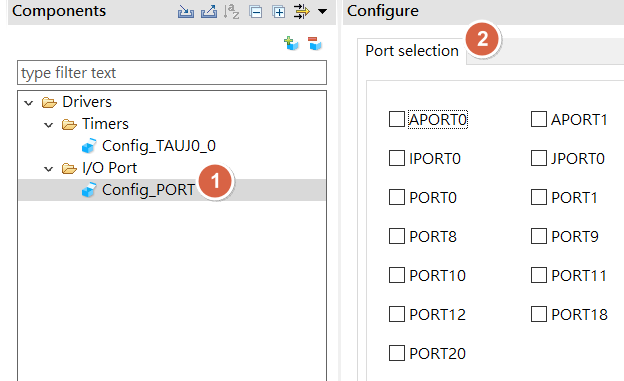

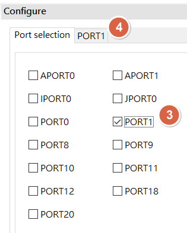

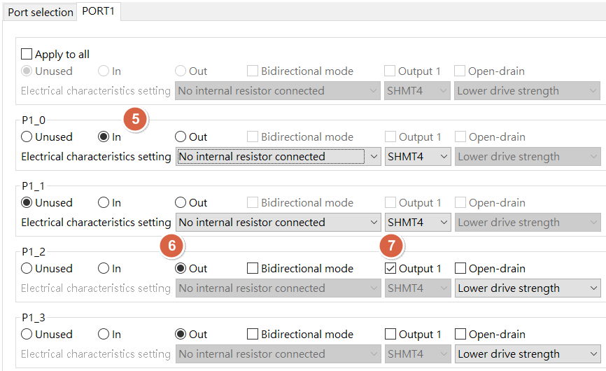

<u>RH850 Smart Configurator User's Guide: CS+</u>
[back to top](index.html#article_top)    

---

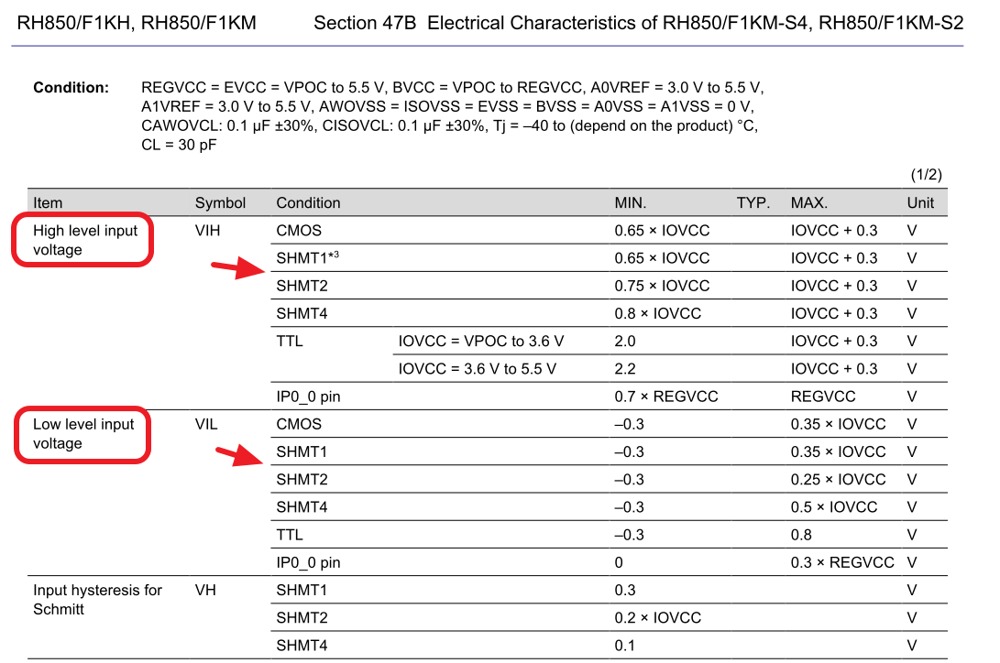

<u>RH850 Smart Configurator User's Guide: CS+</u>
[back to top](index.html#article_top)    

---

<a id="smart-config-–-gpio-output"></a>

## Smart Configurator：GPIO output

```c
#define GPIO_GETLEVEL(n,Pin)                            (((PORT.PPR##n & 1u<<Pin) == 0U)? 0U : 1U)
#define GPIO_TOGGLE(n,Pin)                              (PORT.PNOT##n |= 1u<<Pin)
#define GPIO_HIGH(Port,Pin)                             (PORT.Port |= 1u<<Pin)
#define GPIO_LOW(Port,Pin)                              (PORT.Port &= ~(1u<<Pin))
```


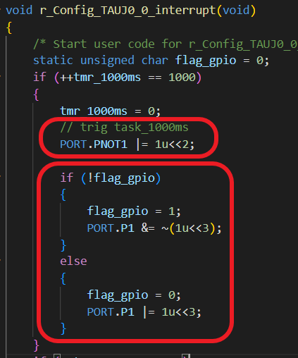

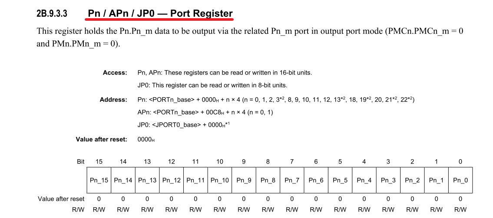

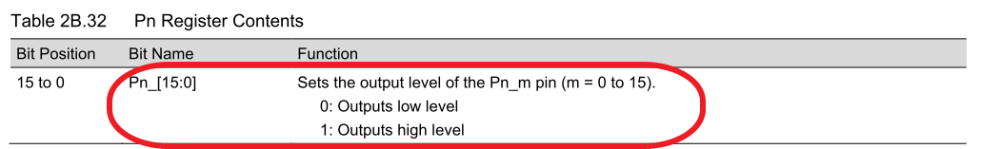

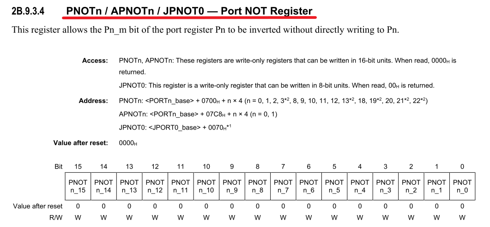

<u>RH850 Smart Configurator User's Guide: CS+</u>
[back to top](index.html#article_top)    

---

<a id="smart-config-–-gpio-input"></a>

## Smart Configurator：GPIO input

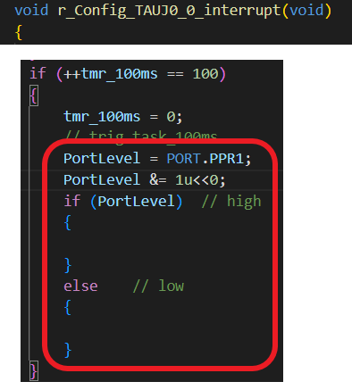

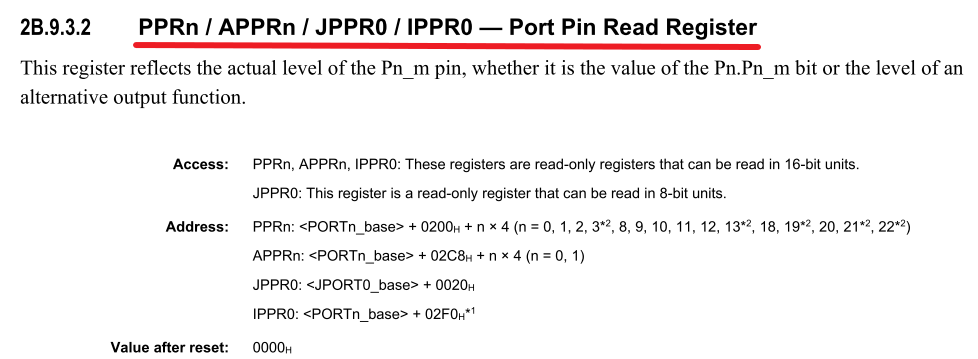

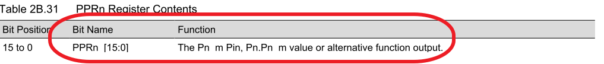

<u>RH850 Smart Configurator User's Guide: CS+</u>
[back to top](index.html#article_top)    

---

<a id="rh850-f1km-s4-sample-code"></a>

## RH850 F1KM-S4 sample code

[Y-ASK-RH850F1KM-S4-V3](https://www.renesas.com/en/products/microcontrollers-microprocessors/rh850-automotive-mcus/y-ask-rh850f1km-s4-v3-rh850f1km-s4-and-rh850f1km-s2-starter-kit)

[Y-ASK-RH850F1KM-S1-V3](https://www.renesas.com/en/products/microcontrollers-microprocessors/rh850-automotive-mcus/y-ask-rh850f1km-s1-v3-rh850f1km-s1-starter-kit)

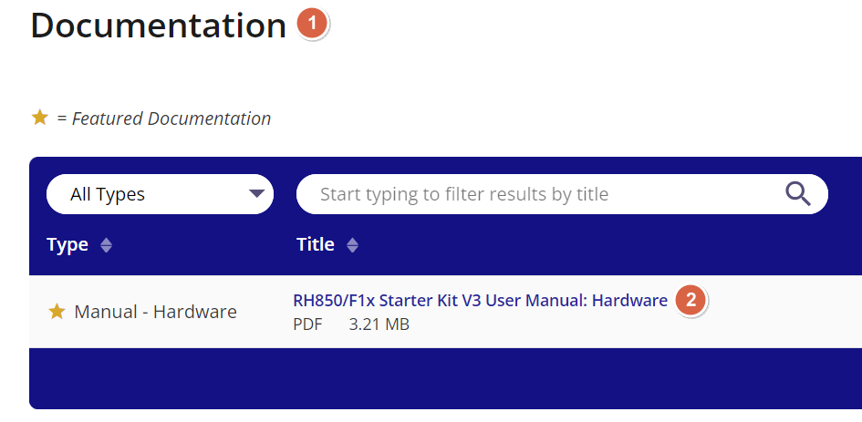

[Y-ASK-RH850F1KM-S4-V3 Software Package](https://www.renesas.com/document/sws/y-ask-rh850f1km-s4-v3-software-package?language=en&r=1261056)

[Y-ASK-RH850F1KM-S1-V3 Sample Code](https://www.renesas.com/en/document/scd/y-ask-rh850f1km-s1-v3-sample-code?r=1261041)

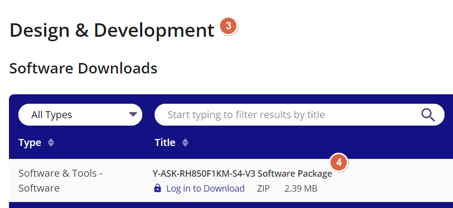


<u>RH850 Smart Configurator User's Guide: CS+</u>
[back to top](index.html#article_top)    

[主題索引](index.html) · [上一主題](timer.html) · [下一主題](interrupt.html)
