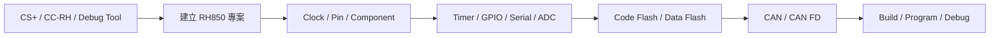

[回到知識庫總索引](https://released.github.io/)

# RH850 開發工具與周邊實作

> 以 Renesas RH850 為核心，整理 CS+、CC-RH、Smart Configurator、Flash Programmer，以及 timer、通訊介面、Flash 與 CAN FD 的完整實作路徑。

## 內容範圍

- RH850 toolchain、專案結構與 code generation 流程。
- clock、pin、interrupt 與周邊 driver 的應用程式整合。
- memory、register、interrupt flag 與實際通訊資料的除錯對照。

## 主題關聯

## 內容索引

* IDE 開發工具的安裝&介紹
  * CS+ , e² studio , CCRH , CCRL , Smart Configurator , Renesas Flash programmer
* Smart Configurator
  * [Clock tree , Pin configuration , Peripheral configuration](clock.html#article_clock)
  * [Timer](timer.html#article_timer)
  * [GPIO](gpio.html#article_gpio)
  * [external pin interrupt](interrupt.html#article_ext)
  * [I2C](i2c.html#article_i2c)
  * [SPI](spi.html#article_spi)
  * [UART](uart.html#article_uart)
  * [PWM](pwm.html#article_pwm)
  * [ADC](adc.html#article_adc)
  * [Code flash](flash-can.html#article_code_flash)
  * [Data flash](flash-can.html#article_data_flash)
  * [CAN FD](flash-can.html#article_can_fd)
* CS+
  * Code Compiler & programming flow ( from C code to IC ).
* Tips

## 主題頁

| 項目 | 內容 |
| --- | --- |
| [開發環境與專案](tools.html) | 開發環境與專案的設定、畫面與來源 |
| [時脈與元件](clock.html) | 時脈與元件的設定、畫面與來源 |
| [Timer 與程式產生](timer.html) | Timer 與程式產生的設定、畫面與來源 |
| [GPIO 與範例](gpio.html) | GPIO 與範例的設定、畫面與來源 |
| [外部中斷](interrupt.html) | 外部中斷的設定、畫面與來源 |
| [I²C](i2c.html) | I²C的設定、畫面與來源 |
| [SPI／CSIG／CSIH](spi.html) | SPI／CSIG／CSIH的設定、畫面與來源 |
| [UART](uart.html) | UART的設定、畫面與來源 |
| [PWM](pwm.html) | PWM的設定、畫面與來源 |
| [ADC](adc.html) | ADC的設定、畫面與來源 |
| [Flash 與 CAN FD](flash-can.html) | Flash 與 CAN FD的設定、畫面與來源 |
| [建置與中斷設定](build.html) | 建置與中斷設定的設定、畫面與來源 |
| [燒錄、除錯與記憶體配置](debug.html) | 燒錄、除錯與記憶體配置的設定、畫面與來源 |
