[主題索引](index.html) · [知識庫總索引](https://released.github.io/)

# PWM

<!-- CHAPTER_SCOPE -->
PWM 整理設定位置、操作畫面與對應程式／文件連結。

- 圖中型號、clock、pin、位址與工具介面屬於各參考工程的條件，不延伸為所有型號的固定配置。
- 實際設定與結果以所選 MCU 手冊、工程設定、linker map 及量測為準；原始文件與範例連結保留在各節。


---

<a id="article_pwm"></a>

## Smart Configurator：PWM

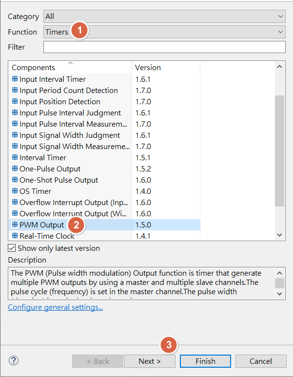

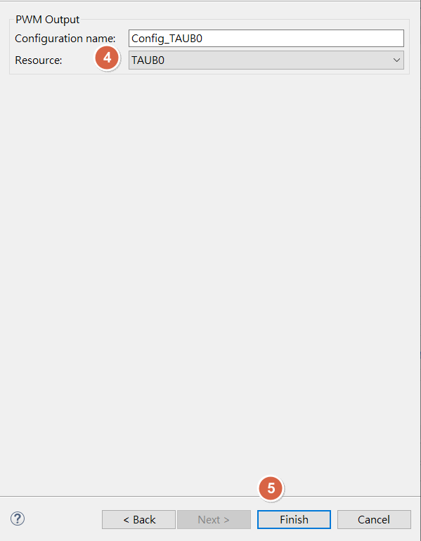

<u>RH850 Smart Configurator User's Guide: CS+</u>
[back to top](index.html#article_top)    

---

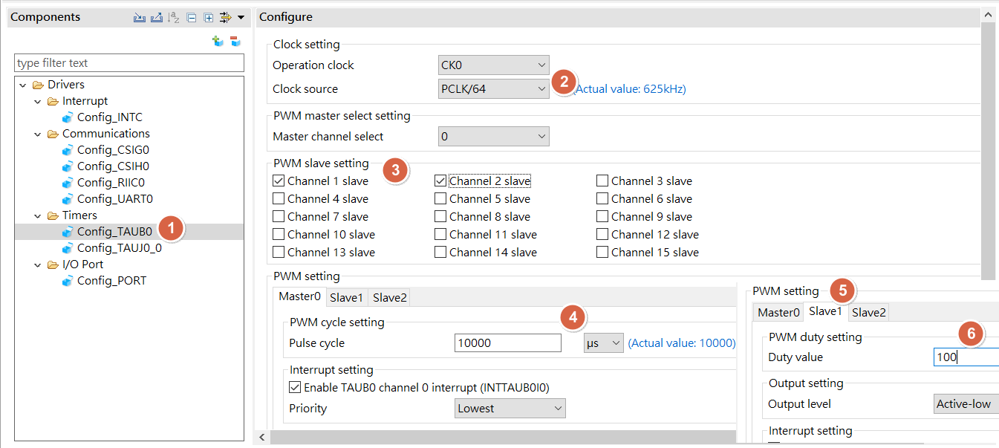

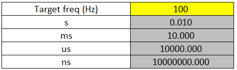

<u>RH850 Smart Configurator User's Guide: CS+</u>
[back to top](index.html#article_top)    

---

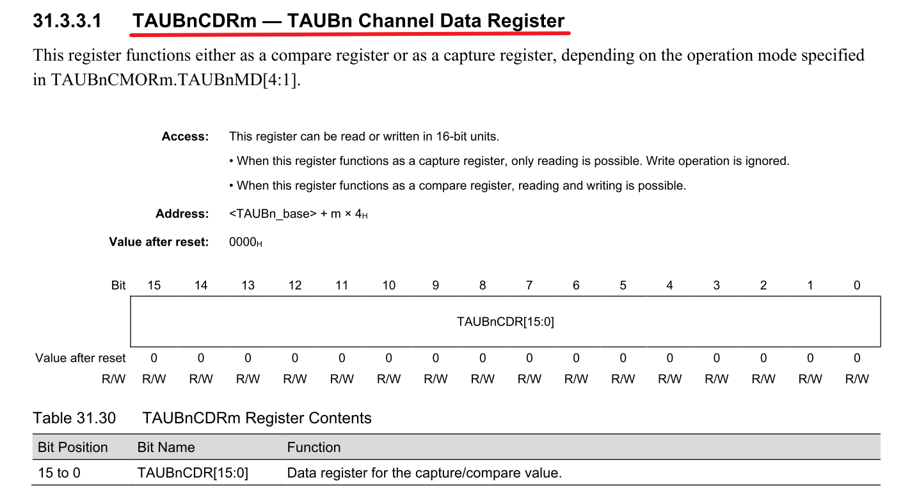

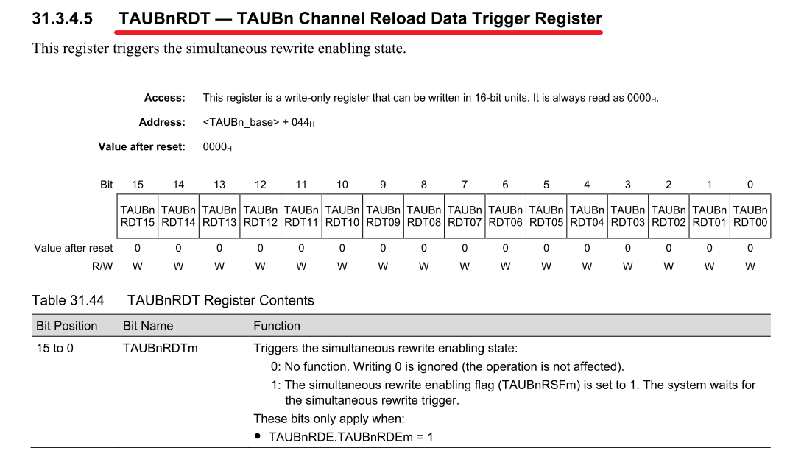

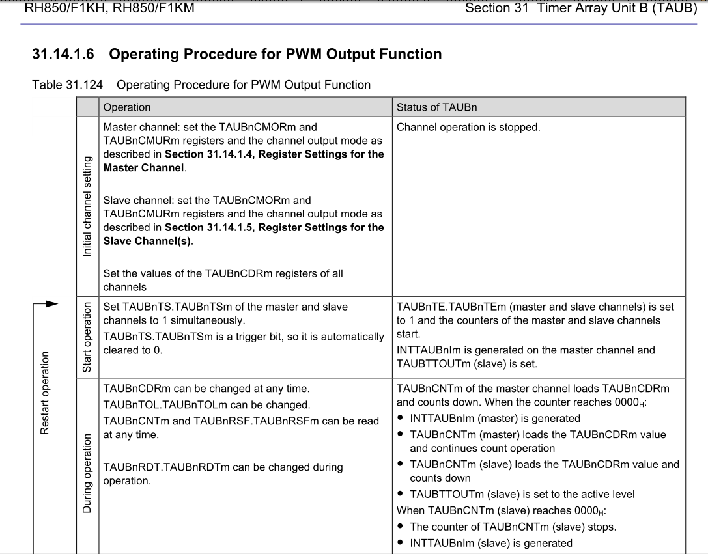

<u>RH850 Smart Configurator User's Guide: CS+</u>
[back to top](index.html#article_top)    

---

[Sample_Project_RH850_S1_PWM_MultiCh](https://github.com/released/Sample_Project_RH850_S1_PWM_MultiCh)

[Sample_Project_RH850_S1_Input_Capture](https://github.com/released/Sample_Project_RH850_S1_Input_Capture)

[Sample_Project_RH850_S1_PWM_Input_Capture](https://github.com/released/Sample_Project_RH850_S1_PWM_Input_Capture)


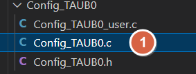

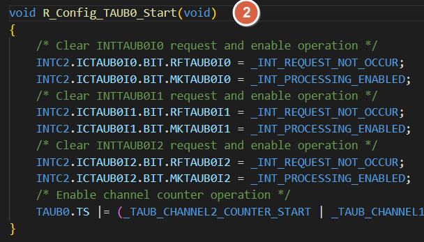


PWM duty adjust example

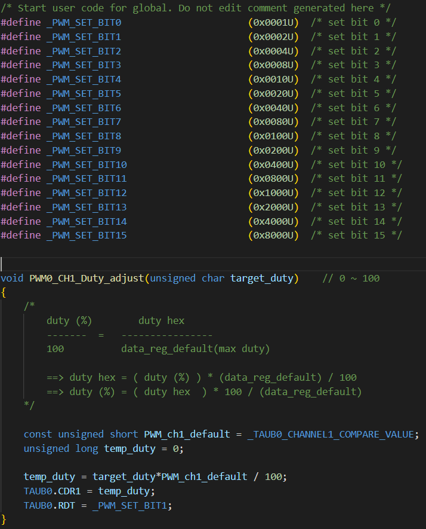


<span style="color:#FF0000">
Need to manual add driver start API , ex : <br><br>
</span>

```
R_Config_TAUB0_Start();
```

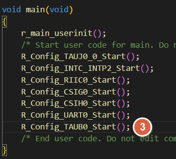

<u>RH850 Smart Configurator User's Guide: CS+</u>
[back to top](index.html#article_top)    

[主題索引](index.html) · [上一主題](uart.html) · [下一主題](adc.html)
