[主題索引](index.html) · [知識庫總索引](https://released.github.io/)

# Timer 與程式產生

<!-- CHAPTER_SCOPE -->
Timer 與程式產生 整理設定位置、操作畫面與對應程式／文件連結。

- 圖中型號、clock、pin、位址與工具介面屬於各參考工程的條件，不延伸為所有型號的固定配置。
- 實際設定與結果以所選 MCU 手冊、工程設定、linker map 及量測為準；原始文件與範例連結保留在各節。


---

<a id="article_timer"></a>

## Smart Configurator：Interval Timer

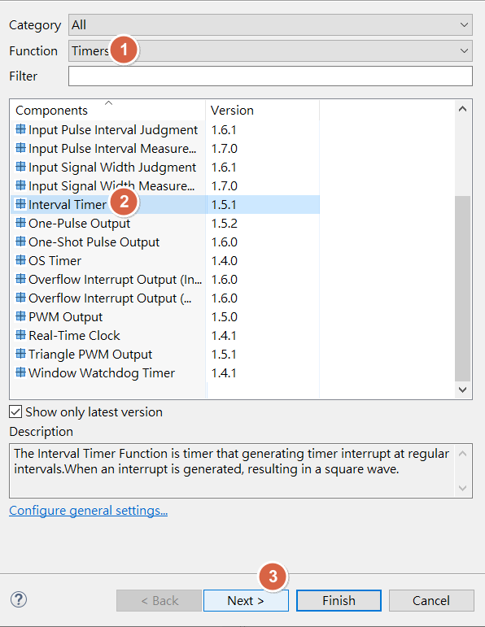

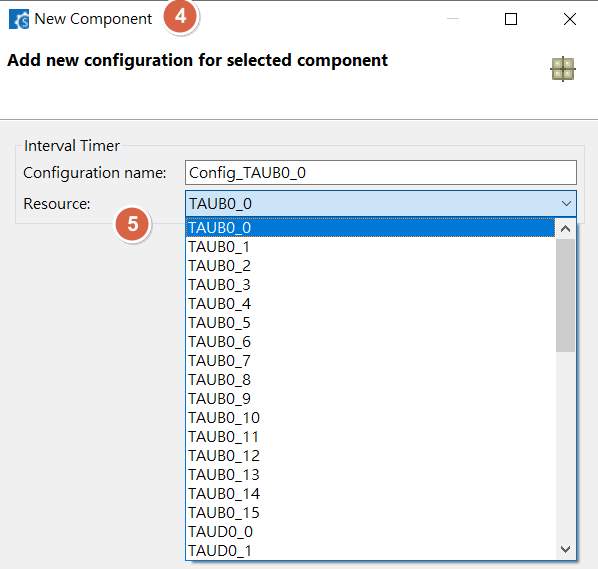

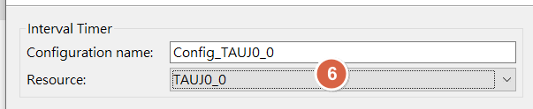

<u>RH850 Smart Configurator User's Guide: CS+</u>
[back to top](index.html#article_top)    

---

<span style="color:#FF0000">
TAUxx timer difference<br><br>
</span>

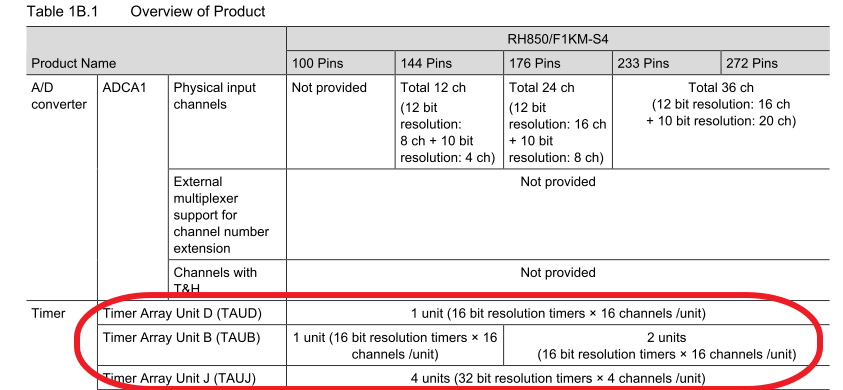


<span style="color:#FF0000">
TAUxx timer clock source<br><br>
</span>

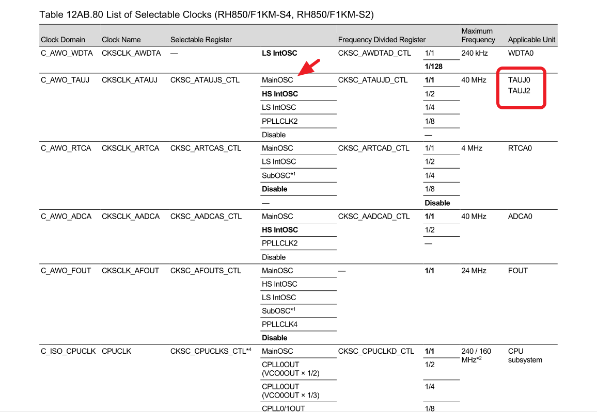

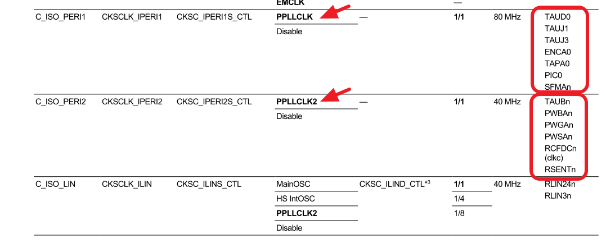

<u>RH850 Smart Configurator User's Guide: CS+</u>
[back to top](index.html#article_top)    

---

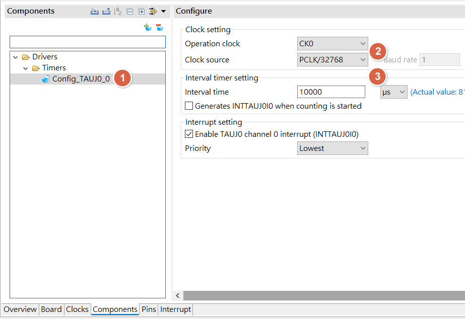

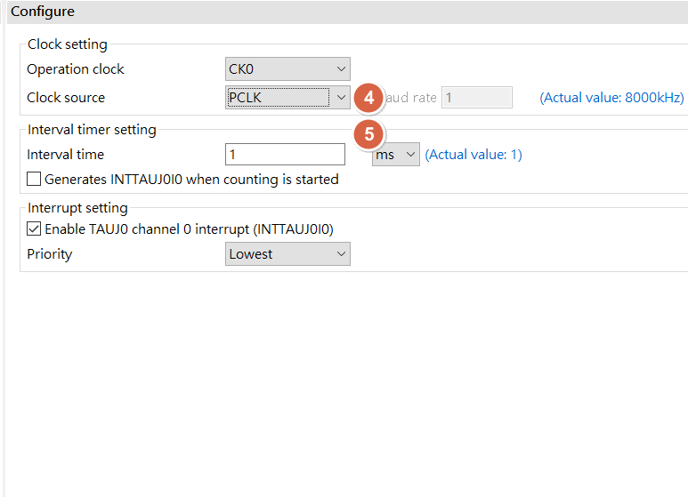

<u>RH850 Smart Configurator User's Guide: CS+</u>
[back to top](index.html#article_top)    

---

<span style="color:#FF0000">
Press <b>[Generate Code]</b> in Smart config. will automatically generate driver source code under CS+ project<br><br>
</span> 

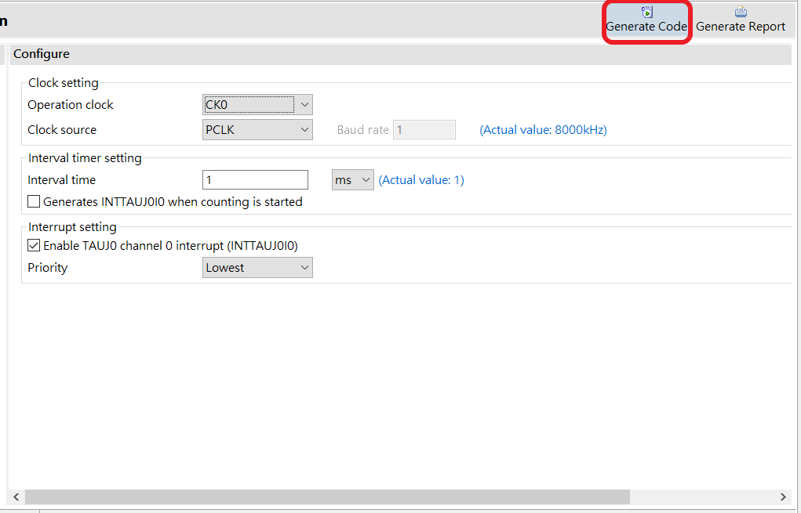

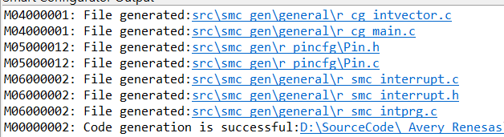

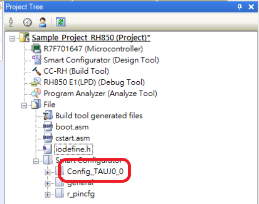


<u>RH850 Smart Configurator User's Guide: CS+</u>
[back to top](index.html#article_top)    

---

<span style="color:#FF0000">
Re-build project , will see the build result is complete without error<br><br>
</span>

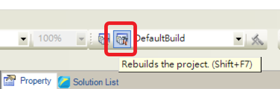

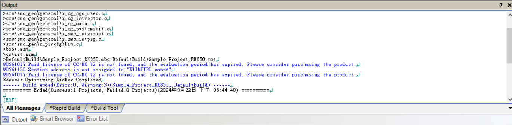


<span style="color:#FF0000">
This will be project main code : <br>
<b>r_cg_main.c</b><br><br>
</span>

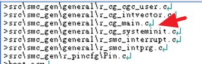


<u>RH850 Smart Configurator User's Guide: CS+</u>
[back to top](index.html#article_top)    

---

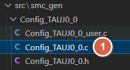

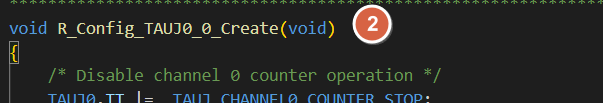

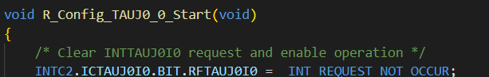

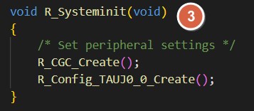

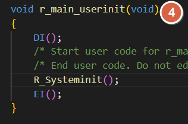


<span style="color:#FF0000">
Need to manual add driver start API , ex : <br><br>
</span>

```
R_Config_TAUJ0_0_Start(); 
```

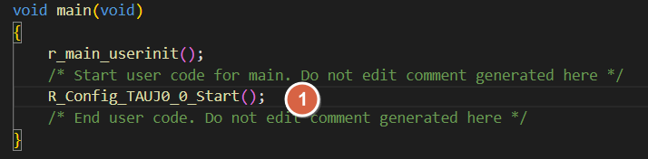

<u>RH850 Smart Configurator User's Guide: CS+</u>
[back to top](index.html#article_top)    

---

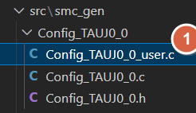

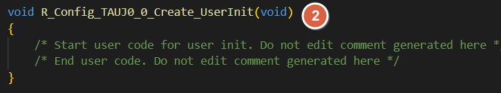

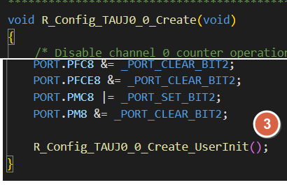


<span style="color:#FF0000">
Add TIMER interrupt function under <br><br>
</span>  

```
r_Config_TAUJ0_0_interrupt()
```

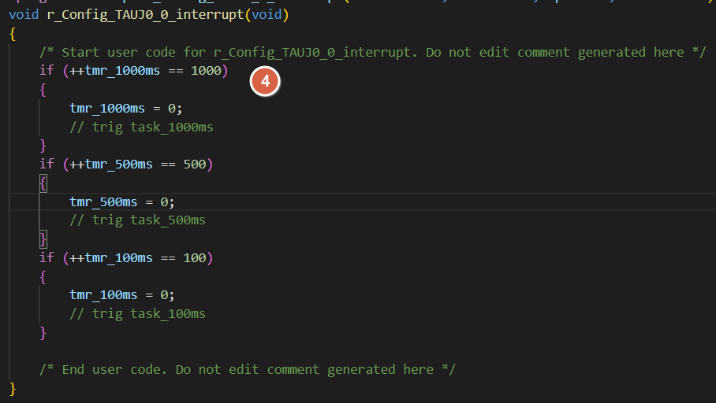

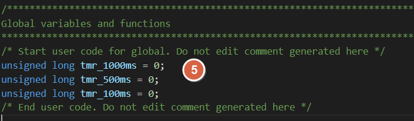

<u>RH850 Smart Configurator User's Guide: CS+</u>
[back to top](index.html#article_top)    

---

<a id="smart-config-timer-delay"></a>

## Smart Configurator：Timer delay

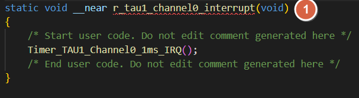

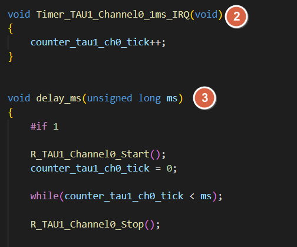


<u>RH850 Smart Configurator User's Guide: CS+</u>
[back to top](index.html#article_top)    

---

<a id="smart-config-–-generate-code"></a>

## Smart Configurator：Generate code

<span style="color:#FF0000">
[Generate Code] in Smart configurator , will re-generate driver code <b><u>every time</b></u><br><br>
</span> 

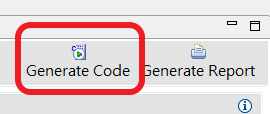

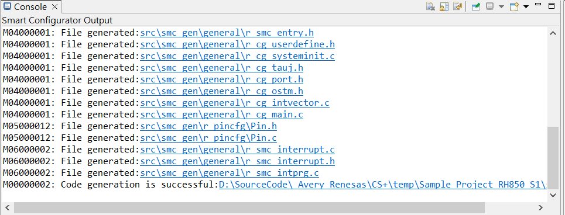


<u>RH850 Smart Configurator User's Guide: CS+</u>
[back to top](index.html#article_top)    

---

<a id="cs---driver-code"></a>

## CS+：driver code

<span style="color:#FF0000">
Put custom application code , variable , declaration , between these 2 comment , will merge into driver code when execute [Generate Code] in Smart config<br><br>
</span>  

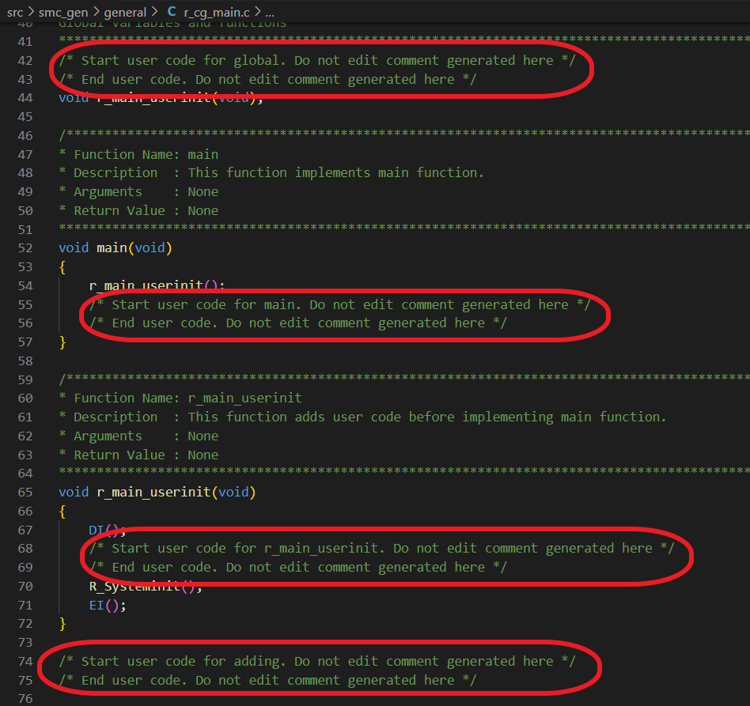

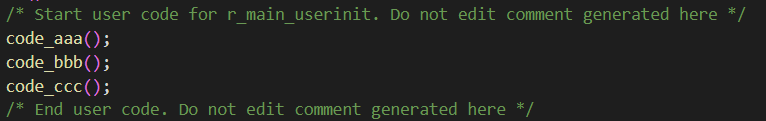

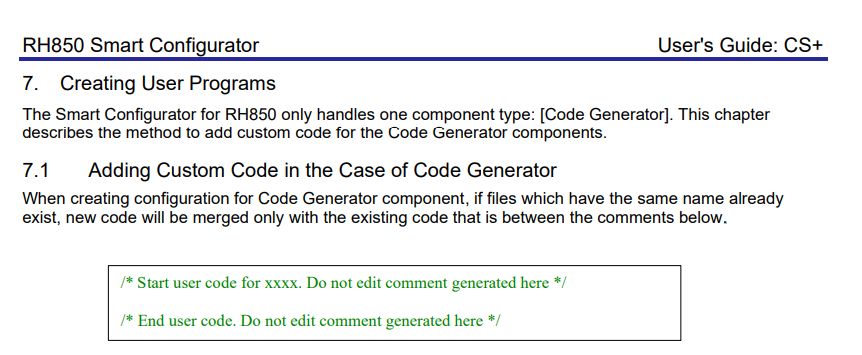


<u>RH850 Smart Configurator User's Guide: CS+</u>
[back to top](index.html#article_top)    

[主題索引](index.html) · [上一主題](clock.html) · [下一主題](gpio.html)
