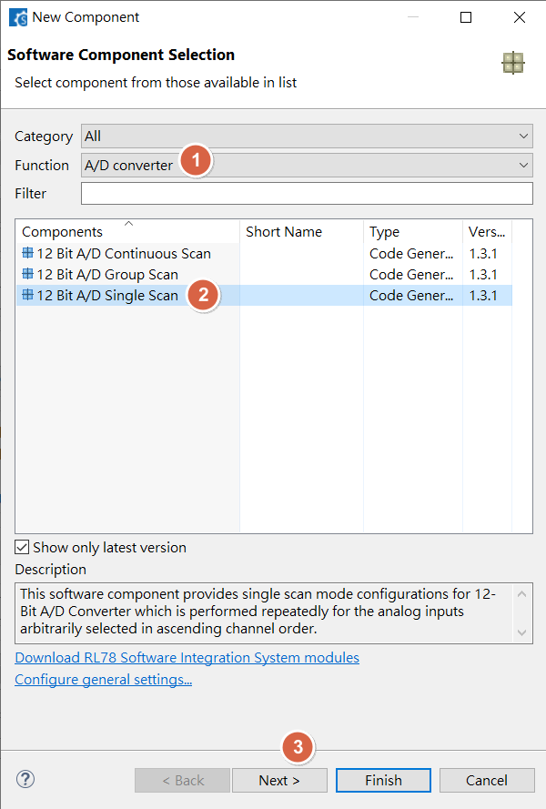
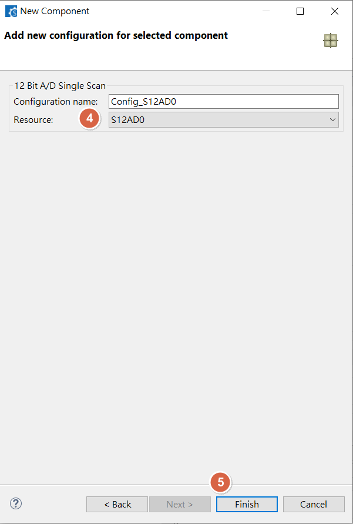
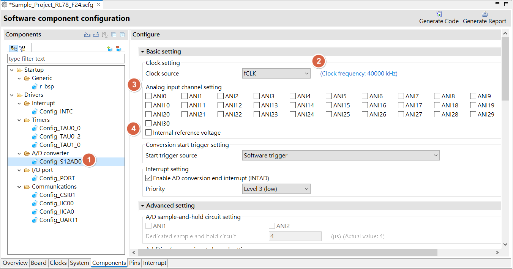
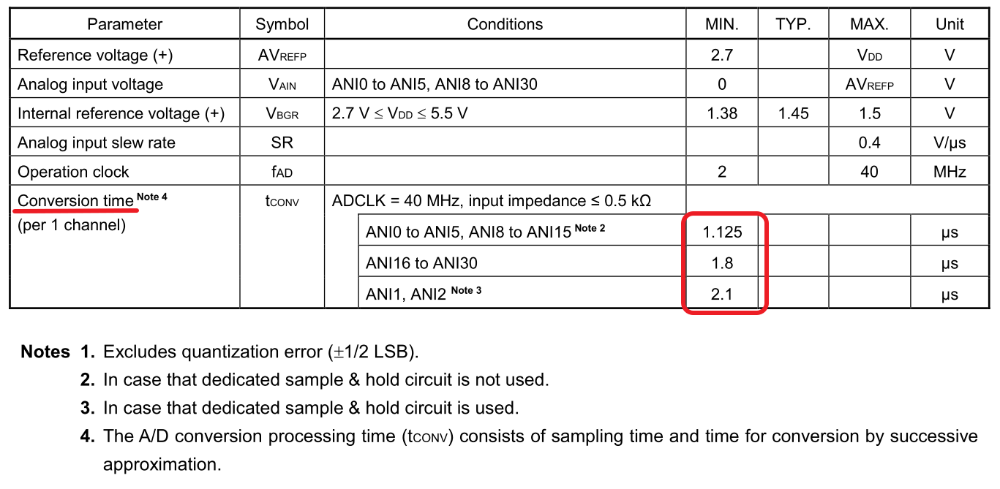
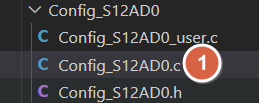
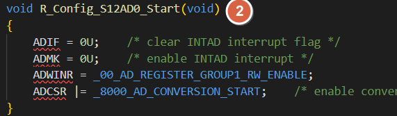
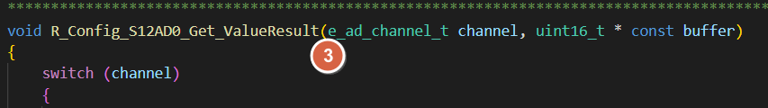
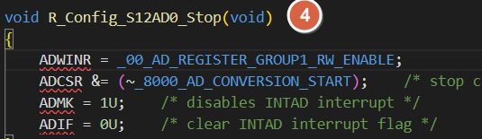
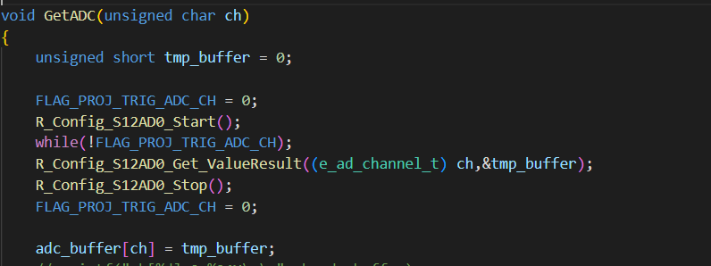

[主題索引](index.html) · [知識庫總索引](https://released.github.io/)

# ADC

<!-- CHAPTER_SCOPE -->
ADC 整理設定位置、操作畫面與對應程式／文件連結。

- 圖中型號、clock、pin、位址與工具介面屬於各參考工程的條件，不延伸為所有型號的固定配置。
- 實際設定與結果以所選 MCU 手冊、工程設定、linker map 及量測為準；原始文件與範例連結保留在各節。


---

<a id="article_adc"></a>

## Smart Configurator：ADC





<u>RL78 Smart Configurator User's Guide: CS+</u>
[back to top](index.html#article_top)    

---



<u>RL78 Smart Configurator User's Guide: CS+</u>
[back to top](index.html#article_top)    

---

<a id="smart-config-adc-sampling"></a>

## Smart Configurator：ADC sampling



<u>RL78 Smart Configurator User's Guide: CS+</u>
[back to top](index.html#article_top)    

---

<a id="smart-config-adc-driver"></a>

## Smart Configurator：ADC driver









example : 

```c
static void __near r_Config_S12AD0_interrupt(void)
{
/* Start user code for r_Config_S12AD0_interrupt. Do not edit comment generated here */
    ADC_Process_in_IRQ();
/* End user code. Do not edit comment generated here */
}

void ADC_Process_in_IRQ(void)
{
    FLAG_PROJ_TRIG_ADC_CH = 1;
}

void GetADC(unsigned char ch)
{
    unsigned short tmp_buffer = 0;

    FLAG_PROJ_TRIG_ADC_CH = 0;
    R_Config_S12AD0_Start();
    while(!FLAG_PROJ_TRIG_ADC_CH);
    R_Config_S12AD0_Get_ValueResult((e_ad_channel_t) ch,&tmp_buffer);
    R_Config_S12AD0_Stop();
    FLAG_PROJ_TRIG_ADC_CH = 0;

    adc_buffer[ch] = tmp_buffer;    
}

```




<a id="more-adc-example-refer-to"></a>

## ADC 範例程式

- RL78 G16 
  - __get VDD voltage + multi ADC channel__ : check /drv/drv_adc.c in [RL78_G16_ADC_PWM_Input_Pulse_UART_1M](https://github.com/released/RL78_G16_ADC_PWM_Input_Pulse_UART_1M)

  - __GetADC__ : check /custom_func.c in [RL78_G16_ADC_PWM_DataFlash](https://github.com/released/RL78_G16_ADC_PWM_DataFlash)

- RL78 G15  
  - __GetADC__ : check /custom_func.c in [RL78_G15_ADC_PWM_Input_Pulse](https://github.com/released/RL78_G15_ADC_PWM_Input_Pulse)

```c
void GetADC(e_ad_channel_t ch)
{
    unsigned short tmp_buffer = 0;

    R_Config_ADC_Set_ADChannel(ch);
    FLAG_PROJ_TRIG_ADC_CH = 0;
    R_Config_ADC_Start();
    while(!FLAG_PROJ_TRIG_ADC_CH);
    R_Config_ADC_Get_Result_10bit(&tmp_buffer);
    R_Config_ADC_Stop();
    FLAG_PROJ_TRIG_ADC_CH = 0;

    adc_buffer[ch] = tmp_buffer;    

    // printf_tiny("ch[%d]:0x%04X\r\n",ch,adc_buffer[ch]);
}
```

<u>RL78 Smart Configurator User's Guide: CS+</u>
[back to top](index.html#article_top)    

[主題索引](index.html) · [上一主題](pwm.html) · [下一主題](build.html)
