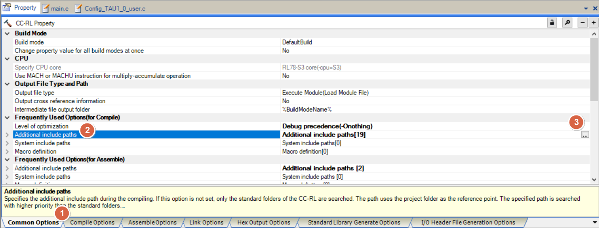
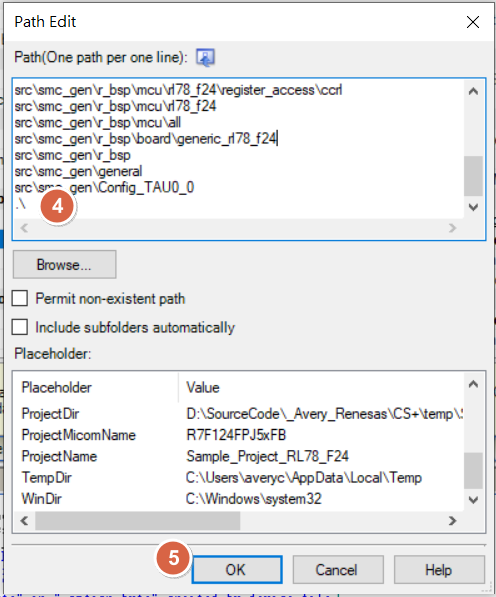
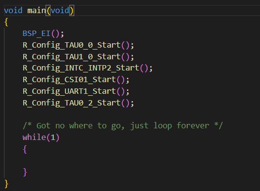
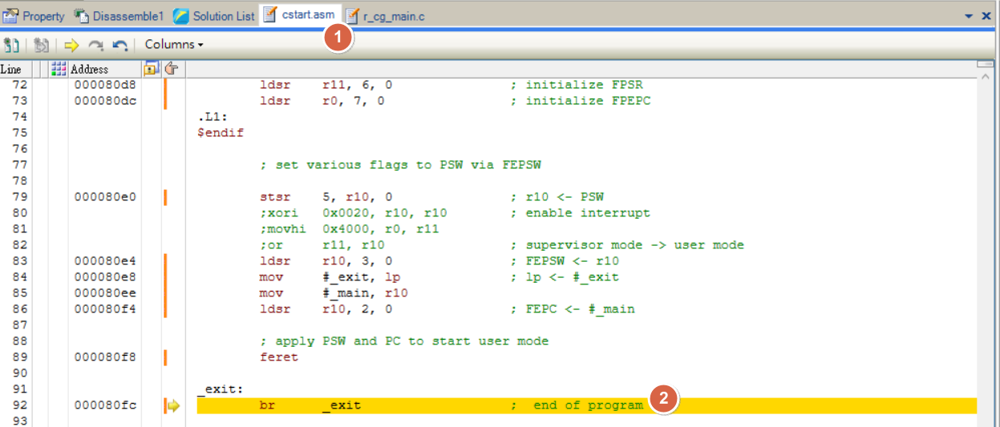

[主題索引](index.html) · [知識庫總索引](https://released.github.io/)

# 建置與程式整合

<!-- CHAPTER_SCOPE -->
建置與程式整合 整理設定位置、操作畫面與對應程式／文件連結。

- 圖中型號、clock、pin、位址與工具介面屬於各參考工程的條件，不延伸為所有型號的固定配置。
- 實際設定與結果以所選 MCU 手冊、工程設定、linker map 及量測為準；原始文件與範例連結保留在各節。


---

<a id="cs-add-root-path-in-path-edit"></a>

## CS+：Add root path in Path Edit




<span style="color:#FF0000">
add root path under project to fix compile error issue<br><br>
</span>

```
.\
.
```



<u>RL78 Smart Configurator User's Guide: CS+</u>
[back to top](index.html#article_top)    

---

<a id="cs-add-main-loop"></a>

## CS+：Add main loop

<span style="color:#FF0000">
Need to manual add enable interrupt <br><br>
</span>

```c
BSP_EI();
```

<span style="color:#FF0000">
Need to manual add main loop , ex : <br><br>
</span>

```c
while(1)
{
}
```



<u>RL78 Smart Configurator User's Guide: CS+</u>
[back to top](index.html#article_top)    

---

<span style="color:#FF0000">
If not add while loop under main code , program will <b>stop</b> at exit in csstart.asm<br><br>
</span> 



<u>RL78 Smart Configurator User's Guide: CS+</u>
[back to top](index.html#article_top)    

[主題索引](index.html) · [上一主題](adc.html) · [下一主題](debug.html)
