[主題索引](index.html) · [知識庫總索引](https://released.github.io/)

# GPIO 與範例

<!-- CHAPTER_SCOPE -->
GPIO 與範例 整理設定位置、操作畫面與對應程式／文件連結。

- 圖中型號、clock、pin、位址與工具介面屬於各參考工程的條件，不延伸為所有型號的固定配置。
- 實際設定與結果以所選 MCU 手冊、工程設定、linker map 及量測為準；原始文件與範例連結保留在各節。


---

<a id="article_gpio"></a>

## Smart Configurator：GPIO


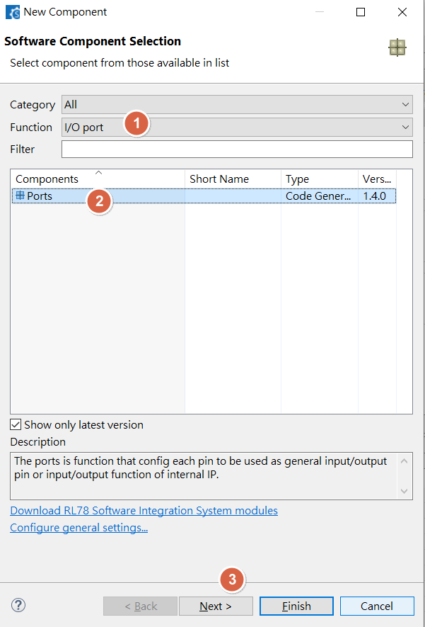

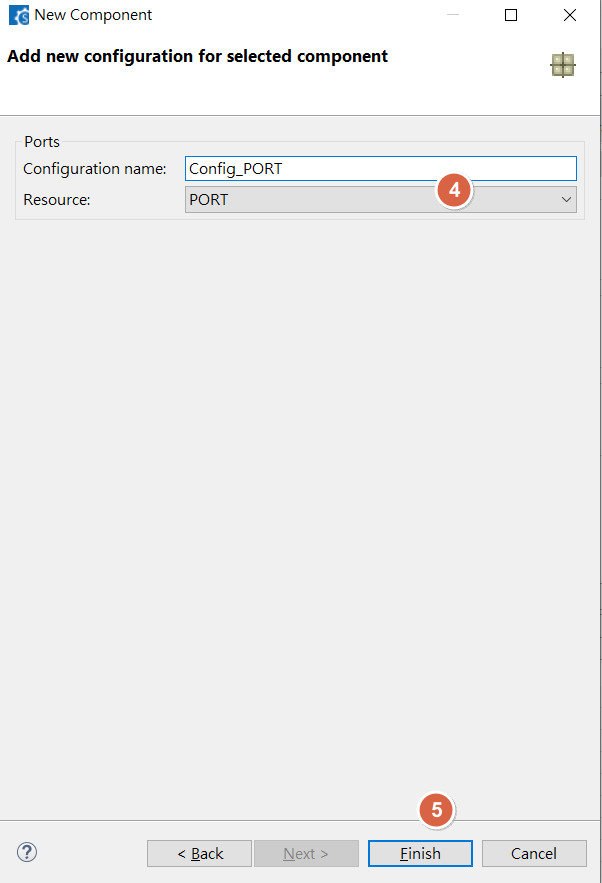

<u>RL78 Smart Configurator User's Guide: CS+</u>
[back to top](index.html#article_top)    

---

<span style="color:#FF0000">
Select target GPIO port , to set GPIO input , output<br><br>
</span>

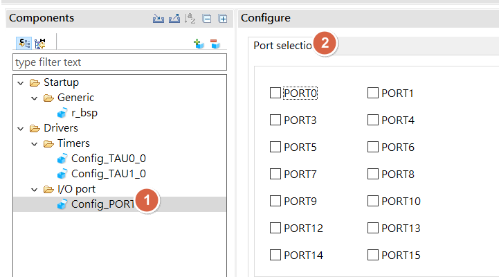

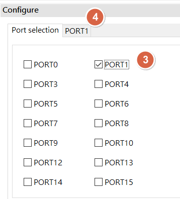

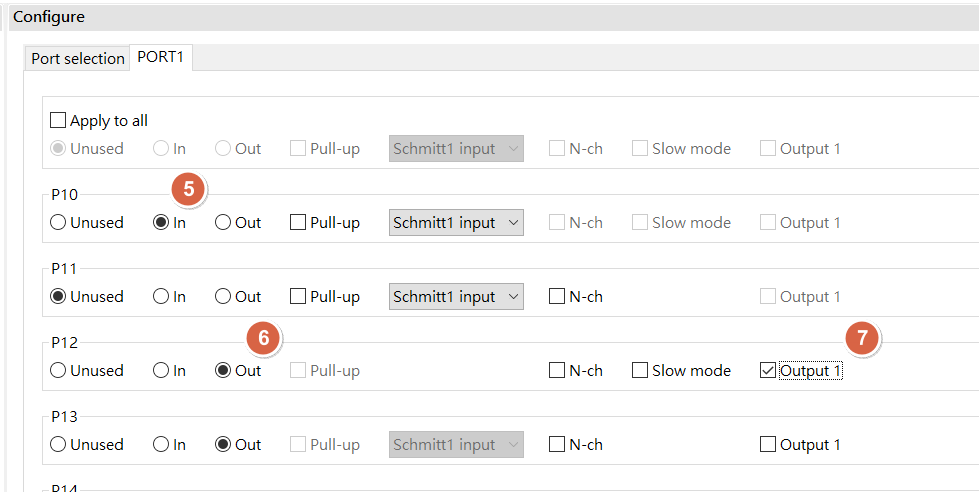

<u>RL78 Smart Configurator User's Guide: CS+</u>
[back to top](index.html#article_top)    

---

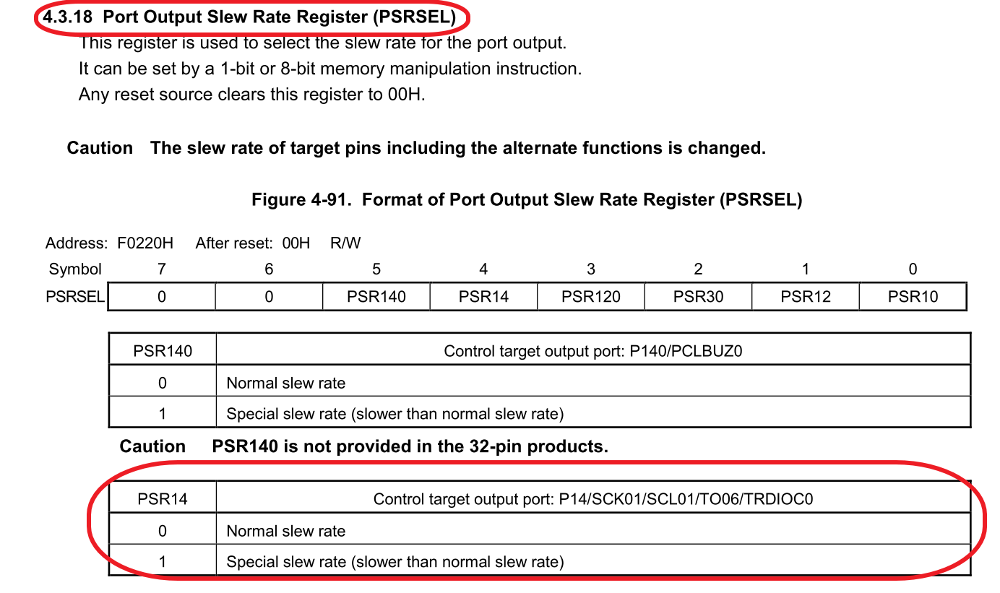

<u>RL78 Smart Configurator User's Guide: CS+</u>
[back to top](index.html#article_top)    

---

<a id="smart-config-gpio-control-example"></a>

## Smart Configurator：GPIO control example

example
```c
P7_bit.no3 = ~P7_bit.no3;
P7_bit.no3 ^= 1;
P7_bit.no3 = 1;
P7_bit.no3 = 0;
```
```c
/*
  b7  b6  b5  b4  b3  b2  b1  b0
  0   0   0   0   1   0   0   0
*/
#define P73_PIN				(0x08U)

P7 ^= P73_PIN;    //toggle
P7 &= ~P73_PIN;   //on
P7 |= P73_PIN;    //off
```

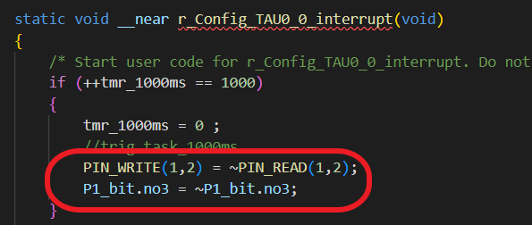

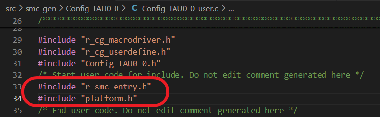

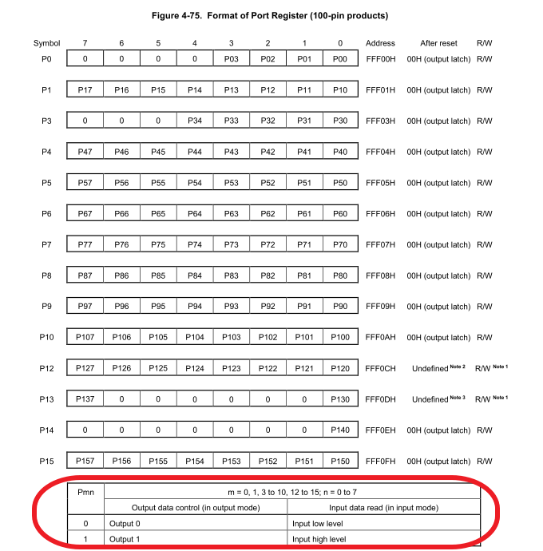

<u>RL78 Smart Configurator User's Guide: CS+</u>
[back to top](index.html#article_top)    

---

<a id="rl78-f24-example-code"></a>

## RL78 F24 example code

[https://www\.renesas\.com/en/products/microcontrollers\-microprocessors/rl78\-low\-power\-8\-16\-bit\-mcus/rl78f24\-next\-generation\-actuator\-and\-sensor\-microcontroller](https://www.renesas.com/en/products/microcontrollers-microprocessors/rl78-low-power-8-16-bit-mcus/rl78f24-next-generation-actuator-and-sensor-microcontroller)

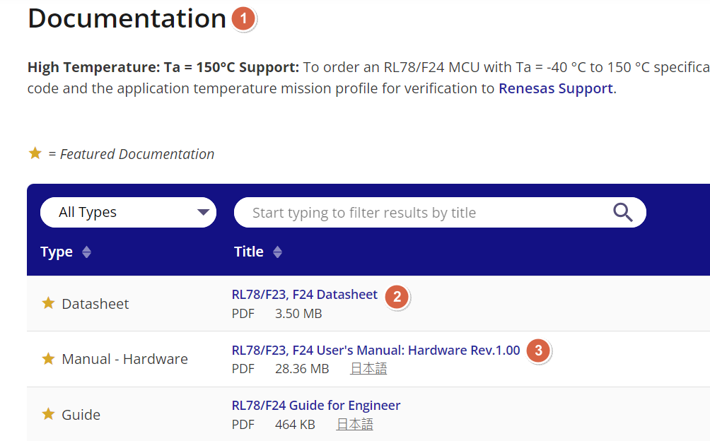

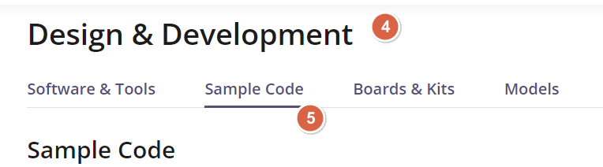

<u>RL78 Smart Configurator User's Guide: CS+</u>
[back to top](index.html#article_top)    

[主題索引](index.html) · [上一主題](timer.html) · [下一主題](interrupt.html)
