[主題索引](index.html) · [知識庫總索引](https://released.github.io/)

# I²C／IICA

<!-- CHAPTER_SCOPE -->
I²C／IICA 整理設定位置、操作畫面與對應程式／文件連結。

- 圖中型號、clock、pin、位址與工具介面屬於各參考工程的條件，不延伸為所有型號的固定配置。
- 實際設定與結果以所選 MCU 手冊、工程設定、linker map 及量測為準；原始文件與範例連結保留在各節。


---

<a id="article_i2c"></a>

## Smart Configurator：I2C


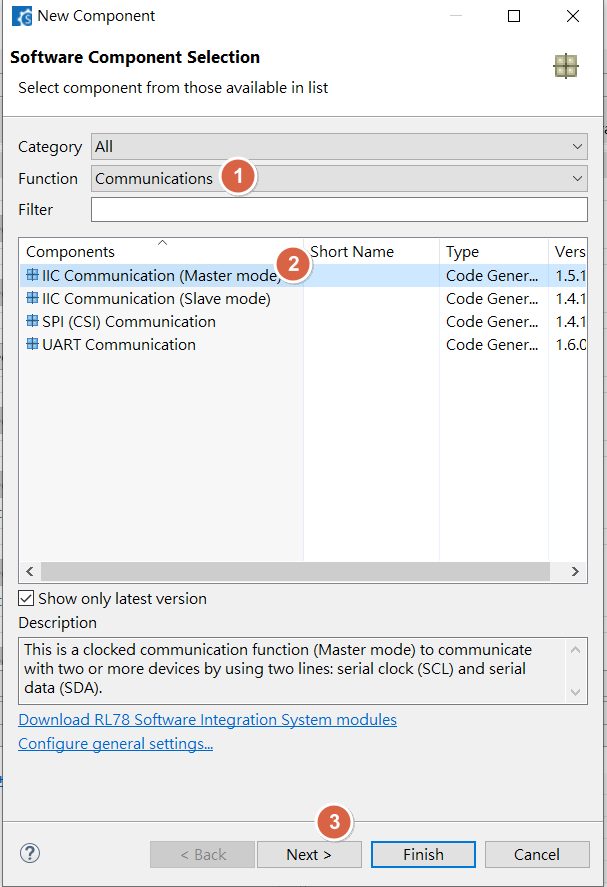

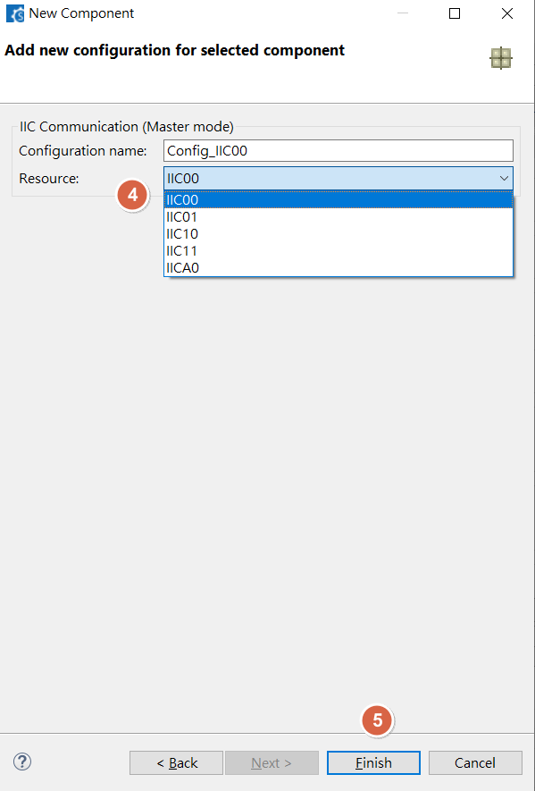

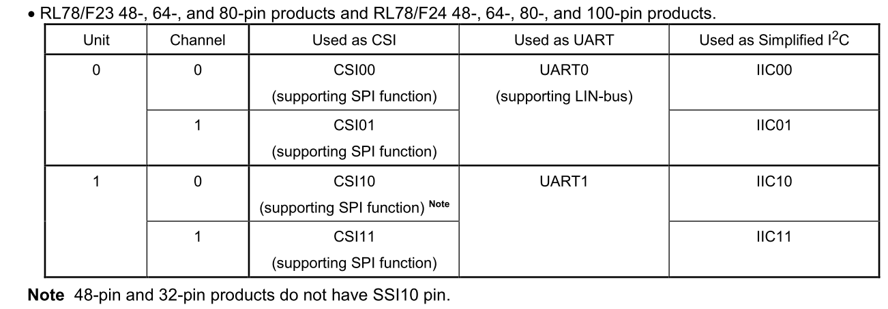

<u>RL78 Smart Configurator User's Guide: CS+</u>
[back to top](index.html#article_top)    

---

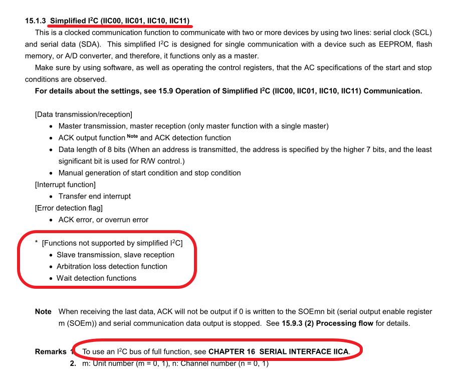

<u>RL78 Smart Configurator User's Guide: CS+</u>
[back to top](index.html#article_top)    

---

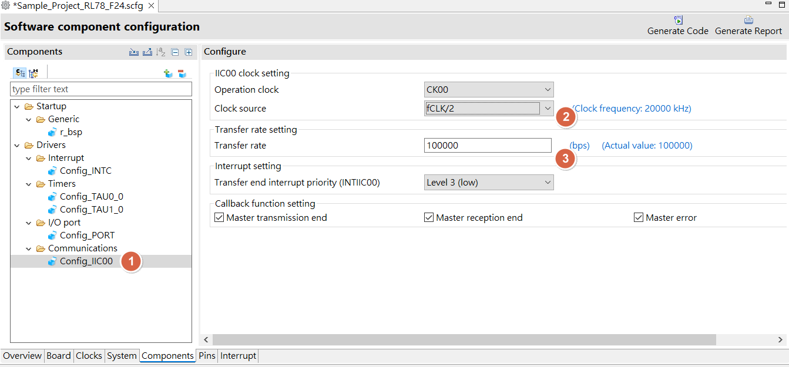

<u>RL78 Smart Configurator User's Guide: CS+</u>
[back to top](index.html#article_top)    

---

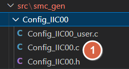

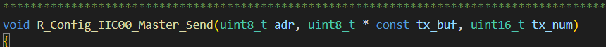

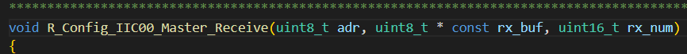

<span style="color:#FF0000">
Read function example :<br><br>
</span>

```c
R_Config_IIC00_Master_Send(…,reg,...)
R_Config_IIC00_Master_Receive(…,data,...)
```

<span style="color:#FF0000">
Write function example :<br><br>
</span>


```c
R_Config_IIC00_Master_Send(…,data,...)
```


<a id="more-iic-example-refer-to"></a>

## IIC 範例程式


- RL78 F13
  - __read__ : 
  ```c
  MD_STATUS IIC11_I2C_read(unsigned char device_addr,unsigned char reg_addr,unsigned char* rx_xfer_data,unsigned short rx_num)
  ```
  - __write__ :
  ```c
  MD_STATUS IIC11_I2C_write(unsigned char device_addr,unsigned char reg_addr,unsigned char* tx_xfer_data,unsigned short tx_num)
  ```
  - check /simple_i2c_drive.c in [https://github.com/released/RL78_F13_IIC11_I2C_TCA9548A_DA7280](https://github.com/released/RL78_F13_IIC11_I2C_TCA9548A_DA7280)


- RL78 F13
  - __read__ : 
  ```c
  MD_STATUS IIC10_I2C_read(unsigned char device_addr,unsigned char reg_addr,unsigned char* rx_xfer_data,unsigned short rx_num)
  ```
  - __write__ :
  ```c
  MD_STATUS IIC10_I2C_write(unsigned char device_addr,unsigned char reg_addr,unsigned char* tx_xfer_data,unsigned short tx_num)
  ```
  - check /simple_i2c_driver.c in [https://github.com/released/RL78_F13_IIC10_I2C_TCA9548A_DF8100](https://github.com/released/RL78_F13_IIC10_I2C_TCA9548A_DF8100)


- RL78 F24
  - __read__ : 
  ```c
  MD_STATUS IIC11_read(unsigned char device_addr,unsigned char reg_addr,unsigned char* rx_xfer_data,unsigned short rx_num)
  ```
  - __write__ :
  ```c
  MD_STATUS IIC11_write(unsigned char device_addr,unsigned char reg_addr,unsigned char* tx_xfer_data,unsigned short tx_num)
  ```
  - check /IIC11_simple_i2c_driver.c in [https://github.com/released/RL78_F24_IICA0_I2C_Slave_IIC_Master](https://github.com/released/RL78_F24_IICA0_I2C_Slave_IIC_Master)


<u>RL78 Smart Configurator User's Guide: CS+</u>
[back to top](index.html#article_top)    

---

<a id="smart-config-i2ciica0"></a>

## Smart Configurator：I2C(IICA0)

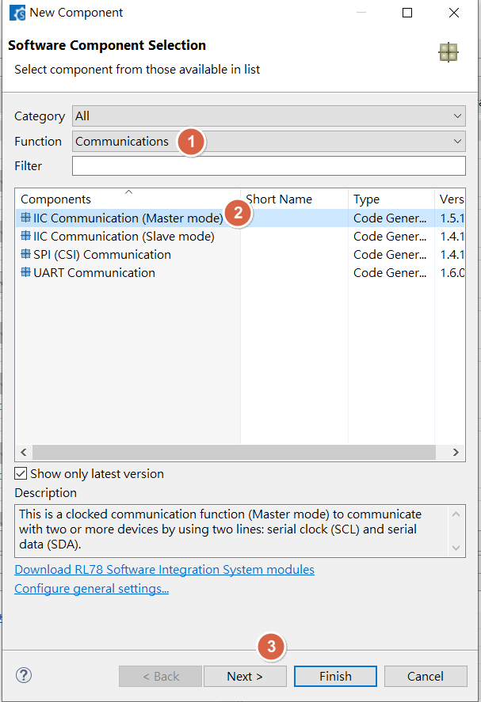

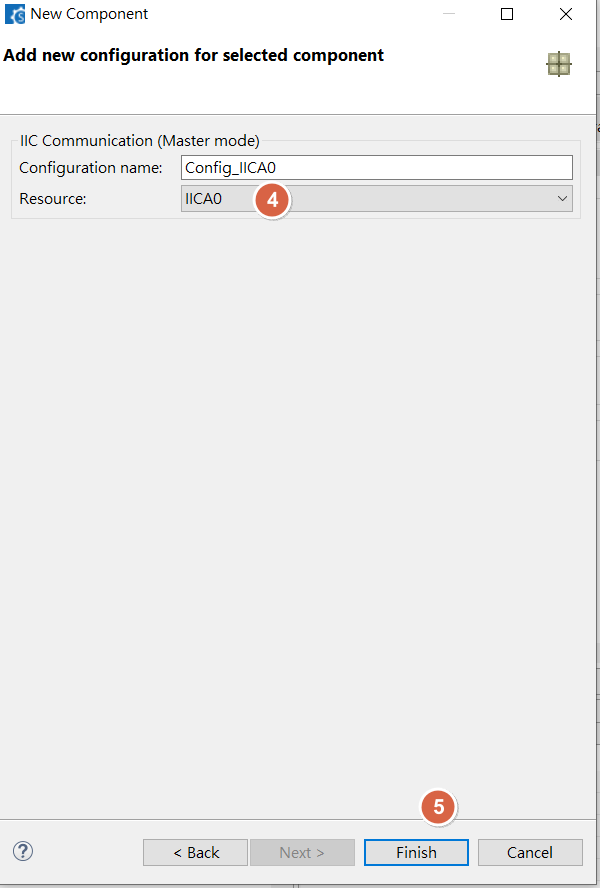

<u>RL78 Smart Configurator User's Guide: CS+</u>
[back to top](index.html#article_top)    

---

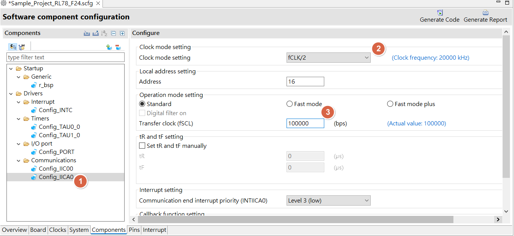

<u>RL78 Smart Configurator User's Guide: CS+</u>
[back to top](index.html#article_top)    

---

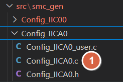

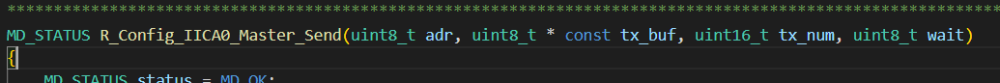

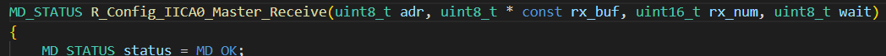

<span style="color:#FF0000">
Read function example :<br><br>
</span>

```c
R_Config_IICA0_Master_Send(…,reg,...)
R_Config_IICA0_Master_Receive(…,data,...)
```
<span style="color:#FF0000">
Write function example :<br><br>
</span>

```c
R_Config_IICA0_Master_Send(…,data,...)
```

<a id="more-iica-example-refer-to"></a>

## IICA 範例程式

- RL78 F24 slave
  - __read and write__ : 
  ```c
  void r_Config_IICA0_custom_slave_handler(void)
  ```
  - check /IICA0_slave_driver.c in [https://github.com/released/RL78_F24_IICA0_I2C_Slave_IIC_Master](https://github.com/released/RL78_F24_IICA0_I2C_Slave_IIC_Master)


- RL78 F13 slave
  - __read and write__ : 
  ```c
  void iica0_custom_slavehandler(void)
  ```
  - check /IICA0_slave_driver.c in [https://github.com/released/RL78_F13_IICA0_I2C_Slave](https://github.com/released/RL78_F13_IICA0_I2C_Slave)


- RL78 F24 slave
  - __read and write__ : 
  ```c
  void __near I2C_Downloader_routine_IRQ(void)
  ```
  - check /custom_func.c in [https://github.com/released/RL78_F24_IICA0_I2C_Slave_interrupt](https://github.com/released/RL78_F24_IICA0_I2C_Slave_interrupt)


- RL78 F24 master
  - __read__ :   
  ```c
  MD_STATUS IICA0_read(unsigned char device_addr,unsigned char reg_addr,unsigned char* rx_xfer_data,unsigned short rx_num)
  ```
  - __write__ : 
  ```c
  MD_STATUS IICA0_write(unsigned char device_addr,unsigned char reg_addr,unsigned char* tx_xfer_data,unsigned short tx_num)
  ```
  - check /simple_i2c_driver.c in [https://github.com/released/RL78_F24_IICA0_I2C_Master](https://github.com/released/RL78_F24_IICA0_I2C_Master)


- RL78 G16 master
  - __read__ :   
  ```c
  MD_STATUS IICA0_read(unsigned char device_addr,unsigned char reg_addr,unsigned char* rx_xfer_data,unsigned short rx_num)
  ```
  - __write__ : 
  ```c
  MD_STATUS IICA0_write(unsigned char device_addr,unsigned char reg_addr,unsigned char* tx_xfer_data,unsigned short tx_num)
  ```
  - check /simple_i2c_driver.cin [https://github.com/released/RL78_G16_IICA0_I2C_Master](https://github.com/released/RL78_G16_IICA0_I2C_Master)


<u>RL78 Smart Configurator User's Guide: CS+</u>
[back to top](index.html#article_top)    

[主題索引](index.html) · [上一主題](interrupt.html) · [下一主題](spi.html)
