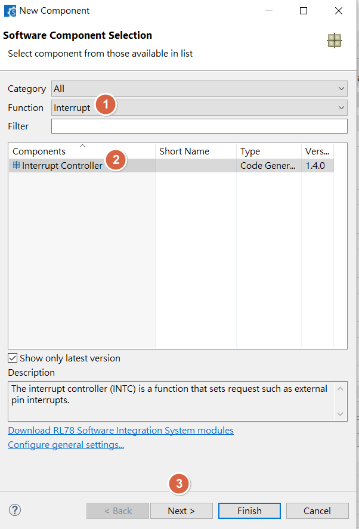
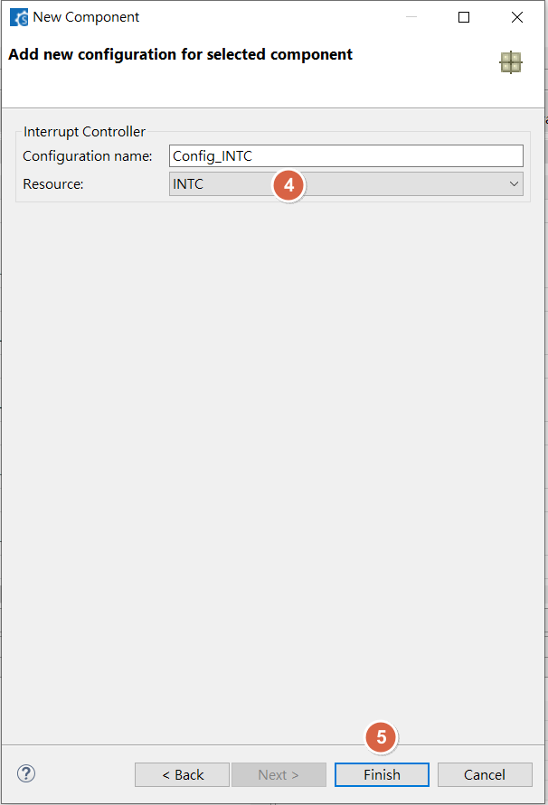
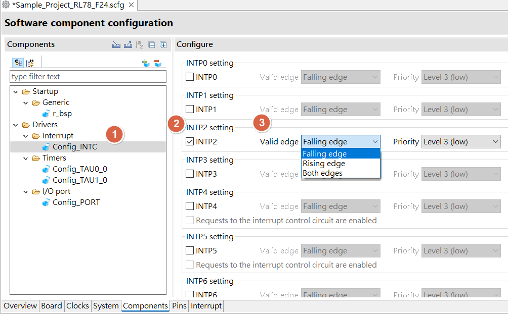
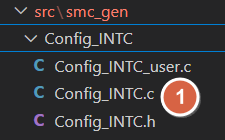
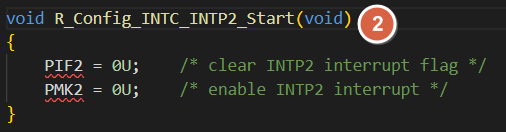
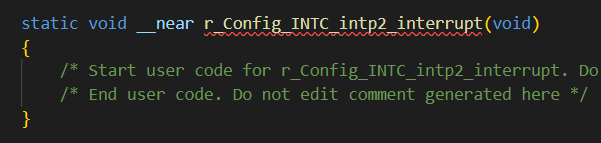
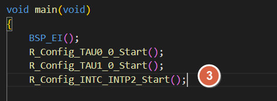

[主題索引](index.html) · [知識庫總索引](https://released.github.io/)

# 外部中斷

<!-- CHAPTER_SCOPE -->
外部中斷 整理設定位置、操作畫面與對應程式／文件連結。

- 圖中型號、clock、pin、位址與工具介面屬於各參考工程的條件，不延伸為所有型號的固定配置。
- 實際設定與結果以所選 MCU 手冊、工程設定、linker map 及量測為準；原始文件與範例連結保留在各節。


---

<a id="article_ext"></a>

## Smart Configurator：external int.






<u>RL78 Smart Configurator User's Guide: CS+</u>
[back to top](index.html#article_top)    

---



<u>RL78 Smart Configurator User's Guide: CS+</u>
[back to top](index.html#article_top)    

---





<span style="color:#FF0000">
Add code when trigger external interrupt INTP2<br><br>
</span>




<span style="color:#FF0000">
Need to manual add driver start API , ex : <br><br>
</span>

```c
R_Config_INTC_INTP2_Start();
```




<a id="more-intc-example-refer-to"></a>

## INTC 範例程式

- RL78 G16 
  - __external_input_with_timer_100us__ 
  ```c
  void drv_pulse_input_tick_isr(void)

  void drv_pulse_input_irq_handler(void)  
  ```  
  - check /drv/drv_pulse_input.c in [RL78_G16_ADC_PWM_INTP_UART_1M](https://github.com/released/RL78_G16_ADC_PWM_INTP_UART_1M)


<u>RL78 Smart Configurator User's Guide: CS+</u>
[back to top](index.html#article_top)    

[主題索引](index.html) · [上一主題](gpio.html) · [下一主題](i2c.html)
