[主題索引](index.html) · [知識庫總索引](https://released.github.io/)

# PWM

<!-- CHAPTER_SCOPE -->
PWM 整理設定位置、操作畫面與對應程式／文件連結。

- 圖中型號、clock、pin、位址與工具介面屬於各參考工程的條件，不延伸為所有型號的固定配置。
- 實際設定與結果以所選 MCU 手冊、工程設定、linker map 及量測為準；原始文件與範例連結保留在各節。


---

<a id="article_pwm"></a>

## Smart Configurator：PWM

<span style="color:#FF0000">
The PWM (pulse width modulation) output function is timer that generate multiple PWM outputs by using <u>a master and multiple slave channels.</u><br>
The pulse cycle <u>(frequency)</u> is set in the master channel.<br>
The pulse width <u>(duration)</u> is set in the slave channel.<br><br>
</span>

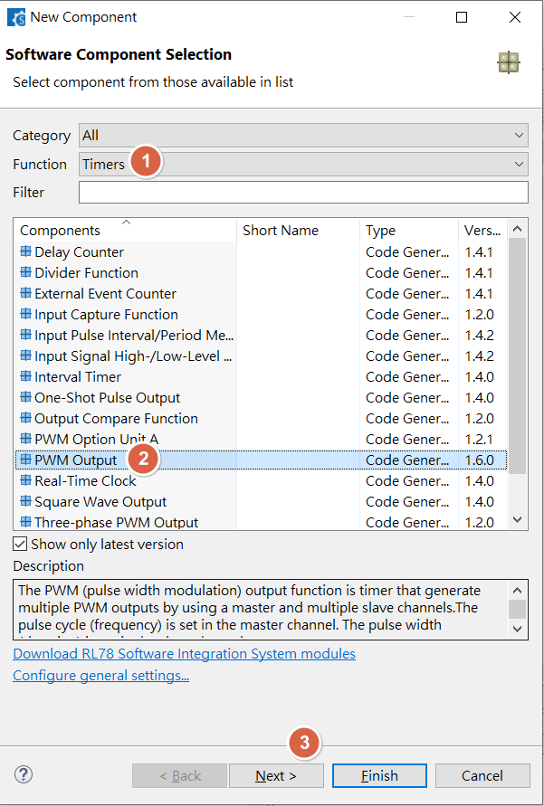

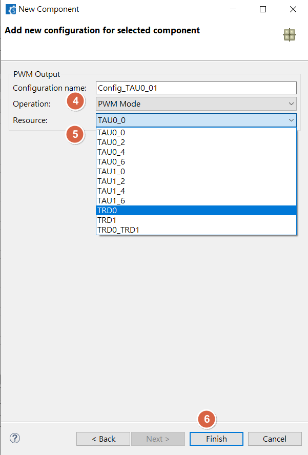


<u>RL78 Smart Configurator User's Guide: CS+</u>
[back to top](index.html#article_top)    

---

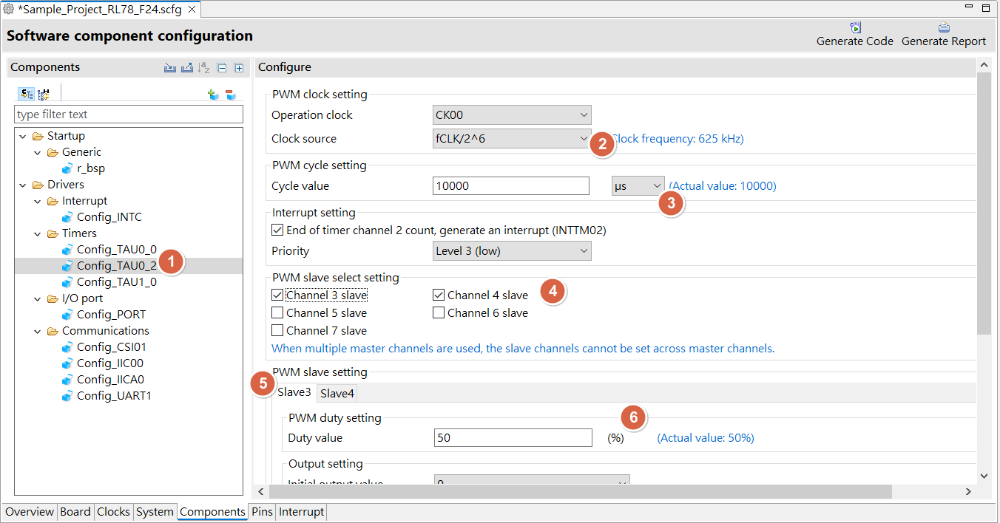

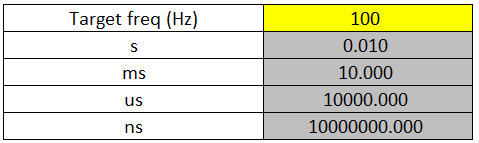

<u>RL78 Smart Configurator User's Guide: CS+</u>
[back to top](index.html#article_top)    

---

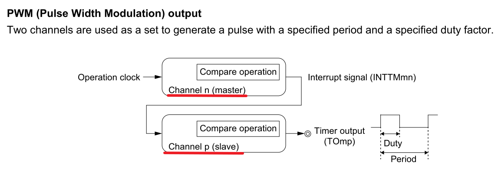

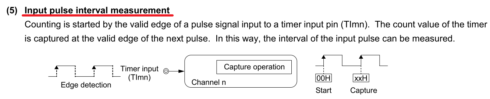

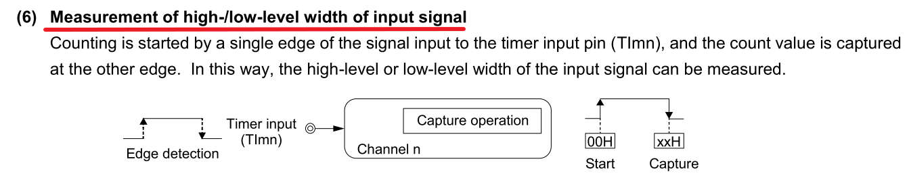

<u>RL78 Smart Configurator User's Guide: CS+</u>
[back to top](index.html#article_top)    

---

<a id="smart-config-pwm-formula"></a>

## Smart Configurator：PWM formula

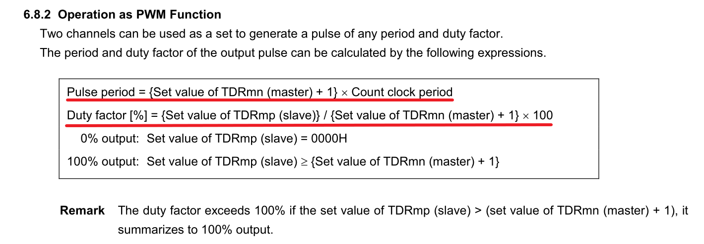

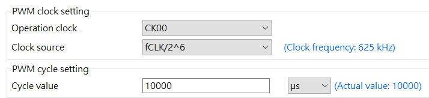

MCU clock src : 40M , 
clock div : 40M / 2^6 = 625K Hz , 
target freq : 100Hz = 10000 us

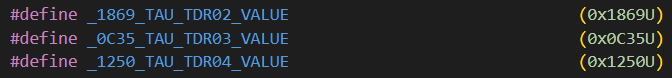

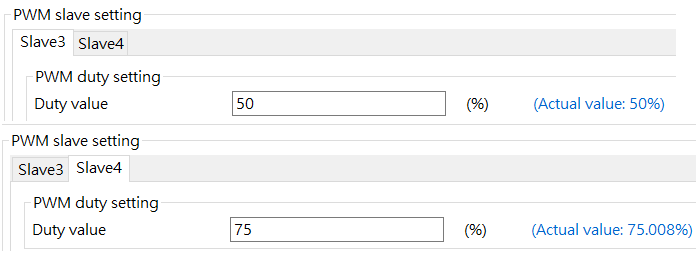

period : 1/100 (which is 10000us) = (val_m + 1 ) * (1/ 625K)

=> val_m : 625K/100 – 1 = 6250 – 1 = 6249 (<span style="color:#FF0000"><b>0x1869</b></span>)

duty(%) = val_s / (val_m + 1) *100 , 50/100 = val_s/(val_m + 1)
=> val_s = (1/2)*6250 = 3125 (<span style="color:#FF0000"><b>0xC35</b></span>)

duty(%) = val_s / (val_m + 1) *100 , 75/100 = val_s/(val_m + 1)
=> val_s = (3/4)*6250 = 4687.5 (<span style="color:#FF0000"><b>0x1250</b></span>)

<u>RL78 Smart Configurator User's Guide: CS+</u>
[back to top](index.html#article_top)    

---

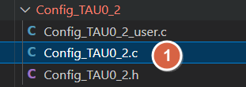

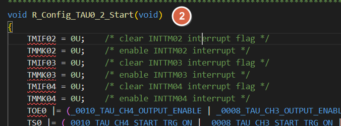

<span style="color:#FF0000">
Need to manual add driver start API , ex : <br><br>
</span>

```c
R_Config_TAU0_2_Start();
```

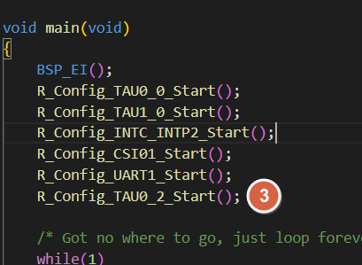


<a id="more-pwm-example-refer-to"></a>

## PWM 範例程式

- RL78 G16 
  - __PWM output__ : check /drv/drv_pwm_output.c in [RL78_G16_ADC_PWM_Input_Pulse_UART_1M](https://github.com/released/RL78_G16_ADC_PWM_Input_Pulse_UART_1M)
  - __breathing led by PWM__ : check /drv/drv_pwm_breath.c in [RL78_G16_ADC_PWM_Input_Pulse_UART_1M](https://github.com/released/RL78_G16_ADC_PWM_Input_Pulse_UART_1M)
  - __sweep led by PWM__ : check /drv/drv_pwm_sweep.c in [RL78_G16_ADC_PWM_Input_Pulse_UART_1M](https://github.com/released/RL78_G16_ADC_PWM_Input_Pulse_UART_1M)
  - __PWM input capture__ : check /drv/drv_pwm_input.c in [RL78_G16_ADC_PWM_Input_Pulse_UART_1M](https://github.com/released/RL78_G16_ADC_PWM_Input_Pulse_UART_1M)


<u>RL78 Smart Configurator User's Guide: CS+</u>
[back to top](index.html#article_top)    

[主題索引](index.html) · [上一主題](uart.html) · [下一主題](adc.html)
