[主題索引](index.html) · [知識庫總索引](https://released.github.io/)

# SPI／CSI

<!-- CHAPTER_SCOPE -->
SPI／CSI 整理設定位置、操作畫面與對應程式／文件連結。

- 圖中型號、clock、pin、位址與工具介面屬於各參考工程的條件，不延伸為所有型號的固定配置。
- 實際設定與結果以所選 MCU 手冊、工程設定、linker map 及量測為準；原始文件與範例連結保留在各節。


---

<a id="article_spi"></a>

## Smart Configurator：SPI (CSI)

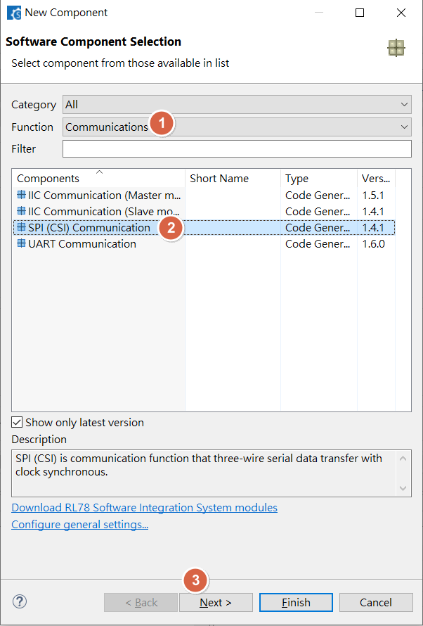

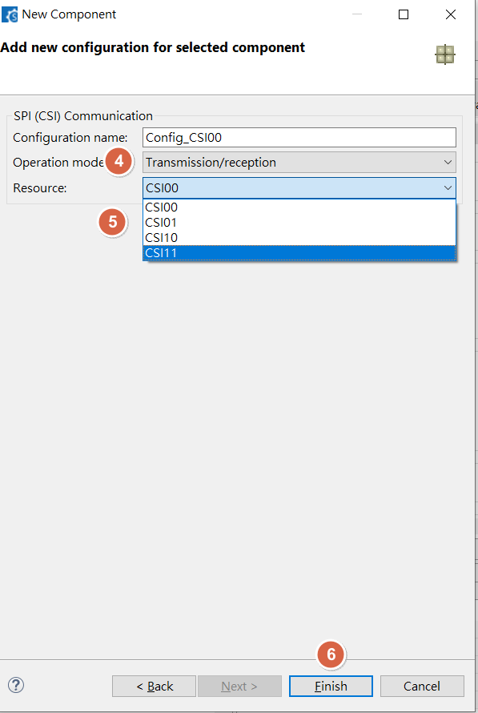

<u>RL78 Smart Configurator User's Guide: CS+</u>
[back to top](index.html#article_top)    

---

<span style="color:#FF0000">
To fix conflict , select other SAU port , each SAU channel only support one function at the same time<br><br>
</span>

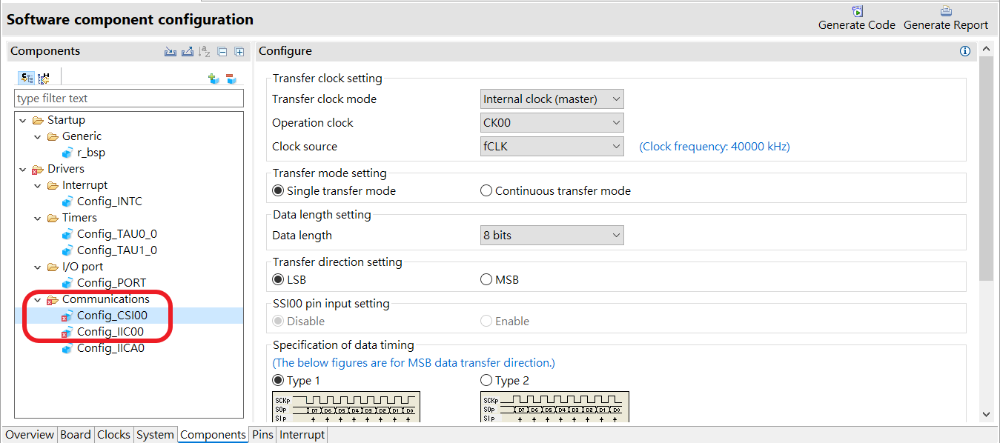


<u>RL78 Smart Configurator User's Guide: CS+</u>
[back to top](index.html#article_top)    

---

<a id="smart-config-csi-table-for-spiuarti2c"></a>

## Smart Configurator：CSI table for SPI/UART/I2C

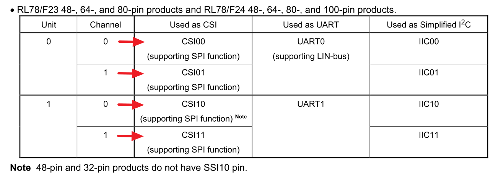

* reason why UART will take 2 channels : full-duplex
[The Reason Why UART Requires Two Channels](https://en.na4.teamsupport.com/knowledgeBase/17943145)
[Why are double channels used in UART?](https://en.na4.teamsupport.com/knowledgeBase/16980186)

<u>RL78 Smart Configurator User's Guide: CS+</u>
[back to top](index.html#article_top)    

---

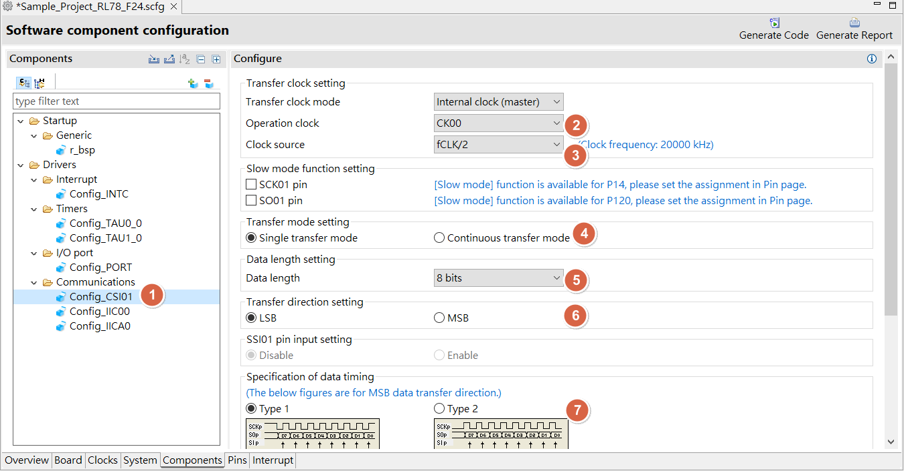

<u>RL78 Smart Configurator User's Guide: CS+</u>
[back to top](index.html#article_top)    

---

<a id="smart-config-cpolcpha"></a>

## Smart Configurator：CPOL/CPHA

* CPOL :
  * 0 : clock idle at LOW
  * 1 : clock idle at HIGH
* CPHA :
  * 0 : 1^st^ EDGE
  * 1 : 2^ND^ EDGE


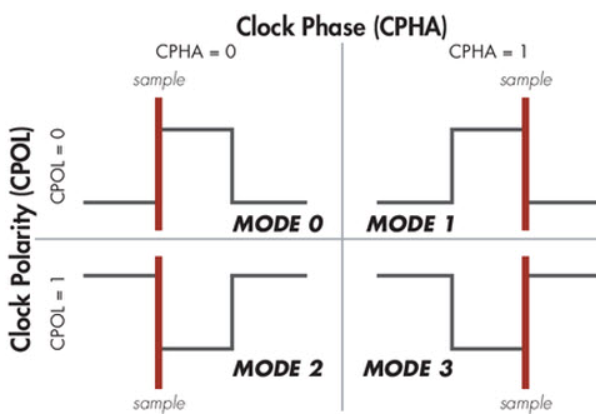

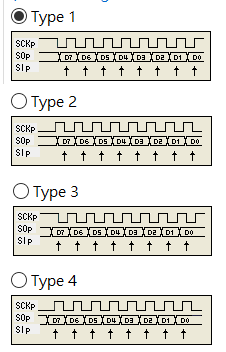


| CPOL | CPHA | mode | Type |
|:--:|:--:|:--:|:--:|
| 1  | 1 | 3 | 1 |
| 0  | 1 | 1 | 2 |
| 1  | 0 | 2 | 3 |
| 0  | 0 | 0 | 4 |


<u>RL78 Smart Configurator User's Guide: CS+</u>
[back to top](index.html#article_top)    

---

<a id="smart-config-spi-csi"></a>

## Smart Configurator：SPI (CSI)

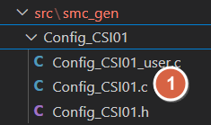

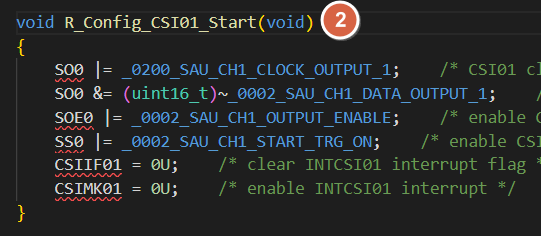

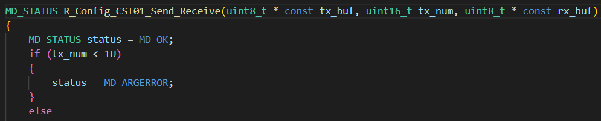


<span style="color:#FF0000">
Need to manual add driver start API , ex : <br><br>
</span>

```c
R_Config_CSI01_Start();
```

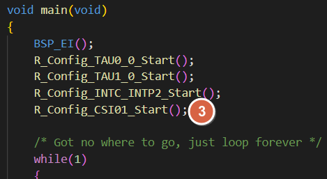

<u>RL78 Smart Configurator User's Guide: CS+</u>
[back to top](index.html#article_top)    

[主題索引](index.html) · [上一主題](i2c.html) · [下一主題](uart.html)
