[主題索引](index.html) · [知識庫總索引](https://released.github.io/)

# Timer 與程式產生

<!-- CHAPTER_SCOPE -->
Timer 與程式產生 整理設定位置、操作畫面與對應程式／文件連結。

- 圖中型號、clock、pin、位址與工具介面屬於各參考工程的條件，不延伸為所有型號的固定配置。
- 實際設定與結果以所選 MCU 手冊、工程設定、linker map 及量測為準；原始文件與範例連結保留在各節。


---

<a id="article_timer"></a>

## Smart Configurator：Interval Timer

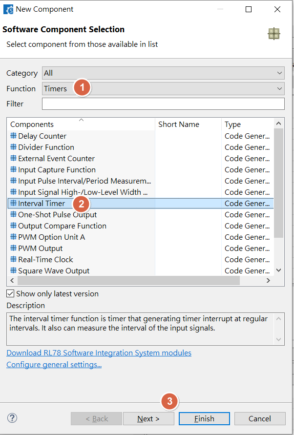

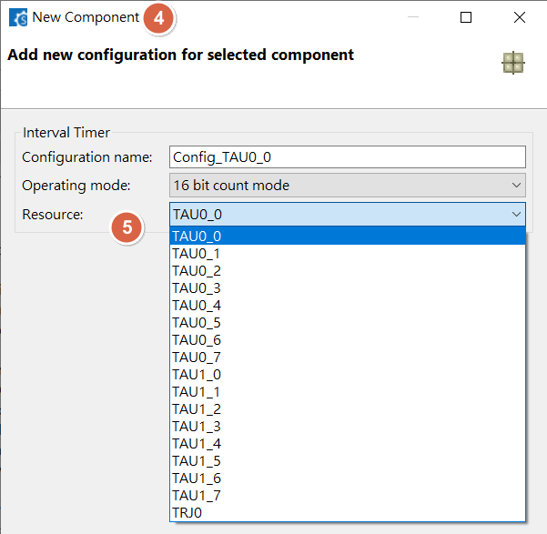

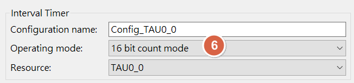

<u>RL78 Smart Configurator User's Guide: CS+</u>
[back to top](index.html#article_top)    

---

<span style="color:#FF0000">
TAUxx timer difference<br><br>
</span>  

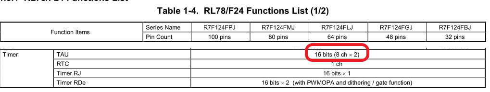


<span style="color:#FF0000">
TAUxx timer clock source<br><br>
</span>

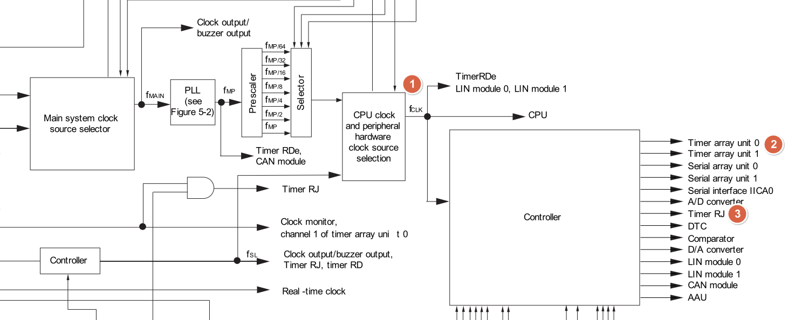


<u>RL78 Smart Configurator User's Guide: CS+</u>
[back to top](index.html#article_top)    

---

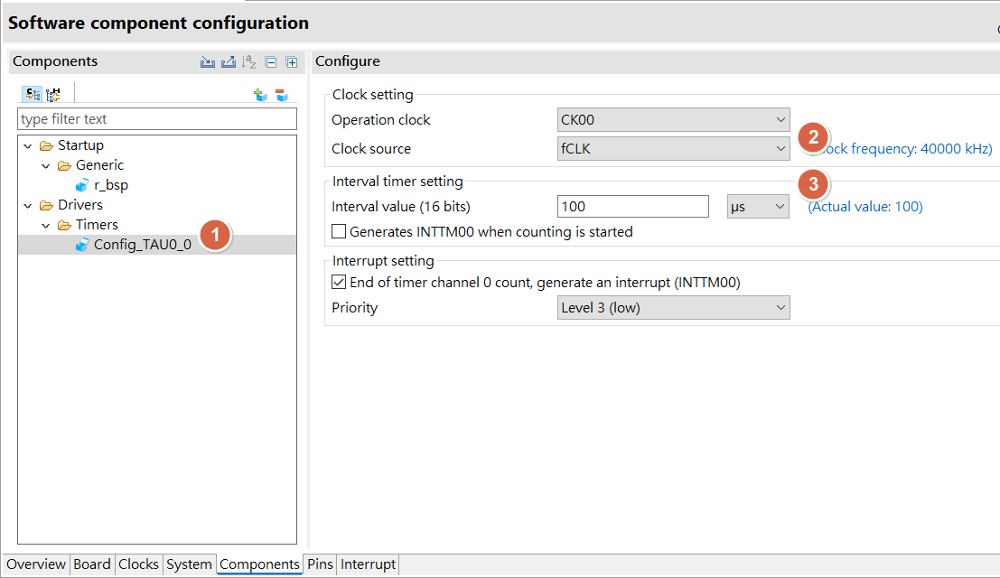

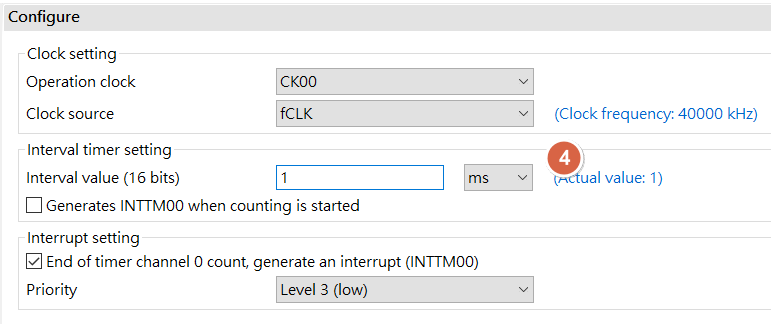

<u>RL78 Smart Configurator User's Guide: CS+</u>
[back to top](index.html#article_top)    

---

<span style="color:#FF0000">
Press <b>[Generate Code]</b> in Smart config. will automatically generate driver source code under CS+ project<br><br>
</span> 

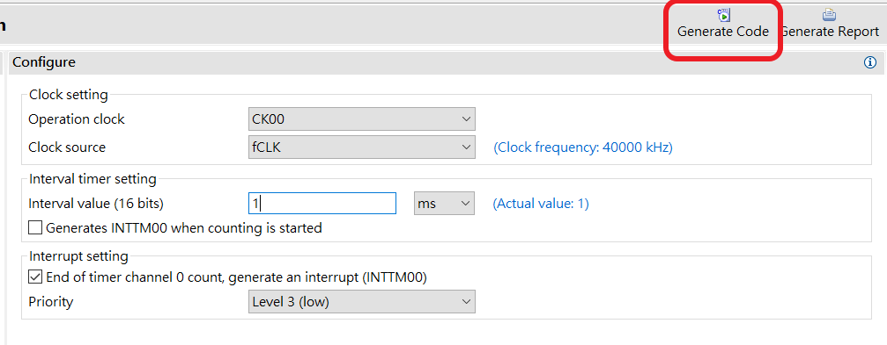

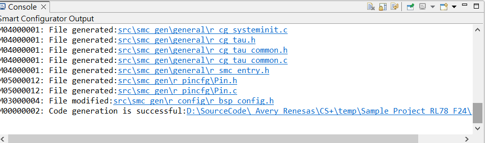

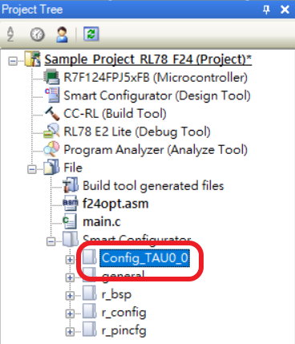

 

<u>RL78 Smart Configurator User's Guide: CS+</u>
[back to top](index.html#article_top)    

---

<span style="color:#FF0000">
Re-build project , will see the build result is complete without error<br><br>
</span>

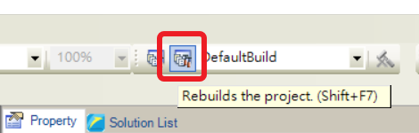

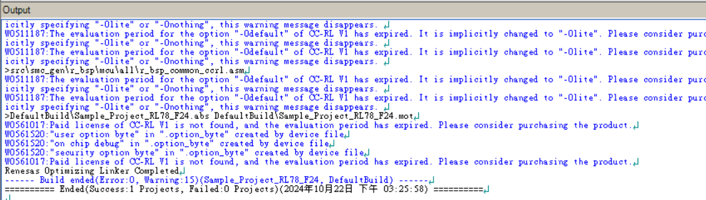


<u>RL78 Smart Configurator User's Guide: CS+</u>
[back to top](index.html#article_top)    

---

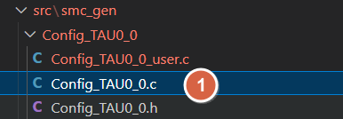

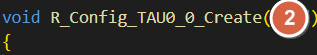

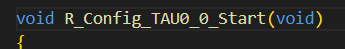

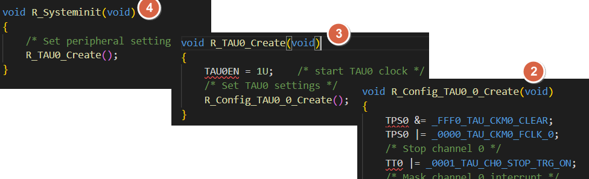

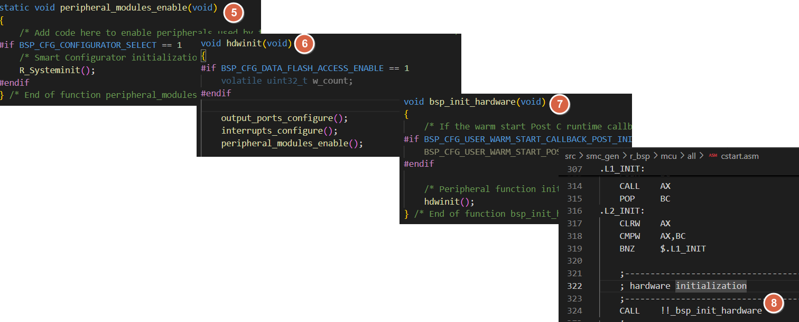

<u>RL78 Smart Configurator User's Guide: CS+</u>
[back to top](index.html#article_top)    

---

<span style="color:#FF0000">
Need to manual add interrupt enable and while(1)<br><br>
</span>

```c
BSP_EI();

while(1)
{
}

```

<span style="color:#FF0000">
Need to manual add driver start API , ex : <br><br>
</span>

```c
R_Config_TAU0_0_Start(); 
```

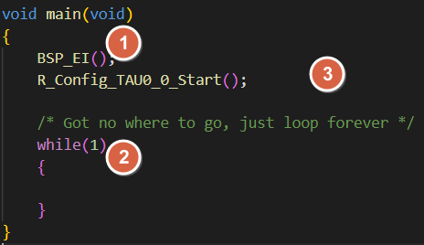


<u>RL78 Smart Configurator User's Guide: CS+</u>
[back to top](index.html#article_top)    

---


<span style="color:#FF0000">
Need to manual add include file , to fix warning<br><br>
</span>

```c
#include "r_smc_entry.h"
#include "platform.h"
```

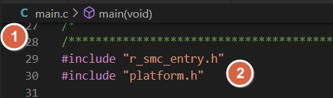

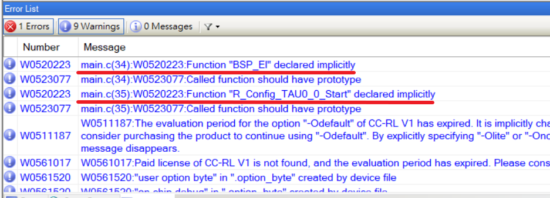

<u>RL78 Smart Configurator User's Guide: CS+</u>
[back to top](index.html#article_top)    

---

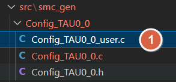

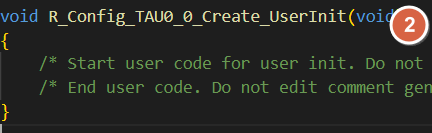

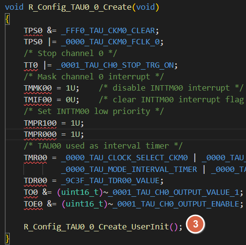


<span style="color:#FF0000">
Add TIMER interrupt function under <br><br>
</span>  

```c
r_Config_TAU0_0_interrupt()
```

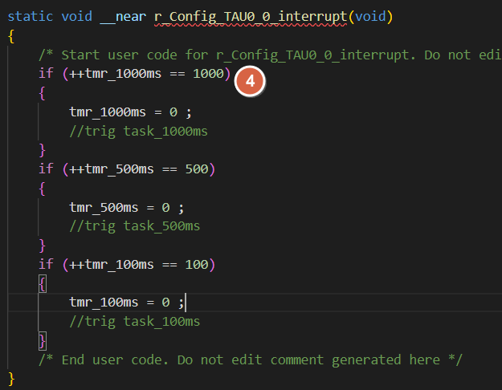

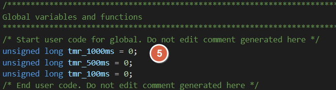


<u>RL78 Smart Configurator User's Guide: CS+</u>
[back to top](index.html#article_top)    

---

<a id="smart-config-timer-delay---interrupt"></a>

## Smart Configurator：Timer delay - interrupt

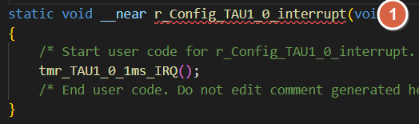

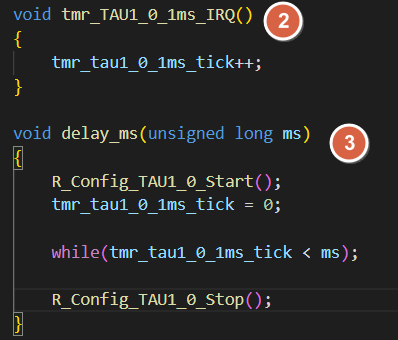


<u>RL78 Smart Configurator User's Guide: CS+</u>
[back to top](index.html#article_top)    

---

<a id="smart-config-timer-delay---polling-f2440mhz"></a>

## Smart Configurator：Timer delay - polling (F24@40MHz)

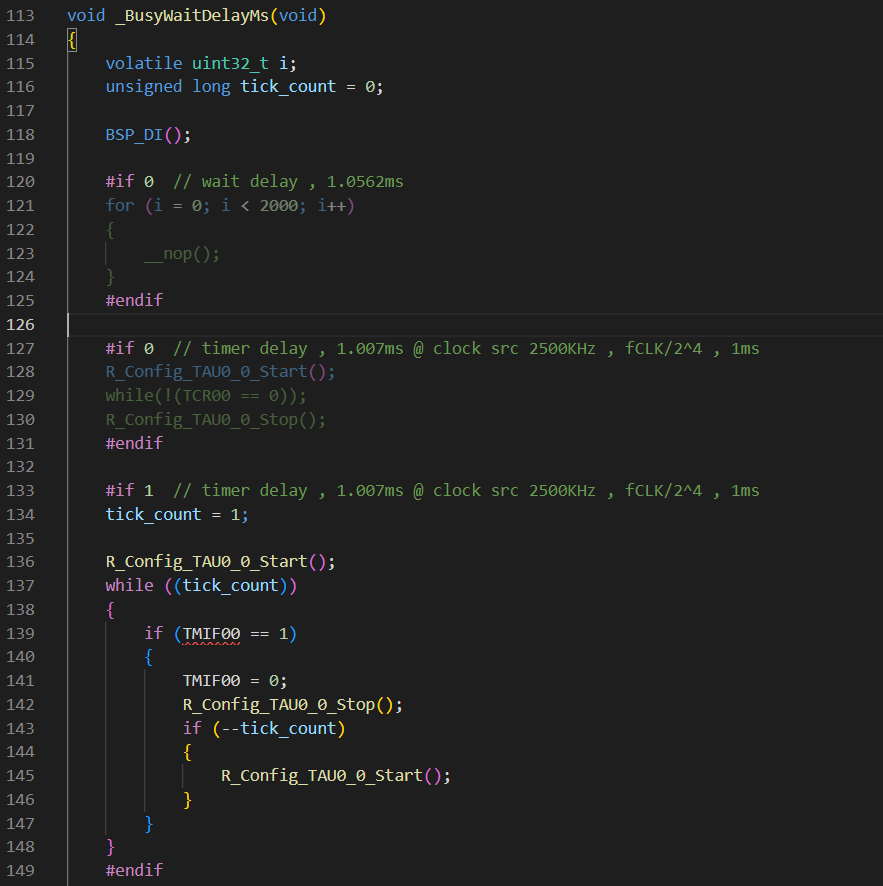

nop delay : wait delay , 1.0562ms
```c
    for (i = 0; i < 2000; i++) 
    {
        __nop();
    }
```

timer delay : timer delay , 1.007ms @ clock src 2500KHz , fCLK/2^4 , 1ms

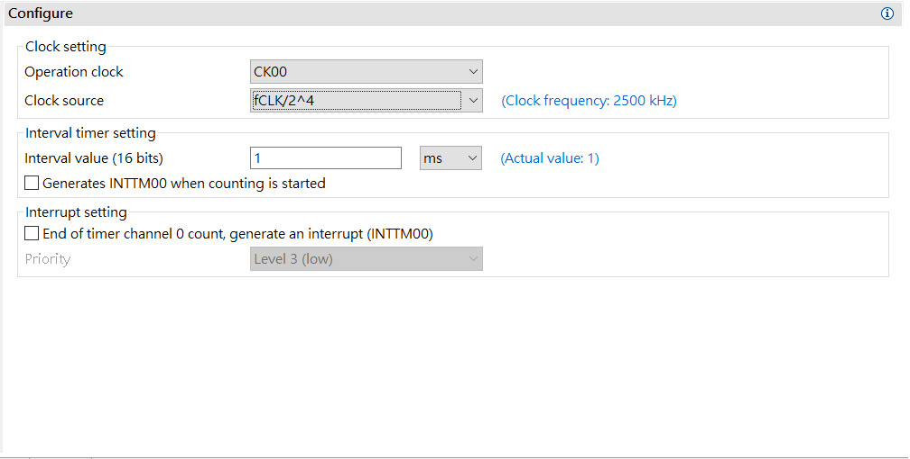


example 1:
```c
    R_Config_TAU0_0_Start();
    while(!(TCR00 == 0));
    R_Config_TAU0_0_Stop();
```

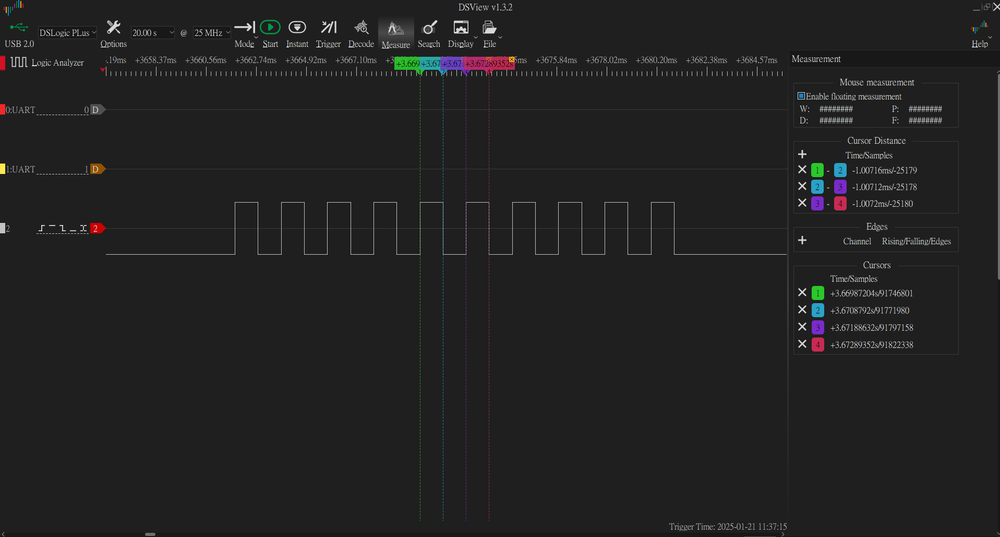

example 2:
```c

    unsigned long tick_count = 0;

    tick_count = 1;
    R_Config_TAU0_0_Start();
    while ((tick_count))
    {
      if (TMIF00 == 1)
      {
        TMIF00 = 0;
        R_Config_TAU0_0_Stop();
        if (--tick_count)
        {
          R_Config_TAU0_0_Start();
        }
      }
    }

```

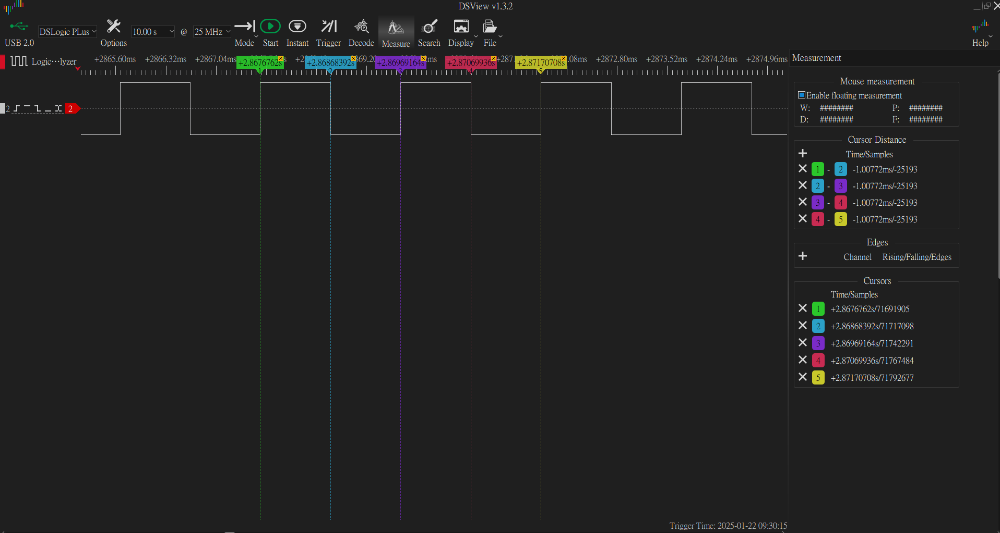


<u>RL78 Smart Configurator User's Guide: CS+</u>
[back to top](index.html#article_top)    

---

<a id="smart-config-generate-code"></a>

## Smart Configurator：Generate code

<span style="color:#FF0000">
[Generate Code] in Smart configurator , will re-generate driver code <b><u>every time</b></u><br><br>
</span> 

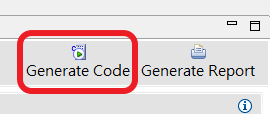

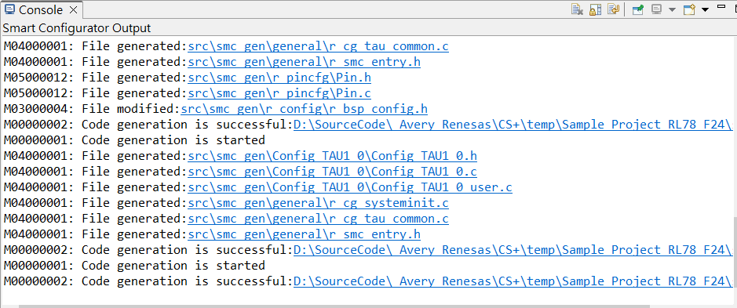


<u>RL78 Smart Configurator User's Guide: CS+</u>
[back to top](index.html#article_top)    

---

<a id="cs-driver-code"></a>

## CS+：driver code

<span style="color:#FF0000">
Put custom application code , variable , declaration , between these 2 comment , will merge into driver code when execute [Generate Code] in Smart config<br><br>
</span>  

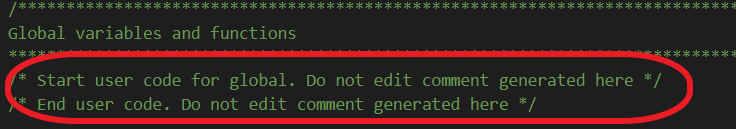

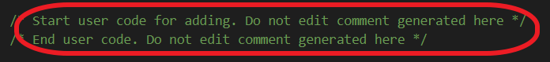

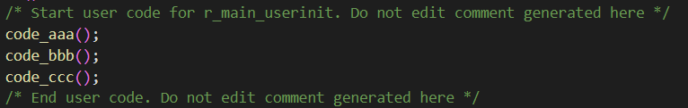


<u>RL78 Smart Configurator User's Guide: CS+</u>
[back to top](index.html#article_top)    

[主題索引](index.html) · [上一主題](clock.html) · [下一主題](gpio.html)
