[主題索引](index.html) · [知識庫總索引](https://released.github.io/)

# 開發環境與專案

<!-- CHAPTER_SCOPE -->
開發環境與專案 整理設定位置、操作畫面與對應程式／文件連結。

- 圖中型號、clock、pin、位址與工具介面屬於各參考工程的條件，不延伸為所有型號的固定配置。
- 實際設定與結果以所選 MCU 手冊、工程設定、linker map 及量測為準；原始文件與範例連結保留在各節。

---

## IDE & Debug tool

[Debug & programmer - E2 emulator](https://www.renesas.com/us/en/software-tool/e2-emulator-rte0t00020kce00000r)

[Debug & programmer - E2 emulator lite for RL78](https://www.renesas.com/us/en/software-tool/e2-emulator-lite-rte0t0002lkce00000r)

[IDE – CS+](https://www.renesas.com/en/software-tool/cs)

[IDE – e² studio](https://www.renesas.com/en/software-tool/e-studio)

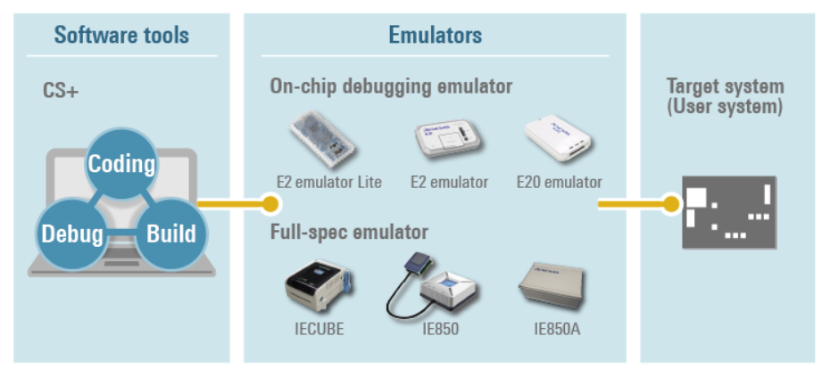

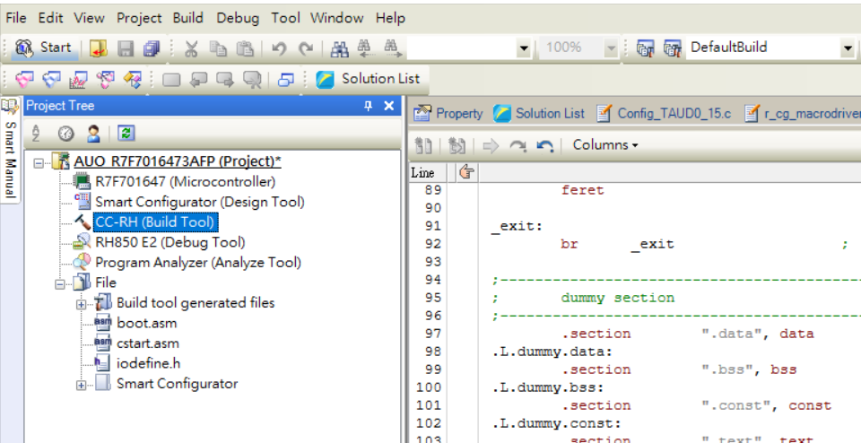

---

## User manual : CS+

[CS+ User’s Manual](https://www.renesas.com/en/software-tool/cs)

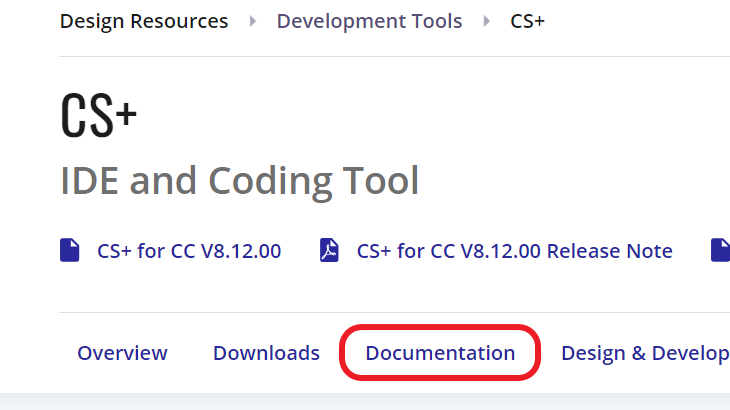

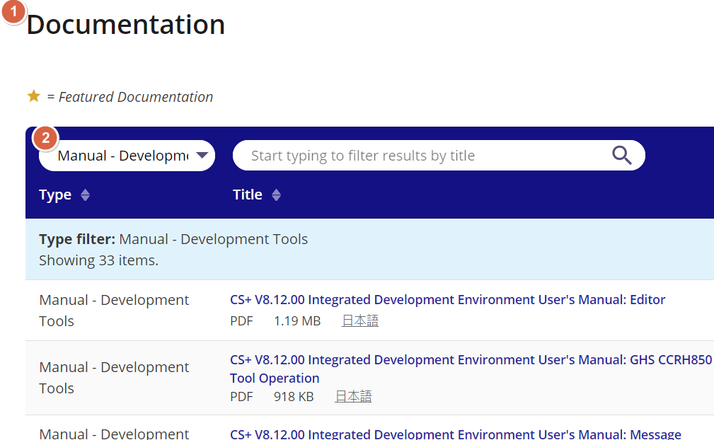

<u>Integrated Development Environment User's Manual: RL78 Debug Tool</u>
[back to top](index.html#article_top)

---

## User manual : e² studio

[e² studio User’s Manual](https://www.renesas.com/en/software-tool/e-studio)

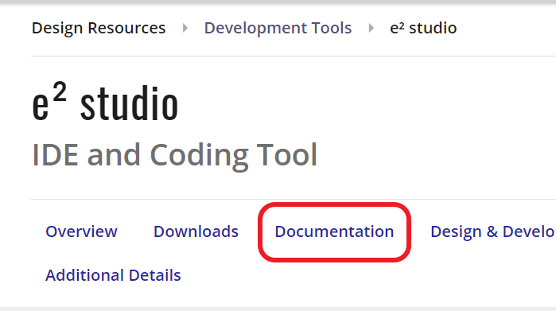

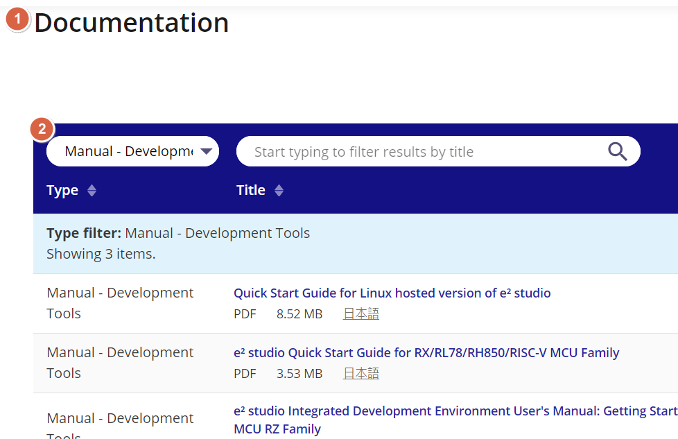

---

## Compiler : CC-RL for RL78
 

[Compiler – C Compiler Package for RL78 Family [CC-RL] ](https://www.renesas.com/en/software-tool/c-compiler-package-rl78-family)

依 IDE 選擇對應 compiler 套件（ RL78 Compiler CC-RL for CS+ or for e² studio）。

[Compiler Licenses](https://www.renesas.com/en/software-tool/compiler-licenses)

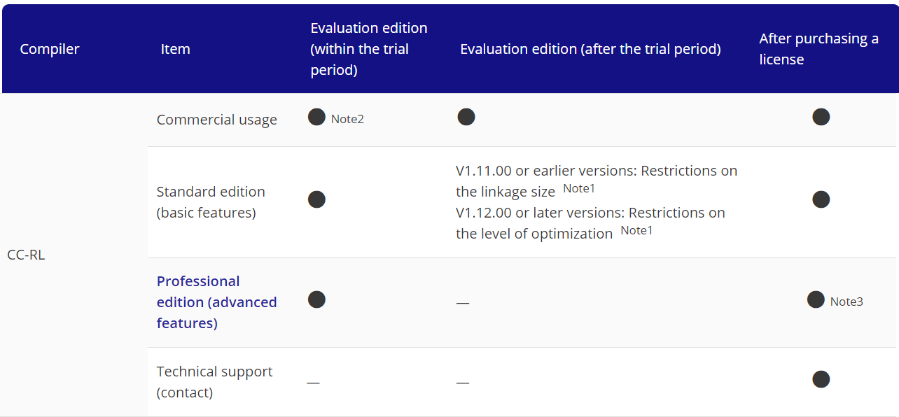

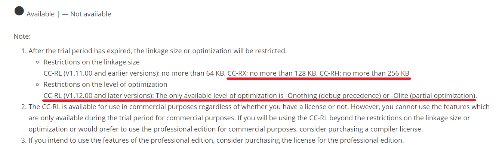

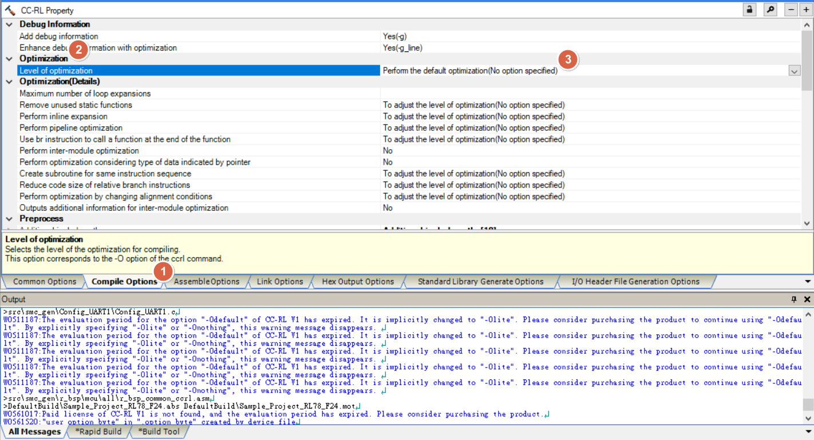

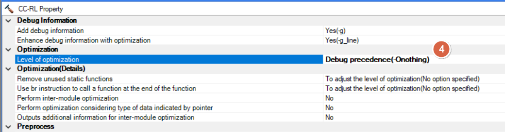

---

## User manual : CC-RL for RL78

[Compiler CC-RL User’s Manual](https://www.renesas.com/en/software-tool/c-compiler-package-rl78-family)

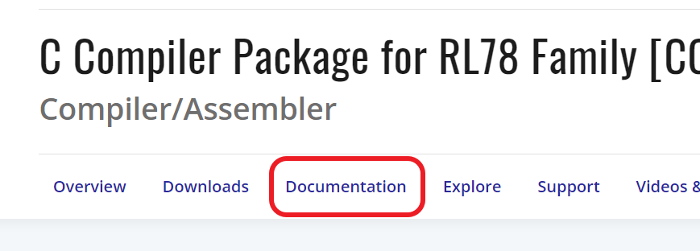

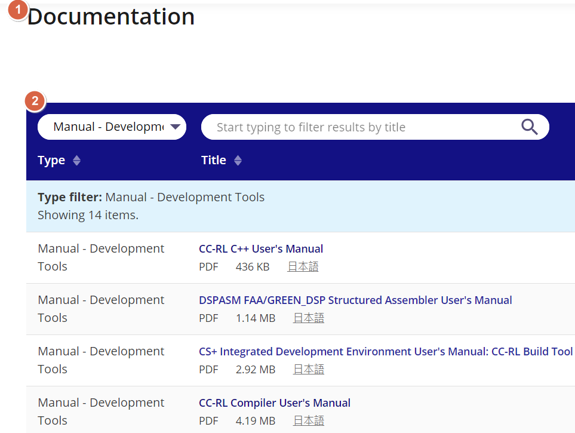

---

## Download driver : CS+ for CC Device Information

[Search : CS+ for CC Device Information and download ](https://www.renesas.com/en/search?keywords=CS%2B+for+CC+Device+Information)

Device Information 套件提供對應 MCU 的工具支援；套件與 IDE 的相容條件以下載頁說明為準。

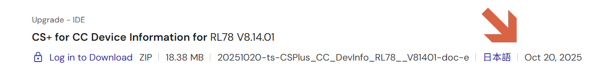

---

## Smart Configurator main window

[IDE plug in  – Smart Configurator](https://www.renesas.com/en/software-tool/smart-configurator)

Smart Configurator 套件與所選 IDE 對應。

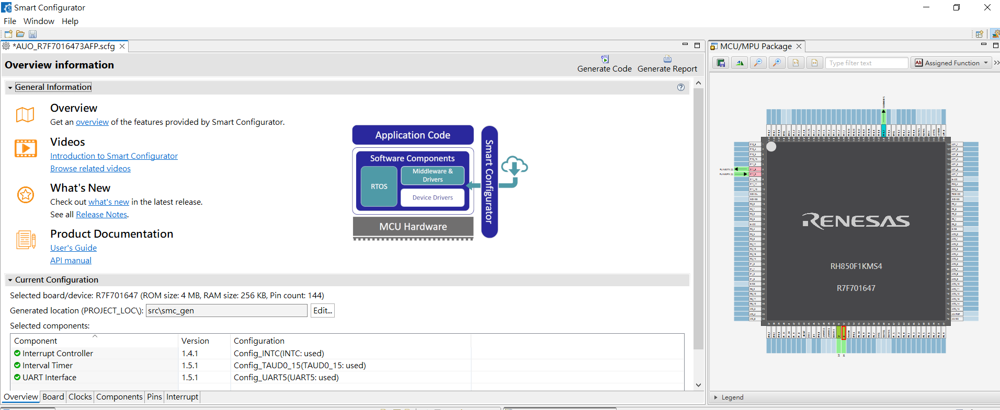

---

## Renesas Flash Programmer

[Renesas Flash Programmer (Programming GUI)](https://www.renesas.com/en/software-tool/renesas-flash-programmer-programming-gui)

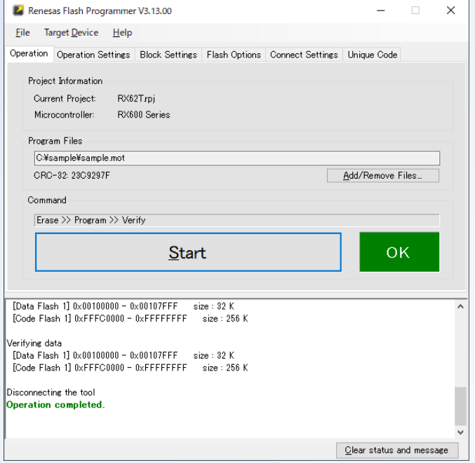

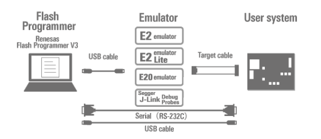

---

## Create project by CS+ (RL78)

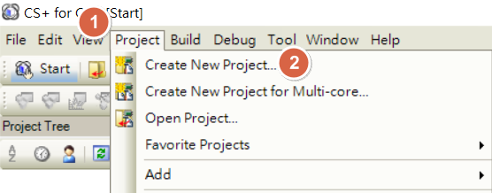

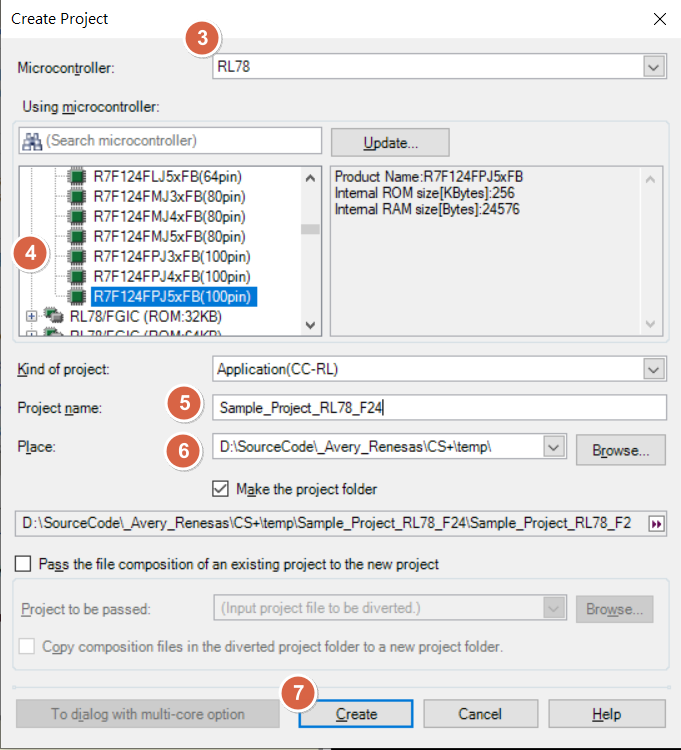

<u>Integrated Development Environment User's Manual: Project Operation</u>
[back to top](index.html#article_top)

---

## CS+ (RL78) : main window

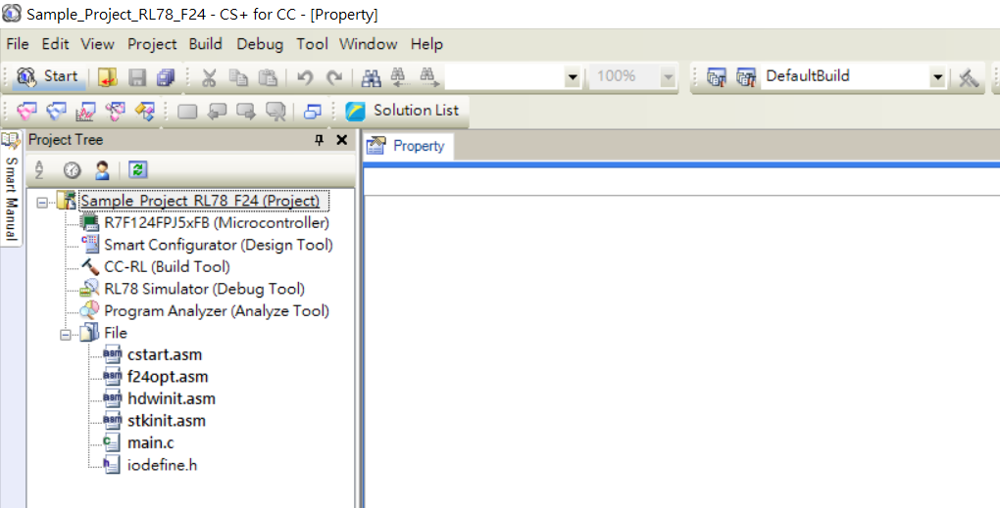

---

## CS+ (RL78) : open smart configurator

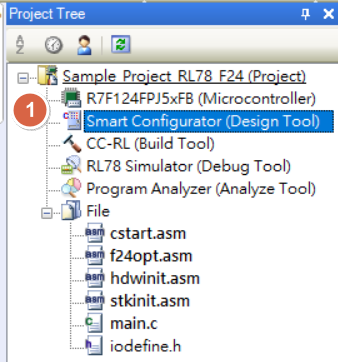

Open smart configurator from IDE (CS+)   

    
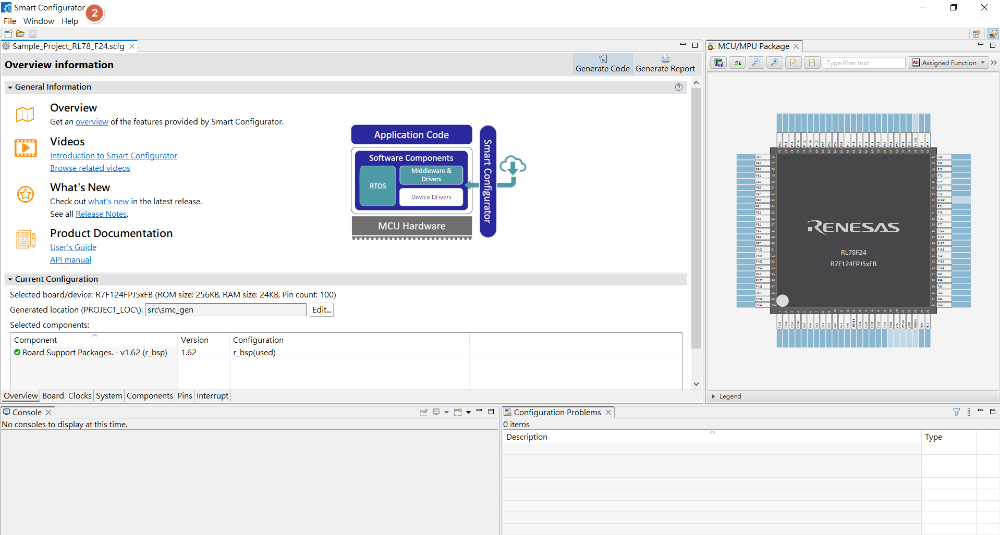

<u>RL78 Smart Configurator User's Guide: CS+</u>
<u>Smart Configurator User's Manual: RL78 API Reference</u>
[back to top](index.html#article_top)

---

## CS+ (RL78) : CC-RL options

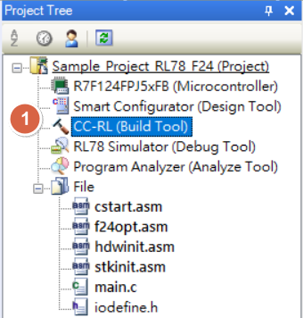

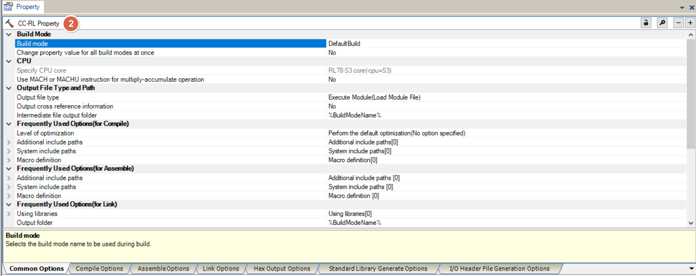

<u>Integrated Development Environment User's Manual: RL78 Debug Tool</u>
[back to top](index.html#article_top)

---

## CS+ (RL78) : Debug Tool options

Select Debug Tool  

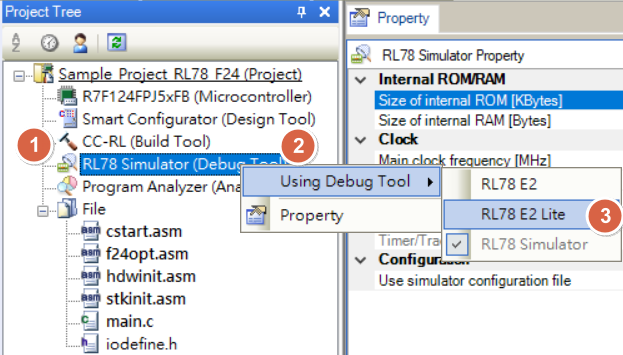

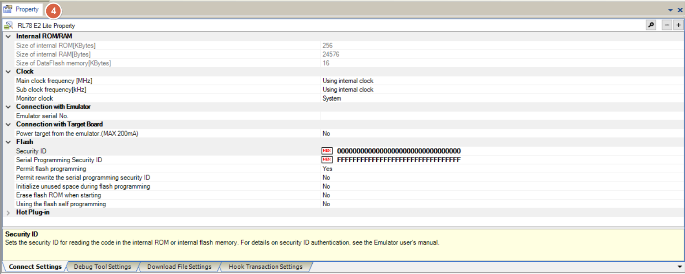

<u>Integrated Development Environment User's Manual: RL78 Debug Tool</u>
[back to top](index.html#article_top)

---

## Smart Configurator：main window (RL78)

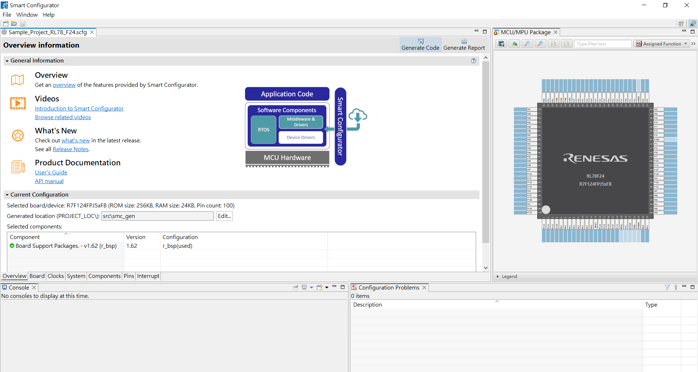

<u>RL78 Smart Configurator User's Guide: CS+</u>
[back to top](index.html#article_top) 

[主題索引](index.html) · [下一主題](clock.html)
