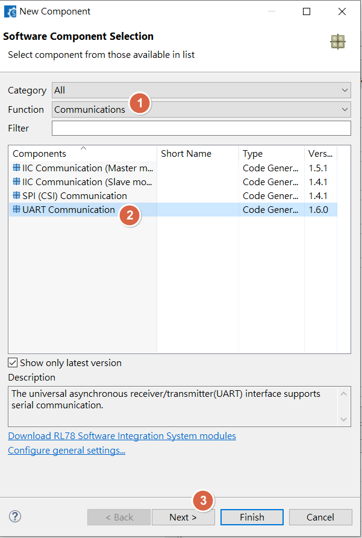
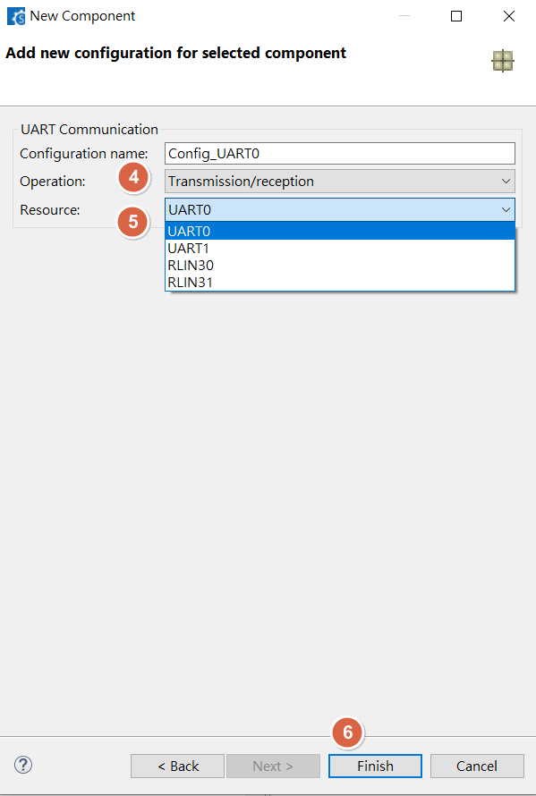
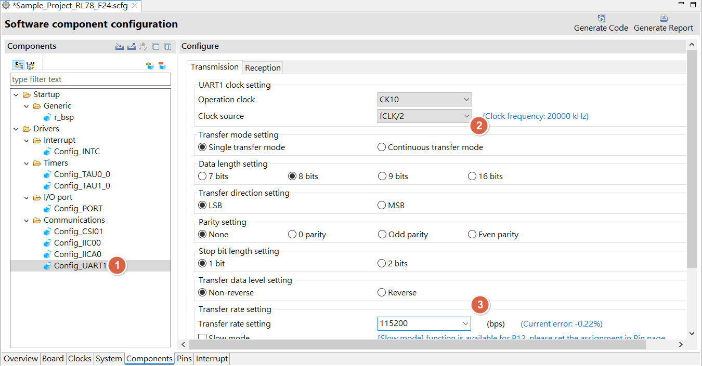
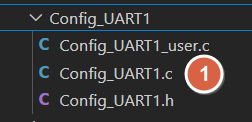
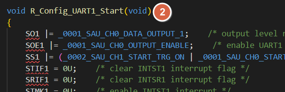
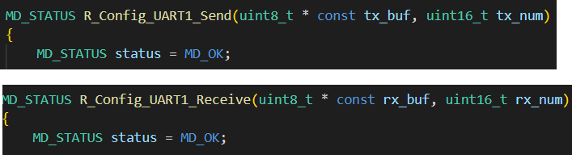
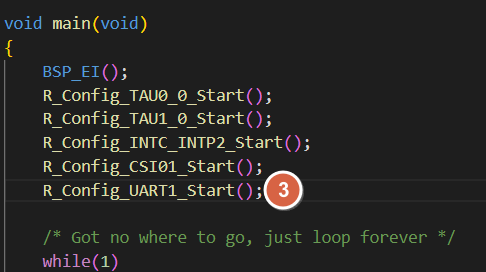
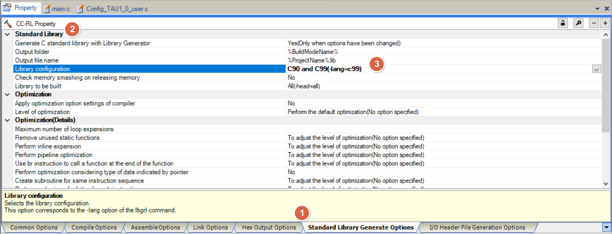

[主題索引](index.html) · [知識庫總索引](https://released.github.io/)

# UART

<!-- CHAPTER_SCOPE -->
UART 整理設定位置、操作畫面與對應程式／文件連結。

- 圖中型號、clock、pin、位址與工具介面屬於各參考工程的條件，不延伸為所有型號的固定配置。
- 實際設定與結果以所選 MCU 手冊、工程設定、linker map 及量測為準；原始文件與範例連結保留在各節。


---

<a id="article_uart"></a>

## Smart Configurator：UART





<u>RL78 Smart Configurator User's Guide: CS+</u>
[back to top](index.html#article_top)    

---



<u>RL78 Smart Configurator User's Guide: CS+</u>
[back to top](index.html#article_top)    

---








<span style="color:#FF0000">
Need to manual add driver start API , ex : <br><br>
</span>

```c
R_Config_UART1_Start();
```



<u>RL78 Smart Configurator User's Guide: CS+</u>
[back to top](index.html#article_top)    

---

<a id="smart-config-uart-printf-redirect"></a>

## Smart Configurator：UART , printf redirect

<span style="color:#FF0000">
Add printf function

1. Add include <stdio.h>
2. Enable library config : C90/C99
3. redirect putchar function
</span> 




<span style="color:#000000">
Ex : redirect putchar in UART<span style="color:#FF0000"><b>0</b></span> 

STMK<span style="color:#FF0000"><b>0</b></span> = 1U;  \/\* disable INTST0 interrupt \*\/
SDR<span style="color:#FF0000"><b>00L</b></span> = (unsigned char)c;
while(STIF<span style="color:#FF0000"><b>0</b></span>  == 0)
{
}
STIF<span style="color:#FF0000"><b>0</b></span>  = 0U\;  \/\* clear INTST0 interrupt flag \*\/
</span>


<u>RL78 Smart Configurator User's Guide: CS+</u>
[back to top](index.html#article_top)    

---

<a id="smart-config-uart-tx-rx---polling-example"></a>

## Smart Configurator：UART tx , rx - polling example


uart1 tx
```c
void UART1_SendByte(int c)
{
    STMK1 = 1U;    /* disable interrupt */
    SDR10L = (unsigned char)c;
    // STIF1 = 0U;    /* clear interrupt flag */  
    while(STIF1 == 0)
    {

    }
    STIF1 = 0U;    /* clear interrupt flag */  
}
```

```c
void UART1_sendString(unsigned char* str)
{
    while (*str) 
    {
        UART1_SendByte(*str++);
    }
}
```

uart1 rx
```c
int UART1_Get(void)
{  
    unsigned char c = 0;  
    while (SRIF1 == 0);
    SRIF1 = 0;
    c = SDR11L;
    return c;
}
```

```c
// 115200 : 1 bytes (10bit) = 0.08ms
// set timer interval delay , clock src 2500KHz , fCLK/2^4 , 1ms
int boot_UART1_Get_withTimeOut(unsigned long timeout, unsigned char *data)
{
    unsigned long tick_count;

    tick_count = timeout;
    R_Config_TAU0_0_Start();

    /* wait for a byte to arrive */
    while ((SRIF1 == 0) && (tick_count))
    {
      if (TMIF00 == 1)
      {
        TMIF00 = 0;
        R_Config_TAU0_0_Stop();
        if (--tick_count)
        {
          R_Config_TAU0_0_Start();
        }
      }
    }

    if (tick_count == 0)
    {
      *data = '0';
      return FALSE;
    }

    *data=(uint8_t) SDR11L;
    SRIF1 = 0;


    return TRUE;
}
```

<a id="more-uart-example-refer-to"></a>

## UART 範例程式

- RL78 G16 
  - __UART TX and RX__ : check /drv/drv_uart.c in [RL78_G16_ADC_PWM_Input_Pulse_UART_1M](https://github.com/released/RL78_G16_ADC_PWM_Input_Pulse_UART_1M)


<u>RL78 Smart Configurator User's Guide: CS+</u>
[back to top](index.html#article_top)    

[主題索引](index.html) · [上一主題](spi.html) · [下一主題](pwm.html)
