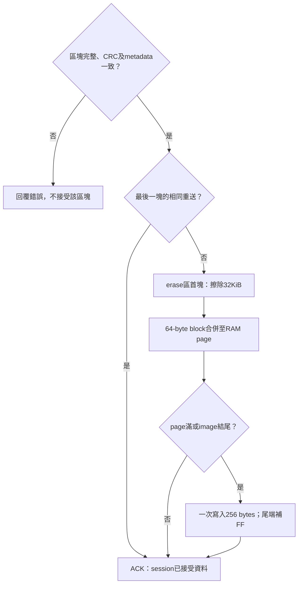

[知識庫首頁](https://released.github.io/) · [RH850 Bootloader](index.html)

# CAN FD Bootloader 與工程

CAN FD 的設定、接收與更新契約；各 MCU 工程直接入口。

<!-- BOOTLOADER_TOPICS_BEGIN -->

章節與另一平台對照

| 章節／規格 | 本頁 | 另一平台 |
| --- | --- | --- |
| MCU CAN FD device 工程設定 | [閱讀](#guide-can-device-5) | [RL78](../slide_boot_loader_for_RL78/can-fd-device.html#guide-can-device-5) |
| 設定來源 | [閱讀](#guide-can-device-6) | [RL78](../slide_boot_loader_for_RL78/can-fd-device.html#guide-can-device-6) |

<!-- BOOTLOADER_TOPICS_END -->

<!-- DEVICE_UPGRADE_PATHS_BEGIN -->
## MCU 工程與實驗索引

工程設定與實板紀錄分開列出；每個入口直接到達對應主題。

| MCU／料號 | 工程設定 | 實驗資料 |
| --- | --- | --- |
| RH850／R7F701684 | [配對工程與配置](#upgrade-rh850-can-fd) | [實板紀錄與限制](experiments.html#rh850-can-fd-update-measurements) |

<!-- DEVICE_UPGRADE_PATHS_END -->

## MCU CAN FD device 工程設定

### 設定來源

| 項目 | FD工程設定 | 修改來源 |
| --- | --- | --- |
| Mode／BRS | FD+BRS，control8bytes／raw64bytes | FD工程`RH850_CAN_FD`、`can_boot_config.h`與adapter |
| Clock／timing | CAN40MHz，nominal500K／data2M | `hal/can/can_config.c`及`rs_canfd.h`timing preset |
| IDs | control700h／reply701h，raw720h | CAN設定header與各port exact filters |
| RX | 每個啟用port各有16-depth FIFO及CPU queue | `can_port_config.h`與CAN service |
| IRQ | 共用RX EIINT23；tick84 | SC／工程table與ISR |
| 映像 | format6、256-byte Metadata、64KiB Boot、R8V1 IRQ ABI | 中性image配置與實際post-build guards |

### Flash與建置

FD沿用本工程的256-byte Flash page與FCL RAM鏈；完整mapping、產物與建置命令集中於 [移植與Flash](https://released.github.io/slide_boot_loader_for_RH850/porting.html) 及 [App建置](https://released.github.io/slide_boot_loader_for_RH850/app-development.html#rh850-build-products)。

<!-- RH850_PAGE_BEGIN -->

### 更新區塊與 Flash 交接

#### CAN 區塊與 Flash page

Tool 先完成 BIN／live 契約比對、metadata staging／seal 與 START，再依序傳送 BEGIN／raw data／COMMIT。
每個 COMMIT 的處理如下。

CAN Classical 的 raw ID 為 `0x720..0x727`，每幀最多8 bytes；CAN FD 使用 `0x720`／DLC15／64 bytes。
控制幀及 byte 格式見 [CAN frame reference](https://released.github.io/slide_boot_loader_for_RH850/reference.html#rh850-can-frames)。
每次 COMMIT 接受最多64 bytes；ACK 表示該 session 已接受區塊，未滿256-byte page 的資料仍在 RAM。
最後一塊重送由 RAM cache 核對，不再次擦寫。
斷電會遺失未寫滿的 RAM page；重新上電依完整映像驗證決定留在 Boot 或啟動有效 App，更新重新從起點進行。

擦寫由 FCL internal-handler mode 的 RAM 執行鏈完成，期間 IRQ 遮罩。
可能空白或中斷的 Flash 資料由 RAM reader 暫時關閉 VCI data ECC 後讀取並恢復設定；PE instruction ECC 不變。
這是 raw data／CRC 檢查，不是硬體 blank check 或 ECC 狀態驗證。

<!-- RH850_PAGE_END -->

<!-- MODEL_DETAILS_BEGIN -->

### RH850 × CAN FD：工程設定

#### 配對工程、接線與映像

| 項目 | 此組合的設定 |
| --- | --- |
| Device／target | R7F701684／`0x8501` |
| Boot 工程 | `Sample_Project_RH850_S1_Boot_loader_CAN_FD` |
| App 工程 | `Sample_Project_RH850_S1_Boot_loader_CAN_FD_app` |
| 初次安裝 | Boot 工程的 `DefaultBuild/boot0000_FFFF.hex`，由 programmer 安裝；確認 MCU 與擦除範圍 |
| Tool 更新檔 | App 工程的 `DefaultBuild/Sample_Project_RH850_S1_Boot_loader_CAN_FD_app_update.bin`；HEX、boot_app 合併檔與 Transfer HEX 不放入 App 更新欄 |
| Flash 配置 | App 起點 `0x10000`，容量 `960 KiB`；64 KiB Boot、App 最大 960 KiB；Flash／debugger 保留配置以配對工程與燒錄器設定核對。 |
| 資料介面 | nominal 500K、data 2M、BRS；standard control 0x700／reply 0x701，raw 0x720（64 bytes） |
| RAM 交接 | `0xFEDFFFF0..0xFEDFFFFF`；返回 Boot request：`signature／request／反碼／owner` |

- [Tool CAN FD 操作](https://released.github.io/slide_simple_renesas_isp_tool/can-fd.html)提供接線、Discover、Enter Boot、更新與結果確認。
- [Boot 接收與驗證機制](https://released.github.io/slide_boot_loader_for_RH850/can-fd-device.html#can-fd-device-engineering)集中描述此介面的接收、CRC、更新命令與完成回覆。
- [App 返回 Boot 與 RAM 交接](https://released.github.io/slide_boot_loader_for_RH850/architecture.html#boot-app-handoff)說明 ENTER 與 UART0 z/Z 的差異；實際保留位址以本節表格為準。
- [此組合的實驗資料與限制](https://released.github.io/slide_boot_loader_for_RH850/experiments.html#rh850-can-fd-update-measurements)與工程設定分開呈現，沒有實板紀錄的組合不推定為已驗證。
- 程式入口為配對工程的 `custom_func.c`：`hardware_init()`／`loop()`；移植修改位置見 [Boot／App 移植](https://released.github.io/slide_boot_loader_for_RH850/porting.html)。
<!-- MODEL_DETAILS_END -->

---

[上一主題：CAN Bootloader 與工程](can-device.html) · [指南入口](index.html) · [下一主題：I2C Bootloader 與協定格式](i2c-device.html)
