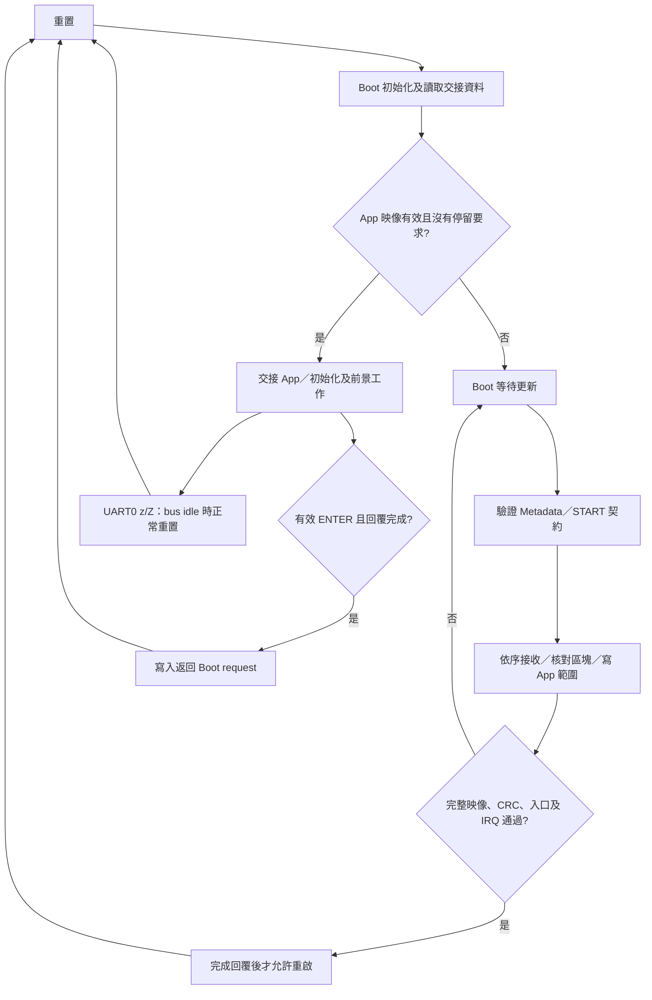

[知識庫首頁](https://released.github.io/) · [RL78 Bootloader](index.html)

# Bootloader 整體架構

Boot／App／Host 分工、啟動驗證、更新流程與 RAM 交接。

<!-- BOOTLOADER_TOPICS_BEGIN -->

章節與另一平台對照

| 章節／規格 | 本頁 | 另一平台 |
| --- | --- | --- |
| Boot、App 與 Host 的責任 | [閱讀](#boot-architecture) | [RH850](../slide_boot_loader_for_RH850/architecture.html#boot-architecture) |
| 啟動、更新與交接 | [閱讀](#boot-app-handoff) | [RH850](../slide_boot_loader_for_RH850/architecture.html#boot-app-handoff) |

<!-- BOOTLOADER_TOPICS_END -->

## Boot、App 與 Host 的責任

| 元件 | 責任 | 設定與機制 |
| --- | --- | --- |
| PC Tool | 讀取 BIN、核對 live 裝置、排程更新、確認結果與產生報告 | [Tool 操作](https://released.github.io/slide_simple_renesas_isp_tool/) |
| MCU Host／bridge | 承載 Host Link，依所選介面轉送資料與回報 bus 結果 | [Host 工程](https://released.github.io/slide_simple_renesas_isp_tool/host-firmware.html) |
| Device Boot | 驗證映像、管理 App 分區與更新狀態，通過入口／IRQ／CRC 檢查後交接 | [介面機制](index.html#boot-interfaces)／[Flash 與移植](porting.html) |
| Device App | 執行前景工作、回覆身分與支援的查詢，接受返回 Boot 要求 | [Metadata／IRQ](app-development.html) |

Host 的傳輸成功不等於 Device Flash 驗證成功；完整映像 CRC 通過也不等於 App 已完成初始化。
Tool 的完成判定集中於[更新確認與報告](https://released.github.io/slide_simple_renesas_isp_tool/status-and-reports.html#app-restart-confirmation)。

## 啟動、更新與交接

- **RAM 交接是啟動契約的一部分。** Linker 保留區、stack、BSS／data 與 ECC 初始化須一致；保留位址及 request 欄位由各 MCU 工程表說明。
- ENTER 與 UART0 z/Z 分別代表「要求停留 Boot」及「正常 MCU reset」；協定命令值與完整回覆條件由各介面章節定義。
- 冷上電不能假設 RAM marker 有效；Boot 仍需驗證 Flash 映像。正常更新紀錄不自動涵蓋冷啟動、斷電或故障恢復。
- 中斷入口、Metadata 與 Flash backend 的具體修改位置分別見 [App 設定](app-development.html)、[逐 byte decode](reference.html)及[移植](porting.html)。

---

[指南入口](index.html) · [下一主題：CAN Bootloader 與工程](can-device.html)
