[主題索引](index.html) · [知識庫總索引](https://released.github.io/)

# App 建置與燒錄設定

<!-- CHAPTER_SCOPE -->
App 建置與燒錄設定 整理設定位置、操作畫面與對應程式／文件連結。

- 圖中型號、clock、pin、位址與工具介面屬於各參考工程的條件，不延伸為所有型號的固定配置。
- 實際設定與結果以所選 MCU 手冊、工程設定、linker map 及量測為準；原始文件與範例連結保留在各節。


---
<a id="project-app-code-property-modifictaion---e2-lite-setting"></a>

## Project : app code property modification - E2 lite setting

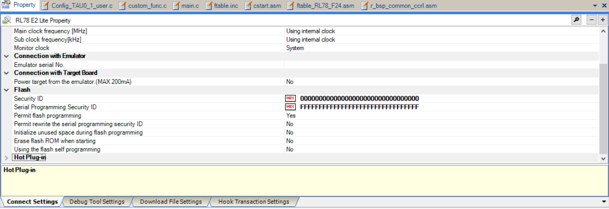


<u>CC-RL Compiler User's Manual</u>
<u>CS+ User’s Manual: CC-RL Build Tool Operation</u>

---

<a id="project-app-code-property-modifictaion---cc-rl-build-tool-setting"></a>

## Project : app code property modification - CC-RL Build Tool setting

**Common Options**

refer to How to Divide Boot and Flash Areas :
__4.2.3  Specifying hex file output only to the flash area address range__


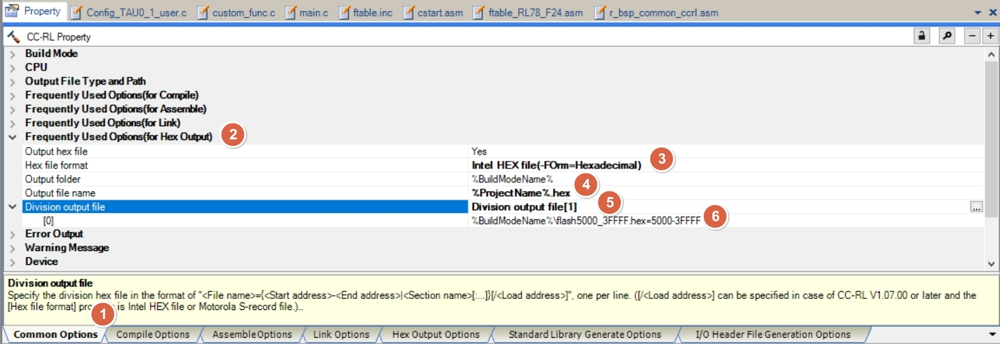


* __[Frequently Used Options (for Hex Output)] > [Division output file]__
  * base on MCU (ex : RL78F24 , 256K flash) , to ==app code start address and end address== as file name
* file size will be different if use other platform (ex : RL78 F13 , RL78 G16 , etc)
  * [map const define ?](boot-startup.html#map_const)

```c
%BuildModeName%\flash5000_3FFFF.hex=5000-3FFFF
```


---

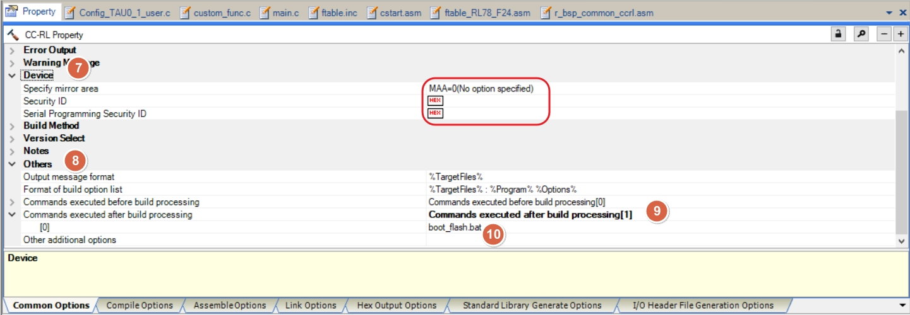

* __[Other] > [Commands executed after build processing]__
  * add : boot_flash.bat , for RL78 F24 (256K)
  * use srecord tool , do action as below
    * save app code hex to back hex file
      * 1backupHex.cmd
    * base on app code hex , generate CRC
      * 2generateChecksum.cmd
    * base on app code hex (w/ CRC) , generate CRC into hex
      * 3generateCRCHex.cmd
    * covert app code hex (w/ CRC) to app code bin
      * 4generateCRCBin.cmd
    * base on app code hex (w/ CRC) , to over lap original hex
      * 5generateCRCHexOverlap.cmd
    * combine boot code and app code
      * 6generateBootAppHex.cmd
    * covert boot/app code hex (w/ CRC) to boot/app code bin
      * 7generateBootAppBin.cmd

<br>

__1backupHex.cmd__
```c
# input file
.\DefaultBuild\flash5000_3FFFF.hex -Intel

-crop 0x005000 0x40000

# produce the output file
-Output
.\DefaultBuild\flash5000_3FFFF_backup.hex -Intel

```

<br>

__2generateChecksum.cmd__
```c
# input file
.\DefaultBuild\flash5000_3FFFF.hex -Intel

-crop 0x5000 0x3FFFC

-crc32-l-e 0x3FFFC		

-crop 0x3FFFC 0x40000
											
-Output 
- 
-HEX_Dump

```

<br>

__3generateCRCHex.cmd__
```c

# input file
.\DefaultBuild\flash5000_3FFFF.hex -Intel

-crop 0x5000 0x3FFFC

-crc32-l-e 0x3FFFC

-Output
.\DefaultBuild\flash5000_3FFFF_CRC.hex -Intel

```

<br>

__4generateCRCBin.cmd__
```c

# input file
.\DefaultBuild\flash5000_3FFFF_CRC.hex -Intel

-crop 0x005000 0x40000 -offset -0x005000

# produce the output file
-Output
.\DefaultBuild\flash5000_3FFFF.bin -binary

```

<br>

__5generateCRCHexOverlap.cmd__
```c

# input file
.\DefaultBuild\flash5000_3FFFF_CRC.hex -Intel

-crop 0x005000 0x40000

# produce the output file
-Output
.\DefaultBuild\flash5000_3FFFF.hex -intel

```

<br>

__6generateBootAppHex.cmd__
```c
..\RL78_F24_Basic_Boot_loader_UART\DefaultBuild\boot0000_4FFF.hex -Intel .\DefaultBuild\flash5000_3FFFF.hex -Intel -o .\boot_app.hex -Intel -Output_Block_Size=16

```

<br>

__7generateBootAppBin.cmd__
```c

# input file
.\boot_app.hex -Intel

-crop 0x00000 0x40000

# produce the output file
-Output
.\boot_app.bin -binary

```

---

use RFP to download whole program : boot_app.bin(boot code + app code)

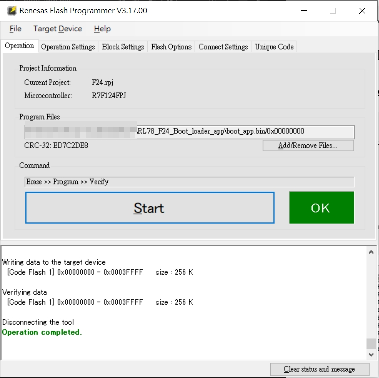


__boot+app binary folder__ : 
RL78_F24_Basic_Boot_loader_app\boot_app.bin

__boot code binary folder__ : 
RL78_F24_Basic_Boot_loader_UART\DefaultBuild\boot0000_4FFF.hex

__app code binary folder__ : 
RL78_F24_Basic_Boot_loader_app\DefaultBuild\flash5000_3FFFF.bin
RL78_F24_Basic_Boot_loader_app\DefaultBuild\flash5000_3FFFF.hex

---

<a id="project-app-code-property-modifictaion---cc-rl-build-tool-setting-2"></a>

## Project : app code property modification - CC-RL Build Tool setting

**Compile Options**

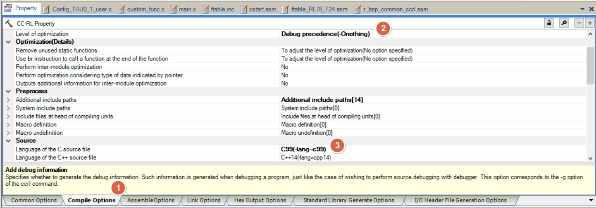


<u>How to Divide Boot and Flash Areas</u>
<u>CC-RL Compiler User's Manual</u>
<u>CS+ User’s Manual: CC-RL Build Tool Operation</u>


---

<a id="project-app-code-property-modifictaion---cc-rl-build-tool-setting-3"></a>

## Project : app code property modification - CC-RL Build Tool setting

**Link Options**

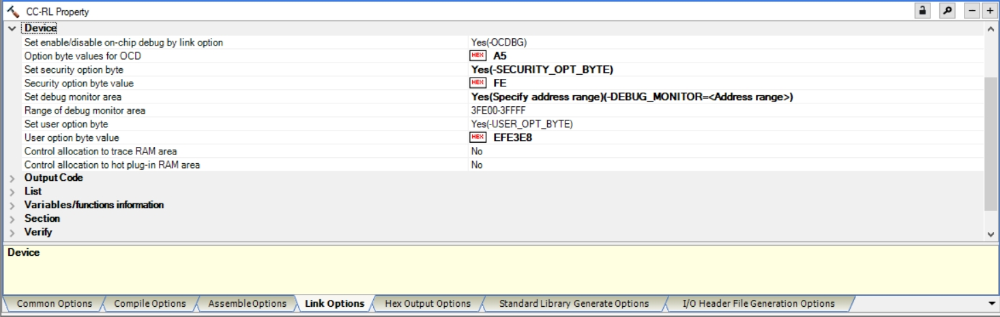
* __[Device] > [Option byte values for OCD]__
  * set to ```A5```
  * default will be 0xFF

<br>

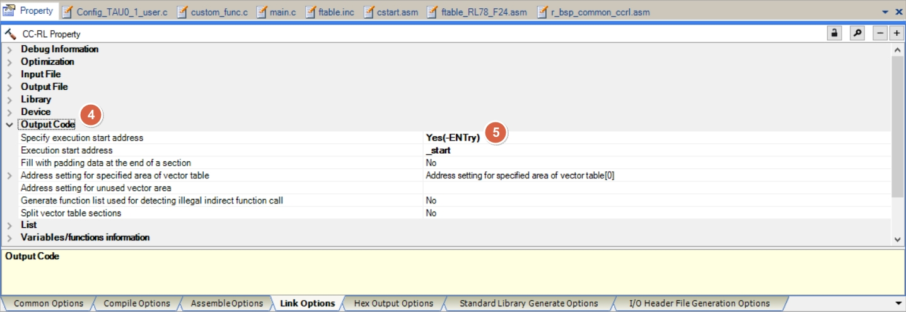
* __[Output Code] > [Execute start address]__
  * will be called by cstart.asm
<br>


---

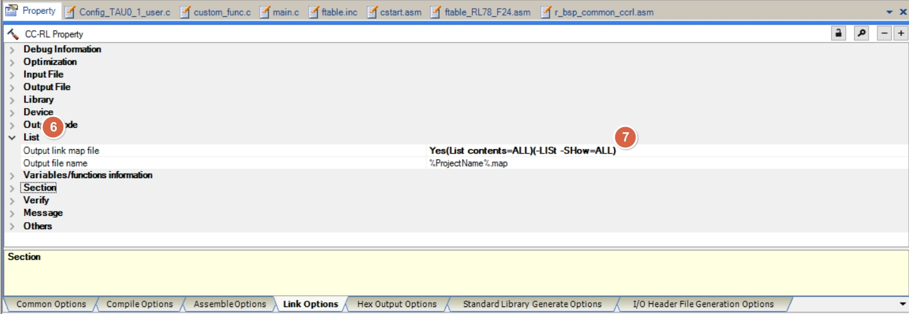
* __[List] > [Ooutput link map file]__
  * select -SHow=ALL , will display the compile result (function , address) in map file for debug
  * map file under /DefaultBuild

* refer to document : 
  * How to Divide Boot and Flash Areas (R20UT3475EJ0300) 
    * __3.2.2  Specifying the section allocation__
  * Renesas Flash Driver RL78 Type 02 User’s  Manual (R20UT5009EJ0110) 
    * __6.1.3.3  Section Item Settings__
<br>

---

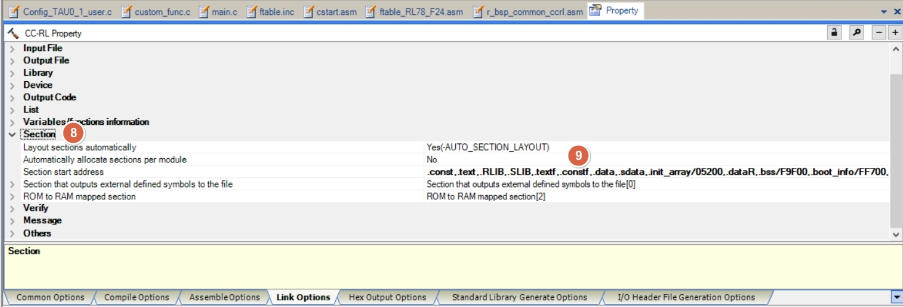
* __[Section] > [Section start address]__

refer to How to Divide Boot and Flash Areas :
__4.2.2  Specifying the section allocation__

  * set __Layout sections automatically__ to ==NO== 
  * app code will start from 0x5000 (RL78 F24) , and reserved branch table area (0x5200)
  * entry editor and modify as below ( for data flash library )
  * flash area
  ```
  RFD_DATA_n 
  RFD_CMN_f 
  RFD_DF_f 
  SMP_CMN_f 
  SMP_DF_f 

  ```

  * ram area
  ```
  RFD_DATA_nR 

  ```

  * reserve SRAM flag 0xFF700 area [(ram flag)](architecture.html#ram_flag) , to prevent initial when power on

  * __[Section] > [ROM to RAM mapped section]__
    * entry editor and modify as below :

  ```
  .data=.dataR
  .sdata=.sdataR
  RFD_DATA_n=RFD_DATA_nR
  ``` 

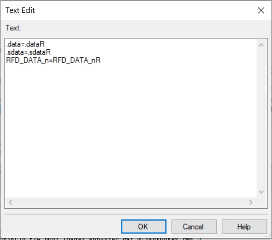

  * set __Layout sections automatically__ to ==YES==
  * the final result : 

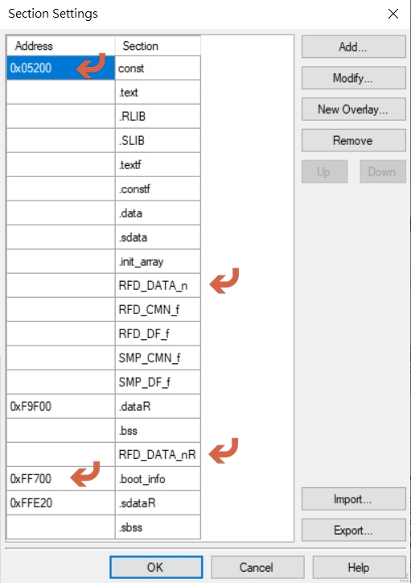

<br>

---

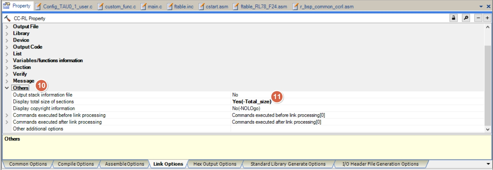
* __[Others] > [Display total size sections]__
  * select -Total_size , will display the section size in output window
  * display build code size in Output window


<u>How to Divide Boot and Flash Areas</u>
<u>CC-RL Compiler User's Manual</u>
<u>CS+ User’s Manual: CC-RL Build Tool Operation</u>
<u>Renesas Flash Driver RL78 Type 02 User’s  Manual</u>


---

<a id="project-app-code-property-modifictaion---cc-rl-build-tool-setting-4"></a>

## Project : app code property modification - CC-RL Build Tool setting

**Hex Output Options**

refer to How to Divide Boot and Flash Areas :
__4.2.3  Specifying hex file output only to the flash area address range__


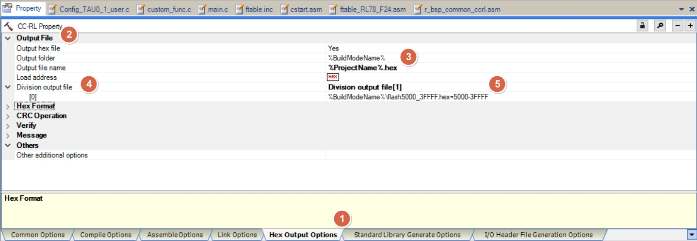

* __[Output File] > [Division output file]__  
  * base on MCU (ex : RL78F24) , to set ==app code start address and end address== as file name
* file size will be different if use other platform (ex : RL78 F13 , RL78 G16 , etc)
  * [map const define ?](boot-startup.html#map_const)

```c
%BuildModeName%\flash5000_3FFFF.hex=5000-3FFFF
```

---

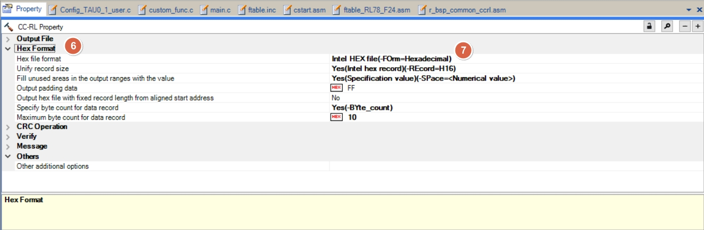
* __[Hex Format]__  
  * follow the setting of the picture 


<u>How to Divide Boot and Flash Areas</u>
<u>CC-RL Compiler User's Manual</u>
<u>CS+ User’s Manual: CC-RL Build Tool Operation</u>
<u>Renesas Flash Driver RL78 Type 02 User’s  Manual</u>

[主題索引](index.html) · [上一主題](app.html) · [下一主題](irq-crc.html)
