[主題索引](index.html) · [知識庫總索引](https://released.github.io/)

# App 向量與主程式

<!-- CHAPTER_SCOPE -->
App 向量與主程式 整理設定位置、操作畫面與對應程式／文件連結。

- 圖中型號、clock、pin、位址與工具介面屬於各參考工程的條件，不延伸為所有型號的固定配置。
- 實際設定與結果以所選 MCU 手冊、工程設定、linker map 及量測為準；原始文件與範例連結保留在各節。


---

<a id="project-boot-codeapp-code-modifictaion---ftableinc-2"></a>

## App 專案的 ftable.inc 引用

App 與 Boot 使用相同的分區設定，欄位與 map 對照集中於 [ftable.inc 與 App 起點](boot-startup.html#ftable_inc)。

---

<a id="project-app-code-modifictaion---cstartasm"></a>

## Project : app code modification - cstart.asm

refer to How to Divide Boot and Flash Areas :
__4.1.1  Modifying the startup routine (cstart.asm)__

* use smart config generate code
* ==copy== cstart.asm to app code project root folder
* ==register== to Flash area (app code) project , then start to ==modify==

(1)
comment out conditional check

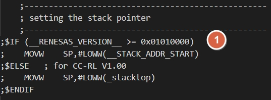

(2)
add ram flag section

```c
  .SECTION .boot_info, BSS
  .L_section_boot_info:
```

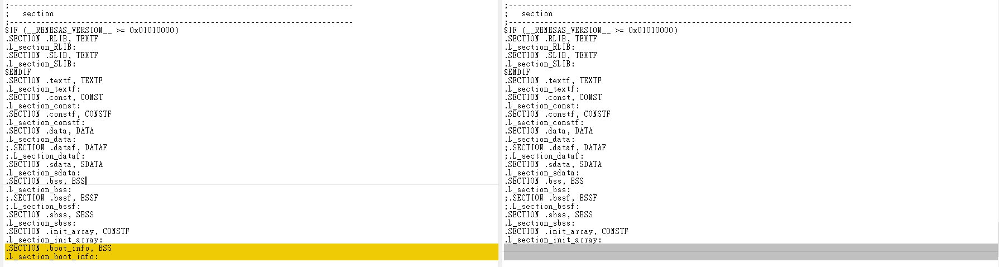

(3)
add ==data flash library section==

```c
  .SECTION RFD_DATA_nR, DATA
```

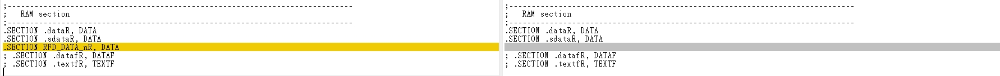


```c
	; copy RFD external variables having initial value (near)
	MOV	ES,#HIGHW(STARTOF(RFD_DATA_n))
	MOVW	BC,#LOWW(SIZEOF(RFD_DATA_n))
	BR	$.L2_RFD_DATA
.L1_RFD_DATA:
	DECW	BC
	MOV	A,ES:LOWW(STARTOF(RFD_DATA_n))[BC]
	MOV	LOWW(STARTOF(RFD_DATA_nR))[BC],A
.L2_RFD_DATA:
	CLRW	AX
	CMPW	AX,BC
	BNZ	$.L1_RFD_DATA

```

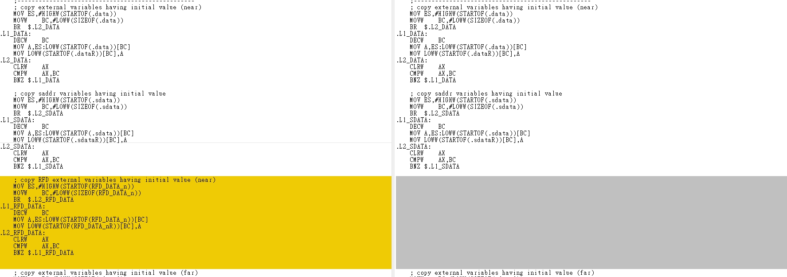


---

app code : Compare below file to see the difference
after modification : 
RL78_F24_Basic_Boot_loader_app\cstart.asm
https://github.com/released/RL78_F24_Basic_Boot_loader_app/blob/main/cstart.asm

data flash : 
RL78_F24_Basic_Boot_loader_app\RFDRL78T02\sample\RL78_F24\DF\CCRL\source\cstart.asm

smart configurator original file : 
RL78_F24_Basic_Boot_loader_app\src\smc_gen\r_bsp\mcu\all\cstart.asm


<u>How to Divide Boot and Flash Areas</u>

---

<a id="project-app-code-modifictaion---ftableasm"></a>

## Project : app code modification - ftable.asm

refer to How to Divide Boot and Flash Areas :
__4.1.2  Creating a branch table program (ftable.asm)__

* create ftable and register interrupt (used in app code) in proper sequence
  * [vector table ?](boot-build.html#vector_table)

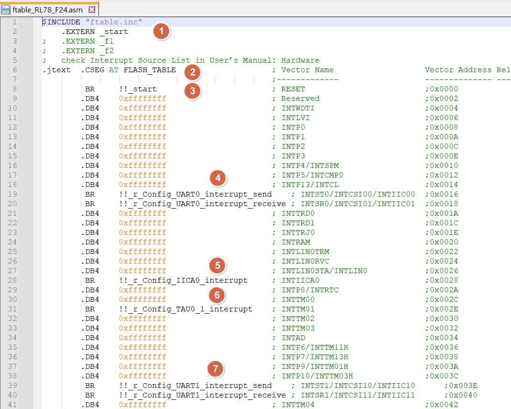

* ==register== ftable to Flash area (app code) project

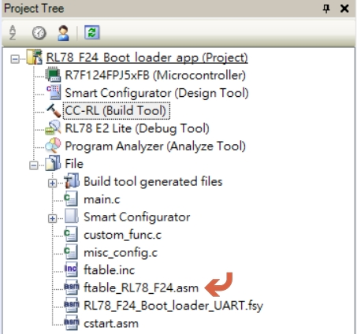

* example 
  * in app code , use UART0 TX/RX , UART1 TX/RX , TAU0_1 , IICA0 interrupt
  * register these interrupt name with prefix !!_ 

```c
		.DB4    0xffffffff                      ; INTP13/INTCL	             	;0x0014
		 BR     !!_r_Config_UART0_interrupt_send	; INTST0/INTCSI00/INTIIC00  ;0x0016
		 BR     !!_r_Config_UART0_interrupt_receive	; INTSR0/INTCSI01/INTIIC01 	;0x0018
		.DB4    0xffffffff						; INTTRD0                       ;0x001A
    ...
		.DB4    0xffffffff					    ; INTLIN0STA/INTLIN0	        ;0x0026
		 BR     !!_r_Config_IICA0_interrupt	    ; INTIICA0 		                ;0x0028
		.DB4    0xffffffff                      ; INTP8/INTRTC                  ;0x002A
		.DB4    0xffffffff      				; INTTM00                     	;0x002C
		 BR     !!_r_Config_TAU0_1_interrupt    ; INTTM01                       ;0x002E
		.DB4    0xffffffff                	    ; INTTM02                       ;0x0030
    ...
		.DB4    0xffffffff                      ; INTP10/INTTM03H               ;0x003C
		 BR     !!_r_Config_UART1_interrupt_send	; INTST1/INTCSI10/INTIIC10      ;0x003E
		 BR     !!_r_Config_UART1_interrupt_receive	; INTSR1/INTCSI11/INTIIC11      ;0x0040
		.DB4    0xffffffff					    ; INTTM04                       ;0x0042

```

<u>How to Divide Boot and Flash Areas</u>

---

<a id="project-app-code-modifictaion---fsy-file"></a>

## Project : app code modification - fsy file

refer to How to Divide Boot and Flash Areas :
__4.2.1  Registering the externally defined symbol file with the project__

* when boot code build finish , will copy fsy file into app code project 
  * [fsy file ?](boot-build.html#fsy_file)
* ==register== fsy file to Flash area (app code) project

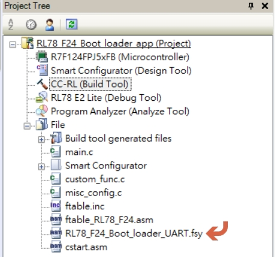

<u>How to Divide Boot and Flash Areas</u>

---

<a id="project-app-code-modifictaion---project-tree"></a>

## Project : app code modification - project tree

* after modification , ==Flash area (app code) project== will increse 4 files as below 

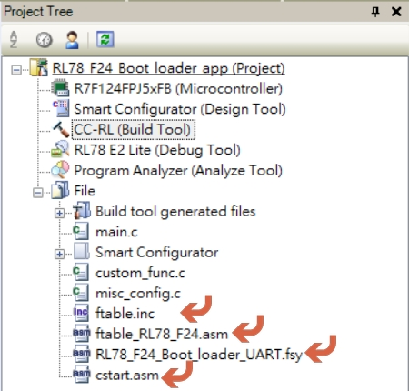

---

<a id="project-app-code-modifictaion---add-data-flash-library"></a>

## Project : app code modification - add DATA FLASH library

* base on [RL78 MCU](index.html#target_MCU_flash_type)  , register correspond ==DATA FLASH library== into Flash area (app code) project and exclude uncessary file (code flash , extra area)

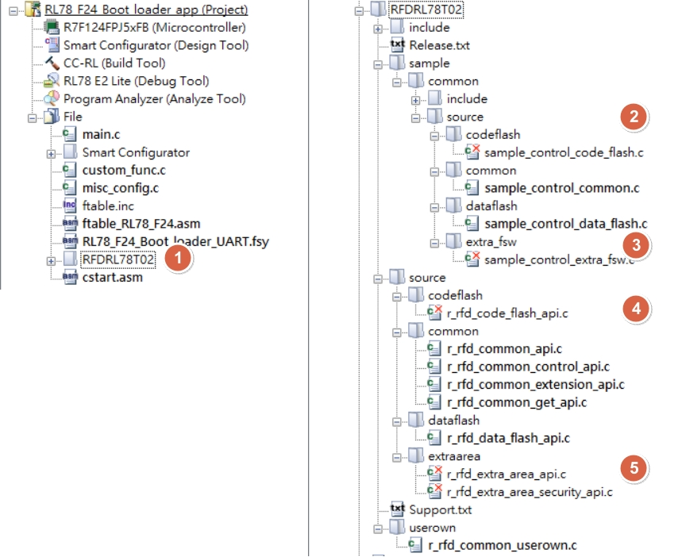


---

<a id="project-app-code-modifictaion---use-smart-config-tool-to-generate-driver"></a>

## Project : app code modification - use smart config tool to generate driver

* exclude the driver code (c code , asm code)

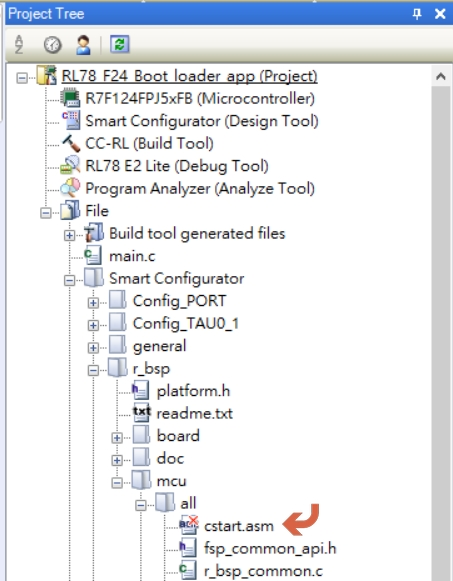


---

* smart configurator system setting as below

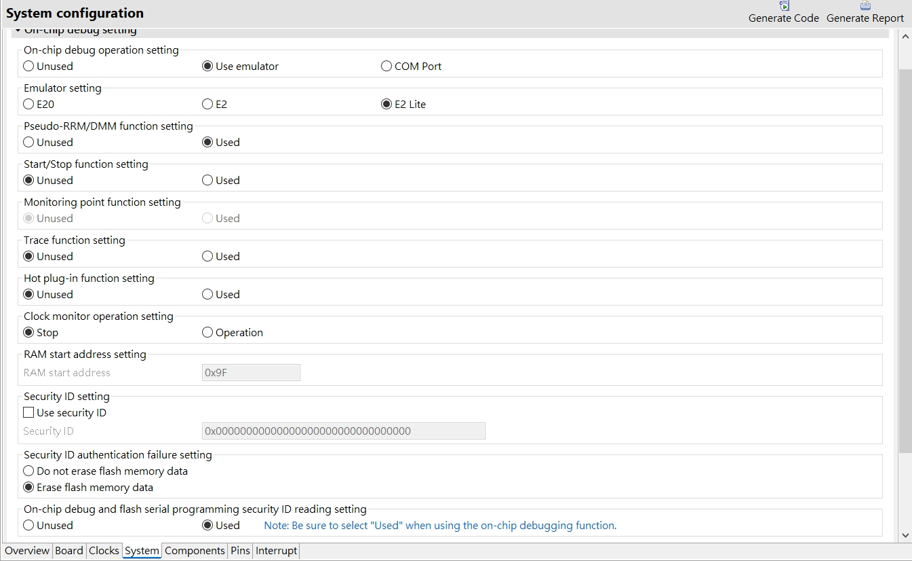

---


<a id="project-app-code-modifictaion---remove-static-and-vect-define"></a>

## Project : app code modification -  remove static and vect define

refer to How to Divide Boot and Flash Areas :
__Do not specify the vector address (vect) with the #pragma interrupt directive in the flash area.__

* ==EVERY TIME== when use smart config tool to ==re-generate driver==
* need to ==remove static declaration== and ==comment on vect definition== in earch drvier ==Config_xxx_user.c==

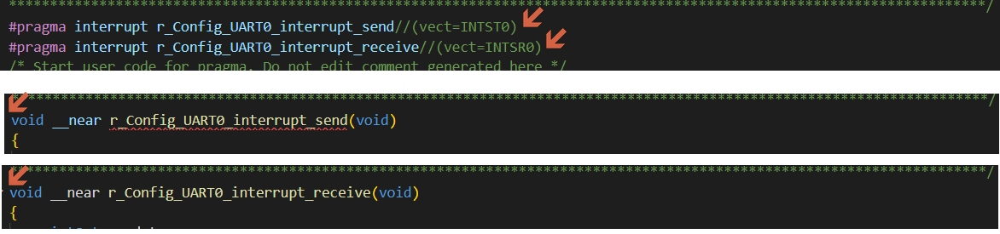
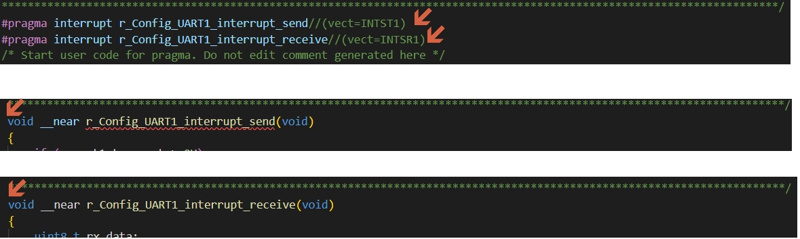
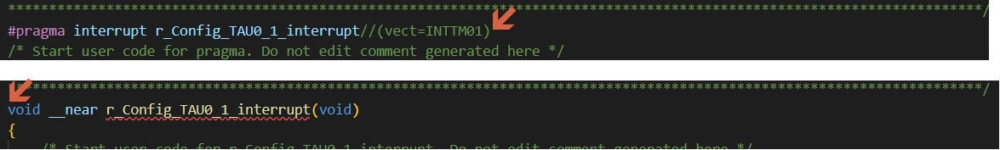
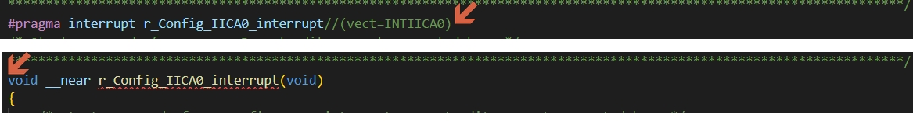

<u>How to Divide Boot and Flash Areas</u>

---

<a id="project-app-code-modifictaion---mainc"></a>

## Project : app code modification - main.c

* add [ram flag](architecture.html#ram_flag) declaration

```c
#define RESET_TO_BOOT_SIGN 0xAA55AA55

#pragma address (reset_to_bootloader = 0x000FF700)
volatile uint32_t reset_to_bootloader;
#pragma address (_no_init_global = 0x000FF710)
unsigned char _no_init_global[RAM_FLAG_MAX];

```
below is map file result 
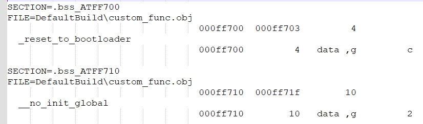

* add change flag data ==condition check== and execute reset

  * example : when receive change to boot mode command , modify the flag and reset MCU

```c
    if(g_i2c_receive_complete)
    {
        if(0 == memcmp(&iic_buf[0], switch_device_to_boot_mode_cmd, 6))
        {
            R_Config_IICA0_Slave_Send((uint8_t *)response_status_ok, 7);
            while(!g_i2c_transmit_complete);

            reset_to_bootloader = RESET_TO_BOOT_SIGN;
            _reset_by_illegal_memory_access();
        }

        g_i2c_receive_complete = false;
    }

```

```c
void uart_rcv_process(void)
{
    if (FLAG_PROJ_TRIG_3)
    {
        FLAG_PROJ_TRIG_3 = 0;

        reset_to_bootloader = RESET_TO_BOOT_SIGN;
        printf_tiny("(app)reset_to_bootloader:0x%X",reset_to_bootloader>>16);
        printf_tiny("%X\r\n",reset_to_bootloader&0xFFFF);

        _reset_by_illegal_memory_access();        
    }
}
```

[主題索引](index.html) · [上一主題](boot-build.html) · [下一主題](app-build.html)
