[主題索引](index.html) · [知識庫總索引](https://released.github.io/)

# Flash 分區與啟動

<!-- CHAPTER_SCOPE -->
Flash 分區與啟動 整理設定位置、操作畫面與對應程式／文件連結。

- 圖中型號、clock、pin、位址與工具介面屬於各參考工程的條件，不延伸為所有型號的固定配置。
- 實際設定與結果以所選 MCU 手冊、工程設定、linker map 及量測為準；原始文件與範例連結保留在各節。

---

## Flash 分區

參考工程將 Code Flash 分為 Boot 區域與 App 區域；分界由 `ftable.inc`、linker 設定與輸出映像共同定義。

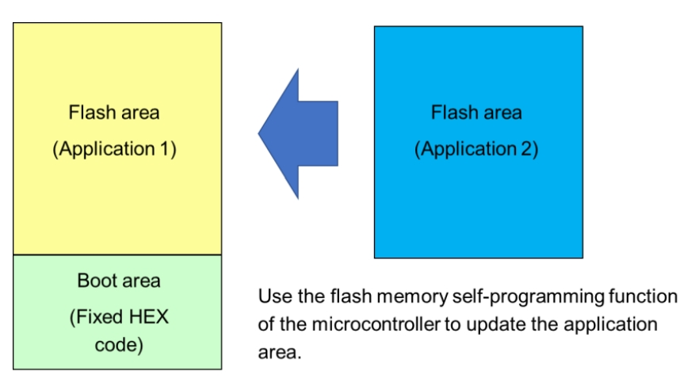

<u>How to Divide Boot and Flash Areas</u>

---

## Boot 區域的啟動與更新

* UART0 使用 P15/TX、P16/RX，輸出啟動與更新狀態。
* __condition_check__ : 
  * detect ==flag== store in ram specific area (ex : 0xFF700) , to determine if re-boot from Flash area (app code) 
  * if no app code in app section

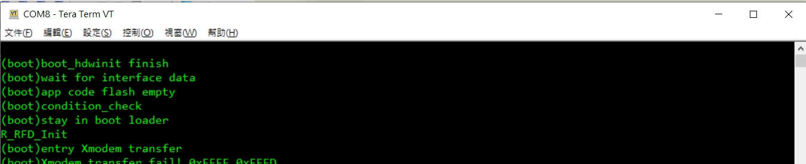

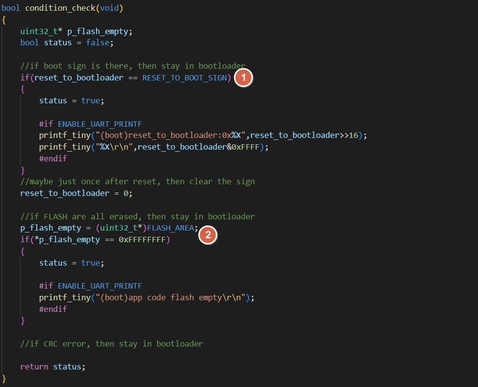

  * base on the ==flag== or ==BUTTON presssed (active LOW)== , to determine 
    * need to stay in boot code , to receive data flow from interface (ex : I2C , UART , ...) 
    * ready to jump into Flash area (app code)

* __verify_application_chksum__ : 
  * compare CRC checksum when power on 
  * at Flash area (app code) last 4 bytes , will store ==CRC data==
  * calculate the Flash area (app code) CRC byte (==caculate_crc32_checksum==) and compare to the CRC data store in last 4 bytes of Flash area (app code)
  * if comapare error , stay in Boot area (boot code) 

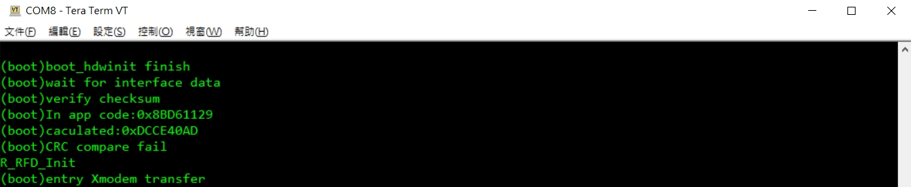

* any other custom user defined condition

* __programming Flash area (app code) flow__
  * refer the code flash sample function : Sample_CodeFlashControl and modify as : 
    * ==Sample_CodeFlashControl_Erase==
    * ==Sample_CodeFlashControl_SingleWrite==
    * __KEY POINT : SAMPLE_START_SECTION_SMP_CF__
  * after Flash area (app code) update finish , 
    * UART (xmodem , UART1 : P74/TX , P75/RX) : reboot MCU 
    * I2C (IICA0 , P62/SCL , P63/SDA): reboot MCU

xmodem
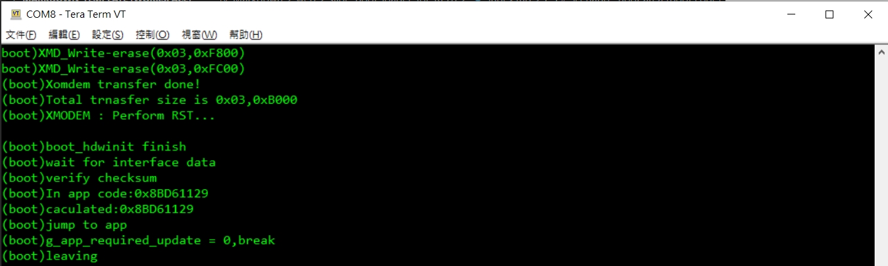

I2C
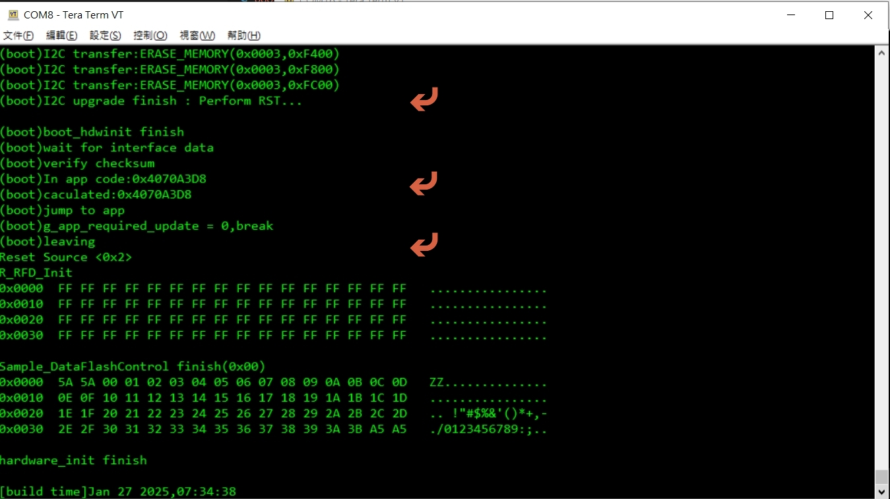

  * if CRC compare OK and no detect update inquiry , jump to Flash area (app code)

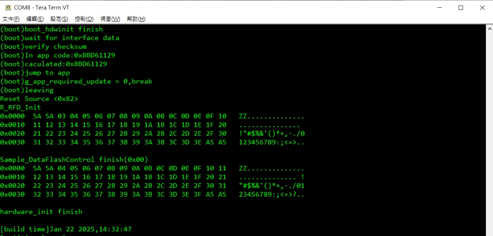

* at project:RL78_F24_Basic_Boot_loader_UART_CRC , add timer to control reset flow
  * when entry boot code in upgrade process , count down to 30 sec and execute reboot MCU if no receive data from interface (XMODEM , IICA0)

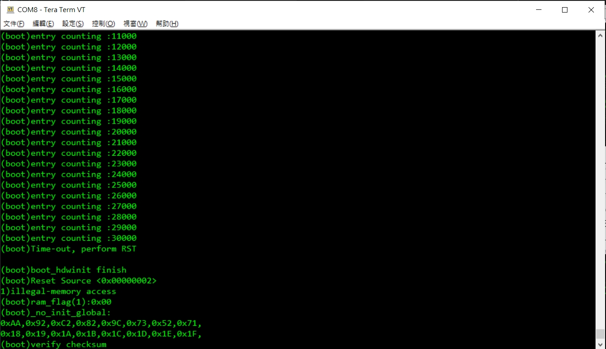

---

## App 區域的執行與更新請求

* set ==ram flag== store in ram specific area (ex : 0xFF700) 
  * change flag data and execute reset , when
    * receive interface boot command (ex : I2C , UART , ...) 

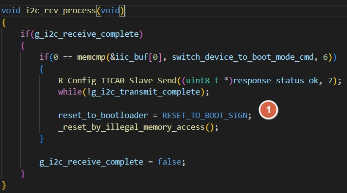
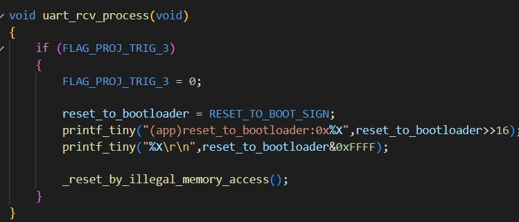

  * any other custom user defined condition (ex : ADC , GPIO etc)
  * use terminal (UART0 : P15/TX , P16/RX) , by press ==digit 3== ,to set ram flag and reset

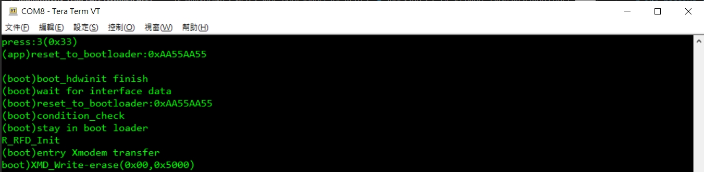

* by press ==digit 1== to write data flash 
* by press ==digit 2== to read data flash

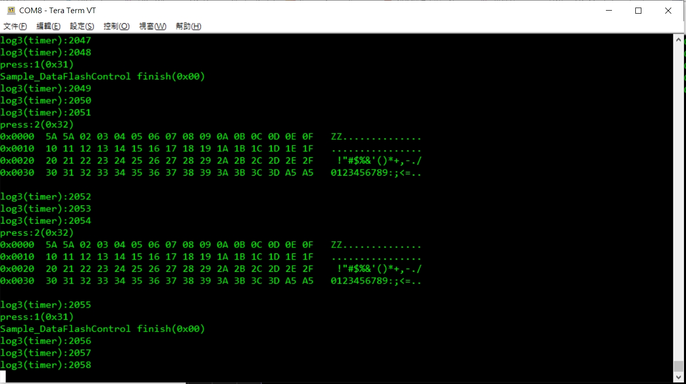

* at Flash area (app code) last 4 bytes , will add ==CRC data== after ==project compile finish==

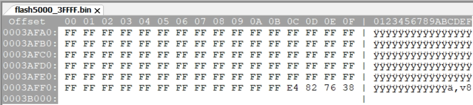

[主題索引](index.html) · [下一主題](boot-startup.html)
