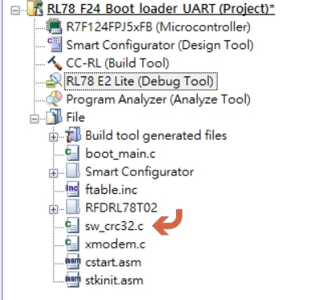
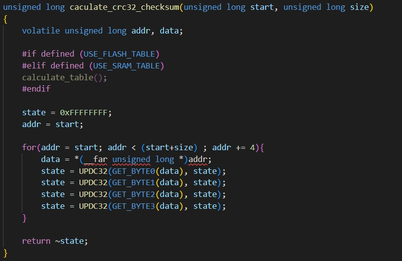
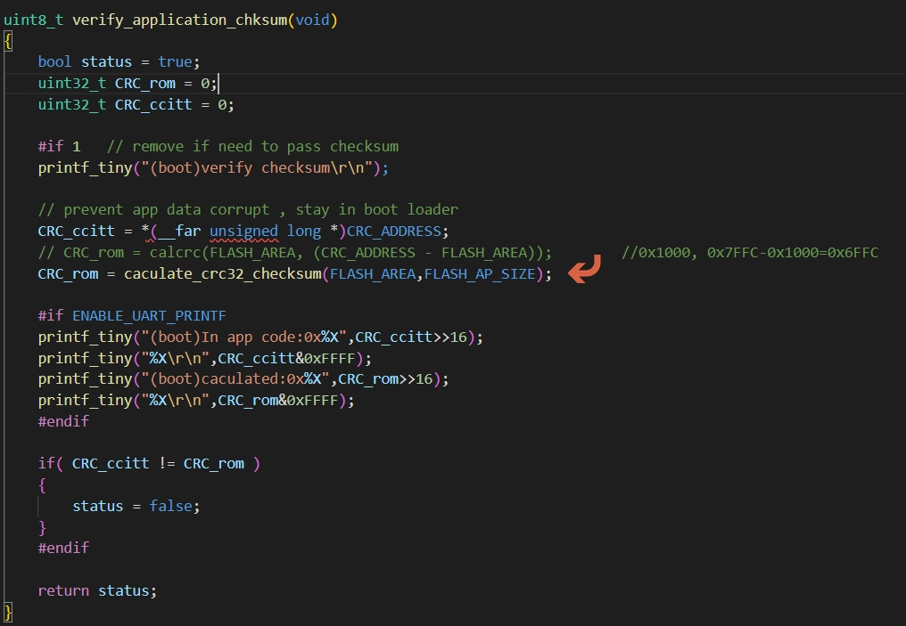
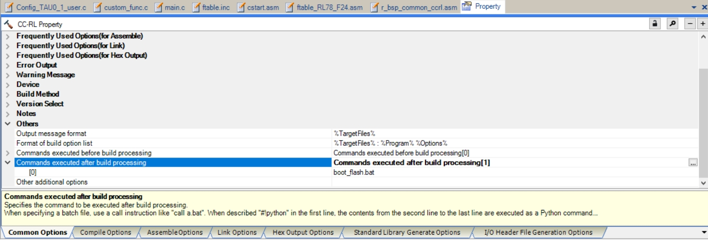

[主題索引](index.html) · [知識庫總索引](https://released.github.io/)

# Boot CRC

<!-- CHAPTER_SCOPE -->
Boot CRC 整理設定位置、操作畫面與對應程式／文件連結。

- 圖中型號、clock、pin、位址與工具介面屬於各參考工程的條件，不延伸為所有型號的固定配置。
- 實際設定與結果以所選 MCU 手冊、工程設定、linker map 及量測為準；原始文件與範例連結保留在各節。

---

## Project : boot code modification - add CRC compare (1)

* register CRC compare into Boot area (boot code) project 
* purpose: 
  * condition check (check and compare app code CRC , prevent jump into corrupted app code)

---

## Project : boot code modification - add CRC compare (2)

 

CRC in app code last 4 bytes will be added after compile at <b><u>app code project</u></b> by use SRecord tool  

[主題索引](index.html) · [上一主題](boot-startup.html) · [下一主題](boot-driver.html)
