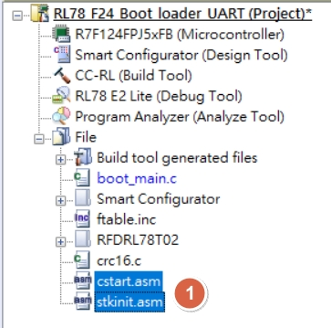
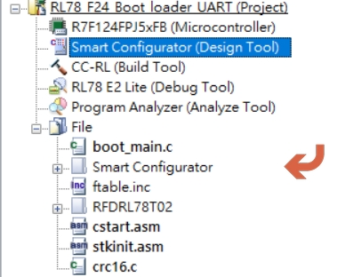
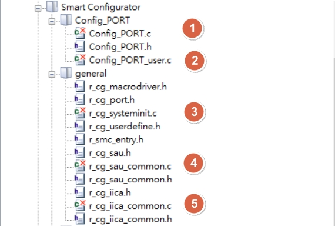
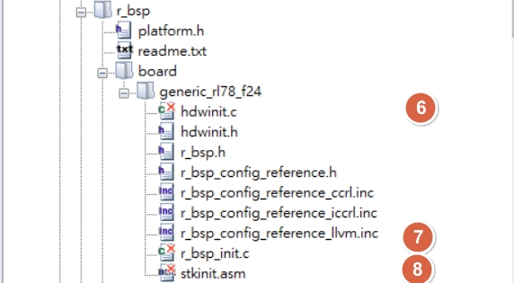
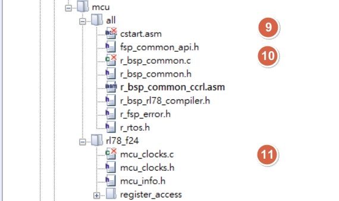
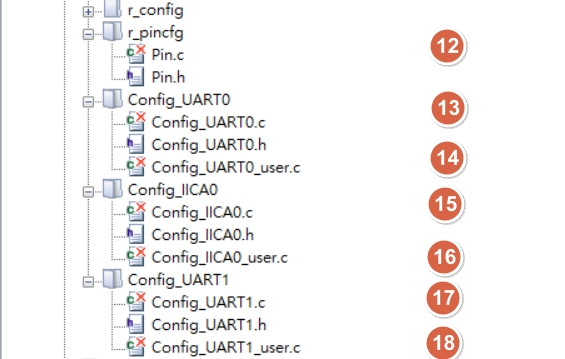
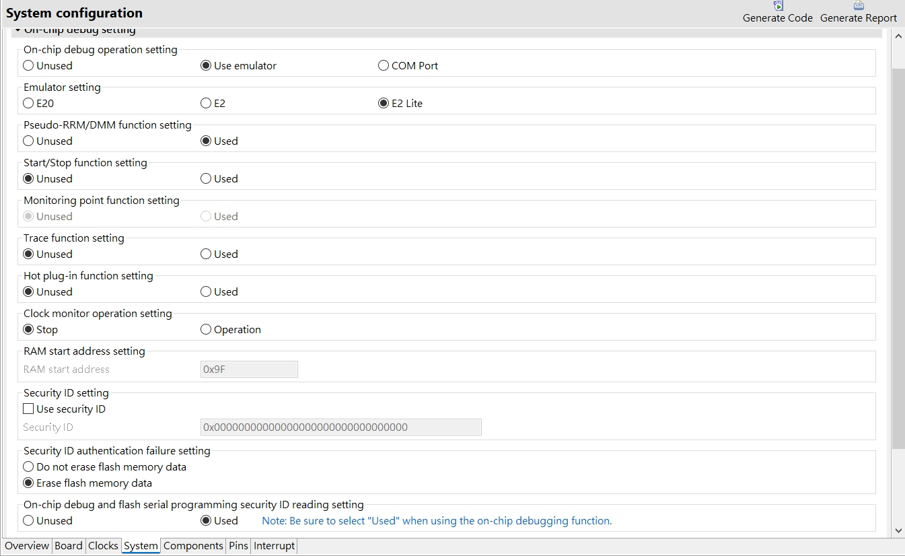

[主題索引](index.html) · [知識庫總索引](https://released.github.io/)

# Boot Driver 與主程式

<!-- CHAPTER_SCOPE -->
Boot Driver 與主程式 整理設定位置、操作畫面與對應程式／文件連結。

- 圖中型號、clock、pin、位址與工具介面屬於各參考工程的條件，不延伸為所有型號的固定配置。
- 實際設定與結果以所選 MCU 手冊、工程設定、linker map 及量測為準；原始文件與範例連結保留在各節。

---

## Project : boot code modification - use smart config tool to generate driver

- Smart Configurator 產生所選介面的 driver，供 Boot 工程使用。
- Generate Code 後核對 `cstart.asm`、`stkinit.asm` 是否仍註冊於工程；缺少時依 Startup 章節重新加入。

- 工程將使用的 driver 初始化整合至 `boot_main.c`。
- 以該工程的註冊清單排除重複的 C／ASM 實作，避免 Boot 與 App 同時連入相同初始化。

---

Smart Configurator 的系統設定對照如下。

---

## Project : boot code modification - boot_main.c

* for boot_hdwinit() , will be initialized by [cstart.asm](boot-startup.html#boot_hdwinit)
  * ==copy== below function from driver and ==rename== with prefix: ==boot_== in boot_main.c for boot_hdwinit
    * bsp_init_system() 
      * copy mcu_clock_setup()
    * R_Config_PORT_Create
    * if use UART for debug or download
      * R_SAU0_Create()
      * R_Config_UART0_Start()
      * R_SAU1_Create()
      * R_Config_UART1_Start()
    * R_Config_IICA0_Create()
    * R_Config_TAU0_0_Start , for delay function (1ms)
* for boot_main() , will start with condition check and judge if need to start programming

[主題索引](index.html) · [上一主題](boot-crc.html) · [下一主題](i2c.html)
