[主題索引](index.html) · [知識庫總索引](https://released.github.io/)

# Boot 向量與 Startup

<!-- CHAPTER_SCOPE -->
Boot 向量與 Startup 整理設定位置、操作畫面與對應程式／文件連結。

- 圖中型號、clock、pin、位址與工具介面屬於各參考工程的條件，不延伸為所有型號的固定配置。
- 實際設定與結果以所選 MCU 手冊、工程設定、linker map 及量測為準；原始文件與範例連結保留在各節。


---

<a id="project-boot-codeapp-code-modifictaion---ftableinc"></a>

## Project : boot code/app code modification - ftable.inc

<a id="FALSH_TABLE"></a>
<a id="ftable_inc"></a>
* ==create and register== below file in __Boot area (boot code)__ and __Flash area (app code)__ project

* ftable.inc 

```c
FLASH_TABLE       .EQU  0x5000 
INTERRUPT_OFFSET  .EQU  0x100 
```
<br/>

<a id="map_const"></a>
`FLASH_TABLE` 指定此範例的 App 起點，Boot 與 App 的設定保持一致。
Mirror 與近位址常數配置可對照各工程 map 及 CC-RL《How to Divide Boot and Flash Areas》；圖中以 `0xF5000 - 0xF0000 = 0x5000` 示範位址對照。

下表列出本頁參考工程採用的 App 起點，由 `ftable.inc`、linker map 與 MCU mirror 設定共同核對。
這些是各範例的工程配置，不是依 MCU 型號固定的最小 Boot 容量。

| MCU | 參考工程 App 起點 |
|:--:|:--:|
| F24  | 0x5000 |
| F23  | 0x3000 |
| F13  | 0x2000 | 
| G15  | 0x800 |
| G16  | 0x800 |

* below is default project map file after compile

**RL78 F24**
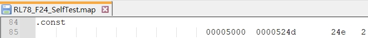
**RL78 F23**
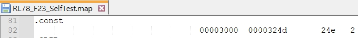
**RL78 F13**
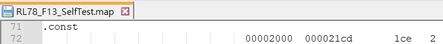
**RL78 G15**
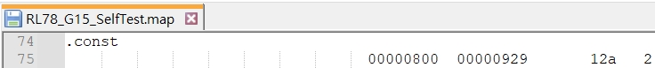
**RL78 G16**
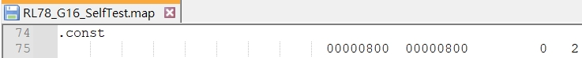

<u>How to Divide Boot and Flash Areas</u>

---

<a id="project-boot-code-modifictaion---cstartasm"></a>

## Project : boot code modification - cstart.asm

refer to How to Divide Boot and Flash Areas :
__3.1.1  Modifying the startup routine (cstart.asm)__

* use smart config generate code
* ==copy== cstart.asm to boot code project root folder
* ==register== to Boot area (boot code) project , then start to ==modify==

(1) 
include [ftable.inc](#ftable_inc)

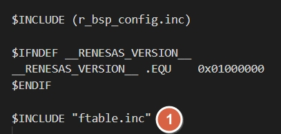

(2)
comment out conditional check

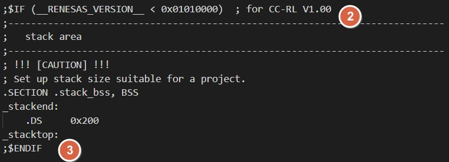

(3)
modify the section name

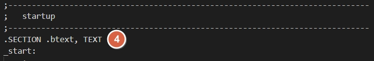

(4)
comment out conditional check and assembly instructions

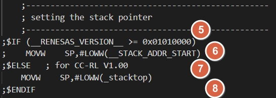

(5)
modify main function name (__boot_main__) <a id="boot_main"></a>
add branch instructions : [FALSH_TABLE](#FALSH_TABLE)

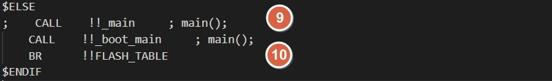

(6)
comment out .const section

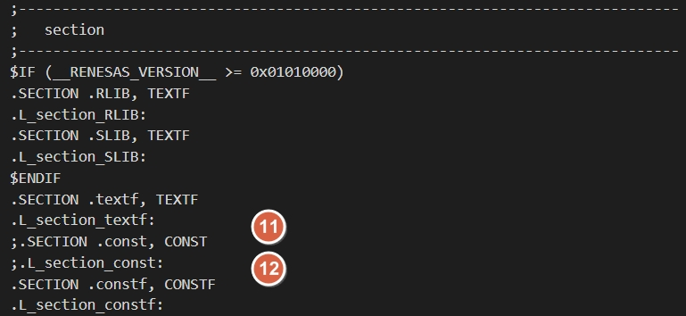

(7)
modify bsp_init_system function name

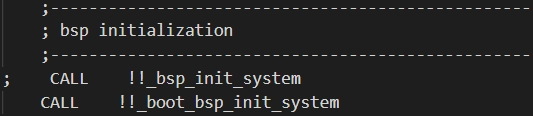

(8)
modify hardware init function name (__boot_hdwinit__) <a id="boot_hdwinit"></a>

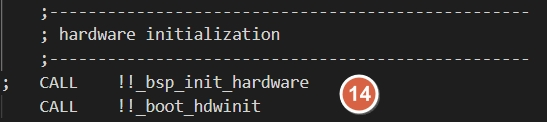

(9)
increase bss size to 0x500

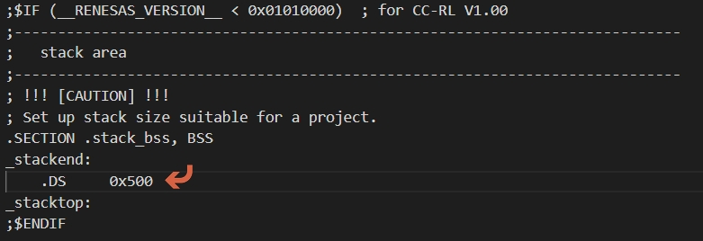
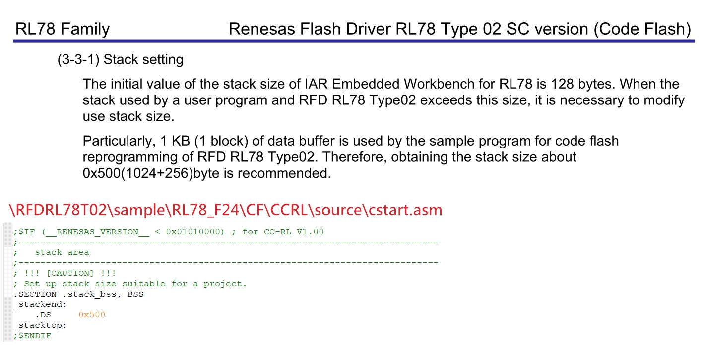

(10)
add ram flag section

```c
  .SECTION .boot_info, BSS
  .L_section_boot_info:
```

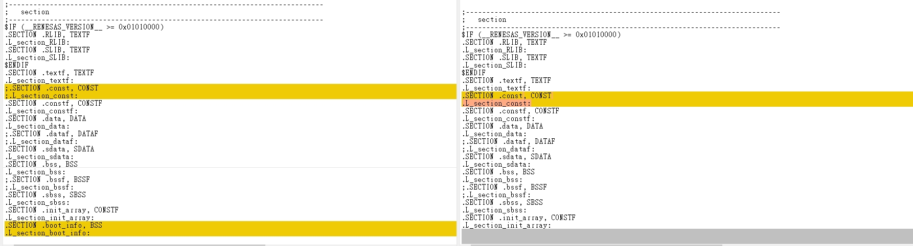

(11)
add ==code flash library section==

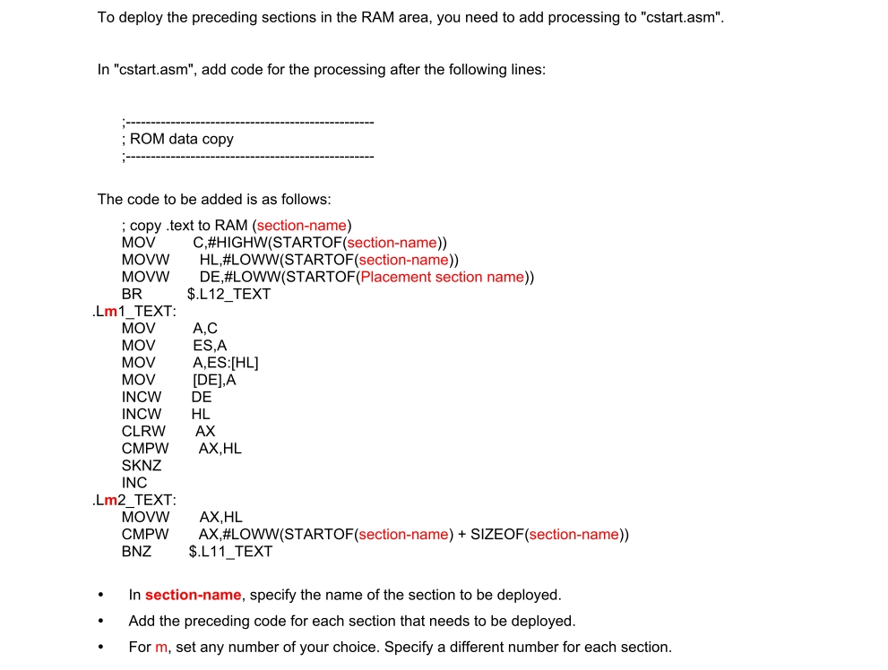

```c
  .SECTION RFD_DATA_nR, DATA
  .SECTION RFD_CMN_fR, TEXTF
  .SECTION RFD_CF_fR, TEXTF
  .SECTION SMP_CMN_fR, TEXTF
  .SECTION SMP_CF_fR, TEXTF
```

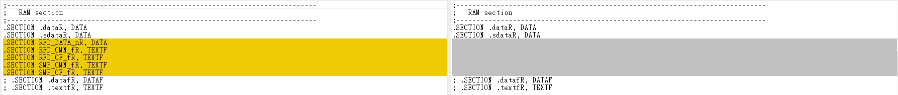

```c

	; copy RFD external variables having initial value (near)
	MOV	ES,#HIGHW(STARTOF(RFD_DATA_n))
	MOVW	BC,#LOWW(SIZEOF(RFD_DATA_n))
	BR	$.L2_RFD_DATA
.L1_RFD_DATA:
	DECW	BC
	MOV	A,ES:LOWW(STARTOF(RFD_DATA_n))[BC]
	MOV	LOWW(STARTOF(RFD_DATA_nR))[BC],A
.L2_RFD_DATA:
	CLRW	AX
	CMPW	AX,BC
	BNZ	$.L1_RFD_DATA


	; copy code to RAM (RFD_CMN)
	MOV	C,#HIGHW(STARTOF(RFD_CMN_f))
	MOVW	HL,#LOWW(STARTOF(RFD_CMN_f))
	MOVW	DE,#LOWW(STARTOF(RFD_CMN_fR))
	BR	$.L12_TEXT
.L11_TEXT:
	MOV	A,C
	MOV	ES,A
	MOV	A,ES:[HL]
	MOV	[DE],A
	INCW	DE
	INCW	HL
	CLRW	AX
	CMPW	AX,HL
	SKNZ
	INC	C
.L12_TEXT:
	MOVW	AX,HL
	CMPW	AX,#LOWW(STARTOF(RFD_CMN_f) + SIZEOF(RFD_CMN_f))
	BNZ	$.L11_TEXT

	; copy code to RAM (RFD_CF)
	MOV	C,#HIGHW(STARTOF(RFD_CF_f))
	MOVW	HL,#LOWW(STARTOF(RFD_CF_f))
	MOVW	DE,#LOWW(STARTOF(RFD_CF_fR))
	BR	$.L22_TEXT
.L21_TEXT:
	MOV	A,C
	MOV	ES,A
	MOV	A,ES:[HL]
	MOV	[DE],A
	INCW	DE
	INCW	HL
	CLRW	AX
	CMPW	AX,HL
	SKNZ
	INC	C
.L22_TEXT:
	MOVW	AX,HL
	CMPW	AX,#LOWW(STARTOF(RFD_CF_f) + SIZEOF(RFD_CF_f))
	BNZ	$.L21_TEXT

	; copy code to RAM (SMP_CMN)
	MOV	C,#HIGHW(STARTOF(SMP_CMN_f))
	MOVW	HL,#LOWW(STARTOF(SMP_CMN_f))
	MOVW	DE,#LOWW(STARTOF(SMP_CMN_fR))
	BR	$.L32_TEXT
.L31_TEXT:
	MOV	A,C
	MOV	ES,A
	MOV	A,ES:[HL]
	MOV	[DE],A
	INCW	DE
	INCW	HL
	CLRW	AX
	CMPW	AX,HL
	SKNZ
	INC	C
.L32_TEXT:
	MOVW	AX,HL
	CMPW	AX,#LOWW(STARTOF(SMP_CMN_f) + SIZEOF(SMP_CMN_f))
	BNZ	$.L31_TEXT

	; copy code to RAM (SMP_CF)
	MOV	C,#HIGHW(STARTOF(SMP_CF_f))
	MOVW	HL,#LOWW(STARTOF(SMP_CF_f))
	MOVW	DE,#LOWW(STARTOF(SMP_CF_fR))
	BR	$.L42_TEXT
.L41_TEXT:
	MOV	A,C
	MOV	ES,A
	MOV	A,ES:[HL]
	MOV	[DE],A
	INCW	DE
	INCW	HL
	CLRW	AX
	CMPW	AX,HL
	SKNZ
	INC	C
.L42_TEXT:
	MOVW	AX,HL
	CMPW	AX,#LOWW(STARTOF(SMP_CF_f) + SIZEOF(SMP_CF_f))
	BNZ	$.L41_TEXT
```

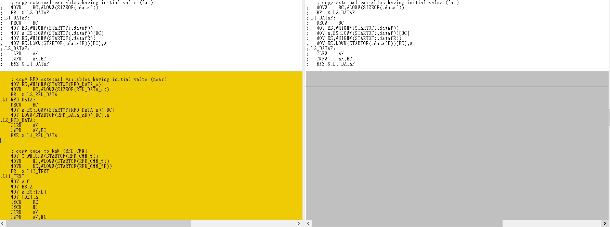


---

boot code : Compare below file to see the difference
after modification : 
RL78_F24_Basic_Boot_loader_UART\cstart.asm
https://github.com/released/RL78_F24_Basic_Boot_loader_UART/blob/main/cstart.asm

code flash : 
RL78_F24_Basic_Boot_loader_UART\RFDRL78T02\sample\RL78_F24\CF\CCRL\source\cstart.asm

smart configurator original file : 
RL78_F24_Basic_Boot_loader_UART\src\smc_gen\r_bsp\mcu\all\cstart.asm


<u>How to Divide Boot and Flash Areas</u>

---

<a id="project-boot-code-modifictaion---stkinitasm"></a>

## Project : boot code modification - stkinit.asm

refer to How to Divide Boot and Flash Areas :
__3.1.2  Modifying hdwinit.asm and stkinit.asm__

* use smart config generate code 
* ==copy== stkinit.asm to boot code project root folder
* ==register== to Boot area (boot code) project , then start to ==modify==

- modify the section name

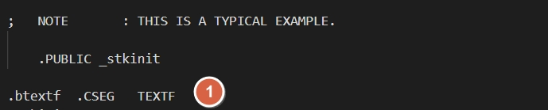


<u>How to Divide Boot and Flash Areas</u>

---

<a id="project-boot-code-modifictaion---project-tree"></a>

## Project : boot code modification - project tree

* after modification , ==Boot area (boot code) project== will increse 3 files as below 

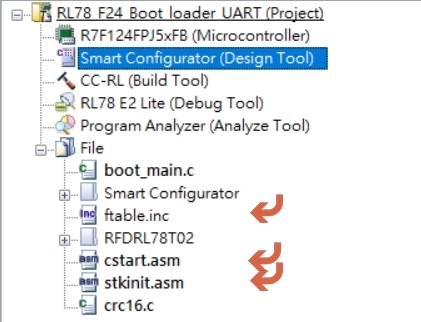

* make sure manual register ==cstart.asm , stkinit.asm== if file ==missing== after ==generate code==

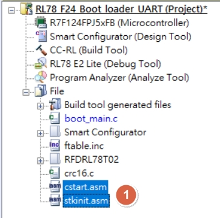


<u>How to Divide Boot and Flash Areas</u>

---

<a id="project-boot-code-modifictaion---add-code-flash-library"></a>

## Project : boot code modification - add CODE FLASH library

* base on [RL78 MCU](index.html#target_MCU_flash_type)  , register correspond ==CODE FLASH library== into Boot area (boot code) project and exclude uncessary file (data flash , extra area)

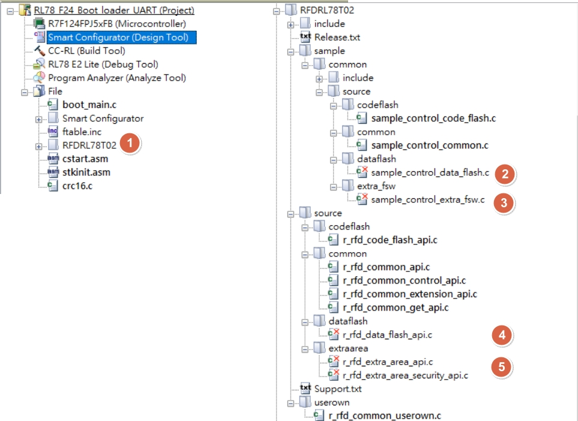


---

* refer to RL78_F24_Basic_Boot_loader_UART\RFDRL78T02\sample\common\source\codeflash\sample_control_code_flash.c
* __KEY POINT : SAMPLE_START_SECTION_SMP_CF__

* __Sample_CodeFlashControl_Erase__

```c
R_RFD_FAR_FUNC e_sample_ret_t Sample_CodeFlashControl_Erase(uint32_t i_u32_start_addr)
{
    /* Local variable definition */
    e_rfd_ret_t    l_e_rfd_ret_status;
    e_sample_ret_t l_e_sam_ret_status;
    e_sample_ret_t l_e_sam_ret_value;
    bool           l_e_sam_error_flag;
    // uint16_t       l_u16_count;
    uint16_t       l_u16_block_number;
    // uint32_t       l_u32_check_write_data_addr;
    
    /* Set local variables */
    l_e_sam_ret_value           = SAMPLE_ENUM_RET_STS_OK;
    l_e_sam_error_flag          = false;
    
    /* This expression (actual block number) never exceeds the range of casting uint16_t */
    l_u16_block_number          = (uint16_t)(i_u32_start_addr >> SAMPLE_VALUE_U08_SHIFT_ADDR_TO_BLOCK_CF);
    // l_u32_check_write_data_addr = i_u32_start_addr;
    
    /******************************************************************************************************************
     * Set the code flash programming mode
     *****************************************************************************************************************/
    l_e_rfd_ret_status = R_RFD_SetFlashMemoryMode(R_RFD_ENUM_FLASH_MODE_CODE_PROGRAMMING);
    
    if (R_RFD_ENUM_RET_STS_OK != l_e_rfd_ret_status)
    {
        l_e_sam_error_flag = true;
        l_e_sam_ret_value  = SAMPLE_ENUM_RET_ERR_MODE_MISMATCHED;
    }
    else
    {
        /* No operation */
    }
    
    /******************************************************************************************************************
     * BLANKCHECK -> ERASE
     *****************************************************************************************************************/
    if (false == l_e_sam_error_flag)
    {
        /* BLANKCHECK (1 block) */
        R_RFD_BlankCheckCodeFlashReq(l_u16_block_number);
        l_e_sam_ret_status = Sample_CheckCFDFSeqEnd();
        
        if (SAMPLE_ENUM_RET_ERR_ACT_BLANKCHECK == l_e_sam_ret_status)
        {
            /* ERASE (1 block) */
            R_RFD_EraseCodeFlashReq(l_u16_block_number);
            l_e_sam_ret_status = Sample_CheckCFDFSeqEnd();
            
            if (SAMPLE_ENUM_RET_STS_OK != l_e_sam_ret_status)
            {
                l_e_sam_error_flag = true;
                l_e_sam_ret_value  = SAMPLE_ENUM_RET_ERR_CMD_ERASE;
            }
            else
            {
                /* No operation */
            }
        }
        else if (SAMPLE_ENUM_RET_STS_OK != l_e_sam_ret_status)
        {
            l_e_sam_error_flag = true;
            l_e_sam_ret_value  = SAMPLE_ENUM_RET_ERR_CMD_BLANKCHECK;
        }
        else
        {
            /* No operation */
        }
    }
    else /* true == l_e_sam_error_flag */
    {
        /* No operation */
    }
        
    /******************************************************************************************************************
     * Set non-programmable mode
     *****************************************************************************************************************/
    l_e_rfd_ret_status = R_RFD_SetFlashMemoryMode(R_RFD_ENUM_FLASH_MODE_CODE_TO_NONPROGRAMMABLE);
    
    if (R_RFD_ENUM_RET_STS_OK != l_e_rfd_ret_status)
    {
        l_e_sam_error_flag = true;
        l_e_sam_ret_value  = SAMPLE_ENUM_RET_ERR_MODE_MISMATCHED;
    }
    else
    {
        /* No operation */
    }
        
    return (l_e_sam_ret_value);
}
```

* __Sample_CodeFlashControl_SingleWrite__

```c
R_RFD_FAR_FUNC e_sample_ret_t Sample_CodeFlashControl_SingleWrite(uint32_t i_u32_start_addr,
                                                      uint8_t __near * inp_u08_write_data)
{
    /* Local variable definition */
    e_rfd_ret_t    l_e_rfd_ret_status;
    e_sample_ret_t l_e_sam_ret_status;
    e_sample_ret_t l_e_sam_ret_value;
    bool           l_e_sam_error_flag;
    uint16_t       l_u16_count = 0;
    // uint16_t       l_u16_block_number;
    // uint32_t       l_u32_check_write_data_addr;
    
    /* Set local variables */
    l_e_sam_ret_value           = SAMPLE_ENUM_RET_STS_OK;
    l_e_sam_error_flag          = false;
    
    /* This expression (actual block number) never exceeds the range of casting uint16_t */
    // l_u16_block_number          = (uint16_t)(i_u32_start_addr >> SAMPLE_VALUE_U08_SHIFT_ADDR_TO_BLOCK_CF);
    // l_u32_check_write_data_addr = i_u32_start_addr;
    
    /******************************************************************************************************************
     * Set the code flash programming mode
     *****************************************************************************************************************/
    l_e_rfd_ret_status = R_RFD_SetFlashMemoryMode(R_RFD_ENUM_FLASH_MODE_CODE_PROGRAMMING);
    
    if (R_RFD_ENUM_RET_STS_OK != l_e_rfd_ret_status)
    {
        l_e_sam_error_flag = true;
        l_e_sam_ret_value  = SAMPLE_ENUM_RET_ERR_MODE_MISMATCHED;
    }
    else
    {
        /* No operation */
    }
   
    /******************************************************************************************************************
     * WRITE
     *****************************************************************************************************************/
    if (false == l_e_sam_error_flag)
    {
        // for (l_u16_count = 0u; l_u16_count < i_u16_write_data_length; l_u16_count += 4u)
        {
            // R_RFD_WriteCodeFlashReq(i_u32_start_addr + l_u16_count, &inp_u08_write_data[l_u16_count]);
            R_RFD_WriteCodeFlashReq(i_u32_start_addr , &inp_u08_write_data[l_u16_count]);
            l_e_sam_ret_status = Sample_CheckCFDFSeqEnd();
            
            if (SAMPLE_ENUM_RET_STS_OK != l_e_sam_ret_status)
            {
                l_e_sam_error_flag = true;
                l_e_sam_ret_value  = SAMPLE_ENUM_RET_ERR_CMD_WRITE;
                // break;
            }
            else
            {
                /* No operation */
            }
        }
    }
    else /* true == l_e_sam_error_flag */
    {
        /* No operation */
    }
        
    /******************************************************************************************************************
     * Set non-programmable mode
     *****************************************************************************************************************/
    l_e_rfd_ret_status = R_RFD_SetFlashMemoryMode(R_RFD_ENUM_FLASH_MODE_CODE_TO_NONPROGRAMMABLE);
    
    if (R_RFD_ENUM_RET_STS_OK != l_e_rfd_ret_status)
    {
        l_e_sam_error_flag = true;
        l_e_sam_ret_value  = SAMPLE_ENUM_RET_ERR_MODE_MISMATCHED;
    }
    else
    {
        /* No operation */
    }
    
    return (l_e_sam_ret_value);
}


```

<u>Renesas Flash Driver RL78 Type 02 User’s  Manual</u>

[主題索引](index.html) · [上一主題](architecture.html) · [下一主題](boot-crc.html)
