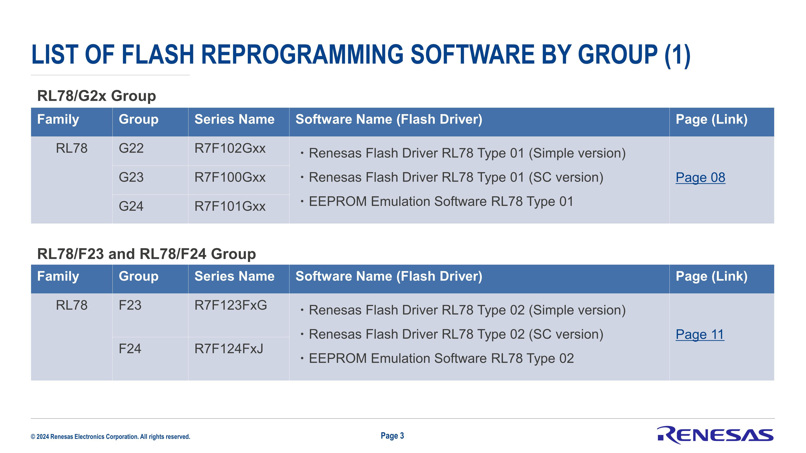
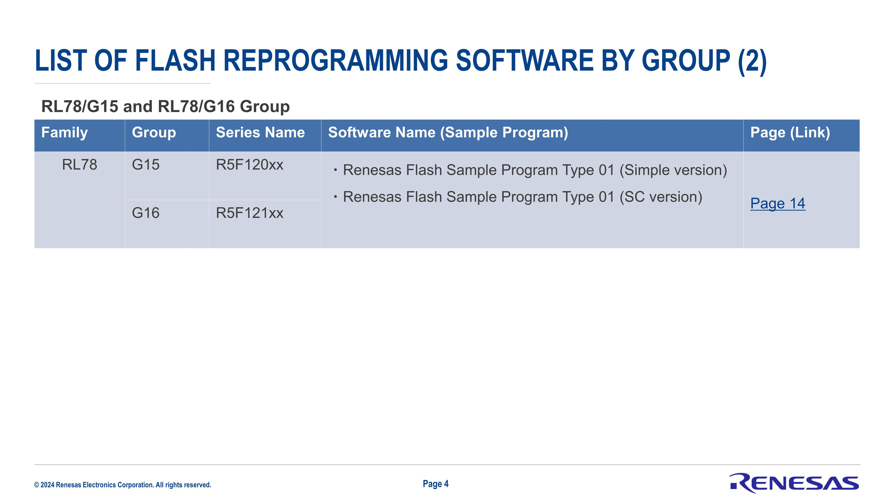
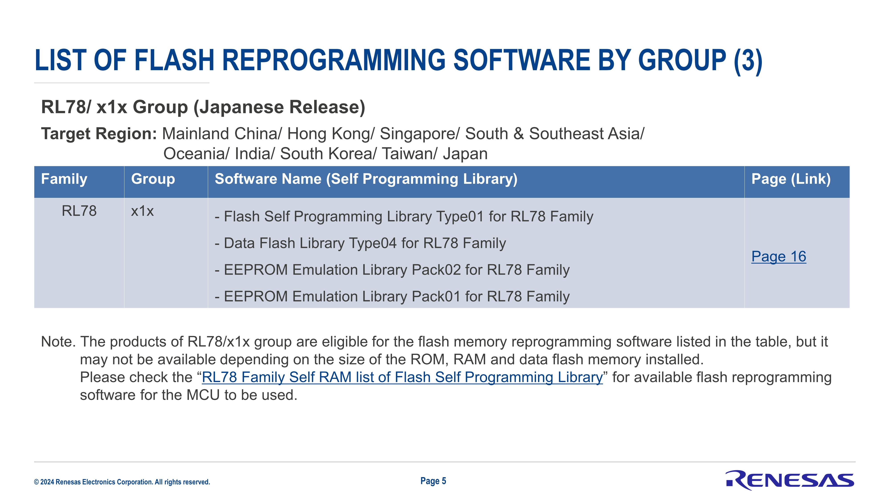
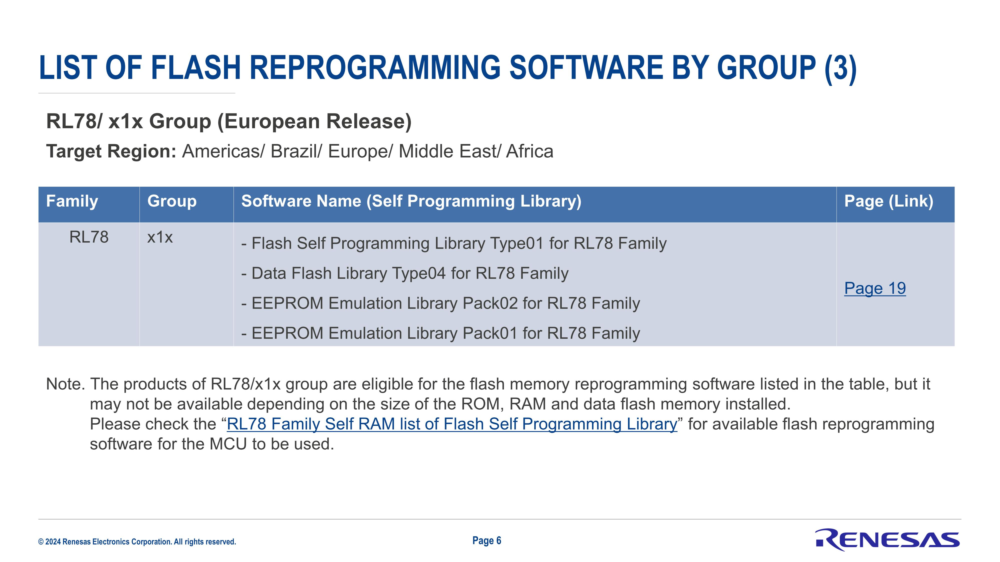
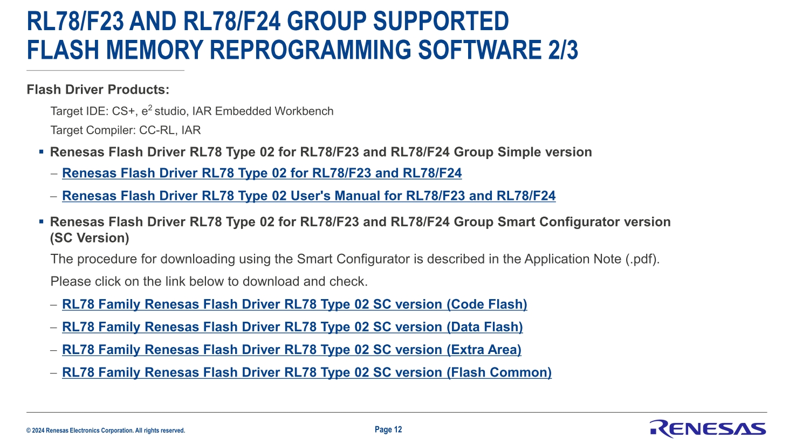

[MCU CAN device 指南](../) · [ISP Tool 操作](../../slide_simple_renesas_isp_tool/)

<a id="uart／i2c-範例"></a>
<a id="article_top"></a>

# RL78 Basic UART／I2C Boot／App 範例

本頁收錄 UART／I2C 範例的分區、startup、向量與 CRC 設定；各段以列出的參考工程為適用對象。
`RL78_F24_Basic_Boot_loader_UART` 系列採用 App 起點 `0x5000`；分區與中斷交接方式依該工程設定核對。
MCU CAN device 的 C header、固定向量與 metadata 操作集中於 [CAN device 指南](../#device-metadata-vector-workshop)。

與 CAN golden sample 的功能分工見 [Basic／golden sample 對照](../#basic-vs-golden)。
Flash 擦寫的執行條件見 [ROM 儲存與 RAM 執行](../#flash-ram-execution)；演算法選擇見 [CRC32／硬體 CRC](../#crc-backends)。

<a id="basic-projects"></a>

## Basic 工程索引

各列的 Boot 與 App 放在同一父目錄，保留表中 repository 名稱。
先建置 Boot 產生並複製 `.fsy`，再建置配對 App；開啟與 repository 同名的 `.mtpj`。

| 配對 | Boot 原始碼 | App 原始碼 | 配置與 checksum |
| --- | --- | --- | --- |
| Polling | [Basic UART](https://github.com/released/RL78_F24_Basic_Boot_loader_UART) | [Basic App](https://github.com/released/RL78_F24_Basic_Boot_loader_app) | UART XMODEM／可選 IICA0 polling；軟體 CRC32 |
| IRQ | [Basic UART CRC](https://github.com/released/RL78_F24_Basic_Boot_loader_UART_CRC) | [Basic App CRC](https://github.com/released/RL78_F24_Basic_Boot_loader_app_CRC) | timer／IICA0 IRQ；軟體 CRC32 |
| e2 studio | [Basic UART e2](https://github.com/released/RL78_F24_Basic_Boot_loader_UART_e2) | [Basic App e2](https://github.com/released/RL78_F24_Basic_Boot_loader_app_e2) | 附 e2 studio 工程設定；軟體 CRC32 |
| Hardware CRC | [Basic UART HW CRC](https://github.com/released/RL78_F24_Basic_Boot_loader_UART_HW_CRC) | [Basic App HW CRC](https://github.com/released/RL78_F24_Basic_Boot_loader_app_HW_CRC) | general-purpose 硬體 CRC16 |

Boot 的 `user_def.h` 選擇 UART／IICA0 與 IRQ 開關；`ftable.inc` 定義 App 起點。
`_CRC` 來源目前選擇 IICA0 IRQ／timer，其他介面依開關重建配對工程。
下列程式片段同時列出可選設定，實際啟用值以所選工程為準。

* Introduce boot code and app code modification for RL78 
  * In this section , use RL78 F24 as example  
  <br/>


* reference document 
  * How to set up boot code and app project
  [How to Divide Boot and Flash Areas](https://www.renesas.com/en/document/man/rl78-family-c-compiler-package-cc-rl-how-divide-boot-and-flash-areas?srsltid=AfmBOoopybLnK6nMIfwPclpX1SYJL0OfZ1ZD5o9odBLUk4F70ckFtVWd)
  document no. : R20UT3475EJ0300
  <br/>

  <a id="target_MCU_flash_type"></a>
  * How to know the MCU need use which flash library type (code flash)
  [RL78 FAMILY FLASH MEMORY REPROGRAMMING SOFTWARE INTRODUCTION](https://www.renesas.com/en/document/oth/rl78-family-flash-memory-reprogramming-software-introduction?r=488891)

    * RL78 F23/F24 : Renesas Flash Driver RL78 Type 02 (document no. : R20UT5009EJ0110)
    [Renesas Flash Driver RL78 Type 02](https://www.renesas.com/en/document/mat/renesas-flash-driver-rl78-type-02-users-manual-rl78f23-and-rl78f24)
    * RL78 G22/G23/G24 : Renesas Flash Driver RL78 Type 01
    * RL78 G15/G16 : Renesas Flash Sample Program Type 01
    * RL78 x1x : Flash Self Programming Library Type01
  <br/>







__code base : polling__
* reference code base : boot code (RL78 F24)
[RL78_F24_Basic_Boot_loader_UART](https://github.com/released/RL78_F24_Basic_Boot_loader_UART)
[RL78_F24_Basic_Boot_loader_UART_e2](https://github.com/released/RL78_F24_Basic_Boot_loader_UART_e2)
<br/>

* reference code base : app code (RL78 F24)
[RL78_F24_Basic_Boot_loader_app](https://github.com/released/RL78_F24_Basic_Boot_loader_app)
[RL78_F24_Basic_Boot_loader_app_e2](https://github.com/released/RL78_F24_Basic_Boot_loader_app_e2)
<br/>

  * interface : xmodem by UART (polling)
  * interface : IICA0 (polling)
  * LDROM address : 0x0000 , size : 20K
  * APROM address : 0x5000 , size : 236K (CRC addr:3FFFC)
  * check define as below 

```c
#define ENABLE_UART_BL                                  (1)
#define ENALBE_IICA0_BL                                 (0)
```

__code base : interrupt__
* reference code base : boot code (RL78 F24)
[RL78_F24_Basic_Boot_loader_UART_CRC](https://github.com/released/RL78_F24_Basic_Boot_loader_UART_CRC)
<br/>

* reference code base : app code (RL78 F24)
[RL78_F24_Basic_Boot_loader_app_CRC](https://github.com/released/RL78_F24_Basic_Boot_loader_app_CRC)
<br/>

  * interface : xmodem by UART (polling) + TIMER interrupt
  * interface : IICA0 (interrupt) + TIMER interrupt
  * LDROM address : 0x0000 , size : 20K
  * APROM address : 0x5000 , size : 235K (CRC addr:3FBFC)
  * check define as below 

```c
#define ENABLE_UART_PRINTF                      (1)
#define ENABLE_UART_BL                          (1)

#define ENALBE_TIMER_TAU0_1_IRQ                 (1)

#define ENALBE_IICA0_BL                         (0)
#if ENALBE_IICA0_BL
#define ENALBE_IICA0_BL_USE_IRQ                 (1)
#endif
```


__code base : interrupt with hardware CRC__
* reference code base : boot code (RL78 F24)
[RL78_F24_Basic_Boot_loader_UART_HW_CRC](https://github.com/released/RL78_F24_Basic_Boot_loader_UART_HW_CRC)
<br/>

* reference code base : app code (RL78 F24)
[RL78_F24_Basic_Boot_loader_app_HW_CRC](https://github.com/released/RL78_F24_Basic_Boot_loader_app_HW_CRC)
<br/>

  * interface : xmodem by UART (polling) + TIMER interrupt
  * interface : IICA0 (interrupt) + TIMER interrupt
  * LDROM address : 0x0000 , size : 20K (0x5000)
  * APROM address : 0x5000 , size : 235K；CRC16 calculation ends at 0x3FBFB, stored at 0x3FBFE..0x3FBFF

refer to document :
[RL78 Family RL78 Hardware CRC Functions (R01AN3530EU0110)](https://www.renesas.com/en/document/apn/rl78-family-rl78-hardware-crc-functions?queryID=f29102cd30aa1ffab265983af4afc4fe)

download sample code :
[RL78 Family RL78 Hardware CRC Functions (R01AN3530EU0110)](https://www.renesas.com/en/document/scd/rl78-family-rl78-hardware-crc-functions?queryID=f29102cd30aa1ffab265983af4afc4fe)

<span style="color:#FF0000">
<b><u>Key point</b></u><br><br>
</span> 

* project setting for boot code and app code 
* target MCU platform flash library usage and setting
* target interface initial and receive data 

## 主題頁

| 項目 | 內容 |
| --- | --- |
| [Flash 分區與啟動](architecture.html) | Flash 分區與啟動的設定、畫面與來源 |
| [Boot 向量與 Startup](boot-startup.html) | Boot 向量與 Startup的設定、畫面與來源 |
| [Boot CRC](boot-crc.html) | Boot CRC的設定、畫面與來源 |
| [Boot Driver 與主程式](boot-driver.html) | Boot Driver 與主程式的設定、畫面與來源 |
| [I²C 更新封包與操作](i2c.html) | I²C 更新封包與操作的設定、畫面與來源 |
| [XMODEM 更新](xmodem.html) | XMODEM 更新的設定、畫面與來源 |
| [Boot 建置與燒錄設定](boot-build.html) | Boot 建置與燒錄設定的設定、畫面與來源 |
| [App 向量與主程式](app.html) | App 向量與主程式的設定、畫面與來源 |
| [App 建置與燒錄設定](app-build.html) | App 建置與燒錄設定的設定、畫面與來源 |
| [Boot 中斷與硬體 CRC](irq-crc.html) | Boot 中斷與硬體 CRC的設定、畫面與來源 |
