[主題索引](index.html) · [知識庫總索引](https://released.github.io/)

# Boot 中斷與硬體 CRC

<!-- CHAPTER_SCOPE -->
Boot 中斷與硬體 CRC 整理設定位置、操作畫面與對應程式／文件連結。

- 圖中型號、clock、pin、位址與工具介面屬於各參考工程的條件，不延伸為所有型號的固定配置。
- 實際設定與結果以所選 MCU 手冊、工程設定、linker map 及量測為準；原始文件與範例連結保留在各節。


---

<a id="how-to-add-interrupt-at-boot-code"></a>

## How to add interrupt at boot code 

refer to define : ENALBE_IICA0_BL_USE_IRQ in project:RL78_F24_Basic_Boot_loader_UART_CRC

add interrupt vect declare in boot code 
  * use smart config generate driver code and move to boot_main.c
  * use [#pragma interrupt] to declare custom interrupt 
  * vect refer to [vector table ](boot-build.html#vector_table)
  * use ram flag (ex:_no_init_global[RAM_FLAG_INDICATE_BOOT_APP]) to define excute which irq when in boot code / app code
    * declare ram_flag = 0xAA when in boot code
    * declare ram_flag = 0x55 when in app code
  * add boot code interrupt process (ex:I2C_Downloader_routine_IRQ)
  * interrupt process in app code wll be defined as [vector number](boot-build.html#vect_address)

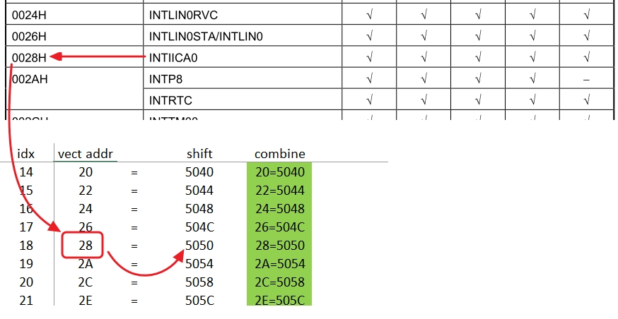

```C
#pragma interrupt boot_r_Config_IICA0_interrupt(vect=INTIICA0)
void __near boot_r_Config_IICA0_interrupt(void)
{
	if(_no_init_global[RAM_FLAG_INDICATE_BOOT_APP] == 0xAA)   // execute boot code ISR
	{
        if (0U == (IICS0 & _80_IICA_STATUS_MASTER))
        {            
            I2C_Downloader_routine_IRQ();   // r_Config_IICA0_slave_handler();
        }
	}
	if(_no_init_global[RAM_FLAG_INDICATE_BOOT_APP] == 0x55)   //user app ISR address
	{	    	
        if (0U == (IICS0 & _80_IICA_STATUS_MASTER))
        {
            ((void(*)(void))0x5050)();	
        }
	}
}
```


__TIMER example__
refer to define : ENALBE_TIMER_TAU0_1_IRQ in project:RL78_F24_Basic_Boot_loader_UART_CRC

add interrupt vect declare in boot code 
  * use smart config generate driver code and move to boot_main.c
  * use [#pragma interrupt] to declare custom interrupt 
  * vect refer to [vector table ](boot-build.html#vector_table)
  * use ram flag (ex:_no_init_global[RAM_FLAG_INDICATE_BOOT_APP]) to define excute which irq when in boot code / app code
    * declare ram_flag = 0xAA when in boot code
    * declare ram_flag = 0x55 when in app code
  * add boot code interrupt process (ex:boot_Timer_1ms_IRQ)
  * interrupt process in app code wll be defined as [vector number](boot-build.html#vect_address)

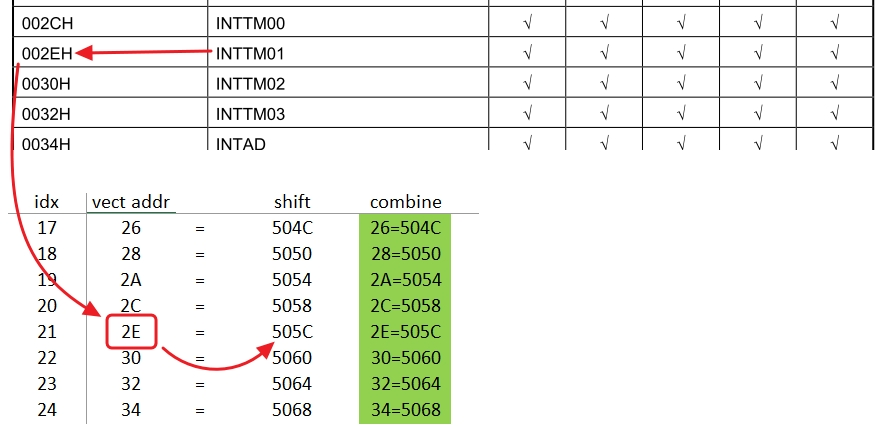

```C
#pragma interrupt boot_r_Config_TAU0_1_interrupt(vect=INTTM01)
void __near boot_r_Config_TAU0_1_interrupt(void)
{
	if(_no_init_global[RAM_FLAG_INDICATE_BOOT_APP] == 0xAA)   // execute boot code ISR
	{
        boot_Timer_1ms_IRQ();
	}
	if(_no_init_global[RAM_FLAG_INDICATE_BOOT_APP] == 0x55)   //user app ISR address
	{	    	
        ((void(*)(void))0x505C)();
	}
}
```

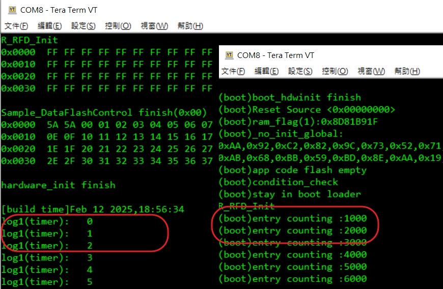


---

<a id="how-to-use-hardware-crc-at-boot-code-and-app-code-project"></a>

## How to use hardware CRC at boot code and app code project

__setting in CS+ (boot code)__

```c
Target Range : 0000-4FFB
type of CRC : CRC-CCITT (LSB) type (General-purpose CRC)
Initial value : 0000
Output size : 2
CRC store address : 0x4FFE

```

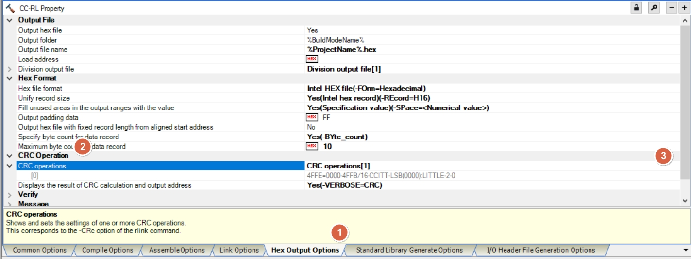

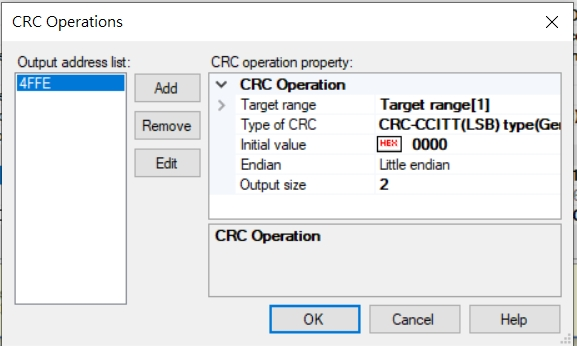

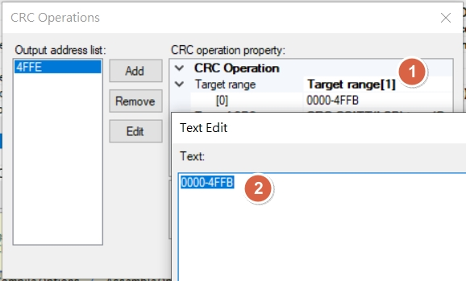


__setting in CS+ (app code)__


```c
Target Range : 5000-3FBFB
type of CRC : CRC-CCITT (LSB) type (General-purpose CRC)
Initial value : 0000
Output size : 2
CRC store address : 0x3FBFE

```

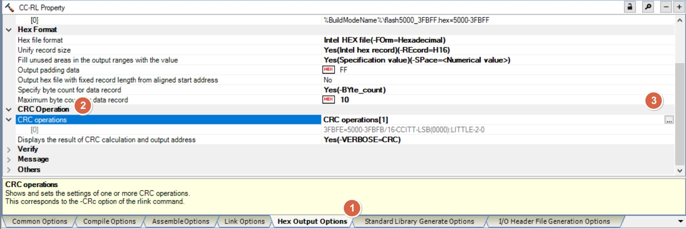

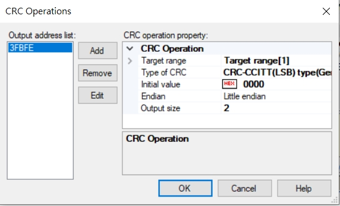

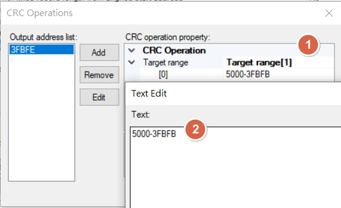


for CRC compare , refer to function : ==verify_application_chksum==
and ==verify_bootcode_chksum==

below is boot code , verify result 

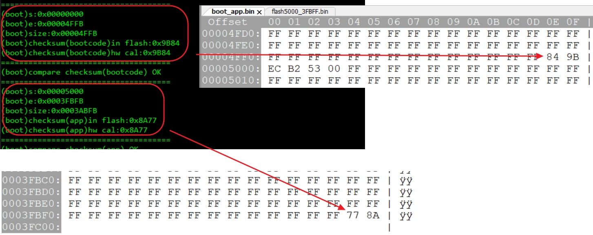


below is boot code , log message 

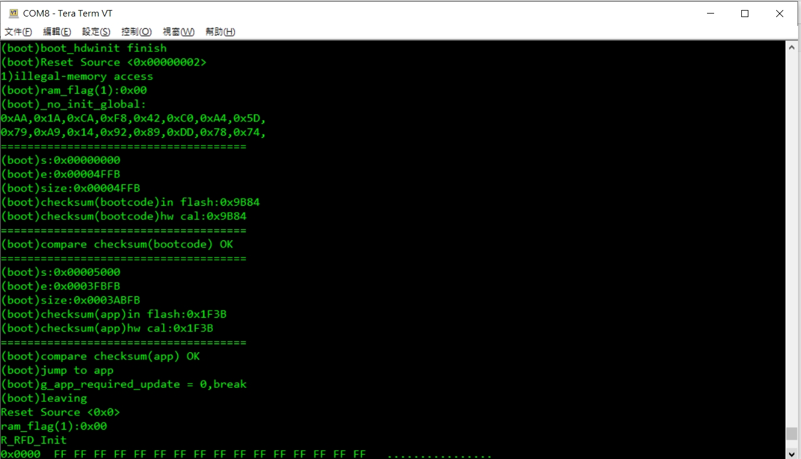


__Need to modify driver , due to far pointers 16bit addressing issue__

[issue](https://community.renesas.com/mcu/rl78/f/rl78-forum/1850/read-program-flash)

```c
void r_crc_general_hardware (uint32_t start_address, uint32_t end_address, uint16_t initial_value, uint16_t *crc)
{
    uint32_t word_counter;
    uint8_t __far *p_address = (uint8_t __far *) start_address;

    CRCD = initial_value;

    if ((end_address >= 0x10000) && (start_address <= 0xFFFF))
    {
        for (word_counter = start_address; word_counter < 0x10000 ; word_counter++)
        {
            CRCIN = *p_address++;
            __nop();
        }  

        p_address = (uint8_t __far *)0x10000;
        for (word_counter = 0x10000; word_counter < (end_address + 1); word_counter++)
        {
            CRCIN = *p_address++;
            __nop();
        }  
    }
    else
    {
        /* Read 4 bytes of data each loop until range complete */
        for (word_counter = start_address; word_counter < (end_address + 1); word_counter++)
        {
            CRCIN = *p_address++;
            __nop();
        }    
    }
    __nop();
    
    /* Return value */
    *crc = CRCD;

    return;
} /* End of function r_crc_general_hardware() */

```

High-speed CRC 的範圍與一般 CRC 的差異見 [CRC32／硬體 CRC](../#crc-backends)。


---


[主題索引](index.html) · [上一主題](app-build.html)
