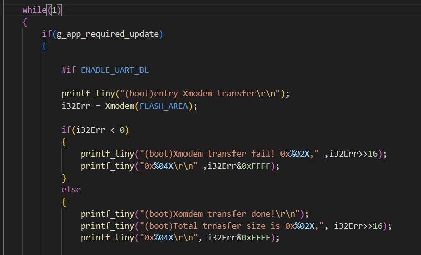
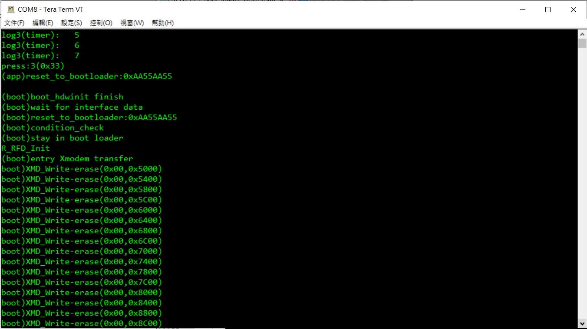
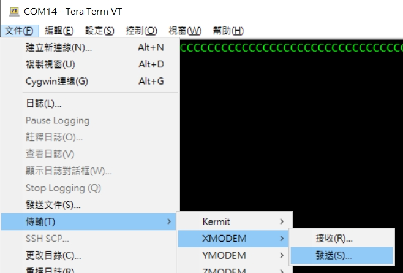
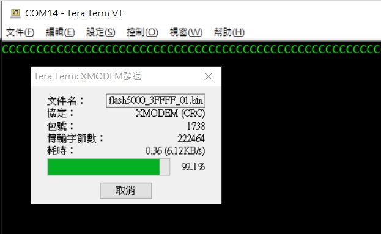
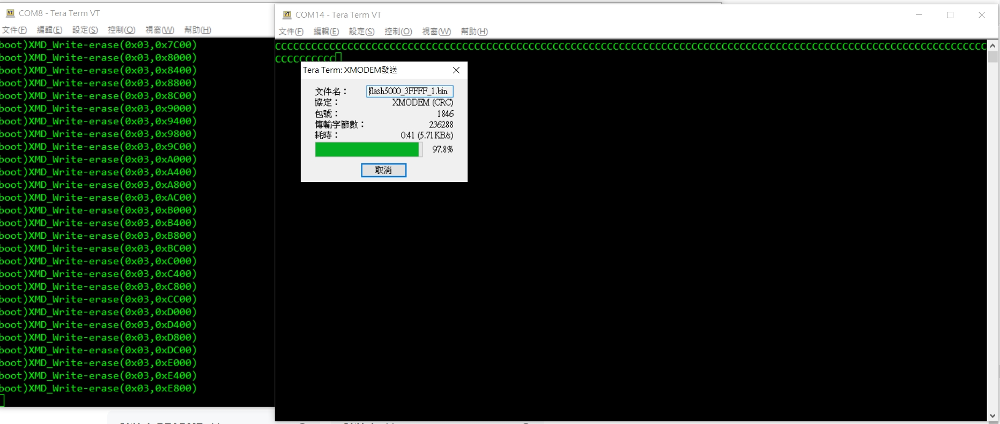
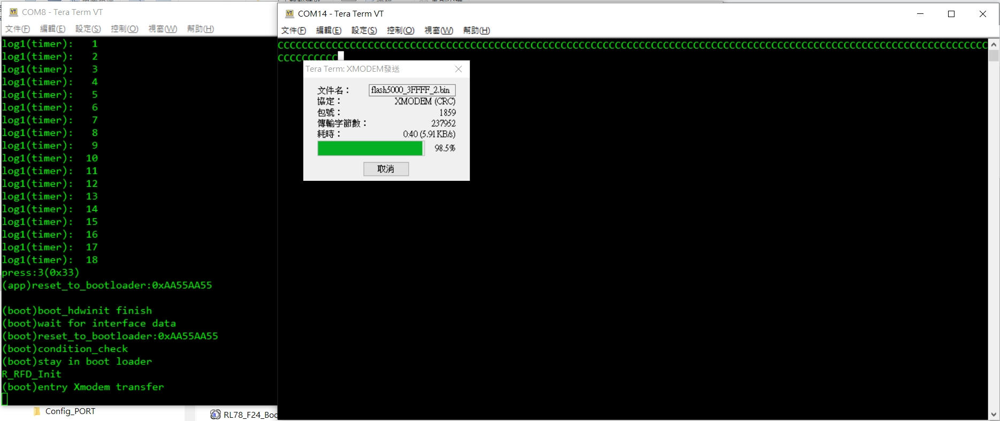
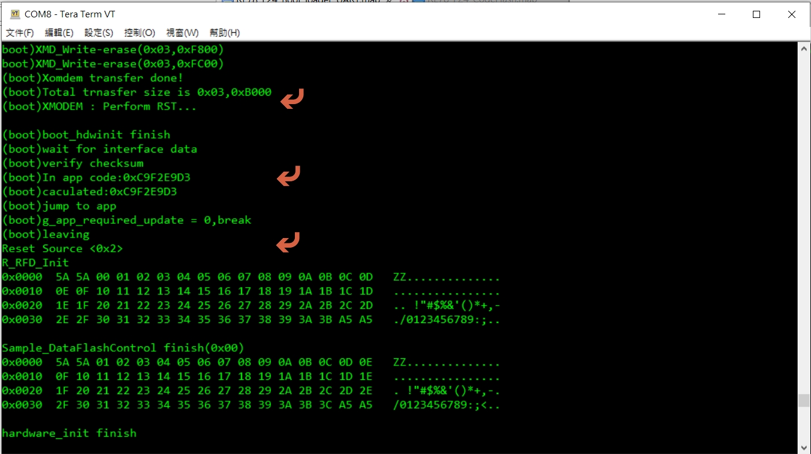

[主題索引](index.html) · [知識庫總索引](https://released.github.io/)

# XMODEM 更新

<!-- CHAPTER_SCOPE -->
XMODEM 更新 整理設定位置、操作畫面與對應程式／文件連結。

- 圖中型號、clock、pin、位址與工具介面屬於各參考工程的條件，不延伸為所有型號的固定配置。
- 實際設定與結果以所選 MCU 手冊、工程設定、linker map 及量測為準；原始文件與範例連結保留在各節。

---

## Project : boot code modification - xmodem update flow

below is at xmodem update when g_app_required_update == 1

when trig update flow , will wait for xmodem from PC host

use teraterm , to send file under xmodem

when under transmit binary file

trasmit time , update RL78 F24 app code : 236K
* with boot code enable log message (xmodem.c , check debug3) , spent 41 sec

* without boot code enable log message (xmodem.c , check debug3) , spent 40 sec

when update app code finish

[主題索引](index.html) · [上一主題](i2c.html) · [下一主題](boot-build.html)
