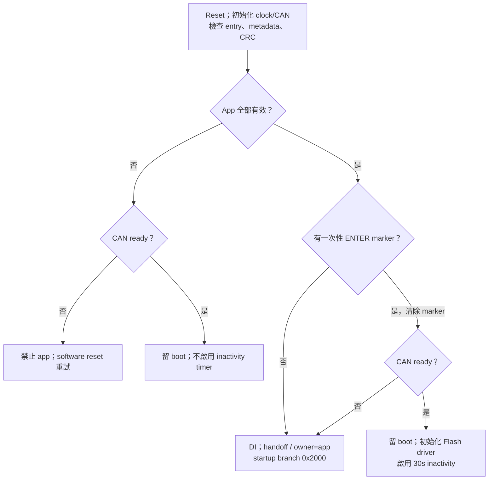
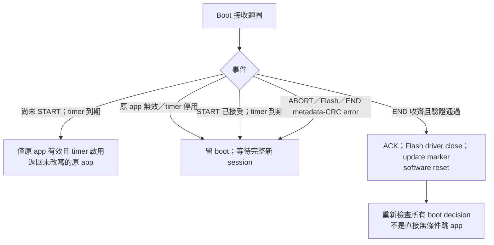
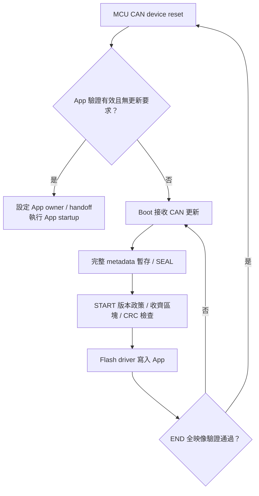

[知識庫首頁](https://released.github.io/) · [RL78 Bootloader](index.html)

<a id="article_top"></a>

# CAN Bootloader 與工程

F13／F24 Classical CAN、F24 CAN FD 的 Boot／App 工程與啟動流程。

<!-- BOOTLOADER_TOPICS_BEGIN -->
<details>
<summary>章節與另一平台對照</summary>

| 章節／規格 | 本頁 | 另一平台 |
| --- | --- | --- |
| 工程與用途 | [閱讀](#guide-can-device-1) | [RH850](../slide_boot_loader_for_RH850/can-device.html#guide-can-device-1) |
| 板端與更新設定 | [閱讀](#guide-can-device-2) | [RH850](../slide_boot_loader_for_RH850/can-device.html#guide-can-device-2) |
| Flash 配置 | [閱讀](#guide-can-device-3) | [RH850](../slide_boot_loader_for_RH850/can-device.html#guide-can-device-3) |
| Boot 啟動與更新 | [閱讀](#f13-boot-decision) | [RH850](../slide_boot_loader_for_RH850/can-device.html#guide-can-device-4) |

</details>
<!-- BOOTLOADER_TOPICS_END -->

<!-- DEVICE_UPGRADE_PATHS_BEGIN -->
## MCU 工程與實驗索引

工程設定與實板紀錄分開列出；每個入口直接到達對應主題。

| MCU／料號 | 工程設定 | 實驗資料 |
| --- | --- | --- |
| F13／R5F10BMG | [配對工程與配置](#upgrade-f13-can) | [實板紀錄與限制](experiments.html#device-update-timing) |
| F24／R7F124FPJ5xFB | [配對工程與配置](#upgrade-f24-can) | [實板紀錄與限制](experiments.html#device-update-timing) |


<!-- DEVICE_UPGRADE_PATHS_END -->

<!-- RL78_CAN_INDEX_BEGIN -->
<a id="guide-can-device-1"></a>

### 工程與用途

| 模式／MCU | Transfer | Boot | App |
| --- | --- | --- | --- |
| Classical CAN／F13 | `RL78_F13_CAN_Transfer` | `RL78_F13_Boot_loader_CAN` | `RL78_F13_Boot_loader_CAN_app` |
| Classical CAN／F24 | `RL78_F24_CAN_Transfer` | `RL78_F24_Boot_loader_CAN` | `RL78_F24_Boot_loader_CAN_app` |
| CAN FD／F24 | `RL78_F24_CAN_FD_Transfer` | `RL78_F24_Boot_loader_CAN_FD` | `RL78_F24_Boot_loader_CAN_FD_app` |

| MCU／模式 | Boot reserve | 預設完整App容量 | 編譯的bus條件 |
| --- | --- | --- | --- |
| F13 Classical CAN | 8KiB | 119KiB | nominal500K |
| F24 Classical CAN | 8KiB | 247KiB | nominal500K |
| F24 CAN FD | 8KiB | 247KiB | nominal500K／data2M、BRS |

Boot、App與獨立Transfer各自建置。下載／產物選擇集中於 [下載入口](https://released.github.io/slide_simple_renesas_isp_tool/downloads.html)。
板端設定與啟動分支依本頁的F13／F24工程說明；完整地址與尾端保護集中於 [移植與Flash](porting.html)。
<!-- RL78_CAN_INDEX_END -->

## F13 (MCU CAN device)：Boot 啟動與更新

<!-- F13_BOOT_DECISION_BEGIN -->
<a id="f13-boot-decision"></a>

本節整理 F13 (MCU CAN device) 的 Boot 啟動與更新狀態。
流程入口為 `custom_func.c` 的 `hardware_init()`／`loop()`；`r_main.c` 保留啟動 adapter，CAN 命令處理由 `hal/isp/can_boot_transport.c` 執行。

#### A. 每次 reset 的 app 有效性檢查：全部通過才可啟動

| 檢查 | 目前 F13 build 必須符合 |
| --- | --- |
| Reset entry | `0x2000` 的第一個 DWORD 不為 `0xFFFFFFFF`；只檢查非 erased，沒有完整反組譯／驗證跳轉目的地 |
| Metadata header | `0x2100` magic=`0x004E4143`；format6、core length128、flags=`0x0003`；protocol ID1／version5、checksum type1（CRC32）、target=`0xF13B`、Classical CAN／standard ID 格式全部匹配 |
| Metadata reserved | 整區256 bytes 中後128 bytes（`0x2180..0x21FF`）全部為 `0xFF` |
| Metadata policy | UPD1 version3／size32、DEVICE_APP／CAN、F1V1 IRQ ABI；minimum Boot 不高於目前 Boot；`0x74..0x77` version control 為0或1，UART baud 與其餘保留欄位為0 |
| Image size | manifest size 含尾端 CRC4 bytes，介於516與121856 bytes，且4-byte aligned |
| App version | `0x00MMmmpp`；啟動時驗證欄位有效。更新版本比較在 START 執行，依目前有效 App 的 version control 判斷；build 不參與比較 |
| Flash layout | app start=`0x2000`、capacity=`0x1DC00`、code Flash=`0x20000`、boot reserve=`0x2000`、erase=`0x400`、minimum=`0x204`，均等於 boot 編譯設定 |
| CAN contract | nominal mask=`0x04`（500K）、data mask=0、request ID=`0x700`、response ID=`0x701`，均等於 boot 編譯設定 |
| CRC32 | 對 `[app_start, app_start + image_size - 4)` 計算 CRC32，等於該 image 最後4 bytes 的 LE32 stored CRC |

Boot 直接比對 MCU ASCII family／part，要求 build 已初始化，並檢查
UPD1更新政策、IRQ ABI與最低boot版本。PC仍須另作image/live device比對。
CRC是完整性，不是簽章或身分認證；最低boot版本不等於app防回滾。

#### B. ENTER marker 與啟動路徑

1. app 有效且沒有 ENTER marker：正常返回 startup，轉到 `0x2000` 的 app table。
2. app 收到 standard data ID=`0x700`、DLC1、data=`06` 的明確 ENTER request 時，
   先嘗試送 ACK（ID=`0x701`、DLC2、`06 00`），再將 `0xAA55AA55` 寫入
   no-init RAM `0xFF700`，最後 software reset。ACK 不是 reset 的可靠送達保證。
3. boot 看見 marker 後立即清除，表示本次先進入更新模式，不是永久鎖住 boot。
   P13.7／INTP0 不參與 boot decision，也不要求 tool 或 analyzer 必須在線才能正常開 app。
4. app 無效：禁止跳 app；CAN ready 時留 boot 等完整更新，clock／CAN 初始化失敗則
   software reset 重試，不能藉此放行無效 app。
5. app 有效但要求進 boot，而 clock／CAN 初始化失敗：目前實作會返回有效 app，
   不會永久卡 boot；CAN ready／FSL ready 不是所有正常啟動都必須通過的額外 gate。
6. 真正交接前關中斷，寫 `0xFF714` handoff signature、將 `0xFF710` ISR owner
   設為 app（`0x55`），startup 再 branch app table。這些是 boot 的輸出，不是額外外部啟動要求。



#### C. 30 秒 inactivity、START、失敗與更新成功

在 Tool 完成 Enter Boot 後，若停留在選檔或確認視窗而未開始更新，原有效 App 可能因 inactivity 到期而重新執行。
此時先 `Discover Target` 取得目前模式；若為 App，再 `Enter Boot`，確認 Boot Ready 後執行 `Start Device Update`。
操作圖集中於 [Device App 更新操作圖](https://released.github.io/slide_simple_renesas_isp_tool/#device-update-example)。

| 事件 | boot 的實際結果 |
| --- | --- |
| 原 app 有效、ENTER 後尚未接受 START | 連續30秒沒有符合底層接收條件的 CAN request，關閉已初始化的 FSL 後返回原 app |
| 持續 INFO／HELLO／其他符合接收條件的 frame | 都會刷新 inactivity；不是上電後固定30秒，也不是只由 DATA 刷新；未知 command／錯誤 DLC 也可能刷新 |
| 原 app 無效 | 從一開始不啟用 inactivity timer，接受 START 後也不會自動啟用；失聯仍留 boot 等重試 |
| START 被拒絕（protocol／target／size／FSL not ready） | 沒有進入 started state；不能把這個拒絕當成 app 已被擦寫；原 app 有效且 timer 啟用時仍可 inactivity 返回 |
| START 已接受後 inactivity 到期 | 若本次 timer 原本啟用，回 session-timeout error、留 boot、關閉後續自動返回；不跳可能只有部分內容的 app |
| ABORT／erase-write error／END metadata 或 CRC error | error 返回主迴圈，關閉後續自動返回，留 boot 等新 session；ABORT 即使在 START 前也走這條留 boot 路徑 |
| END 長度／state 尚不完整 | 回錯誤但保留 session；不得先宣布成功或跳 app |
| END 收齊、metadata size 等於 START size、Flash metadata 與 CRC 正確 | ACK 成功，關閉 FSL，寫 `0xFF718` update-complete marker，再 software reset；下次 reset 重新通過 A 節與 ENTER 判斷才進 app |
| 擦寫中掉電 | 下次上電重新跑 A 節；若 image 仍有效且無 ENTER 則可啟動，否則留 boot；不是保證有雙映像回復 |

底層接收條件為standard／非RTR、ID700或720..727、DLC>0；通過即刷新timer，之後才
檢查 command。計時由1ms TMRJ0 IRQ 累加，Flash 操作關 IRQ 時不是嚴格的 wall-clock
30秒。timer 已停用或未啟用時，PC 失聯不能期待 target 自動 timeout／reset；tool 的
bounded wait／ABORT 不能取代供電、Flash、IRQ 與掉電的實板驗證。


#### App 工程設定

固定向量介面與 ISR 登錄方式見 [Device IRQ 設定](https://released.github.io/slide_boot_loader_for_RL78/#device-app-irq)。
Metadata 與 App-only 建置命令見 [Device App 建置](https://released.github.io/slide_boot_loader_for_RL78/#device-app-build)。

<!-- F13_BOOT_DECISION_END -->

<!-- F24_DEVICE_BEGIN -->
<a id="f24-can-device"></a>

## F24 (MCU CAN device)：Boot／App 工程配置

F24 CAN device 使用獨立的 Transfer、Boot 與 App 工程。
板端為 RL78/F24 Target Board R7F124FPJ5xFB。
正常 CAN App 更新已完成實板驗證，操作與 F13 device 相同：載入配對 BIN、Discover、必要時 Enter Boot、更新並確認 App。
完成報告與 UART counter 見 [F24 device 更新結果](https://released.github.io/slide_simple_renesas_isp_tool/#f24-device-update-example)。

<a id="guide-can-device-2"></a>

### 板端與更新設定

| 項目 | 設定 |
| --- | --- |
| X1／CPU／CAN clock | 4 MHz／40 MHz／40 MHz，PLL80 |
| CAN backend | RS-CANFD，Classical CAN 500K |
| CAN pins | P10 TX、P11 RX、P12 STB LOW |
| 診斷 UART | P15 TX、P16 RX、115200 |
| Flash driver | RFD Type02，programming-mode 路徑在 RAM 執行 |
| Target／IRQ ABI | `0xF24B`／F2V1 |
| IRQ owner | `0xAA`：Boot；`0x55`：App |
| CAN IDs | Control `0x700`、response `0x701`、raw `0x720..0x727` |
| 更新格式 | App image format6、CAN protocol5、64-byte blocks |

<a id="guide-can-device-3"></a>

### Flash 配置

| 絕對 address | 用途 |
| --- | --- |
| `0x00000..0x01FFF` | 8 KiB Boot，含實體 vector／option |
| `0x02000..0x020FF` | App 64 組4-byte跳轉表 |
| `0x02100..0x0217F` | 128-byte metadata core |
| `0x02180..0x021FF` | 128-byte metadata reserved FF |
| `0x02200..` | App startup／code／far constants |
| `app_start + image_size - 4` | App CRC32 尾碼 |
| `0x3FC00..0x3FFFF` | 最後1 KiB保留，含 debug monitor |

最大 App 容量為 `0x3DC00`（247 KiB），擦除單位1 KiB，寫入單位4 bytes。
建置檢查保留至少512 bytes Boot ROM 餘裕，預設關閉 Boot UART log。
完整欄位說明見 [Device metadata 位址表](https://released.github.io/slide_boot_loader_for_RL78/#flash-metadata-can-reference)。

### Boot 啟動與更新

Boot 檢查 metadata、跳轉表與全映像 CRC。
SW1（P137 LOW）或 ENTER marker 進入更新模式；有效 App 的 ENTER session 使用30秒 inactivity。
Flash 操作透過 RAM 中的 RFD 執行路徑更新 App 範圍。



<a id="guide-can-device-9"></a>

### 工程與建置

每個工程自備 `hal` API、設定 header、SC 與 MTPJ，可獨立建置。
目錄分工見 [工程目錄與程式入口](https://released.github.io/slide_boot_loader_for_RL78/#device-project-entry)。

在所選工程根目錄使用 PowerShell：

```powershell
# Rebuild this project and run its linked-image/package guards.
powershell.exe -NoProfile -ExecutionPolicy Bypass -File .\build.ps1

```

日常建置使用 Windows PowerShell、CS+／CC-RL。
CS+ hooks 依序執行產表與封裝；map、ROM／RAM、向量、metadata 與 CRC 由腳本核對。

C header 編輯、ISR 與 App-only 命令集中於 [Device App 設定與建置](https://released.github.io/slide_boot_loader_for_RL78/#device-app-build)。
初裝檔為 Boot `boot0000_1FFF.hex`＋App `flash_app_variable_CRC.hex`，核對兩者的地址範圍。
CAN 更新使用 App `*_update.bin`。App 產表為 `ftable.inc`、`app_identity.h`、`app_irq_table.inc`，
由 `ftable_RL78_F24.asm` 組譯；兩份 C header 仍是編輯入口。

<a id="guide-can-device-10"></a>

### 驗證項目

軟體檢查涵蓋編譯、向量／RETI、IRQ stack、RFD RAM 路徑及 metadata／區塊處理。
正常 500K CAN App 寫入、END CRC、reset 後 APP_READY／live INFO 與 UART timer counter 已確認。
CAN 波形量測、250K／1M、其他 IRQ、長時間壓力、取消、斷線及斷電復原分項驗證，
見 [更新驗證矩陣](https://released.github.io/slide_simple_renesas_isp_tool/#update-confirmation)。
<!-- F24_DEVICE_END -->


---

[指南入口](index.html) · [下一主題：App Metadata、IRQ 與更新耗時](app-development.html)

<!-- MODEL_DETAILS_BEGIN -->
<a id="upgrade-f13-can"></a>

### F13 × CAN：工程設定

#### 配對工程、接線與映像

| 項目 | 此組合的設定 |
| --- | --- |
| Device／target | R5F10BMG／`0xF13B` |
| Boot 工程 | `RL78_F13_Boot_loader_CAN` |
| App 工程 | `RL78_F13_Boot_loader_CAN_app` |
| 初次安裝 | Boot 工程的 `DefaultBuild/boot0000_1FFF.hex`，由 programmer 安裝；確認 MCU 與擦除範圍 |
| Tool 更新檔 | App 工程的 `DefaultBuild/RL78_F13_Boot_loader_CAN_app_update.bin`；HEX、boot_app 合併檔與 Transfer HEX 不放入 App 更新欄 |
| Flash 配置 | App 起點 `0x02000`，容量 `119 KiB`；8 KiB Boot、App 最大 119 KiB；最後 1 KiB 為保留區，App 容量包含 vectors、Metadata、padding 與 CRC。 |
| 資料介面 | Classical 500K；standard control 0x700／reply 0x701，raw 0x720..0x727（各 8 bytes） |
| RAM 交接 | `0xFF710..0xFF71F`；返回 Boot request：`0xFF700` |

- [Tool CAN 操作](https://released.github.io/slide_simple_renesas_isp_tool/can-update.html)提供接線、Discover、Enter Boot、更新與結果確認。
- [Boot 接收與驗證機制](https://released.github.io/slide_boot_loader_for_RL78/can-device.html#f13-boot-decision)集中描述此介面的接收、CRC、更新命令與完成回覆。
- [App 返回 Boot 與 RAM 交接](https://released.github.io/slide_boot_loader_for_RL78/architecture.html#boot-app-handoff)說明 ENTER 與 UART0 z/Z 的差異；實際保留位址以本節表格為準。
- [此組合的實驗資料與限制](https://released.github.io/slide_boot_loader_for_RL78/experiments.html#device-update-timing)與工程設定分開呈現，沒有實板紀錄的組合不推定為已驗證。
- 程式入口為配對工程的 `custom_func.c`：`hardware_init()`／`loop()`；移植修改位置見 [Boot／App 移植](https://released.github.io/slide_boot_loader_for_RL78/porting.html)。

<a id="upgrade-f24-can"></a>

### F24 × CAN：工程設定

#### 配對工程、接線與映像

| 項目 | 此組合的設定 |
| --- | --- |
| Device／target | R7F124FPJ5xFB／`0xF24B` |
| Boot 工程 | `RL78_F24_Boot_loader_CAN` |
| App 工程 | `RL78_F24_Boot_loader_CAN_app` |
| 初次安裝 | Boot 工程的 `DefaultBuild/boot0000_1FFF.hex`，由 programmer 安裝；確認 MCU 與擦除範圍 |
| Tool 更新檔 | App 工程的 `DefaultBuild/RL78_F24_Boot_loader_CAN_app_update.bin`；HEX、boot_app 合併檔與 Transfer HEX 不放入 App 更新欄 |
| Flash 配置 | App 起點 `0x02000`，容量 `247 KiB`；8 KiB Boot、App 最大 247 KiB；最後 1 KiB 為保留區，App 容量包含 vectors、Metadata、padding 與 CRC。 |
| 資料介面 | Classical 500K；standard control 0x700／reply 0x701，raw 0x720..0x727（各 8 bytes） |
| RAM 交接 | `0xFF710..0xFF71F`；返回 Boot request：`0xFF71C` |

- [Tool CAN 操作](https://released.github.io/slide_simple_renesas_isp_tool/can-update.html)提供接線、Discover、Enter Boot、更新與結果確認。
- [Boot 接收與驗證機制](https://released.github.io/slide_boot_loader_for_RL78/can-device.html#f13-boot-decision)集中描述此介面的接收、CRC、更新命令與完成回覆。
- [App 返回 Boot 與 RAM 交接](https://released.github.io/slide_boot_loader_for_RL78/architecture.html#boot-app-handoff)說明 ENTER 與 UART0 z/Z 的差異；實際保留位址以本節表格為準。
- [此組合的實驗資料與限制](https://released.github.io/slide_boot_loader_for_RL78/experiments.html#device-update-timing)與工程設定分開呈現，沒有實板紀錄的組合不推定為已驗證。
- 程式入口為配對工程的 `custom_func.c`：`hardware_init()`／`loop()`；移植修改位置見 [Boot／App 移植](https://released.github.io/slide_boot_loader_for_RL78/porting.html)。
<!-- MODEL_DETAILS_END -->

---

[上一主題：Bootloader 整體架構](architecture.html) · [指南入口](index.html) · [下一主題：CAN FD Bootloader 與工程](can-fd-device.html)
