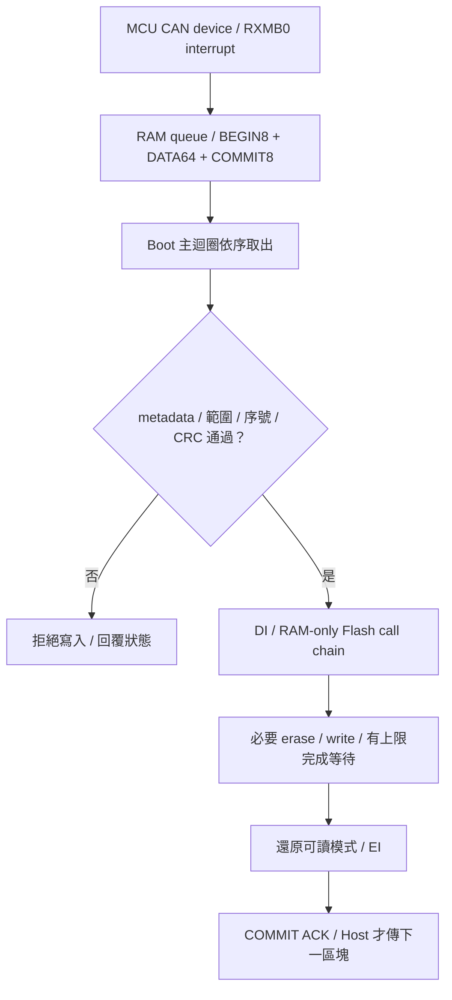

[知識庫首頁](https://released.github.io/) · [RL78 Bootloader](index.html)

<a id="article_top"></a>

# CAN FD Bootloader 與工程

CAN FD 的設定、接收與更新契約；各 MCU 工程直接入口。

<!-- BOOTLOADER_TOPICS_BEGIN -->
<details>
<summary>章節與另一平台對照</summary>

| 章節／規格 | 本頁 | 另一平台 |
| --- | --- | --- |
| MCU CAN FD device 工程設定 | [閱讀](#guide-can-device-5) | [RH850](../slide_boot_loader_for_RH850/can-fd-device.html#guide-can-device-5) |
| 設定來源 | [閱讀](#guide-can-device-6) | [RH850](../slide_boot_loader_for_RH850/can-fd-device.html#guide-can-device-6) |

</details>
<!-- BOOTLOADER_TOPICS_END -->

<!-- DEVICE_UPGRADE_PATHS_BEGIN -->
## MCU 工程與實驗索引

工程設定與實板紀錄分開列出；每個入口直接到達對應主題。

| MCU／料號 | 工程設定 | 實驗資料 |
| --- | --- | --- |
| F24／R7F124FPJ5xFB | [配對工程與配置](#upgrade-f24-can-fd) | [實板紀錄與限制](experiments.html#device-update-timing) |


<!-- DEVICE_UPGRADE_PATHS_END -->

<!-- FD_DEVICE_BEGIN -->
<a id="can-fd-device-engineering"></a>

<a id="guide-can-device-5"></a>

## MCU CAN FD device 工程設定

F24 device 使用獨立 `RL78_F24_Boot_loader_CAN_FD` 與
`RL78_F24_Boot_loader_CAN_FD_app` 工程；各自包含本地來源與工具，可分開建置。
App 使用本工程的 `hal` API、metadata 設定與建置工具。
App 發行與 IRQ 編輯沿用 [C header 工作流程](https://released.github.io/slide_boot_loader_for_RL78/#device-metadata-vector-workshop)。

<a id="guide-can-device-6"></a>

### 設定來源

| 可編輯來源 | 作用／此範例值 |
| --- | --- |
| App `app_image_config.h` | 版本、build、target、role、允許更新介面、版本政策 |
| App `app_irq_handlers.h` | App-local IRQ mapping；無 vect ISR |
| Boot `image_metadata_config.h` | Flash／metadata格式／IRQ ABI／最低Boot相容契約 |
| Boot `can_boot_config.h` | mode2、nominal mask4、data mask2及ID |
| Boot `hal/device/f24_device_config.h` | 實際40MHz CAN clock timing、FD模式、64-byte RXMB及中斷來源 |
| Boot `boot_app_handoff.h` | owner Boot=AA／App=55、no-init RAM |
| `image_metadata_profile.c` | 由獨立metadata parser比對的工程契約 |
| `tools/device_common.ps1` | 讀取上述C headers、產生metadata |

mode mask 的 bit1 表示 CAN FD；nominal mask 的 bit2 表示500K；data mask 的 bit1表示2M。
這些值描述已編譯的設定，不會重新設定周邊。
變更速率時，Boot／App 的實際 timing、metadata及Tool選項需一起對應。

| Timing輸入 | Nominal | Data |
| --- | --- | --- |
| fCAN | 40MHz | 40MHz |
| BRP register | 3 | 1 |
| 實際divider | 4 | 2 |
| TSEG1／TSEG2／SJW（時間單位數） | 15／4／1 | 7／2／1 |
| 計算 | 40M/(4×(1+15+4))=500K | 40M/(2×(1+7+2))=2M |
| Sample point | 80% | 80% |

preinclude 在SC header之後覆寫CLOE=0、FDOE=1與RXMB RMPLS=7（64bytes）。
SC重新產生後仍需執行工程prepare及clean build，核對實際linked產物。
硬體來源見 [Renesas F24 Target Board](https://www.renesas.com/en/design-resources/boards-kits/rtk7f124fpc01000bj)；
4MHz resonator與周邊接線依實際板本確認。

<a id="can-fd-device-rx"></a>

<a id="guide-can-device-7"></a>

### 接收與中斷

Boot 與 App 各自連結 `hal/can/device_can.c`，使用精簡 RXMB0 ISR 與 8 筆 RAM queue。
主迴圈負責命令、metadata、CRC 及 Flash 流程；ISR 只核對幀的型態／長度並搬移資料，不解析更新命令、不輸出 UART，也不等待 TX。
主迴圈不直接輪詢 RXMB0；TX 完成狀態仍使用有上限的輪詢。

| 項目 | 設定與來源 |
| --- | --- |
| RXMB0 | `CAN_CFG_NRXMB=1`、`CAN_CFG_RMPLS=7`；RMNB=0x0701，保存完整 64-byte payload |
| 接收規則 | Boot 接收 standard 0x700 與 0x720；App 接收 0x700；exact mask 0x7FF，只存 RXMB0 |
| 硬體中斷 | RMIEC bit0=1；初始化完成後 RCANGRVCMK=0 |
| Driver ISR 設定 | `CAN_CFG_INTRCANGRVC_USE=0` 只停用 driver 自帶的 vect ISR；硬體 RXMB 中斷由 `Device_CanRxIsr` 處理 |
| 接收 FIFO | RF0／RF1 關閉，不與 RXMB0 重複存放 |
| 向量來源 | App `iodefine.h` 的 `INTRCANGRVC=0x004C`，對應此 MCU 的硬體手冊中斷表 |
| Boot owner=AA | Boot 的實體 vector 0x4C → 完整 dispatcher → Boot `Device_CanRxIsr` |
| App owner=55 | 同一實體 vector → App table 的 0x2098 槽位 → App `Device_CanRxIsr` |
| App 編輯來源 | `app_irq_handlers.h` 的 `X(0x4C, Device_CanRxIsr)`；函式使用 global、無 `vect=` 的 interrupt pragma，以 RETI 返回 |

槽位換算、Boot／App ISR 名稱及一般 IRQ 轉送規則見
[中斷所有權與向量轉送](https://released.github.io/slide_boot_loader_for_RL78/#device-irq-ownership)。
建置會檢查完整向量、實際 CAN ISR 槽位、RETI 及實體 vector 所有權。

queue 使用 9 個儲存槽提供 8 筆容量；producer 發布 head、consumer 釋放 tail 都在完成複製後進行。
queue 滿時丟棄新到訊息，保留原有順序。
ISR 確認 RMND 後讀取 RXMB0，保存／還原 CAN RAM window；讀取期間若再次收到訊息，該次副本不入列。

| 診斷 | 意義與取得方式 |
| --- | --- |
| `Device_CanRxFaults()` bit0 | queue 滿載或 CAN 尚未 ready 時的丟棄 |
| bit1 | 讀取 RXMB0 期間發生覆寫 |
| bit2 | 不符合 standard data／FD+BRS／支援長度的幀 |
| `Device_CanRxDrops()` | 丟棄觀察計數，累計到 255 後飽和；不是線上所有遺失幀的精確數量 |
| 觀察位置 | App 在 UART counter 旁顯示非零 faults／drops；Boot 可由 debugger 查看 `g_rx_faults`／`g_device_rx_drops`，位址由當次 map 查詢 |
| 重設範圍 | 上述值只在 CAN 初始化時歸零；正常一問一答應保持 0 |

<a id="guide-can-device-8"></a>

### 更新區塊與 Flash 交接

一個區塊的 BEGIN8、DATA64、COMMIT8 可先入 queue，再由 Boot 主迴圈依序處理。
metadata、分區、版本政策、重送序號與區塊 CRC 檢查完成後，才允許 Flash 寫入。
Boot 的回覆由 HAL 固定為 standard response ID、FD+BRS、8-byte payload；不從收到的幀複製回覆路由或長度。



Flash 忙碌期間，RFD 呼叫鏈及必要資料位於 RAM，全域中斷關閉；恢復可讀模式後才重新開啟中斷。
8 筆 RAM queue 不代表 DI 期間硬體可額外保存 8 幀；RXMB0 仍只有一筆硬體容量。
Host 在 COMMIT ACK 前等待，不連續送下一個區塊；逾時與斷線結果保持有限重送與明確失敗，不以自動重置掩蓋。


### Flash與建置

`RL78_F24_Boot_loader_CAN_FD`、`RL78_F24_Boot_loader_CAN_FD_app` 與 `RL78_F24_CAN_FD_Transfer`
各自包含來源碼與 PowerShell helpers，可單獨建置；搭配安裝的 Boot／App 使用相容契約。
來源分工見 [工程目錄與程式入口](https://released.github.io/slide_boot_loader_for_RL78/#device-project-entry)。
詳細相依與生成路徑檢查見 [工程發佈說明](https://github.com/released/simple_renesas_isp_tool/blob/main/docs/GITHUB_PUBLISH_zh-TW.md#fd-publication-layout)。
SC 重新生成後使用同一建置入口；`-CheckOnly` 檢查相對路徑及生成檔狀態。

| 絕對address | 用途 |
| --- | --- |
| 0x0000..0x1FFF | 8KiB Boot與實體vectors |
| 0x2000..0x20FF | 完整64-slot App跳轉表 |
| 0x2100..0x217F |128-byte metadata core |
| 0x2180..0x21FF |128-byte reservedFF |
| 0x2200起 | App startup／code |
| App start + image_size -4 | 全映像 CRC32 tail |
| 0x3FC00..0x3FFFF | 保護區 |

在所選 FD Boot 或 App 工程根目錄執行：

```powershell
# Rebuild this project and run its linked-image/package guards.
powershell.exe -NoProfile -ExecutionPolicy Bypass -File .\build.ps1
```

MCU建置使用CS+ CC-RL、Windows PowerShell5.1／.NET，不需Python。
封裝維持至少512-byte Boot餘裕、完整IRQ表、RAM-only RFD與分區界線；
App-only建置不改Boot；操作見 [CAN FD更新](https://released.github.io/slide_simple_renesas_isp_tool/#can-fd-update)。

| 產物 | 使用方式 |
| --- | --- |
| Boot `DefaultBuild/boot0000_1FFF.hex` | 燒錄器安裝 FD Boot |
| App `DefaultBuild/flash_app_variable_CRC.hex` | 燒錄器安裝含metadata／CRC的App |
| App `boot_app.hex` | 合併Boot/App初裝 |
| App `DefaultBuild/RL78_F24_Boot_loader_CAN_FD_app_update.bin` | Tool CAN FD更新 |
| App `DefaultBuild/app_build_report.html` | 實際BIN metadata／CRC／hash／IRQ報告 |

<!-- FD_DEVICE_END -->

<!-- MODEL_DETAILS_BEGIN -->
<a id="upgrade-f24-can-fd"></a>

### F24 × CAN FD：工程設定

#### 配對工程、接線與映像

| 項目 | 此組合的設定 |
| --- | --- |
| Device／target | R7F124FPJ5xFB／`0xF24B` |
| Boot 工程 | `RL78_F24_Boot_loader_CAN_FD` |
| App 工程 | `RL78_F24_Boot_loader_CAN_FD_app` |
| 初次安裝 | Boot 工程的 `DefaultBuild/boot0000_1FFF.hex`，由 programmer 安裝；確認 MCU 與擦除範圍 |
| Tool 更新檔 | App 工程的 `DefaultBuild/RL78_F24_Boot_loader_CAN_FD_app_update.bin`；HEX、boot_app 合併檔與 Transfer HEX 不放入 App 更新欄 |
| Flash 配置 | App 起點 `0x02000`，容量 `247 KiB`；8 KiB Boot、App 最大 247 KiB；最後 1 KiB 為保留區，App 容量包含 vectors、Metadata、padding 與 CRC。 |
| 資料介面 | nominal 500K、data 2M、BRS；standard control 0x700／reply 0x701，raw 0x720（64 bytes） |
| RAM 交接 | `0xFF710..0xFF71F`；返回 Boot request：`0xFF71C` |

- [Tool CAN FD 操作](https://released.github.io/slide_simple_renesas_isp_tool/can-fd.html)提供接線、Discover、Enter Boot、更新與結果確認。
- [Boot 接收與驗證機制](https://released.github.io/slide_boot_loader_for_RL78/can-fd-device.html#can-fd-device-engineering)集中描述此介面的接收、CRC、更新命令與完成回覆。
- [App 返回 Boot 與 RAM 交接](https://released.github.io/slide_boot_loader_for_RL78/architecture.html#boot-app-handoff)說明 ENTER 與 UART0 z/Z 的差異；實際保留位址以本節表格為準。
- [此組合的實驗資料與限制](https://released.github.io/slide_boot_loader_for_RL78/experiments.html#device-update-timing)與工程設定分開呈現，沒有實板紀錄的組合不推定為已驗證。
- 程式入口為配對工程的 `custom_func.c`：`hardware_init()`／`loop()`；移植修改位置見 [Boot／App 移植](https://released.github.io/slide_boot_loader_for_RL78/porting.html)。
<!-- MODEL_DETAILS_END -->

---

[上一主題：CAN Bootloader 與工程](can-device.html) · [指南入口](index.html) · [下一主題：I2C Bootloader 與協定格式](i2c-device.html)
