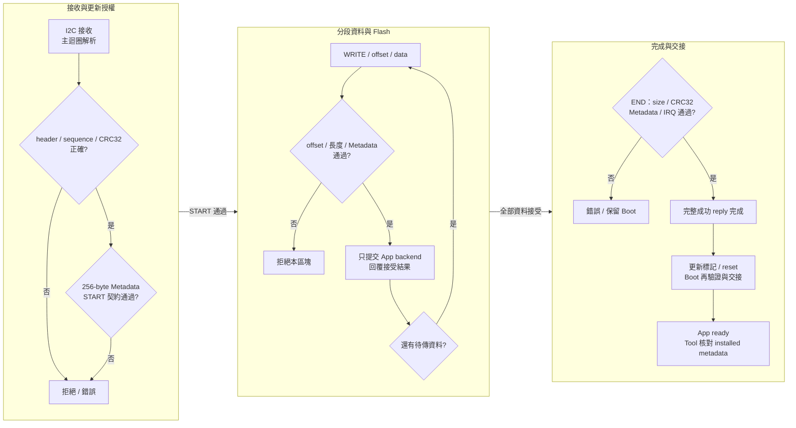
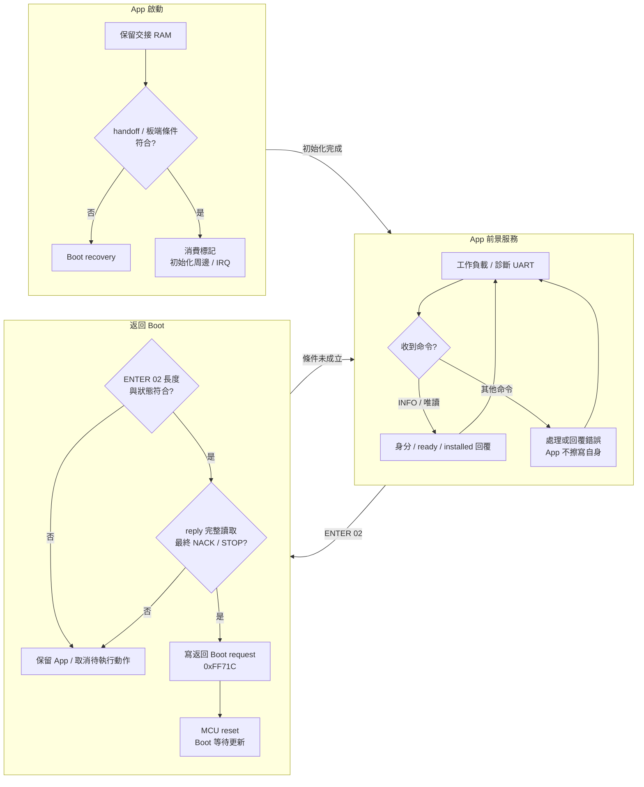
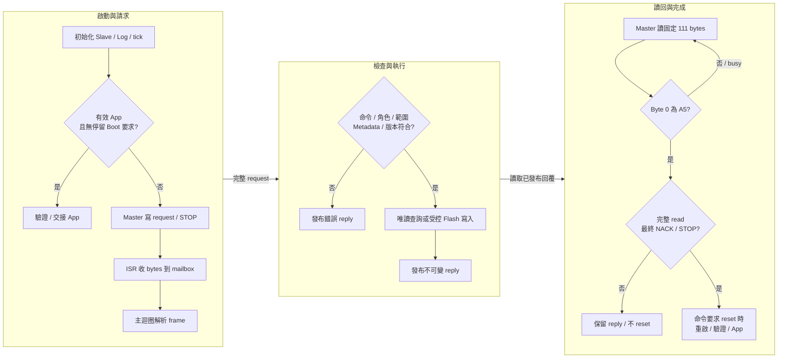

[知識庫首頁](https://released.github.io/) · [RL78 Bootloader](index.html)

<a id="article_top"></a>

# I2C Bootloader 與協定格式

I2C Slave、STOP mailbox、111-byte reply window 與更新完成條件。

<!-- BOOTLOADER_TOPICS_BEGIN -->
## 本頁主題

| 章節／規格 | 本頁 | 另一平台 |
| --- | --- | --- |
| 工程與接線 | [閱讀](#guide-i2c-device-1) | [RH850](../slide_boot_loader_for_RH850/i2c-device.html#guide-i2c-device-1) |
| 通訊設定 | [閱讀](#guide-i2c-device-2) | [RH850](../slide_boot_loader_for_RH850/i2c-device.html#guide-i2c-device-2) |
| Boot 執行流程 | [閱讀](#guide-i2c-device-3) | [RH850](../slide_boot_loader_for_RH850/i2c-device.html#guide-i2c-device-3) |
| Protocol Format | [閱讀](#guide-i2c-device-4) | [RH850](../slide_boot_loader_for_RH850/i2c-device.html#guide-i2c-device-4) |
| 異常與完成條件 | [閱讀](#guide-i2c-device-5) | [RH850](../slide_boot_loader_for_RH850/i2c-device.html#guide-i2c-device-5) |
| 程式對照與診斷 | [閱讀](#guide-i2c-device-6) | [RH850](../slide_boot_loader_for_RH850/i2c-device.html#guide-i2c-device-6) |
<!-- BOOTLOADER_TOPICS_END -->

<!-- DEVICE_UPGRADE_PATHS_BEGIN -->
## 依型號閱讀完整更新流程

| 型號與介面 | 章節 |
| --- | --- |
| F13 / I2C | [操作、Boot 與 App](#upgrade-f13-i2c) |
| F24 / I2C | [操作、Boot 與 App](#upgrade-f24-i2c) |

<a id="upgrade-f13-i2c"></a>

### F13 × I2C：App 更新與兩端機制

#### 配對工程、接線與映像

| 項目 | 此組合的設定 |
| --- | --- |
| Device／target | R5F10BMG／`0xF13B` |
| Boot 工程 | `RL78_F13_ISP_Boot_loader_I2C` |
| App 工程 | `RL78_F13_ISP_Boot_loader_I2C_app` |
| 初次安裝 | Boot 工程的 `DefaultBuild/boot0000_1FFF.hex`，由 programmer 安裝；確認 MCU 與擦除範圍 |
| Tool 更新檔 | App 工程的 `DefaultBuild/RL78_F13_ISP_Boot_loader_I2C_app_update.bin`；HEX、boot_app 合併檔與 Transfer HEX 不放入 App 更新欄 |
| Flash 配置 | App 起點 `0x02000`，容量 `119 KiB`；8 KiB Boot、App 最大 119 KiB；最後 1 KiB 為保留區，App 容量包含 vectors、Metadata、padding 與 CRC。 |
| 資料介面 | I2C framed ISP；0x20／100 kHz 為範例值，Boot／App／BIN／Tool 必須一致 |
| RAM 交接 | `0xFF710..0xFF71F`；返回 Boot request：`0xFF71C` |

- Bridge SCL P62 接 device SCL P62；SDA P63 接 P63。共地並使用電壓相容的上拉；Tool 填未左移的 7-bit 0x20。
- 獨立診斷 UART TX P15／RX P16，115200、8-N-1；terminal 與 binary data link 分開。
- PC 連接 F24 bridge 的 Host Link UART0，預設 115200；Host 必須宣告所選 I2C port／rate；使用 I2C ISP，不能選 G16 Reference read-only。
- 編輯配對工程的 image／IRQ／transport 設定後重新建置 App，Tool 必須重新 Load Update Image 才會取代已快取的舊 bytes。Bridge 只轉送資料，Device Boot 負責 target、Flash 與映像驗證。

#### Simple Renesas ISP Tool 操作步驟

1. 安裝本組合的 Boot HEX；一般換 App 時保留配對 Boot。若需先檢查接線，使用獨立 Transfer 工程並選 Custom Transfer；Transfer 不等於本組合的 Boot／App。
2. 開啟 Tool，選實接 bridge COM，按 **Open + Probe Host**。核對 Host LIVE 身分與所需能力，不能從 USB-UART 名稱推定 Host 型號。
3. 設定 **I2C TAB：7-bit address 0x20、100 kHz**，選實接 Bridge port，Workflow 選 **I2C ISP**；速率與安裝的 Boot／App 及 BIN 一致。
4. **Load Update Image** 載入 `RL78_F13_ISP_Boot_loader_I2C_app_update.bin`。核對 CRC、Device target、介面、App 起點／容量、版本政策與 IRQ ABI；讀取 **BIN Details／Preflight** 排除 blocker。
5. 按 **Discover Target**。應得到此型號的 Boot 或 App；若為 App，按 **Enter Boot** 後重新確認 Boot。若已在 Boot，直接進入下一步；有效 App 的 Boot 等待窗口會到期，開始前仍核對 live mode。
6. 按 **Start Device Update**。Tool staging Metadata，再開始傳輸與驗證；傳輸進度 100% 並非 App 已啟動。
7. 等待 END 成功與重啟後確認。**APP_READY 與全部 256-byte installed metadata 相符**才代表 App 身分與啟動確認完成。
8. 核對完成提示、JSON／HTML report、UART App 啟動與持續 counter。更新完成會釋放 device bus，保留 Host COM；Host counter 不可用時仍獨立標示 UNAVAILABLE。

#### Boot 如何接收與驗證 Host raw data

- ISR 只處理接收與周邊狀態，主迴圈才解碼。framed control 為 10-byte header、0..96-byte payload、LE32 CRC32；先檢查 frame extent、CRC、request type、sequence，再交給 `IspDeviceProcess()`。
- `METADATA 0x03` 依 offset 暫存完整 256 bytes；`START 0x04` 核對 target、介面、App 起點／容量、size、IRQ ABI 與 installed App 的版本政策，建立新的更新 session。
- I2C request 以 STOP 分隔；讀取固定 111-byte window，byte0 為 `00 busy`／`A5 ready`，其後為完整 framed reply 與 FF padding。I2C bus ACK 只代表 bus 接收；命令結果由 framed reply status 判斷。完整回覆、最終 NACK 與 STOP 都完成後才執行 pending reset；放棄／逾時的 App 回覆取消待執行動作。
- `WRITE 0x05` 帶 LE32 offset 與最多 64 image bytes；必須等於 next offset、符合區塊與尾塊長度、App 範圍及 Metadata 重疊內容，通過後才交給 Flash backend。成功 reply 表示該次 session 接受；完整映像仍待 END 驗證。
- RL78 由所屬 MCU 的 Flash driver 執行 App 區擦寫；Boot 與尾端 1 KiB 保留區不在可更新範圍。
- `END 0x06` 核對完整 size、CRC32、Metadata、入口與 IRQ table；成功回覆完成後才允許重啟，Tool 再核對 APP_READY 與 installed metadata。



#### App 的命令與返回 Boot

- App 提供 INFO、PING 20、ECHO 21、STATS 22，以及依 capability 開放的診斷；Flash 命令由 Boot 執行。
- **ENTER `0x02`** 是 Tool 的返回 Boot 命令；只有符合命令與回覆完成條件的 ENTER 才執行返回 Boot；UART0 z/Z 為另一個本機操作。
- RAM marker 是一次性交接資料；linker 必須保留此區，startup 的 stack／BSS／data／ECC 初始化避開此區。冷上電不可假設 RAM 值有效，仍由 Boot 驗證 Flash 後重建交接。
- 前景 UART0 **z/Z 是正常 MCU reset**，需要 bus idle／沒有更新；不等同 ENTER 的強制停留 Boot。有效 App 可在 Boot 檢查後重新啟動。



#### 完成條件、錯誤與程式對照

| 現象／階段 | 判讀與處理 |
| --- | --- |
| Discover 無回覆 | 核對所選 MCU／周邊、Boot 或 Transfer 身分、供電、共地、pin／port、速率及 7-bit address／上拉；先保留原始錯誤 |
| START／Metadata 被拒絕 | 尚未通過該 session 的映像契約；核對 exact BIN、live mode、版本政策與相容 Boot |
| 傳輸中失敗／取消 | 保留最後確認 stage／offset 與 Flash status；不從百分比猜測續傳，不手動重送 erase／START／END |
| END／EOT 通過但 App 未確認 | Flash 驗證與 App 啟動分開；保留報告並唯讀 Discover，核對 UART、startup、RAM 交接、clock 與 IRQ，不盲目 RUN／重寫 |
| App confirmed | installed identity／Metadata 與 BIN 相符，UART 啟動及持續工作另作觀察；不延伸成冷啟動、斷電恢復或全部故障情境的保證 |
| 程式入口 | Boot／App 各自的 `custom_func.c`：`hardware_init()`／`loop()`；`boot_app_handoff.h`、`image_metadata_config.h` 與各自 `hal/isp/` |

進一步欄位定義：[串列共用封包／INFO／Status](https://released.github.io/slide_boot_loader_for_RL78/serial-device.html#guide-serial-device-5)；[RAM／startup 與 Flash](https://released.github.io/slide_boot_loader_for_RL78/porting.html#guide-porting-5)。

<a id="f13-i2c-update-measurements"></a>

#### F13 I2C 更新量測與範圍

條件為 R5F10BMG、F24 bridge、I2C 100 kHz／7-bit 0x20、Host Link 115200；Tool 0.1.0.138、Host FW 1.8.1／build 20261023。時間單位為秒。

| App BIN | bytes | WRITE | END CRC | App 確認 | 總耗時 | 結果與資料 |
| --- | --- | --- | --- | --- | --- | --- |
| 原始 App | 12316 | 21.071 | 0.188 | 1.990 | 24.127 | [PASS／摘要](https://released.github.io/slide_boot_loader_for_RL78/data/f13_i2c_12316b.html) |
| 24 KiB | 24576 | 42.026 | 0.324 | 2.007 | 45.238 | [PASS／摘要](https://released.github.io/slide_boot_loader_for_RL78/data/f13_i2c_24576b.html) |
| 56 KiB | 57344 | 98.240 | 0.650 | 2.150 | 101.918 | [PASS／摘要](https://released.github.io/slide_boot_loader_for_RL78/data/f13_i2c_57344b.html) |
| 119 KiB | 121856 | 208.912 | 1.183 | 3.385 | 214.357 | [PASS／摘要](https://released.github.io/slide_boot_loader_for_RL78/data/f13_i2c_121856b.html) |

- 四份映像均取得 START／END 成功回覆、APP_READY，並核對全部 256-byte installed metadata；UART0 有對應的 boot-validated 啟動與後續 counter。
- 119 KiB 在重啟後唯讀 App 確認期間有四次 I2C_NACK，之後確認成功；Host Link retries=0 不能解讀成每次 I2C 查詢都一次成功。
- Host counter assessment 為 UNAVAILABLE，與更新 PASS 分開判斷；總耗時來自本次 report elapsed_ms，不採載入下一個 BIN 時仍顯示的前次 Result／Elapsed。
- 結果限上述四份映像的一般更新與重啟後確認；冷啟動、斷電／故障恢復、其他速率或 MCU 另行確認。

<a id="upgrade-f24-i2c"></a>

### F24 × I2C：App 更新與兩端機制

#### 配對工程、接線與映像

| 項目 | 此組合的設定 |
| --- | --- |
| Device／target | R7F124FPJ5xFB／`0xF24B` |
| Boot 工程 | `RL78_F24_ISP_Boot_loader_I2C` |
| App 工程 | `RL78_F24_ISP_Boot_loader_I2C_app` |
| 初次安裝 | Boot 工程的 `DefaultBuild/boot0000_1FFF.hex`，由 programmer 安裝；確認 MCU 與擦除範圍 |
| Tool 更新檔 | App 工程的 `DefaultBuild/RL78_F24_ISP_Boot_loader_I2C_app_update.bin`；HEX、boot_app 合併檔與 Transfer HEX 不放入 App 更新欄 |
| Flash 配置 | App 起點 `0x02000`，容量 `247 KiB`；8 KiB Boot、App 最大 247 KiB；最後 1 KiB 為保留區，App 容量包含 vectors、Metadata、padding 與 CRC。 |
| 資料介面 | I2C framed ISP；0x20／100 kHz 為範例值，Boot／App／BIN／Tool 必須一致 |
| RAM 交接 | `0xFF710..0xFF71F`；返回 Boot request：`0xFF71C` |

- Bridge SCL P62 接 device SCL P62；SDA P63 接 P63。共地並使用電壓相容的上拉；Tool 填未左移的 7-bit 0x20。
- 獨立診斷 UART TX P15／RX P16，115200、8-N-1；terminal 與 binary data link 分開。
- PC 連接 F24 bridge 的 Host Link UART0，預設 115200；Host 必須宣告所選 I2C port／rate；使用 I2C ISP，不能選 G16 Reference read-only。
- 編輯配對工程的 image／IRQ／transport 設定後重新建置 App，Tool 必須重新 Load Update Image 才會取代已快取的舊 bytes。Bridge 只轉送資料，Device Boot 負責 target、Flash 與映像驗證。

#### Simple Renesas ISP Tool 操作步驟

1. 安裝本組合的 Boot HEX；一般換 App 時保留配對 Boot。若需先檢查接線，使用獨立 Transfer 工程並選 Custom Transfer；Transfer 不等於本組合的 Boot／App。
2. 開啟 Tool，選實接 bridge COM，按 **Open + Probe Host**。核對 Host LIVE 身分與所需能力，不能從 USB-UART 名稱推定 Host 型號。
3. 設定 **I2C TAB：7-bit address 0x20、100 kHz**，選實接 Bridge port，Workflow 選 **I2C ISP**；速率與安裝的 Boot／App 及 BIN 一致。
4. **Load Update Image** 載入 `RL78_F24_ISP_Boot_loader_I2C_app_update.bin`。核對 CRC、Device target、介面、App 起點／容量、版本政策與 IRQ ABI；讀取 **BIN Details／Preflight** 排除 blocker。
5. 按 **Discover Target**。應得到此型號的 Boot 或 App；若為 App，按 **Enter Boot** 後重新確認 Boot。若已在 Boot，直接進入下一步；有效 App 的 Boot 等待窗口會到期，開始前仍核對 live mode。
6. 按 **Start Device Update**。Tool staging Metadata，再開始傳輸與驗證；傳輸進度 100% 並非 App 已啟動。
7. 等待 END 成功與重啟後確認。**APP_READY 與全部 256-byte installed metadata 相符**才代表 App 身分與啟動確認完成。
8. 核對完成提示、JSON／HTML report、UART App 啟動與持續 counter。更新完成會釋放 device bus，保留 Host COM；Host counter 不可用時仍獨立標示 UNAVAILABLE。

#### Boot 如何接收與驗證 Host raw data

- ISR 只處理接收與周邊狀態，主迴圈才解碼。framed control 為 10-byte header、0..96-byte payload、LE32 CRC32；先檢查 frame extent、CRC、request type、sequence，再交給 `IspDeviceProcess()`。
- `METADATA 0x03` 依 offset 暫存完整 256 bytes；`START 0x04` 核對 target、介面、App 起點／容量、size、IRQ ABI 與 installed App 的版本政策，建立新的更新 session。
- I2C request 以 STOP 分隔；讀取固定 111-byte window，byte0 為 `00 busy`／`A5 ready`，其後為完整 framed reply 與 FF padding。I2C bus ACK 只代表 bus 接收；命令結果由 framed reply status 判斷。完整回覆、最終 NACK 與 STOP 都完成後才執行 pending reset；放棄／逾時的 App 回覆取消待執行動作。
- `WRITE 0x05` 帶 LE32 offset 與最多 64 image bytes；必須等於 next offset、符合區塊與尾塊長度、App 範圍及 Metadata 重疊內容，通過後才交給 Flash backend。成功 reply 表示該次 session 接受；完整映像仍待 END 驗證。
- RL78 由所屬 MCU 的 Flash driver 執行 App 區擦寫；Boot 與尾端 1 KiB 保留區不在可更新範圍。
- `END 0x06` 核對完整 size、CRC32、Metadata、入口與 IRQ table；成功回覆完成後才允許重啟，Tool 再核對 APP_READY 與 installed metadata。


#### App 的命令與返回 Boot

- App 提供 INFO、PING 20、ECHO 21、STATS 22，以及依 capability 開放的診斷；Flash 命令由 Boot 執行。
- **ENTER `0x02`** 是 Tool 的返回 Boot 命令；只有符合命令與回覆完成條件的 ENTER 才執行返回 Boot；UART0 z/Z 為另一個本機操作。
- RAM marker 是一次性交接資料；linker 必須保留此區，startup 的 stack／BSS／data／ECC 初始化避開此區。冷上電不可假設 RAM 值有效，仍由 Boot 驗證 Flash 後重建交接。
- 前景 UART0 **z/Z 是正常 MCU reset**，需要 bus idle／沒有更新；不等同 ENTER 的強制停留 Boot。有效 App 可在 Boot 檢查後重新啟動。


#### 完成條件、錯誤與程式對照

| 現象／階段 | 判讀與處理 |
| --- | --- |
| Discover 無回覆 | 核對所選 MCU／周邊、Boot 或 Transfer 身分、供電、共地、pin／port、速率及 7-bit address／上拉；先保留原始錯誤 |
| START／Metadata 被拒絕 | 尚未通過該 session 的映像契約；核對 exact BIN、live mode、版本政策與相容 Boot |
| 傳輸中失敗／取消 | 保留最後確認 stage／offset 與 Flash status；不從百分比猜測續傳，不手動重送 erase／START／END |
| END／EOT 通過但 App 未確認 | Flash 驗證與 App 啟動分開；保留報告並唯讀 Discover，核對 UART、startup、RAM 交接、clock 與 IRQ，不盲目 RUN／重寫 |
| App confirmed | installed identity／Metadata 與 BIN 相符，UART 啟動及持續工作另作觀察；不延伸成冷啟動、斷電恢復或全部故障情境的保證 |
| 程式入口 | Boot／App 各自的 `custom_func.c`：`hardware_init()`／`loop()`；`boot_app_handoff.h`、`image_metadata_config.h` 與各自 `hal/isp/` |

進一步欄位定義：[串列共用封包／INFO／Status](https://released.github.io/slide_boot_loader_for_RL78/serial-device.html#guide-serial-device-5)；[RAM／startup 與 Flash](https://released.github.io/slide_boot_loader_for_RL78/porting.html#guide-porting-5)。
<!-- DEVICE_UPGRADE_PATHS_END -->

<!-- I2C_DEVICE_BEGIN -->
<a id="i2c-bootloader"></a>


Device 使用 I2C Slave，bridge 使用 I2C Master。每份 Boot、App、Transfer 各自是獨立工程，
另保留獨立 UART 診斷文字。

<a id="guide-i2c-device-1"></a>

### 工程與接線

| 用途 | 工程或連線 | 詳細說明 |
| --- | --- | --- |
| Boot／App | 選擇名稱含 ISP_Boot_loader_I2C 的配對工程 | [平台工程與周邊](serial-device.html#guide-serial-device-1) |
| Custom Transfer | 名稱含 I2C_Slave_Transfer 的獨立診斷工程 | 透過相同 mailbox 驗證 PING／ECHO／計數，不擦 Flash |
| I2C 資料 | SCL、SDA、共地；核對上拉電壓、阻值與負載 | [Tool 接線與操作](https://released.github.io/slide_simple_renesas_isp_tool/serial-isp.html#uart-device-operation) |
| 診斷文字與產物 | 獨立 Log UART；Boot 安裝檔／App 更新 BIN 分開使用 | [編輯、產生與建置](serial-device.html#guide-serial-device-2) |

各工程包含自身建置來源，不需要其他工程 checkout 才能編譯。
燒錄後配對的 Boot／App 保持相同介面及映像契約。

<a id="guide-i2c-device-2"></a>

### 通訊設定

| 修改來源 | 作用 | 同步核對 |
| --- | --- | --- |
| `ISP_I2C_ADDRESS`／`ISP_LINK_PARAMETER_1` | 7-bit Slave address，範例 0x20 | Boot／App slave 初始化、BIN Metadata＋0x34 與 Tool 所選位址 |
| `ISP_BUS_RATE`／`ISP_LINK_PARAMETER_0` | 編譯 bus rate，範例 100000 Hz | Slave 時序、INFO、BIN Metadata＋0x30 與 Tool 100／400 kHz 能力 |
| `.scfg` 或各工程 board adapter | IICA、腳位、時脈與中斷 | [平台配置](serial-device.html#guide-serial-device-1)、[SC 設定](serial-device.html#guide-serial-device-4) |
| `ISP_BOOT_IDLE_TIMEOUT_MS` | 有效 App 進入 Boot 後、更新尚未開始時的閒置返回期限 | 範例 30000 ms；active 更新不套用此條件 |

Tool 輸入 7-bit 位址 0x20，不是 address byte 0x40。
完整設定條件集中於 [通訊設定與更新必要條件](https://released.github.io/slide_simple_renesas_isp_tool/serial-isp.html#serial-update-requirements)。
INFO 不含 Slave address；Tool 使用實際交易位址，並核對讀回的 Metadata。

<a id="guide-i2c-device-3"></a>
<a id="i2c-boot-flow"></a>

### Boot 執行流程



START 檢查完整 staged Metadata；WRITE 依序寫入，END 驗證完整映像。
I2C ACK 只代表 bus byte／交易的接收，更新結果仍以 framed reply status 與 App 確認判斷。

| 階段 | 完成條件 | 等待或失敗時的處理 |
| --- | --- | --- |
| ENTER | 完整成功 reply 經最終 NACK／STOP 後才要求 reset | 回覆未確認不推定已進 Boot；新 BIN 尚未傳送 |
| WRITE | 對應 sequence／command 的成功 reply | 保留最後確認 offset；不把 bus ACK 當作 Flash 成功 |
| END | 完整映像驗證及成功 reply | 保留 status 與驗證耗時；不重送 END |
| 重啟後 | App ready 及全部 installed metadata 相符 | 與 END 成功分開判斷；依已安裝／新映像所在階段排程等待 |

大小估計與靜默查詢排程見[Tool I2C 更新與等待](https://released.github.io/slide_simple_renesas_isp_tool/serial-isp.html#i2c-image-waits)。
Mailbox 的最後活動與逾時取樣須使用一致的 IRQ 保護，避免 ISR 更新活動時間後，主迴圈以較舊時間誤判逾時。
真正超過 2 秒未完成的交易仍會放棄；App／Transfer 取消該回覆的待執行動作與診斷所有權，不因此自動 reset。

<a id="guide-i2c-device-4"></a>
<a id="i2c-protocol"></a>
<a id="guide-serial-device-7"></a>

### Protocol Format

I2C 先寫入一份以 STOP 分隔的完整 request，再讀取固定 111-byte reply window。
ISR 只處理 bytes 與 START／NACK／STOP；主迴圈才解析、執行 Flash 並發布不可變回覆。

| 交易／byte | 長度與內容 | 意義 |
| --- | --- | --- |
| Write | START ＋ address/W ＋完整 ISP frame ＋ STOP | Frame 為 10-byte header＋0..96 payload＋CRC32，最長 110 bytes |
| Read byte 0 | 00 busy 或 A5 ready | 只有 A5 後才解析 framed reply |
| Read byte 1..N | 完整 framed reply，14..110 bytes | sequence／command 對應 request，status 回報命令結果 |
| Read 剩餘 bytes | FF padding，直到總計 111 bytes | 由內層 frame length 決定有效資料，不把 padding 納入 frame CRC |
| Read 結尾 | Master 最終 NACK，接著 STOP | 與完整 read 一起作為回覆完成條件 |

完整 header、各命令 payload、INFO 與 status 定義見 [共用封包與命令表](serial-device.html#guide-serial-device-5)。
UART／I2C 使用相同命令格式，I2C 外層 mailbox byte 不屬於內層 CRC 範圍。

#### 位址與交易範例

7-bit address＝0x20 時，線上 address byte 為寫入 0x40、讀取 0x41。
以下以 INFO request 為例；`[]` 表示說明佔位，不是線上 bytes。

```text
S 40 49 53 01 00 01 00 01 00 00 00 F1 8D B0 75 P
S 41 00 [busy read window] NACK P
S 41 A5 [完整 INFO framed reply] [FF padding] NACK P
```

`S` 為 START，`P` 為 STOP；每次 read window 都讀取 111 bytes。
busy 後只重讀 mailbox，不重新送出前一個 Flash request。

#### 成功與錯誤回覆範例

I2C內層沿用 [UART完整request／reply範例](uart-device.html#uart-protocol)。
以PING為例，ready window為`A5`＋上述PING reply＋`FF` padding至111bytes；未知命令則為`A5`＋error reply＋padding。
`A5`只表示已有完整回覆；更新是否獲接受仍看內層status。
busy window的首byte為`00`，不是`BAD_STATE`或CRC錯誤回覆。


<a id="guide-i2c-device-5"></a>

### 異常與完成條件

| 觀察 | Device／Tool 行為 | 核對方向 |
| --- | --- | --- |
| 無 address ACK | 尚無有效 ISP 回覆 | 7-bit 位址、接線、電壓、上拉、Slave 初始化 |
| Byte 0＝00 | 唯讀 poll 等待 ready | 不因 busy 重送 Flash request |
| Short read | 保留 reply；不執行 pending reset | 固定 111-byte read、最終 NACK 與 STOP |
| CRC／sequence／命令錯誤 | 不以錯誤交易授權 Flash；可解碼命令回報對應 status | [共用狀態碼](serial-device.html#serial-status-codes) |
| 回覆已完整讀取 | 僅已接受命令的 pending action 可執行 | ENTER／END 的重啟條件與 Tool App 確認 |

mailbox 的交易 lease 為 2 秒；逾時清除 mailbox 狀態不表示恢復已擦寫的 App。
更新／取消與報告見 [Tool 串列操作](https://released.github.io/slide_simple_renesas_isp_tool/serial-isp.html)。
平台與實板驗證範圍見 [驗證範圍](serial-device.html#guide-serial-device-9)。

<a id="guide-i2c-device-6"></a>

### 程式對照與診斷

| 程式位置 | 入口或 API | 責任 |
| --- | --- | --- |
| `custom_func.c` | `hardware_init()`／`loop()` | 初始化、主迴圈命令處理與 pending action |
| `hal/isp/isp_i2c_mailbox.c` | `IspMailboxStart()`／`IspMailboxReceive()`／`IspMailboxNext()`／`IspMailboxNack()`／`IspMailboxStop()` | 有界交易資料與狀態，不解析 ISP 命令 |
| 同一 mailbox 模組 | `IspMailboxGet()`／`Publish()`／`Release()` | 主迴圈取 request、發布及釋放 reply |
| `hal/isp/isp_protocol.c`／`isp_device.c` | `IspStreamFeed()`／`IspDeviceProcess()` | 內層 frame 與更新命令 |
| `hal/device` 與各平台 I2C adapter | IICA ISR、reply-complete 判斷 | 暫存器、STOP／NACK／最後資料的完成邊界 |

各平台所用 peripheral、實體向量／EIINT 與 Flash API 集中於 [平台配置](serial-device.html#guide-serial-device-1)。
Metadata、IRQ 與 Flash 驗證維持各平台工程的契約。
<!-- I2C_DEVICE_END -->

---

[上一主題：UART Bootloader 與協定格式](uart-device.html) · [指南入口](index.html) · [下一主題：Xmodem Bootloader 與協定格式](xmodem-device.html)
