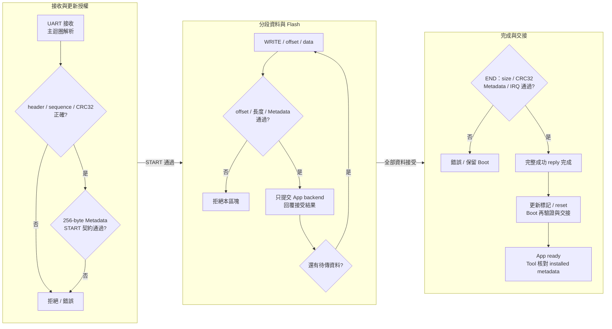
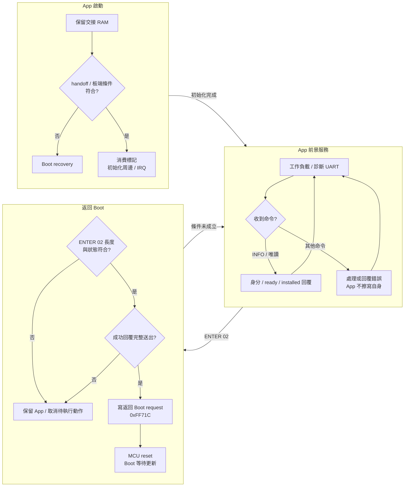
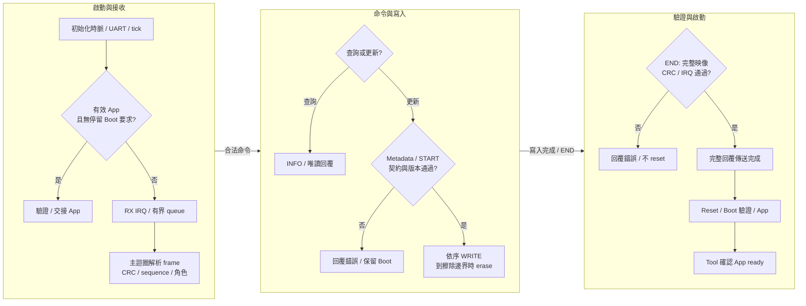

[知識庫首頁](https://released.github.io/) · [RL78 Bootloader](index.html)

<a id="article_top"></a>

# UART Bootloader 與協定格式

資料 UART、接收中斷、framed ISP 更新、封包範例與診斷。

<!-- BOOTLOADER_TOPICS_BEGIN -->
## 本頁主題

| 章節／規格 | 本頁 | 另一平台 |
| --- | --- | --- |
| 工程與接線 | [閱讀](#guide-uart-device-1) | [RH850](../slide_boot_loader_for_RH850/uart-device.html#guide-uart-device-1) |
| 通訊設定 | [閱讀](#guide-uart-device-2) | [RH850](../slide_boot_loader_for_RH850/uart-device.html#guide-uart-device-2) |
| Boot 執行流程 | [閱讀](#guide-uart-device-3) | [RH850](../slide_boot_loader_for_RH850/uart-device.html#guide-uart-device-3) |
| Protocol Format | [閱讀](#guide-uart-device-4) | [RH850](../slide_boot_loader_for_RH850/uart-device.html#guide-uart-device-4) |
| 異常與完成條件 | [閱讀](#guide-uart-device-5) | [RH850](../slide_boot_loader_for_RH850/uart-device.html#guide-uart-device-5) |
| 程式對照與診斷 | [閱讀](#guide-uart-device-6) | [RH850](../slide_boot_loader_for_RH850/uart-device.html#guide-uart-device-6) |
<!-- BOOTLOADER_TOPICS_END -->

<!-- DEVICE_UPGRADE_PATHS_BEGIN -->
## 依型號閱讀完整更新流程

| 型號與介面 | 章節 |
| --- | --- |
| F13 / UART | [操作、Boot 與 App](#upgrade-f13-uart) |
| F24 / UART | [操作、Boot 與 App](#upgrade-f24-uart) |

<a id="upgrade-f13-uart"></a>

### F13 × UART：App 更新與兩端機制

#### 配對工程、接線與映像

| 項目 | 此組合的設定 |
| --- | --- |
| Device／target | R5F10BMG／`0xF13B` |
| Boot 工程 | `RL78_F13_ISP_Boot_loader_UART` |
| App 工程 | `RL78_F13_ISP_Boot_loader_UART_app` |
| 初次安裝 | Boot 工程的 `DefaultBuild/boot0000_1FFF.hex`，由 programmer 安裝；確認 MCU 與擦除範圍 |
| Tool 更新檔 | App 工程的 `DefaultBuild/RL78_F13_ISP_Boot_loader_UART_app_update.bin`；HEX、boot_app 合併檔與 Transfer HEX 不放入 App 更新欄 |
| Flash 配置 | App 起點 `0x02000`，容量 `119 KiB`；8 KiB Boot、App 最大 119 KiB；最後 1 KiB 為保留區，App 容量包含 vectors、Metadata、padding 與 CRC。 |
| 資料介面 | UART framed ISP，115200／8-N-1 為範例值 |
| RAM 交接 | `0xFF710..0xFF71F`；返回 Boot request：`0xFF71C` |

- Bridge UART1 TX P74 接 device RX P75；Bridge RX P75 接 device TX P74。共地並核對 I/O 電壓，二進位資料不經診斷 UART。
- 獨立診斷 UART TX P15／RX P16，115200、8-N-1；terminal 與 binary data link 分開。
- PC 連接 F24 bridge 的 Host Link UART0，預設 115200；Host 必須宣告 UART forwarding 能力，所選 Device baud 須由 Host 接受；Host Baud 與 Device baud 分別設定。
- 編輯配對工程的 image／IRQ／transport 設定後重新建置 App，Tool 必須重新 Load Update Image 才會取代已快取的舊 bytes。Bridge 只轉送資料，Device Boot 負責 target、Flash 與映像驗證。

#### Simple Renesas ISP Tool 操作步驟

1. 安裝本組合的 Boot HEX；一般換 App 時保留配對 Boot。若需先檢查接線，使用獨立 Transfer 工程並選 Custom Transfer；Transfer 不等於本組合的 Boot／App。
2. 開啟 Tool，選實接 bridge COM，按 **Open + Probe Host**。核對 Host LIVE 身分與所需能力，不能從 USB-UART 名稱推定 Host 型號。
3. 設定 **UART / Xmodem TAB：Device baud 115200、8-N-1**，選實接 Bridge port，Workflow 選 **UART ISP**；速率與安裝的 Boot／App 及 BIN 一致。
4. **Load Update Image** 載入 `RL78_F13_ISP_Boot_loader_UART_app_update.bin`。核對 CRC、Device target、介面、App 起點／容量、版本政策與 IRQ ABI；讀取 **BIN Details／Preflight** 排除 blocker。
5. 按 **Discover Target**。應得到此型號的 Boot 或 App；若為 App，按 **Enter Boot** 後重新確認 Boot。若已在 Boot，直接進入下一步；有效 App 的 Boot 等待窗口會到期，開始前仍核對 live mode。
6. 按 **Start Device Update**。Tool staging Metadata，再開始傳輸與驗證；傳輸進度 100% 並非 App 已啟動。
7. 等待 END 成功與重啟後確認。**APP_READY 與全部 256-byte installed metadata 相符**才代表 App 身分與啟動確認完成。
8. 核對完成提示、JSON／HTML report、UART App 啟動與持續 counter。更新完成會釋放 device bus，保留 Host COM；Host counter 不可用時仍獨立標示 UNAVAILABLE。

#### Boot 如何接收與驗證 Host raw data

- ISR 只處理接收與周邊狀態，主迴圈才解碼。framed control 為 10-byte header、0..96-byte payload、LE32 CRC32；先檢查 frame extent、CRC、request type、sequence，再交給 `IspDeviceProcess()`。
- `METADATA 0x03` 依 offset 暫存完整 256 bytes；`START 0x04` 核對 target、介面、App 起點／容量、size、IRQ ABI 與 installed App 的版本政策，建立新的更新 session。
- `WRITE 0x05` 帶 LE32 offset 與最多 64 image bytes；必須等於 next offset、符合區塊與尾塊長度、App 範圍及 Metadata 重疊內容，通過後才交給 Flash backend。成功 reply 表示該次 session 接受；完整映像仍待 END 驗證。
- RL78 由所屬 MCU 的 Flash driver 執行 App 區擦寫；Boot 與尾端 1 KiB 保留區不在可更新範圍。
- `END 0x06` 核對完整 size、CRC32、Metadata、入口與 IRQ table；成功回覆完成後才允許重啟，Tool 再核對 APP_READY 與 installed metadata。



#### App 的命令與返回 Boot

- App 提供 INFO、PING 20、ECHO 21、STATS 22，以及依 capability 開放的診斷；Flash 命令由 Boot 執行。
- **ENTER `0x02`** 是 Tool 的返回 Boot 命令；只有符合命令與回覆完成條件的 ENTER 才執行返回 Boot；UART0 z/Z 為另一個本機操作。
- RAM marker 是一次性交接資料；linker 必須保留此區，startup 的 stack／BSS／data／ECC 初始化避開此區。冷上電不可假設 RAM 值有效，仍由 Boot 驗證 Flash 後重建交接。
- 前景 UART0 **z/Z 是正常 MCU reset**，需要 bus idle／沒有更新；不等同 ENTER 的強制停留 Boot。有效 App 可在 Boot 檢查後重新啟動。



#### 完成條件、錯誤與程式對照

| 現象／階段 | 判讀與處理 |
| --- | --- |
| Discover 無回覆 | 核對所選 MCU／周邊、Boot 或 Transfer 身分、供電、共地、pin／port、速率；先保留原始錯誤 |
| START／Metadata 被拒絕 | 尚未通過該 session 的映像契約；核對 exact BIN、live mode、版本政策與相容 Boot |
| 傳輸中失敗／取消 | 保留最後確認 stage／offset 與 Flash status；不從百分比猜測續傳，不手動重送 erase／START／END |
| END／EOT 通過但 App 未確認 | Flash 驗證與 App 啟動分開；保留報告並唯讀 Discover，核對 UART、startup、RAM 交接、clock 與 IRQ，不盲目 RUN／重寫 |
| App confirmed | installed identity／Metadata 與 BIN 相符，UART 啟動及持續工作另作觀察；不延伸成冷啟動、斷電恢復或全部故障情境的保證 |
| 程式入口 | Boot／App 各自的 `custom_func.c`：`hardware_init()`／`loop()`；`boot_app_handoff.h`、`image_metadata_config.h` 與各自 `hal/isp/` |

進一步欄位定義：[串列共用封包／INFO／Status](https://released.github.io/slide_boot_loader_for_RL78/serial-device.html#guide-serial-device-5)；[RAM／startup 與 Flash](https://released.github.io/slide_boot_loader_for_RL78/porting.html#guide-porting-5)。

<!-- F13_UART_MEASURED_BEGIN -->
<a id="f13-uart-update-measurements"></a>

#### F13 UART ISP App 更新量測

- Device：R5F10BMG；F24 bridge；Device UART1 與 Host Link 各為 115200／8-N-1。Tool 0.1.0.139，Host FW 1.8.1 build 20261023。
- 四份報告與實際 BIN 的大小、CRC32、SHA256 相符。START、END／EOT、完整接受 bytes、APP_READY 及全部 256-byte installed metadata 均已確認。
- UART0 有四次 boot-validated／update completed、後續 counter 與完整 framed RX／TX；payload 每列 8 bytes。

| 映像 | Bytes | Write 秒 | END CRC 秒 | App 確認秒 | 總秒數 | 報告 |
| --- | ---: | ---: | ---: | ---: | ---: | --- |
| 原始 App | 10556 | 15.750 | 0.176 | 1.944 | 18.761 | [PASS 摘要](https://released.github.io/slide_simple_renesas_isp_tool/data/f13_uart_10556b.html) |
| 24 KiB | 24576 | 36.784 | 0.303 | 1.960 | 39.940 | [PASS 摘要](https://released.github.io/slide_simple_renesas_isp_tool/data/f13_uart_24576b.html) |
| 56 KiB | 57344 | 85.957 | 0.576 | 2.024 | 89.445 | [PASS 摘要](https://released.github.io/slide_simple_renesas_isp_tool/data/f13_uart_57344b.html) |
| 119 KiB | 121856 | 182.768 | 1.136 | 3.209 | 188.001 | [PASS 摘要](https://released.github.io/slide_simple_renesas_isp_tool/data/f13_uart_121856b.html) |

- 更新後 Device UART 快照的 RX errors／drops／TX timeouts 為 0；Bridge UART1 deltas 的 RX errors／drops 為 0，每次記有 backend aborts=1。abort 計數與 Device UART 錯誤為不同觀察項。
- Host counter assessment 為 **UNAVAILABLE**，Host Link retry 為 0；不能由此推定所有 Host 計數全程零錯誤。
- 獨立 Transfer 的 PING／ECHO／counters 通過，沒有 Flash 命令。8 組 UART0 RX／TX 的 sequence、command、payload 與八位元組分行相符。[Transfer 摘要](https://released.github.io/slide_simple_renesas_isp_tool/data/f13_uart_transfer.html)
- Transfer 成功段前後的累積 Device RX errors 均為 **1159**，drops／TX timeouts 為 0；不能與更新後 App 的 0 跨執行相減。較早曾有 Host command 0x61 INTERNAL_ERROR；其原因未由本批資料確立。
- 本批涵蓋正常更新後 App 確認；z/Z 人工重置、冷啟動、斷電及其他型號的結果另行驗證。
<!-- F13_UART_MEASURED_END -->

<a id="upgrade-f24-uart"></a>

### F24 × UART：App 更新與兩端機制

#### 配對工程、接線與映像

| 項目 | 此組合的設定 |
| --- | --- |
| Device／target | R7F124FPJ5xFB／`0xF24B` |
| Boot 工程 | `RL78_F24_ISP_Boot_loader_UART` |
| App 工程 | `RL78_F24_ISP_Boot_loader_UART_app` |
| 初次安裝 | Boot 工程的 `DefaultBuild/boot0000_1FFF.hex`，由 programmer 安裝；確認 MCU 與擦除範圍 |
| Tool 更新檔 | App 工程的 `DefaultBuild/RL78_F24_ISP_Boot_loader_UART_app_update.bin`；HEX、boot_app 合併檔與 Transfer HEX 不放入 App 更新欄 |
| Flash 配置 | App 起點 `0x02000`，容量 `247 KiB`；8 KiB Boot、App 最大 247 KiB；最後 1 KiB 為保留區，App 容量包含 vectors、Metadata、padding 與 CRC。 |
| 資料介面 | UART framed ISP，115200／8-N-1 為範例值 |
| RAM 交接 | `0xFF710..0xFF71F`；返回 Boot request：`0xFF71C` |

- Bridge UART1 TX P74 接 device RX P75；Bridge RX P75 接 device TX P74。共地並核對 I/O 電壓，二進位資料不經診斷 UART。
- 獨立診斷 UART TX P15／RX P16，115200、8-N-1；terminal 與 binary data link 分開。
- PC 連接 F24 bridge 的 Host Link UART0，預設 115200；Host 必須宣告 UART forwarding 能力，所選 Device baud 須由 Host 接受；Host Baud 與 Device baud 分別設定。
- 編輯配對工程的 image／IRQ／transport 設定後重新建置 App，Tool 必須重新 Load Update Image 才會取代已快取的舊 bytes。Bridge 只轉送資料，Device Boot 負責 target、Flash 與映像驗證。

#### Simple Renesas ISP Tool 操作步驟

1. 安裝本組合的 Boot HEX；一般換 App 時保留配對 Boot。若需先檢查接線，使用獨立 Transfer 工程並選 Custom Transfer；Transfer 不等於本組合的 Boot／App。
2. 開啟 Tool，選實接 bridge COM，按 **Open + Probe Host**。核對 Host LIVE 身分與所需能力，不能從 USB-UART 名稱推定 Host 型號。
3. 設定 **UART / Xmodem TAB：Device baud 115200、8-N-1**，選實接 Bridge port，Workflow 選 **UART ISP**；速率與安裝的 Boot／App 及 BIN 一致。
4. **Load Update Image** 載入 `RL78_F24_ISP_Boot_loader_UART_app_update.bin`。核對 CRC、Device target、介面、App 起點／容量、版本政策與 IRQ ABI；讀取 **BIN Details／Preflight** 排除 blocker。
5. 按 **Discover Target**。應得到此型號的 Boot 或 App；若為 App，按 **Enter Boot** 後重新確認 Boot。若已在 Boot，直接進入下一步；有效 App 的 Boot 等待窗口會到期，開始前仍核對 live mode。
6. 按 **Start Device Update**。Tool staging Metadata，再開始傳輸與驗證；傳輸進度 100% 並非 App 已啟動。
7. 等待 END 成功與重啟後確認。**APP_READY 與全部 256-byte installed metadata 相符**才代表 App 身分與啟動確認完成。
8. 核對完成提示、JSON／HTML report、UART App 啟動與持續 counter。更新完成會釋放 device bus，保留 Host COM；Host counter 不可用時仍獨立標示 UNAVAILABLE。

#### Boot 如何接收與驗證 Host raw data

- ISR 只處理接收與周邊狀態，主迴圈才解碼。framed control 為 10-byte header、0..96-byte payload、LE32 CRC32；先檢查 frame extent、CRC、request type、sequence，再交給 `IspDeviceProcess()`。
- `METADATA 0x03` 依 offset 暫存完整 256 bytes；`START 0x04` 核對 target、介面、App 起點／容量、size、IRQ ABI 與 installed App 的版本政策，建立新的更新 session。
- `WRITE 0x05` 帶 LE32 offset 與最多 64 image bytes；必須等於 next offset、符合區塊與尾塊長度、App 範圍及 Metadata 重疊內容，通過後才交給 Flash backend。成功 reply 表示該次 session 接受；完整映像仍待 END 驗證。
- RL78 由所屬 MCU 的 Flash driver 執行 App 區擦寫；Boot 與尾端 1 KiB 保留區不在可更新範圍。
- `END 0x06` 核對完整 size、CRC32、Metadata、入口與 IRQ table；成功回覆完成後才允許重啟，Tool 再核對 APP_READY 與 installed metadata。


#### App 的命令與返回 Boot

- App 提供 INFO、PING 20、ECHO 21、STATS 22，以及依 capability 開放的診斷；Flash 命令由 Boot 執行。
- **ENTER `0x02`** 是 Tool 的返回 Boot 命令；只有符合命令與回覆完成條件的 ENTER 才執行返回 Boot；UART0 z/Z 為另一個本機操作。
- RAM marker 是一次性交接資料；linker 必須保留此區，startup 的 stack／BSS／data／ECC 初始化避開此區。冷上電不可假設 RAM 值有效，仍由 Boot 驗證 Flash 後重建交接。
- 前景 UART0 **z/Z 是正常 MCU reset**，需要 bus idle／沒有更新；不等同 ENTER 的強制停留 Boot。有效 App 可在 Boot 檢查後重新啟動。


#### 完成條件、錯誤與程式對照

| 現象／階段 | 判讀與處理 |
| --- | --- |
| Discover 無回覆 | 核對所選 MCU／周邊、Boot 或 Transfer 身分、供電、共地、pin／port、速率；先保留原始錯誤 |
| START／Metadata 被拒絕 | 尚未通過該 session 的映像契約；核對 exact BIN、live mode、版本政策與相容 Boot |
| 傳輸中失敗／取消 | 保留最後確認 stage／offset 與 Flash status；不從百分比猜測續傳，不手動重送 erase／START／END |
| END／EOT 通過但 App 未確認 | Flash 驗證與 App 啟動分開；保留報告並唯讀 Discover，核對 UART、startup、RAM 交接、clock 與 IRQ，不盲目 RUN／重寫 |
| App confirmed | installed identity／Metadata 與 BIN 相符，UART 啟動及持續工作另作觀察；不延伸成冷啟動、斷電恢復或全部故障情境的保證 |
| 程式入口 | Boot／App 各自的 `custom_func.c`：`hardware_init()`／`loop()`；`boot_app_handoff.h`、`image_metadata_config.h` 與各自 `hal/isp/` |

進一步欄位定義：[串列共用封包／INFO／Status](https://released.github.io/slide_boot_loader_for_RL78/serial-device.html#guide-serial-device-5)；[RAM／startup 與 Flash](https://released.github.io/slide_boot_loader_for_RL78/porting.html#guide-porting-5)。

<!-- F24_UART_MEASURED_BEGIN -->
<a id="f24-uart-update-measurements"></a>

#### F24 UART App 更新量測

- Device：R7F124FPJ5xFB；F24 bridge；UART1 115200／8-N-1，Host Link 115200。
- Tool 0.1.0.139；Host FW 1.8.1 build 20261023。六份獨立報告與實際 BIN 的 size／CRC32 相符。
- 六次 START、END 均已確認，接受 bytes 等於映像大小；APP_READY 與全部 256-byte installed metadata 相符，UART0 有 boot-validated、update completed 及後續 counter。

| 映像 | Bytes | Write 秒 | END CRC 秒 | App 確認秒 | 總秒數 | 報告 |
| --- | ---: | ---: | ---: | ---: | ---: | --- |
| 原始 App | 6724 | 10.573 | 0.128 | 1.930 | 13.615 | [PASS 摘要](https://released.github.io/slide_simple_renesas_isp_tool/data/f24_uart_6724b.html) |
| 8 KiB | 8192 | 12.208 | 0.144 | 1.946 | 15.187 | [PASS 摘要](https://released.github.io/slide_simple_renesas_isp_tool/data/f24_uart_8192b.html) |
| 24 KiB | 24576 | 36.835 | 0.256 | 1.961 | 39.942 | [PASS 摘要](https://released.github.io/slide_simple_renesas_isp_tool/data/f24_uart_24576b.html) |
| 56 KiB | 57344 | 86.038 | 0.480 | 1.962 | 89.369 | [PASS 摘要](https://released.github.io/slide_simple_renesas_isp_tool/data/f24_uart_57344b.html) |
| 120 KiB | 122880 | 184.479 | 0.945 | 2.635 | 188.949 | [PASS 摘要](https://released.github.io/slide_simple_renesas_isp_tool/data/f24_uart_122880b.html) |
| 247 KiB | 252928 | 380.445 | 1.842 | 9.557 | 392.734 | [PASS 摘要](https://released.github.io/slide_simple_renesas_isp_tool/data/f24_uart_252928b.html) |

- Device UART 的 RX errors、RX drops、TX timeouts 均為 0；這些欄位是 Device 當次執行快照。
- Host counter assessment 為 **UNAVAILABLE**，不能據此推定 Host 全程零錯誤；Host Link retry 為 0。
- 247 KiB 的唯讀 App 確認有 37 次 Host BUSY 觀察，最終確認成功；沒有重送 Flash START／END。
- UART Custom Transfer 及獨立 Xmodem Transfer 均有通過紀錄；Xmodem Boot／App 的更新與 UART0 trace 證據集中於 [F24 Xmodem 更新量測](https://released.github.io/slide_simple_renesas_isp_tool/serial-isp.html#f24-xmodem-update-measurements)。
- 本表涵蓋一般更新與軟體重啟後 App 確認；冷啟動、斷電及其他故障恢復不由本批資料推定。
<!-- F24_UART_MEASURED_END -->
<!-- DEVICE_UPGRADE_PATHS_END -->

<!-- UART_DEVICE_BEGIN -->
<a id="uart-bootloader"></a>


本章使用 framed UART ISP；每份 Boot、App、Transfer 各自是獨立工程。
UART 資料與診斷 Log 分開接線；Tool 的 Host Baud 與 Device baud 也分別設定。

<a id="guide-uart-device-1"></a>

### 工程與接線

| 用途 | 工程或連線 | 詳細說明 |
| --- | --- | --- |
| Boot／App／Transfer | 選擇名稱含 UART 的對應工程；各自包含來源與建置工具 | [平台工程與周邊](serial-device.html#guide-serial-device-1) |
| ISP 資料 | Bridge 資料 UART TX 接 device RX，RX 接 TX；共地並核對電壓 | [Tool 接線與操作](https://released.github.io/slide_simple_renesas_isp_tool/serial-isp.html#uart-device-operation) |
| 診斷文字 | Device 的獨立 Log UART 接 terminal | [平台工程與周邊](serial-device.html#guide-serial-device-1) |
| 建置與下載檔 | 在所選工程執行 PowerShell 建置；Boot 安裝檔與 App 更新 BIN 分別使用 | [編輯、產生與建置](serial-device.html#guide-serial-device-2) |

App-only 建置使用 App 自己的契約與工具；安裝到板上的 Boot 仍需與 App 相容。
Custom Transfer 是獨立通訊診斷映像，不擦寫 App Flash。

<a id="guide-uart-device-2"></a>

### 通訊設定

| 修改來源 | 作用 | 同步核對 |
| --- | --- | --- |
| `isp_transport_config.h` 的 `ISP_UART_BAUD` | Device 資料 UART 速率，範例為 115200 bit/s、8-N-1 | 配對 Boot／App 的周邊分頻、INFO、BIN Metadata 與 Tool Device baud |
| `ISP_POLICY_UART_BAUD` | 映像契約宣告的 UART baud | 與實際初始化及上述速率相符 |
| `.scfg` 或各工程 board adapter | 周邊、腳位、來源時脈與分頻 | [SC 設定與重新產生](serial-device.html#guide-serial-device-4) |
| `ISP_INTERBYTE_TIMEOUT_MS` | 未完成封包的接收閒置期限，範例 200 ms | 與實際傳輸及接收處理相符 |
| `ISP_BOOT_IDLE_TIMEOUT_MS` | 有效 App 進入 Boot 後、更新尚未開始時的閒置返回期限，範例 30000 ms | 已開始的更新不套用此閒置返回 |

變更 baud 時重建配對 Boot／App，並安裝更新後的 Boot。
可選速率與必要條件集中於 [通訊設定與更新必要條件](https://released.github.io/slide_simple_renesas_isp_tool/serial-isp.html#serial-update-requirements)。
Metadata 欄位位置見 [Metadata offset 與協定配置](serial-device.html#guide-serial-device-3)。

<a id="guide-uart-device-3"></a>
<a id="uart-boot-flow"></a>

### Boot 執行流程



INFO 等唯讀命令也由主迴圈回覆；ISR 只處理接收資料與錯誤狀態。
Metadata staging 與 START 不擦除 Flash；第一個合法 WRITE 才依擦除邊界啟動 Flash 操作。

<a id="guide-uart-device-4"></a>
<a id="uart-protocol"></a>

### Protocol Format

UART 依 byte stream 傳送共用 ISP frame。接收端依 header 的 payload length 找到 CRC32 尾碼，
不以 UART idle、換行或 terminal 文字作為命令結尾。

| 層級 | 內容與長度 | 參考 |
| --- | --- | --- |
| Frame | 10-byte header ＋ 0..96-byte payload ＋ 4-byte CRC32，最長 110 bytes | [逐 byte 封包與命令表](serial-device.html#guide-serial-device-5) |
| METADATA `03` | LE16 Metadata offset ＋ 4..64 bytes；依序暫存全部 256 bytes | Offset 基準是 Metadata 起點 |
| START `04` | LE32 完整 BIN bytes ＋ LE32 映像末端 CRC32 | 驗證已暫存 Metadata、配置與版本政策 |
| WRITE `05` | LE32 BIN offset ＋最多 64 bytes；非末塊為 64 bytes | Offset 基準是 BIN 起點，實體位址＝App 起點＋offset |
| END `06` | 空 payload | 重新驗證完整已寫入映像，再回覆結果 |

CRC32 有兩個用途：frame 尾碼保護本次 header／payload；BIN 末端 4 bytes 保護映像中尾碼之前的內容。
兩者分別計算，不能以封包 CRC 正確推定 Flash 映像有效。

#### 完整封包範例

以下 INFO request 為 sequence＝1、command＝01、空 payload；可以送給 Boot、App 或 Transfer。
最後四個 bytes 是前十個 bytes 的 CRC32，採 little-endian。

```text
49 53 01 00 01 00 01 00 00 00 F1 8D B0 75
```

具體回覆的 88-byte INFO payload 取決於板上角色、MCU、分區與 installed App；欄位定義見共用契約。

#### 成功與錯誤回覆範例

下列為依格式計算的封包範例，不是板端擷取記錄。以Transfer角色為例，PING將payload原樣回覆；未知命令回覆`BAD_COMMAND=1`，兩者的sequence／command都對應request。

```text
PING request: 49 53 01 00 02 00 20 00 03 00 12 34 56 1F 91 6C 3F
PING reply:   49 53 01 01 02 00 20 00 03 00 12 34 56 21 FA AE D0
Unknown request: 49 53 01 00 03 00 7F 00 00 00 55 FB 98 B3
Error reply:     49 53 01 01 03 00 7F 01 00 00 D6 9A 2D 14
```

Header的response byte由00改為01；status為00成功、01未知命令。

每列最後4bytes分別對該列header與payload計算CRC32；錯誤回覆也有自己的有效CRC。


<a id="guide-uart-device-5"></a>

### 異常與完成條件

| 觀察 | Device／Tool 行為 | 核對方向 |
| --- | --- | --- |
| Frame 未收齊或 CRC 錯誤 | 不執行該命令；partial frame 超過設定期限後清除 | baud、接線、queue／硬體錯誤、封包長度 |
| 同一 sequence 重送 | 只接受完整相同 request，重播快取回覆 | 不把重播當作第二次寫入 |
| START／WRITE 被拒絕 | 回覆對應 status，不以錯誤 request 授權 Flash 操作 | [狀態碼與命令條件](serial-device.html#serial-status-codes) |
| END 驗證成功 | 完整回覆傳送完成後才 reset | Device 傳送完成與 Tool 收到回覆分別判斷 |
| App 確認尚未成功 | 保留報告並讀取即時狀態 | 不自動重複 erase／END／RUN 來推定結果 |

實際操作與報告判讀見 [Tool 串列操作](https://released.github.io/slide_simple_renesas_isp_tool/serial-isp.html)。
平台與實板驗證範圍見 [驗證範圍](serial-device.html#guide-serial-device-9)。

<a id="guide-uart-device-6"></a>

### 程式對照與診斷

| 程式位置 | 入口或 API | 責任 |
| --- | --- | --- |
| `custom_func.c` | `hardware_init()`／`loop()` | 平台初始化、封包處理及回覆完成後的交接順序 |
| `hal/isp/isp_protocol.c` | `IspStreamFeed()`／`IspEncode()` | 串流組包、長度與 frame CRC32 |
| `hal/isp/isp_device.c` | `IspDeviceProcess()`／`IspDeviceWrite()`／`IspDeviceFinish()` | 命令、角色、版本、範圍及更新狀態 |
| `hal/device` | 各平台 UART RX／Error ISR、board API | 有界 queue、周邊初始化與傳送完成 |
| `hal/image`／`hal/flash` | 映像驗證與 Flash API | Metadata、完整 CRC、IRQ 與實際擦寫 |

<a id="serial-uart-diagnostics"></a>

<a id="guide-serial-device-6"></a>

#### UART診斷格式

Command0x25不帶payload。只有INFO宣告bit6時才查詢；回覆是下表24bytes，多byte整數採little-endian。
回覆使用相同sequence快取規則；重播同一request不重新讀取硬體。

| Offset | Bytes | 內容與範例 |
| --- | --- | --- |
| 00 | 1 | 格式1 |
| 01 | 1 | 診斷種類1：Device UART |
| 02..03 | 2 | 欄位mask0x000F，代表本表四組計數／queue欄位均提供 |
| 04..07 | 4 | RX硬體錯誤次數 |
| 08..0B | 4 | RX queue丟棄新資料次數 |
| 0C..0F | 4 | 本機TX timeout次數 |
| 10..13 | 4 | RX queue最高使用bytes |
| 14..17 | 4 | 快照當下RX queue待處理bytes |

RL78 硬體錯誤／丟棄／TX 計數飽和於 65535，欄位統一序列化為 32 bits。
最高量與待處理量是bytes，不是CAN frame數；reset後重新起算，不宣告跨重啟的累積量。
快照只短暫保留並還原對應IRQ遮罩，不清空接收queue或重設周邊。
`CLEAR_STATS`只清除協定計數，不清除此硬體診斷快照的累積量。
Tool保留支援／未提供／讀取失敗的區別；畫面與報告的用途見[Device串列診斷](https://released.github.io/slide_simple_renesas_isp_tool/serial-isp.html#serial-device-diagnostics)。
<!-- UART_DEVICE_END -->

---

[上一主題：串列 ISP 共用工程與協定契約](serial-device.html) · [指南入口](index.html) · [下一主題：I2C Bootloader 與協定格式](i2c-device.html)
