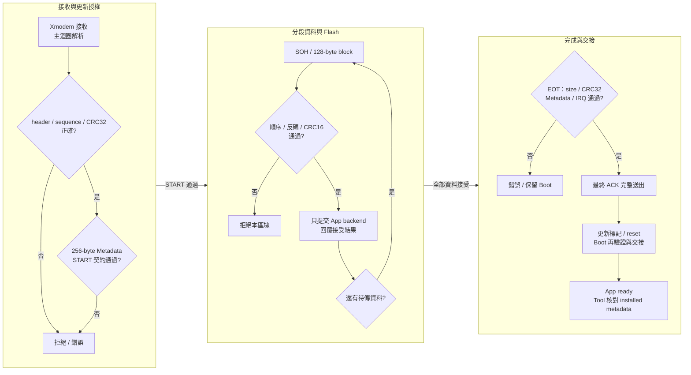
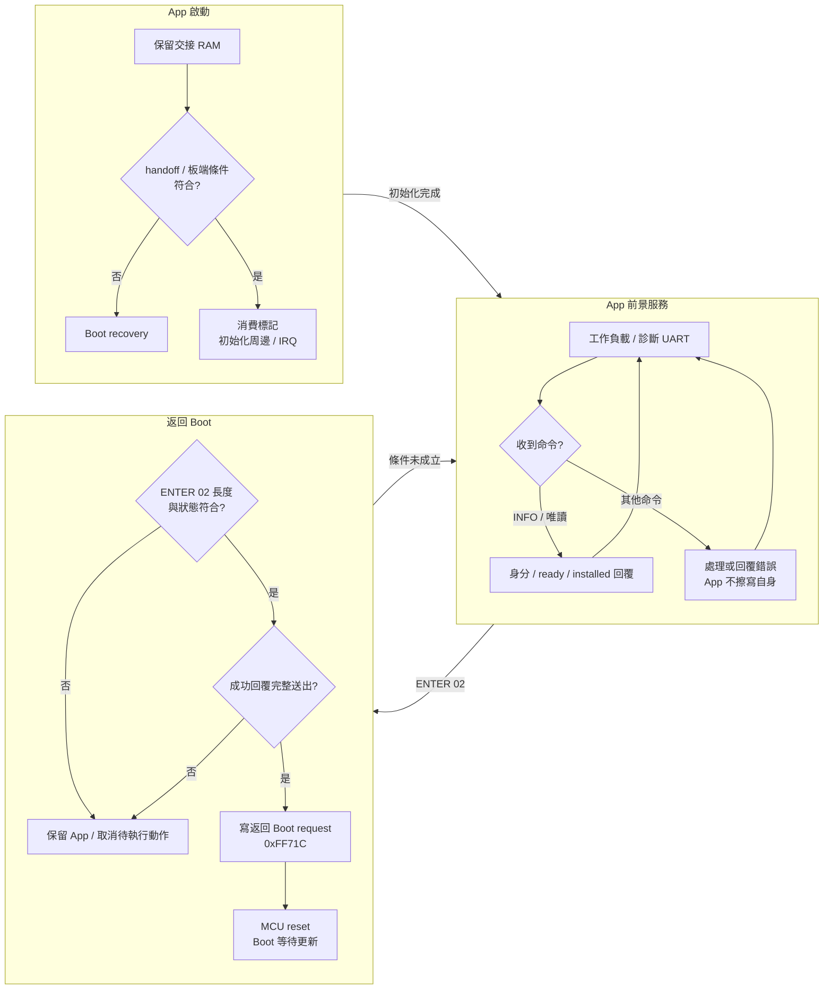
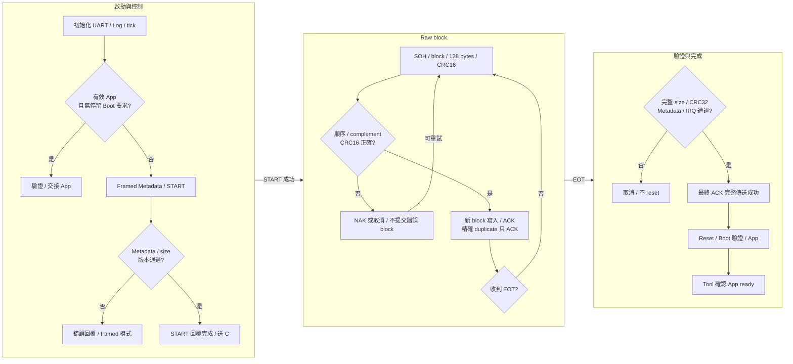

[知識庫首頁](https://released.github.io/) · [RL78 Bootloader](index.html)

<a id="article_top"></a>

# Xmodem Bootloader 與協定格式

Framed control、XMODEM-CRC128、串流寫入、重送與最終 ACK。

<!-- BOOTLOADER_TOPICS_BEGIN -->
## 本頁主題

| 章節／規格 | 本頁 | 另一平台 |
| --- | --- | --- |
| 工程與接線 | [閱讀](#guide-xmodem-device-1) | [RH850](../slide_boot_loader_for_RH850/xmodem-device.html#guide-xmodem-device-1) |
| 通訊設定 | [閱讀](#guide-xmodem-device-2) | [RH850](../slide_boot_loader_for_RH850/xmodem-device.html#guide-xmodem-device-2) |
| Boot 執行流程 | [閱讀](#guide-xmodem-device-3) | [RH850](../slide_boot_loader_for_RH850/xmodem-device.html#guide-xmodem-device-3) |
| Protocol Format | [閱讀](#guide-xmodem-device-4) | [RH850](../slide_boot_loader_for_RH850/xmodem-device.html#guide-xmodem-device-4) |
| 異常與完成條件 | [閱讀](#guide-xmodem-device-5) | [RH850](../slide_boot_loader_for_RH850/xmodem-device.html#guide-xmodem-device-5) |
| 程式對照與診斷 | [閱讀](#guide-xmodem-device-6) | [RH850](../slide_boot_loader_for_RH850/xmodem-device.html#guide-xmodem-device-6) |
<!-- BOOTLOADER_TOPICS_END -->

<!-- DEVICE_UPGRADE_PATHS_BEGIN -->
## 依型號閱讀完整更新流程

| 型號與介面 | 章節 |
| --- | --- |
| F13 / Xmodem | [操作、Boot 與 App](#upgrade-f13-xmodem) |
| F24 / Xmodem | [操作、Boot 與 App](#upgrade-f24-xmodem) |

<a id="upgrade-f13-xmodem"></a>

### F13 × Xmodem：App 更新與兩端機制

#### 配對工程、接線與映像

| 項目 | 此組合的設定 |
| --- | --- |
| Device／target | R5F10BMG／`0xF13B` |
| Boot 工程 | `RL78_F13_ISP_Boot_loader_Xmodem` |
| App 工程 | `RL78_F13_ISP_Boot_loader_Xmodem_app` |
| 初次安裝 | Boot 工程的 `DefaultBuild/boot0000_1FFF.hex`，由 programmer 安裝；確認 MCU 與擦除範圍 |
| Tool 更新檔 | App 工程的 `DefaultBuild/RL78_F13_ISP_Boot_loader_Xmodem_app_update.bin`；HEX、boot_app 合併檔與 Transfer HEX 不放入 App 更新欄 |
| Flash 配置 | App 起點 `0x02000`，容量 `119 KiB`；8 KiB Boot、App 最大 119 KiB；最後 1 KiB 為保留區，App 容量包含 vectors、Metadata、padding 與 CRC。 |
| 資料介面 | XMODEM-CRC128 raw blocks，framed control 與 115200／8-N-1 |
| RAM 交接 | `0xFF710..0xFF71F`；返回 Boot request：`0xFF71C` |

- Bridge UART1 TX P74 接 device RX P75；Bridge RX P75 接 device TX P74。共地並核對 I/O 電壓，二進位資料不經診斷 UART。
- 獨立診斷 UART TX P15／RX P16，115200、8-N-1；terminal 與 binary data link 分開。
- PC 連接 F24 bridge 的 Host Link UART0，預設 115200；Host 必須宣告 UART forwarding 能力，所選 Device baud 須由 Host 接受；Host Baud 與 Device baud 分別設定。
- 編輯配對工程的 image／IRQ／transport 設定後重新建置 App，Tool 必須重新 Load Update Image 才會取代已快取的舊 bytes。Bridge 只轉送資料，Device Boot 負責 target、Flash 與映像驗證。

#### Simple Renesas ISP Tool 操作步驟

1. 安裝本組合的 Boot HEX；一般換 App 時保留配對 Boot。若需先檢查接線，使用獨立 Transfer 工程並選 Custom Transfer；Transfer 不等於本組合的 Boot／App。
2. 開啟 Tool，選實接 bridge COM，按 **Open + Probe Host**。核對 Host LIVE 身分與所需能力，不能從 USB-UART 名稱推定 Host 型號。
3. 設定 **UART / Xmodem TAB：Device baud 115200、8-N-1**，選實接 Bridge port，Workflow 選 **XMODEM-CRC**；速率與安裝的 Boot／App 及 BIN 一致。
4. **Load Update Image** 載入 `RL78_F13_ISP_Boot_loader_Xmodem_app_update.bin`。核對 CRC、Device target、介面、App 起點／容量、版本政策與 IRQ ABI；讀取 **BIN Details／Preflight** 排除 blocker。
5. 按 **Discover Target**。應得到此型號的 Boot 或 App；若為 App，按 **Enter Boot** 後重新確認 Boot。若已在 Boot，直接進入下一步；有效 App 的 Boot 等待窗口會到期，開始前仍核對 live mode。
6. 按 **Start Device Update**。Tool staging Metadata，再開始傳輸與驗證；傳輸進度 100% 並非 App 已啟動。
7. 等待 EOT 成功與重啟後確認。**APP_READY 與全部 256-byte installed metadata 相符**才代表 App 身分與啟動確認完成。
8. 核對完成提示、JSON／HTML report、UART App 啟動與持續 counter。更新完成會釋放 device bus，保留 Host COM；Host counter 不可用時仍獨立標示 UNAVAILABLE。

#### Boot 如何接收與驗證 Host raw data

- ISR 只處理接收與周邊狀態，主迴圈才解碼。framed control 為 10-byte header、0..96-byte payload、LE32 CRC32；先檢查 frame extent、CRC、request type、sequence，再交給 `IspDeviceProcess()`。
- `METADATA 0x03` 依 offset 暫存完整 256 bytes；`START 0x04` 核對 target、介面、App 起點／容量、size、IRQ ABI 與 installed App 的版本政策，建立新的更新 session。
- START 成功回覆後 Boot 送 `C`，開始 raw SOH／block number／反碼／128 bytes／CRC16-XMODEM。順序、反碼與 CRC16 通過才接受新 block；完全相同的前一塊 duplicate 只 ACK，不再寫入。EOT 觸發全映像驗證；最終 ACK 未送出會中止 streaming 並清除待重啟動作。
- RL78 由所屬 MCU 的 Flash driver 執行 App 區擦寫；Boot 與尾端 1 KiB 保留區不在可更新範圍。
- EOT 核對完整 size、CRC32、Metadata、入口與 IRQ table；成功回覆完成後才允許重啟，Tool 再核對 APP_READY 與 installed metadata。



#### App 的命令與返回 Boot

- App 提供 INFO、PING 20、ECHO 21、STATS 22，以及依 capability 開放的診斷；Flash 命令由 Boot 執行。 STREAM_TEST 24 僅作 RAM CRC32 sink，不能視為 App 更新成功。
- **ENTER `0x02`** 是 Tool 的返回 Boot 命令；只有符合命令與回覆完成條件的 ENTER 才執行返回 Boot；UART0 z/Z 為另一個本機操作。
- RAM marker 是一次性交接資料；linker 必須保留此區，startup 的 stack／BSS／data／ECC 初始化避開此區。冷上電不可假設 RAM 值有效，仍由 Boot 驗證 Flash 後重建交接。
- 前景 UART0 **z/Z 是正常 MCU reset**，需要 bus idle／沒有更新；不等同 ENTER 的強制停留 Boot。有效 App 可在 Boot 檢查後重新啟動。



#### 完成條件、錯誤與程式對照

| 現象／階段 | 判讀與處理 |
| --- | --- |
| Discover 無回覆 | 核對所選 MCU／周邊、Boot 或 Transfer 身分、供電、共地、pin／port、速率；先保留原始錯誤 |
| START／Metadata 被拒絕 | 尚未通過該 session 的映像契約；核對 exact BIN、live mode、版本政策與相容 Boot |
| 傳輸中失敗／取消 | 保留最後確認 stage／offset 與 Flash status；不從百分比猜測續傳，不手動重送 erase／START／END |
| END／EOT 通過但 App 未確認 | Flash 驗證與 App 啟動分開；保留報告並唯讀 Discover，核對 UART、startup、RAM 交接、clock 與 IRQ，不盲目 RUN／重寫 |
| App confirmed | installed identity／Metadata 與 BIN 相符，UART 啟動及持續工作另作觀察；不延伸成冷啟動、斷電恢復或全部故障情境的保證 |
| 程式入口 | Boot／App 各自的 `custom_func.c`：`hardware_init()`／`loop()`；`boot_app_handoff.h`、`image_metadata_config.h` 與各自 `hal/isp/` |

進一步欄位定義：[串列共用封包／INFO／Status](https://released.github.io/slide_boot_loader_for_RL78/serial-device.html#guide-serial-device-5)；[RAM／startup 與 Flash](https://released.github.io/slide_boot_loader_for_RL78/porting.html#guide-porting-5)。

<!-- F13_XMODEM_MEASURED_BEGIN -->
<a id="f13-xmodem-update-measurements"></a>

#### F13 Xmodem App 更新量測

- Device：R5F10BMG；F24 bridge；Device UART1 與 Host Link 各為 115200／8-N-1。Tool 0.1.0.139，Host FW 1.8.1 build 20261023。
- 四份報告與實際 BIN 的大小、CRC32、SHA256 相符。START、END／EOT、完整接受 bytes、APP_READY 及全部 256-byte installed metadata 均已確認。
- UART0 有四次 boot-validated／update completed、後續 counter 與完整 framed RX／TX；payload 每列 8 bytes。

| 映像 | Bytes | Write 秒 | END CRC 秒 | App 確認秒 | 總秒數 | 報告 |
| --- | ---: | ---: | ---: | ---: | ---: | --- |
| 原始 App | 12636 | 11.108 | 0.192 | 1.944 | 15.143 | [PASS 摘要](https://released.github.io/slide_simple_renesas_isp_tool/data/f13_xmodem_12636b.html) |
| 24 KiB | 24576 | 21.721 | 0.287 | 1.958 | 25.862 | [PASS 摘要](https://released.github.io/slide_simple_renesas_isp_tool/data/f13_xmodem_24576b.html) |
| 56 KiB | 57344 | 51.094 | 0.576 | 2.022 | 55.588 | [PASS 摘要](https://released.github.io/slide_simple_renesas_isp_tool/data/f13_xmodem_57344b.html) |
| 119 KiB | 121856 | 108.767 | 1.136 | 3.208 | 115.010 | [PASS 摘要](https://released.github.io/slide_simple_renesas_isp_tool/data/f13_xmodem_121856b.html) |

- 更新後 Device UART 快照的 RX errors／drops／TX timeouts 為 0；Bridge UART1 deltas 的 RX errors／drops 為 0，每次記有 backend aborts=1。abort 計數與 Device UART 錯誤為不同觀察項。
- Host counter assessment 為 **UNAVAILABLE**，Host Link retry 為 0；不能由此推定所有 Host 計數全程零錯誤。
- 獨立 Transfer 的 PING／ECHO／counters 及 CRC128 streaming 通過，沒有 Flash 命令。11 組 UART0 RX／TX 的 sequence、command、payload 與八位元組分行相符。[Transfer 摘要](https://released.github.io/slide_simple_renesas_isp_tool/data/f13_xmodem_transfer.html)
- Transfer 成功段前後的累積 Device RX errors 均為 **658**，drops／TX timeouts 為 0；不能與更新後 App 的 0 跨執行相減。
- 本批涵蓋正常更新後 App 確認；z/Z 人工重置、冷啟動、斷電及其他型號的結果另行驗證。
<!-- F13_XMODEM_MEASURED_END -->

<a id="upgrade-f24-xmodem"></a>

### F24 × Xmodem：App 更新與兩端機制

#### 配對工程、接線與映像

| 項目 | 此組合的設定 |
| --- | --- |
| Device／target | R7F124FPJ5xFB／`0xF24B` |
| Boot 工程 | `RL78_F24_ISP_Boot_loader_Xmodem` |
| App 工程 | `RL78_F24_ISP_Boot_loader_Xmodem_app` |
| 初次安裝 | Boot 工程的 `DefaultBuild/boot0000_1FFF.hex`，由 programmer 安裝；確認 MCU 與擦除範圍 |
| Tool 更新檔 | App 工程的 `DefaultBuild/RL78_F24_ISP_Boot_loader_Xmodem_app_update.bin`；HEX、boot_app 合併檔與 Transfer HEX 不放入 App 更新欄 |
| Flash 配置 | App 起點 `0x02000`，容量 `247 KiB`；8 KiB Boot、App 最大 247 KiB；最後 1 KiB 為保留區，App 容量包含 vectors、Metadata、padding 與 CRC。 |
| 資料介面 | XMODEM-CRC128 raw blocks，framed control 與 115200／8-N-1 |
| RAM 交接 | `0xFF710..0xFF71F`；返回 Boot request：`0xFF71C` |

- Bridge UART1 TX P74 接 device RX P75；Bridge RX P75 接 device TX P74。共地並核對 I/O 電壓，二進位資料不經診斷 UART。
- 獨立診斷 UART TX P15／RX P16，115200、8-N-1；terminal 與 binary data link 分開。
- PC 連接 F24 bridge 的 Host Link UART0，預設 115200；Host 必須宣告 UART forwarding 能力，所選 Device baud 須由 Host 接受；Host Baud 與 Device baud 分別設定。
- 編輯配對工程的 image／IRQ／transport 設定後重新建置 App，Tool 必須重新 Load Update Image 才會取代已快取的舊 bytes。Bridge 只轉送資料，Device Boot 負責 target、Flash 與映像驗證。

#### Simple Renesas ISP Tool 操作步驟

1. 安裝本組合的 Boot HEX；一般換 App 時保留配對 Boot。若需先檢查接線，使用獨立 Transfer 工程並選 Custom Transfer；Transfer 不等於本組合的 Boot／App。
2. 開啟 Tool，選實接 bridge COM，按 **Open + Probe Host**。核對 Host LIVE 身分與所需能力，不能從 USB-UART 名稱推定 Host 型號。
3. 設定 **UART / Xmodem TAB：Device baud 115200、8-N-1**，選實接 Bridge port，Workflow 選 **XMODEM-CRC**；速率與安裝的 Boot／App 及 BIN 一致。
4. **Load Update Image** 載入 `RL78_F24_ISP_Boot_loader_Xmodem_app_update.bin`。核對 CRC、Device target、介面、App 起點／容量、版本政策與 IRQ ABI；讀取 **BIN Details／Preflight** 排除 blocker。
5. 按 **Discover Target**。應得到此型號的 Boot 或 App；若為 App，按 **Enter Boot** 後重新確認 Boot。若已在 Boot，直接進入下一步；有效 App 的 Boot 等待窗口會到期，開始前仍核對 live mode。
6. 按 **Start Device Update**。Tool staging Metadata，再開始傳輸與驗證；傳輸進度 100% 並非 App 已啟動。
7. 等待 EOT 成功與重啟後確認。**APP_READY 與全部 256-byte installed metadata 相符**才代表 App 身分與啟動確認完成。
8. 核對完成提示、JSON／HTML report、UART App 啟動與持續 counter。更新完成會釋放 device bus，保留 Host COM；Host counter 不可用時仍獨立標示 UNAVAILABLE。

#### Boot 如何接收與驗證 Host raw data

- ISR 只處理接收與周邊狀態，主迴圈才解碼。framed control 為 10-byte header、0..96-byte payload、LE32 CRC32；先檢查 frame extent、CRC、request type、sequence，再交給 `IspDeviceProcess()`。
- `METADATA 0x03` 依 offset 暫存完整 256 bytes；`START 0x04` 核對 target、介面、App 起點／容量、size、IRQ ABI 與 installed App 的版本政策，建立新的更新 session。
- START 成功回覆後 Boot 送 `C`，開始 raw SOH／block number／反碼／128 bytes／CRC16-XMODEM。順序、反碼與 CRC16 通過才接受新 block；完全相同的前一塊 duplicate 只 ACK，不再寫入。EOT 觸發全映像驗證；最終 ACK 未送出會中止 streaming 並清除待重啟動作。
- RL78 由所屬 MCU 的 Flash driver 執行 App 區擦寫；Boot 與尾端 1 KiB 保留區不在可更新範圍。
- EOT 核對完整 size、CRC32、Metadata、入口與 IRQ table；成功回覆完成後才允許重啟，Tool 再核對 APP_READY 與 installed metadata。


#### App 的命令與返回 Boot

- App 提供 INFO、PING 20、ECHO 21、STATS 22，以及依 capability 開放的診斷；Flash 命令由 Boot 執行。 STREAM_TEST 24 僅作 RAM CRC32 sink，不能視為 App 更新成功。
- **ENTER `0x02`** 是 Tool 的返回 Boot 命令；只有符合命令與回覆完成條件的 ENTER 才執行返回 Boot；UART0 z/Z 為另一個本機操作。
- RAM marker 是一次性交接資料；linker 必須保留此區，startup 的 stack／BSS／data／ECC 初始化避開此區。冷上電不可假設 RAM 值有效，仍由 Boot 驗證 Flash 後重建交接。
- 前景 UART0 **z/Z 是正常 MCU reset**，需要 bus idle／沒有更新；不等同 ENTER 的強制停留 Boot。有效 App 可在 Boot 檢查後重新啟動。


#### 完成條件、錯誤與程式對照

| 現象／階段 | 判讀與處理 |
| --- | --- |
| Discover 無回覆 | 核對所選 MCU／周邊、Boot 或 Transfer 身分、供電、共地、pin／port、速率；先保留原始錯誤 |
| START／Metadata 被拒絕 | 尚未通過該 session 的映像契約；核對 exact BIN、live mode、版本政策與相容 Boot |
| 傳輸中失敗／取消 | 保留最後確認 stage／offset 與 Flash status；不從百分比猜測續傳，不手動重送 erase／START／END |
| END／EOT 通過但 App 未確認 | Flash 驗證與 App 啟動分開；保留報告並唯讀 Discover，核對 UART、startup、RAM 交接、clock 與 IRQ，不盲目 RUN／重寫 |
| App confirmed | installed identity／Metadata 與 BIN 相符，UART 啟動及持續工作另作觀察；不延伸成冷啟動、斷電恢復或全部故障情境的保證 |
| 程式入口 | Boot／App 各自的 `custom_func.c`：`hardware_init()`／`loop()`；`boot_app_handoff.h`、`image_metadata_config.h` 與各自 `hal/isp/` |

進一步欄位定義：[串列共用封包／INFO／Status](https://released.github.io/slide_boot_loader_for_RL78/serial-device.html#guide-serial-device-5)；[RAM／startup 與 Flash](https://released.github.io/slide_boot_loader_for_RL78/porting.html#guide-porting-5)。

<!-- F24_XMODEM_MEASURED_BEGIN -->
<a id="f24-xmodem-update-measurements"></a>

#### F24 Xmodem App 更新量測

- Device：R7F124FPJ5xFB；F24 bridge；UART1 115200／8-N-1，Host Link 115200。
- Tool 0.1.0.139；Host FW 1.8.1 build 20261023。六份獨立報告與實際 BIN 的 size／CRC32 相符。
- 六次 START、END 均已確認，接受 bytes 等於映像大小；APP_READY 與全部 256-byte installed metadata 相符，UART0 有 boot-validated、update completed 及後續 counter。

| 映像 | Bytes | Write 秒 | END CRC 秒 | App 確認秒 | 總秒數 | 報告 |
| --- | ---: | ---: | ---: | ---: | ---: | --- |
| 原始 App | 7856 | 6.883 | 0.127 | 1.944 | 10.851 | [PASS 摘要](https://released.github.io/slide_simple_renesas_isp_tool/data/f24_xmodem_7856b.html) |
| 8 KiB | 8192 | 7.155 | 0.127 | 1.956 | 11.138 | [PASS 摘要](https://released.github.io/slide_simple_renesas_isp_tool/data/f24_xmodem_8192b.html) |
| 24 KiB | 24576 | 21.464 | 0.240 | 1.943 | 25.544 | [PASS 摘要](https://released.github.io/slide_simple_renesas_isp_tool/data/f24_xmodem_24576b.html) |
| 56 KiB | 57344 | 50.549 | 0.480 | 1.958 | 54.884 | [PASS 摘要](https://released.github.io/slide_simple_renesas_isp_tool/data/f24_xmodem_57344b.html) |
| 120 KiB | 122880 | 108.125 | 0.928 | 2.648 | 113.598 | [PASS 摘要](https://released.github.io/slide_simple_renesas_isp_tool/data/f24_xmodem_122880b.html) |
| 247 KiB | 252928 | 222.702 | 1.841 | 9.531 | 235.969 | [PASS 摘要](https://released.github.io/slide_simple_renesas_isp_tool/data/f24_xmodem_252928b.html) |

- Device UART 的 RX errors、RX drops、TX timeouts 均為 0；這些欄位是 Device 當次執行快照。
- Host counter assessment 為 **UNAVAILABLE**，不能據此推定 Host 全程零錯誤；Host Link retry 為 0。
- 247 KiB 的唯讀 App 確認有 37 次 Host BUSY 觀察，最終確認成功；沒有重送 Flash START／END。
- 獨立 Xmodem Transfer 通過 PING、96-byte ECHO、389-byte CRC32 sink／CRC128 串流與 counters；UART0 的 9 組 framed RX／TX、sequence／command、完整 payload 及每列 8 bytes 可互相核對。[Transfer 摘要](https://released.github.io/slide_simple_renesas_isp_tool/data/f24_xmodem_transfer.html)
- Transfer 成功段前後的 Device UART RX errors 均為 **44**，RX drops／TX timeouts 為 0；這是同一次執行的累積快照，不能解讀成全程零錯誤，也不能與更新後 App 的 0 跨執行相減。
- 原始連線階段曾有 Host command 0x61 TIMEOUT 及讀取中斷 995；重新 Open + Probe 後才取得上述 Transfer 成功紀錄。錯誤原因沒有由本批資料確立。
- 六次 App 重啟均有 boot-validated、update completed、UART0 console 與後續 counter；提供的 log 沒有 z/Z 人工重置訊息，故不將功能宣告視為該操作的實板證據。
- 本表涵蓋一般更新與軟體重啟後 App 確認；冷啟動、斷電及其他故障恢復不由本批資料推定。
<!-- F24_XMODEM_MEASURED_END -->
<!-- DEVICE_UPGRADE_PATHS_END -->

<!-- XMODEM_DEVICE_BEGIN -->
<a id="xmodem-bootloader"></a>


本章使用 framed ISP control 搭配 XMODEM-CRC／128-byte block。
Tool 在 **UART / Xmodem → Workflow** 選擇對應功能；Device 使用獨立 Xmodem 工程，另保留 Log UART。

<a id="guide-xmodem-device-1"></a>

### 工程與接線

| 用途 | 工程或連線 | 詳細說明 |
| --- | --- | --- |
| Boot／App／Transfer | 選擇名稱含 Xmodem 的對應工程，各自可獨立建置 | [平台工程與周邊](serial-device.html#guide-serial-device-1) |
| 資料與文字 | 資料 UART 與獨立 Log UART 分別接線 | [Tool 接線與操作](https://released.github.io/slide_simple_renesas_isp_tool/serial-isp.html#uart-device-operation) |
| App 更新 | Tool 載入封裝的 `_update.bin`，以 XMODEM-CRC Workflow 更新 | [建置產物](serial-device.html#guide-serial-device-2) |
| Transfer 診斷 | 使用 STREAM_TEST 接收 RAM CRC32 sink | 不擦 Flash；不回報已安裝 App 的成功更新 |

<a id="guide-xmodem-device-2"></a>

### 通訊設定

| 修改來源或條件 | 作用 | 同步核對 |
| --- | --- | --- |
| `ISP_UART_BAUD`／`ISP_POLICY_UART_BAUD` | 資料 UART 速率，範例 115200 bit/s、8-N-1 | 配對 Boot／App 分頻、INFO、Metadata 與 Tool Device baud |
| `.scfg` 或 board adapter | UART、pin、clock 與接收中斷 | [SC 設定與重新產生](serial-device.html#guide-serial-device-4) |
| XMODEM-CRC128 | 固定 128-byte block，加 CRC16/XMODEM | 與 Tool 的 XMODEM-CRC Workflow 相符 |
| `ISP_BOOT_IDLE_TIMEOUT_MS` | 更新尚未開始時、有效 App 的 Boot 閒置窗口 | 範例 30000 ms；raw streaming 另有接收期限 |

Metadata 的 protocol 為 Xmodem；其 update transport 為 UART。
資料腳位相同不代表 UART framed WRITE 可取代 Xmodem raw block。
設定條件見 [通訊設定與更新必要條件](https://released.github.io/slide_simple_renesas_isp_tool/serial-isp.html#serial-update-requirements)。

<a id="guide-xmodem-device-3"></a>
<a id="xmodem-boot-flow"></a>

### Boot 執行流程



Boot 更新以 staged Metadata 與完整 BIN size 綁定串流，排除末塊 padding。
App／Transfer 的 STREAM_TEST 使用同一 block 接收方式，但資料只送入 RAM CRC32 sink。

<a id="guide-xmodem-device-4"></a>
<a id="xmodem-protocol"></a>
<a id="guide-serial-device-8"></a>

### Protocol Format

| Byte／控制 | 意義 |
| --- | --- |
| 0 | SOH01 |
| 1／2 | 8-bit block number／ones complement，可wrap |
| 3..130 | 128-byte payload，末塊unused positions填1A |
| 131／132 | CRC16/XMODEM high／low byte，poly1021、init0 |
| C／ACK／NAK／CAN | 43／06／15／18；兩個CAN取消 |
| EOT04 | 完整映像或診斷CRC32 finalization，只送一次 |

| 階段 | 線上格式 | 判斷依據 |
| --- | --- | --- |
| 準備 | 共用 ISP framed INFO／ENTER／METADATA／START | [共用 header、命令與 INFO](serial-device.html#guide-serial-device-5) |
| Raw data | SOH、block number、complement、128 bytes、CRC16，共 133 bytes | CRC16 只覆蓋 128-byte payload，尾碼 high byte 先送 |
| 末塊 | 不足 128 bytes 的位置填 1A | 只提交 START 宣告的 useful bytes |
| 結束 | EOT 與最終 ACK | Boot 完整 BIN CRC32／Metadata／IRQ 驗證通過後才完成 |

CRC16/XMODEM 使用 polynomial 1021h、initial 0000h、無反射、無 final XOR；`123456789` 的結果為 31C3h。
它保護單一 block；共用控制 frame 與完整映像仍各自使用 CRC32。

#### Block 範例

```text
01 01 FE [payload: 00 01 02 ... 7F，共 128 bytes] E8 0A
```

第一個 01 是 SOH，第二個 01 是 block number，FE 是其 ones complement。
E8 0A 為這組 128 bytes 的 CRC16 high／low byte；block number 以 8-bit wrap，從 FF 接到 00。

#### 成功與錯誤回覆範例

| Request／狀態 | Device回覆 | 意義 |
| --- | --- | --- |
| 上述block通過CRC、順序與寫入 | `06` ACK | 可以送下一block；完整映像仍待EOT驗證 |
| CRC錯誤或partial block超時 | `15` NAK | 重送相同block；不跳到下一block |
| 完整相同duplicate | `06` ACK | 重播接受結果，不再次寫入 |
| EOT且完整映像驗證通過 | `06`最終ACK，傳送完成後reset | Tool另行確認App ready |
| 取消或完整映像驗證失敗 | `18 18` CAN CAN | 不以ACK或重啟推定成功；保存結果後查詢狀態 |

ACK／NAK是raw單byte控制，不含ISP frame CRC；framed錯誤回覆只在framed控制階段使用。


<a id="guide-xmodem-device-5"></a>

### 異常與完成條件

| 條件 | 處理 | 完成判斷 |
| --- | --- | --- |
| Block CRC16／順序錯誤 | NAK；Tool 對相同 block 最多三次嘗試 | 尚未提交錯誤 block |
| 精確 duplicate block | 全部 128-byte 內容相同才重播 ACK | 不重複寫入 Flash |
| Partial block 閒置 200 ms | NAK 並清除 partial block | 等待合法 block |
| Streaming idle 10 秒或收到兩個 CAN | 取消串流，返回 framed parser | 不執行 pending reset |
| 本機 C／ACK／NAK 傳送失敗 | 取消串流並清除 pending reset | 不以未完成回覆授權重啟 |
| EOT 完整驗證成功 | 最終 ACK 完整傳送後才 reset | Tool 另行確認重連與 App ready |

EOT 只送一次；最終 ACK 遺失時保留映像與報告，再查詢即時狀態，不以重送 EOT 或重燒推定結果。
平台與實板驗證範圍見 [驗證範圍](serial-device.html#guide-serial-device-9)。

<a id="guide-xmodem-device-6"></a>

### 程式對照與診斷

| 程式位置 | 入口或 API | 責任 |
| --- | --- | --- |
| `custom_func.c` | `hardware_init()`／`loop()`、串流 callback | framed／raw 模式切換、sink 與回覆完成後動作 |
| `hal/isp/isp_protocol.c`／`isp_device.c` | `IspStreamFeed()`／`IspDeviceProcess()` | Metadata、START、版本與角色契約 |
| `hal/isp/isp_xmodem.c` | `IspXmodemInit()`／`IspXmodemFeed()`／`IspXmodemPoll()` | block、CRC16、duplicate、cancel 與接收期限 |
| 同一 Xmodem 模組 | `IspXmodemCrc()` | CRC16/XMODEM |
| `hal/image`／`hal/flash` | 映像驗證與 Flash API | Boot 寫入及完整 BIN 驗證；診斷 sink 不使用 Flash |

Tool 的 Xmodem Transfer 使用 389 useful bytes，涵蓋末塊填充及 CRC32。
UART queue 與硬體錯誤欄位沿用 [UART 診斷格式](uart-device.html#serial-uart-diagnostics)。
Tool 操作與報告集中於 [串列操作](https://released.github.io/slide_simple_renesas_isp_tool/serial-isp.html)。
<!-- XMODEM_DEVICE_END -->

---

[上一主題：I2C Bootloader 與協定格式](i2c-device.html) · [指南入口](index.html) · [下一主題：Boot／App 移植與 Flash](porting.html)
