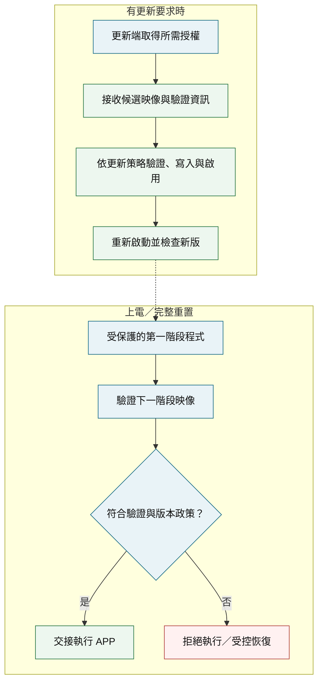
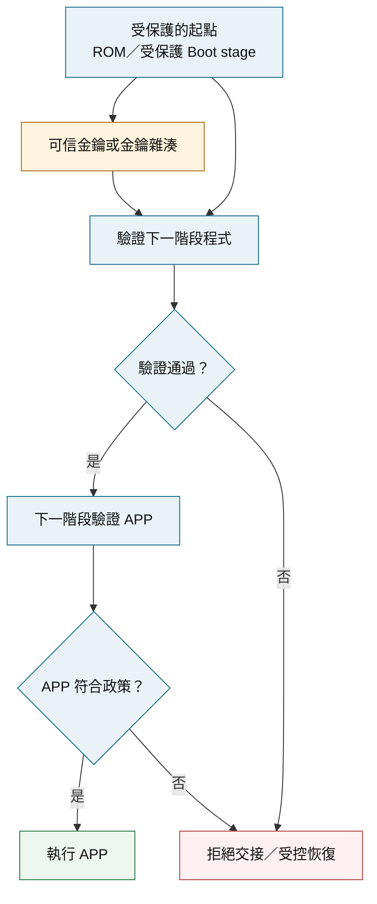
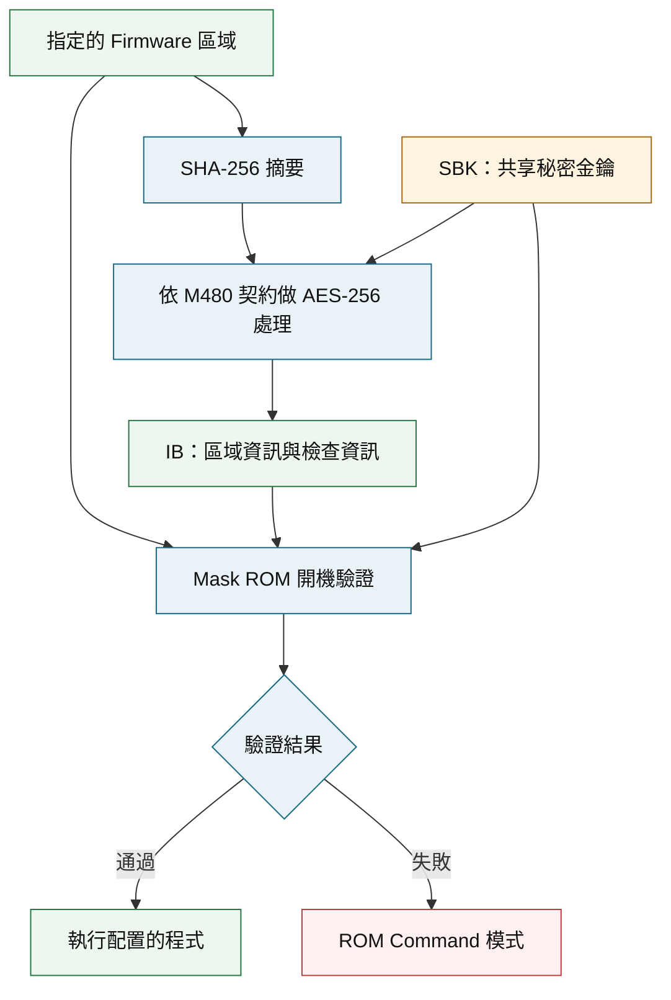
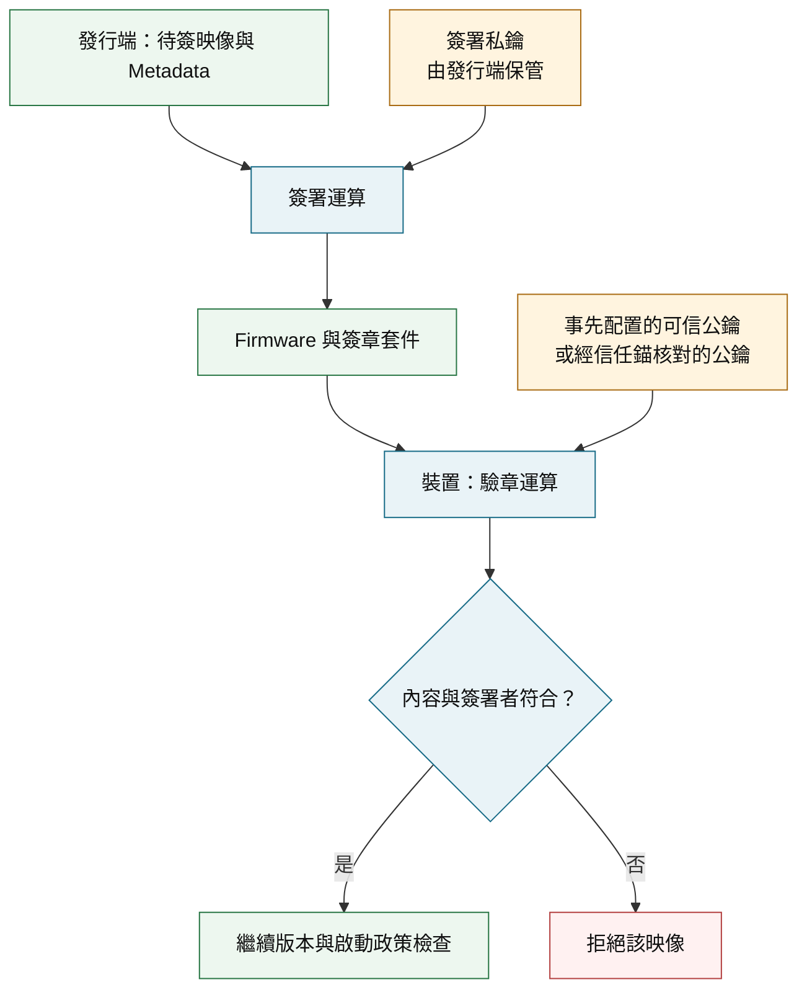
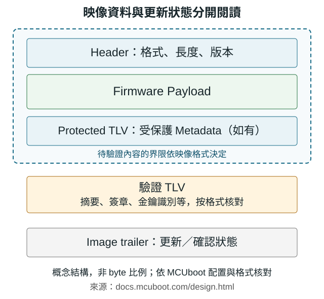
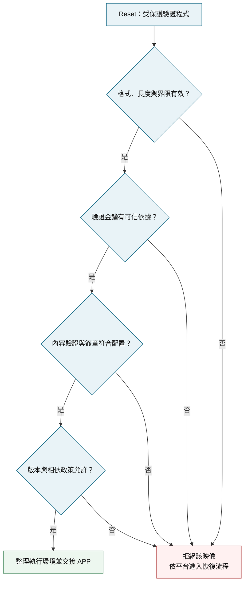
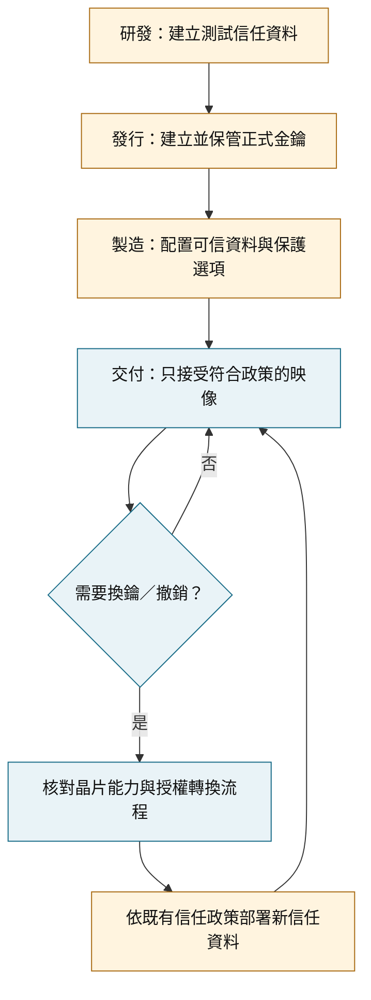
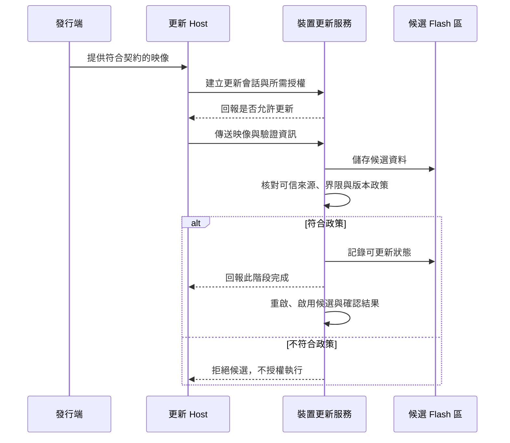
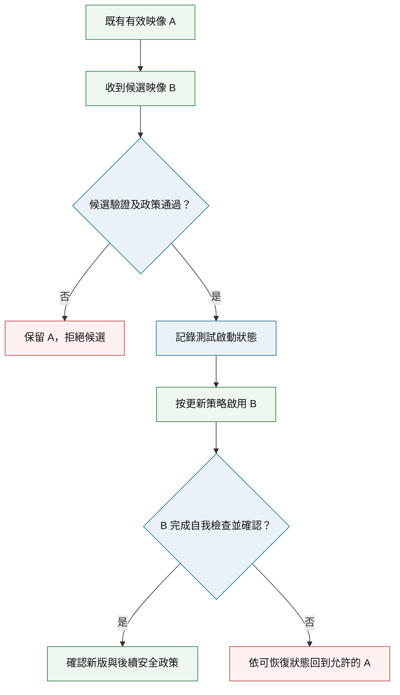

[回到知識庫](https://released.github.io/) · [M480 工具操作與範例](https://released.github.io/slide_Nuvoton_secure_boot_operation_M480/)

# Secure Boot 原理、金鑰與安全更新

> 從「這份程式能否被信任」出發，整理信任根、映像驗證、金鑰配置、更新回復，以及 Nuvoton M480、Renesas RA／RX 的公開實作。

## 內容索引與資料依據

本頁面向 MCU 韌體開發者，共 12 章、24 個閱讀單元。藍色表示信任或驗證，綠色表示 firmware，橙色表示金鑰，紅色表示拒絕或恢復路徑；每張圖另以文字標示角色。

| 主題 | 內容連結 |
| --- | --- |
| 基本概念 | [保護目標](#goals)、[角色分工](#roles)、[信任根](#root-of-trust)、[Hash／驗章示範](#crypto-lab-section) |
| 產品交付 | [驗證模型](#authentication-models)、[映像打包](#image-package)、[金鑰配置](#key-management)、[安全更新](#secure-update) |
| 平台與驗收 | [開機驗證](#boot-validation)、[回復與防降版](#recovery)、[平台案例](#platforms)、[驗收矩陣](#acceptance) |

原理、流程與平台差異就近附上官方公開連結；[參考資料](#references)標示文件版本與閱讀章節。流程圖為依據文件自行整理的教學模型，平台案例另外列出適用條件。

## 1. Secure Boot 的保護目標與邊界

### 1.1 從三種韌體問題開始

產品可正常執行一份 firmware，並不能單憑這個現象判斷其來源、內容及版本是否符合授權政策。

| 情境 | 需要確認的事 | 對應機制 |
| --- | --- | --- |
| Flash 內容被修改 | 執行內容是否仍與核准映像相符 | 具可信依據的完整性／來源驗證 |
| 換成另一方製作的映像 | 簽署者或共享秘密是否被裝置信任 | 簽章驗證或平台指定的認證機制 |
| 放回曾經合法的舊版 | 該版本是否仍在允許範圍內 | 防降版政策與受保護狀態 |

**Secure Boot 的核心工作，是在交接執行前，依信任資料與政策決定映像是否可被執行。** 機制的可信度同時取決於驗證程式、金鑰來源及保護配置。[NIST SP 800-193：信任根與韌體保護原則](https://csrc.nist.gov/pubs/sp/800/193/final)。

### 1.2 完整性、來源、機密性與可用性

| 性質 | 回答的問題 | 設計重點 |
| --- | --- | --- |
| 完整性 | 受驗證的內容是否改變 | 明確的驗證範圍與可信檢查資訊 |
| 來源可信度 | 是否由被授權的一方製作 | 可信金鑰與正確的認證演算法 |
| 機密性 | 未授權的一方能否看見內容 | 映像／儲存／通道加密及金鑰保護 |
| 可用性 | 更新或異常之後能否恢復服務 | 候選區、交易狀態與受控恢復 |

已驗證的映像仍可能有程式缺陷；開機驗證也不能單獨保證執行期間沒有漏洞。產品需要將開機保護、執行期隔離與恢復機制一起規劃。[NIST 的保護、偵測、恢復架構](https://csrc.nist.gov/pubs/sp/800/193/final)提供這個整體視角。

## 2. Secure Boot、Bootloader 與 Secure ISP 分工

### 2.1 開機與更新是兩個執行時機

[開啟完整尺寸流程圖](assets/diagrams/two-moments.svg)。這是責任模型；接收、儲存與驗證的實際次序會受到單槽／雙槽及平台 ROM 服務影響。[Nuvoton AN0039 第 2、3 章](https://www.nuvoton.com/resource-files/AN_0039_M480_SecureBootloader_TC_Rev1.00.pdf)以同一 ROM 提供開機驗證與更新服務，[MCUboot](https://docs.mcuboot.com/design.html)則描述其映像選擇與更新架構。

### 2.2 元件責任與可觀察結果

| 名稱 | 主要責任 | 可觀察結果 |
| --- | --- | --- |
| Secure Boot | 執行前判斷映像是否符合信任政策 | 允許交接或拒絕執行 |
| Bootloader | 啟動、選擇映像，或提供更新功能 | 依其功能與配置而定 |
| Secure ISP／更新服務 | 授權更新、處理資料與 Flash 操作 | 認證結果、寫入與更新結果 |
| PC Tool／Host | 準備映像、發送命令及顯示結果 | 連線、認證、傳輸與工具報告 |
| APP | 執行功能，必要時提出更新／確認新版 | 應用輸出、自我檢查與再次更新 |

「連線成功」「寫入成功」「重置後新版可執行」是不同完成條件。M480 的工具與 ROM 分工可交叉閱讀 [AN0039 第 3～5 章](https://www.nuvoton.com/resource-files/AN_0039_M480_SecureBootloader_TC_Rev1.00.pdf)；MCUboot 的新版確認行為見 [RA FSP 的 Confirming Upgrade](https://renesas.github.io/fsp/group___r_m___m_c_u_b_o_o_t___p_o_r_t.html)。

## 3. 信任根與信任鏈

### 3.1 第一個驗證者從哪裡取得信任

Root of Trust 是信任判斷的起點。它可能涉及不可變的 ROM、由硬體保護的驗證程式，以及經配置的可信金鑰／金鑰雜湊。具體組合由晶片與產品架構決定。

公鑰雖可公開，**裝置使用哪一把公鑰**仍是必須保護的決策。若同時允許更新包任意替換驗證程式與可信金鑰，僅成功執行一次驗章不足以建立完整信任鏈。[NIST SP 800-193](https://csrc.nist.gov/pubs/sp/800/193/final)說明信任根及其保護；[RA FSP](https://renesas.github.io/fsp/group___r_m___m_c_u_b_o_o_t___p_o_r_t.html)亦要求保護 MCUboot 所在 Flash 區域。

### 3.2 每個階段驗證下一個階段

[開啟完整尺寸信任鏈](assets/diagrams/chain-of-trust.svg)。圖中的階段數只是示例，單階段驗證也可構成產品設計。每個執行交接都須保留已建立的保護條件，並核對實際驗證範圍。[NIST 信任鏈原則](https://csrc.nist.gov/pubs/sp/800/193/final)。

## 4. CRC、Hash、MAC 與數位簽章

### 4.1 檢查值與認證資訊的差別

| 機制 | 金鑰需求 | 在本主題的用途 |
| --- | --- | --- |
| CRC／一般 checksum | 無秘密金鑰 | 偵測資料損壞；可被重新計算 |
| Cryptographic Hash | 無秘密金鑰 | 將明確範圍的資料映射為摘要 |
| MAC，例如 HMAC | 共享秘密 | 讓持有秘密的一方產生可驗證的認證資訊 |
| 數位簽章，例如 ECDSA | 私鑰簽署、公鑰驗章 | 將映像與可信簽署者關聯 |

CRC 的非密碼學檢查用途可核對 [NIST CRC 定義](https://csrc.nist.gov/glossary/term/cyclic_redundancy_check)。

Hash 本身不判斷產生者。若內容和附帶 Hash 都可被替換，重新計算 Hash 的一方仍能製作「內容與 Hash 一致」的組合。因此需要保護參考值，或以可信金鑰驗證認證資訊。[W3C Web Cryptography API](https://www.w3.org/TR/2017/REC-WebCryptoAPI-20170126/)分別定義 digest、HMAC 與簽章操作；下方以實際運算觀察差異。

### 4.2 互動：相同 Hash 也可能驗章失敗

此示範固定以「裝置信任的公鑰」驗章，切換的是收到的資料／簽章。SHA-256 與 ECDSA P-256 由瀏覽器執行；這是通用非對稱驗章示例，M480 SBK 模型在下一章另述。

  <fieldset>
    <legend>接收到的映像情境</legend>
    <label><input type="radio" name="lab-scenario" value="valid" checked disabled>合法映像與原簽章</label>
    <label><input type="radio" name="lab-scenario" value="tampered" disabled>修改一個 byte，保留原簽章</label>
    <label><input type="radio" name="lab-scenario" value="wrong-key" disabled>相同內容，改由另一把私鑰簽署</label>
  </fieldset>
  <dl>
    <dt>可信公鑰指紋</dt><dd><code data-lab-key>準備中</code></dd>
    <dt>原始內容 Hash</dt><dd><code data-lab-original>準備中</code></dd>
    <dt>收到內容 Hash</dt><dd><code data-lab-current>準備中</code></dd>
    <dt>Hash 比較</dt><dd data-lab-hash>準備中</dd>
    <dt>可信公鑰驗章</dt><dd data-lab-signature>準備中</dd>
  </dl>
  
正在建立本次頁面的示範金鑰…

  
示範金鑰只存在頁面記憶體，重新載入後更換；不輸入或傳送產品金鑰。此處的公鑰指紋代表示範信任資料，正式裝置仍需事先安全配置。

| 情境 | Hash 與原始內容比較 | 可信公鑰驗章 |
| --- | --- | --- |
| 合法映像與原簽章 | 相同 | 通過 |
| 內容修改一個 byte | 不同 | 失敗 |
| 相同內容、不同簽署金鑰 | 相同 | 失敗 |

運算規則依據 [W3C 的 ECDSA sign／verify 與 SHA-256 digest](https://www.w3.org/TR/2017/REC-WebCryptoAPI-20170126/)。此示範只展示密碼學驗章，未模擬 MCU Flash、版本計數器或完整開機流程。

## 5. 對稱與非對稱兩種驗證模型

### 5.1 M480：SBK 與 IB 檢查資訊

AN0039 第 2.5 節描述：受保護區域的 SHA-256 摘要，經 256-bit SBK 作 AES-256 處理後，形成 IB 所記錄的檢查資訊。SBK 是共享秘密型的安全金鑰，與 ECDSA 的簽署私鑰是不同角色。

[開啟完整尺寸 SBK 模型](assets/diagrams/m480-sbk.svg)。這是依 [Nuvoton AN0039 第 7～9 頁](https://www.nuvoton.com/resource-files/AN_0039_M480_SecureBootloader_TC_Rev1.00.pdf)整理的角色圖。實際 IB 建立、受保護範圍與驗證條件依原廠工具／ROM 契約；圖中不指定 AES mode 或自行定義新的 IB 格式。

### 5.2 非對稱：私鑰簽署、可信公鑰驗章

簽署端持有私鑰，驗證端使用對應的可信公鑰。裝置只做簽章驗證時，不需要持有簽署私鑰；映像加密的解密金鑰是另一個角色。

[開啟完整尺寸簽署／驗章圖](assets/diagrams/signature-flow.svg)。[MCUboot imgtool](https://docs.mcuboot.com/imgtool.html)提供建立金鑰、匯出公鑰及簽署映像的公開工具；簽章演算法須與 Bootloader 配置一致。圖中的角色不表示所有 MCUboot 配置都已啟用簽章。

## 6. Firmware 如何簽署與打包

### 6.1 從 BIN 到可驗證的映像

BIN 提供程式資料，更新格式另定義映像長度、版本、驗證資訊與狀態。下圖以 MCUboot 的概念結構為例，不按實際 byte 比例繪製。

[開啟完整尺寸映像結構圖](assets/diagrams/image-layout.svg)。

| 區塊 | 閱讀重點 |
| --- | --- |
| Header／Payload | 長度、版本與程式內容的解讀規則 |
| Protected TLV（如有） | 需要與映像一起受保護的 Metadata，例如安全計數器 |
| 驗證 TLV | 摘要、簽章、金鑰識別等，按格式核對 |
| Image trailer | 更新／確認狀態，依更新模式使用 |

哪些 byte 納入摘要與簽章，必須依格式定義；簽章資料本身與待簽內容不能混為同一範圍。[MCUboot Image format／Protected TLVs／Image trailer](https://docs.mcuboot.com/design.html)可用來交叉核對。M480 的 IB 是另一種平台格式。

### 6.2 發行端的產物與核對項目

1. 建置符合目標位址與 Flash 配置的 APP。
2. 依 Bootloader 契約設定 Header、slot 大小、對齊與版本等資料。
3. 用正確的發行金鑰簽署，產生可供該 Bootloader 驗證的映像。
4. 保留映像、版本與適用裝置的對應紀錄，確認正式驗證配置接受該產物。

可參考 [imgtool 的 keygen、getpub、sign](https://docs.mcuboot.com/imgtool.html)。`header-size`、`slot-size` 等參數由專案配置決定；範例命令中的位址和大小不能直接套用到其他 MCU。

## 7. MCU 開機驗證順序

### 7.1 從格式檢查到執行交接

[開啟完整尺寸驗證流程](assets/diagrams/boot-validation.svg)。此圖為本頁整理的檢查責任順序，不是所有 ROM 的逐指令流程；各項檢查須對應實際配置。[MCUboot 驗證與相依／版本政策](https://docs.mcuboot.com/design.html)。

### 7.2 驗證失敗之後如何處理

失敗的映像不能因為通訊完成就取得執行授權。可採用的後續行為包含保留既有有效映像、停留恢復服務或由 ROM 接管，取決於平台與產品設計。

M480 AN0039 描述驗證失敗後轉入 HSUSBD／UART1 command mode；MCUboot 則需要結合其 slot、驗證與更新策略判斷可執行映像。[M480 第 2.6～2.7 節](https://www.nuvoton.com/resource-files/AN_0039_M480_SecureBootloader_TC_Rev1.00.pdf)、[MCUboot 設計](https://docs.mcuboot.com/design.html)。

恢復服務自身也需要保護：若恢復路徑允許未授權程式直接執行，就會破壞原有信任政策。[NIST SP 800-193 的恢復原則](https://csrc.nist.gov/pubs/sp/800/193/final)。

## 8. 金鑰建立、配置與生命週期

### 8.1 先用角色辨識金鑰

| 角色 | 典型所在位置 | 需要保護什麼 |
| --- | --- | --- |
| 簽署私鑰 | 發行流程／受控簽署服務 | 機密性與使用權限 |
| 驗證公鑰或其雜湊 | ROM、OTP、受保護 Flash 或安全引擎 | 來源可信度與完整性 |
| M480 SBK | 原廠安全配置及相容工具流程 | 共享秘密與使用條件 |
| M480 KPROM key | 配置紀錄及更新認證流程 | 更新授權與保護範圍 |
| 映像加密金鑰 | 打包／解密架構指定的位置 | 機密性與安全傳遞 |
| Wrapped key | 安全引擎支援的儲存／注入格式 | wrapping 契約與可使用該 key 的環境 |

這張表列的是功能角色，並非所有產品都需要每一項。依據：[MCUboot imgtool](https://docs.mcuboot.com/imgtool.html)、[M480 SBK／KPROM](https://www.nuvoton.com/resource-files/AN_0039_M480_SecureBootloader_TC_Rev1.00.pdf)、[Renesas SKMT](https://www.renesas.com/en/software-tool/security-key-management-tool)。

### 8.2 從研發金鑰到配置與維護

[開啟完整尺寸生命週期圖](assets/diagrams/key-lifecycle.svg)。圖中換鑰不代表每種 OTP／SBK 都能原地修改；必須採用該平台支援的轉換方式。[Renesas SKMT 公開功能](https://www.renesas.com/en/software-tool/security-key-management-tool)包含金鑰 wrapping、注入與更新；[M480 AN0039 第 2.5.1 節](https://www.nuvoton.com/resource-files/AN_0039_M480_SecureBootloader_TC_Rev1.00.pdf)另列出 SBK 的寫入／更新限制。

## 9. Secure Update 與通訊安全

### 9.1 四個不同的保護問題

| 機制 | 保護的對象 | 仍需另行處理 |
| --- | --- | --- |
| 更新端認證 | 誰可提出受保護更新操作 | 映像內容是否被授權 |
| 通道保護 | 傳輸中的資料與會話 | 映像離線儲存後的可信度 |
| 映像驗章 | 映像與可信簽署者的關聯 | 明文內容可能仍可閱讀 |
| 映像加密 | 映像內容的機密性 | 驗證來源、版本與啟用政策 |

例如，MCUboot 可在簽章以外加入映像加密；具體哪些區塊加密、何時解密與驗證，需依其格式與更新模式。[MCUboot Encrypted images](https://docs.mcuboot.com/encrypted_images.html)。Renesas 的 wrapped key 則用於安全引擎金鑰管理，與把整份 APP 加密是不同用途。[SKMT 說明](https://www.renesas.com/en/software-tool/security-key-management-tool)。

### 9.2 候選區更新的角色與次序

[開啟完整尺寸更新泳道](assets/diagrams/update-sequence.svg)。此圖以有候選區的設計為例；單槽原地更新沒有相同的儲存前提。由 Host 驗證過一次，也不能自動取代裝置端的信任判斷。[MCUboot 更新與 slot 架構](https://docs.mcuboot.com/design.html)。

## 10. 防降版、斷電與更新回復

### 10.1 版本號與安全計數器

一份舊映像可能仍有合法簽章，因此「驗章成功」與「允許這個版本」是兩項判斷。防降版需要核對映像版本／安全計數器與裝置保存的可信狀態。

MCUboot 的硬體防降版設計會比對 protected TLV 的安全計數器與可信非揮發儲存值；其啟用條件與平台介面須實作。安全計數器與一般版本號可分開管理。[MCUboot Downgrade prevention](https://docs.mcuboot.com/design.html)。

**回復到可用版本（revert）**處理新版失敗；**防止回到不允許的安全版本（anti-rollback）**處理版本政策。兩者需共同決定何時確認新版、何時提升最低允許狀態。

### 10.2 單槽與雙槽的恢復條件

[開啟完整尺寸更新／回復圖](assets/diagrams/ab-recovery.svg)。

- 圖示適用於具回復能力的配置；實際實作可能使用 swap、bank 切換或其他策略。
- 斷電恢復需要持久的交易狀態與正確 Flash 操作，僅有兩個 slot 並不足以保證成功。
- 配置與確認行為可核對 [RA FSP 的 Swap 與新版確認](https://renesas.github.io/fsp/group___r_m___m_c_u_b_o_o_t___p_o_r_t.html)。

單槽更新可能覆蓋目前 APP，須另外設計映像失效時的恢復入口。驗收時應在接收、擦寫、狀態更新與首次開機等不同階段測試中斷。

## 11. Nuvoton 與 Renesas 平台案例

### 11.1 M480：ROM 服務與兩種呼叫入口

M480 AN0039 描述的 Secure Bootloader 位於 32 KB Mask ROM，並提供開機驗證及 HSUSBD／UART1 更新 API。SBK 參與內容驗證，KPROM 參與受保護更新的授權；兩者角色須分開核對。[AN0039 第 2～3 章](https://www.nuvoton.com/resource-files/AN_0039_M480_SecureBootloader_TC_Rev1.00.pdf)。

既有 M487 範例提供兩個進入 ROM API 的方式：專用 LDROM 轉接，或由 SRAM 模組轉接。改變的是入口程式的執行位置，原廠 Mask ROM 服務仍是更新核心。

| 範例 | 操作說明 |
| --- | --- |
| 專用 LDROM 入口 | [首次部署兩區、後續更新 APROM](https://released.github.io/slide_Nuvoton_secure_boot_operation_M480/#ldrom-example) |
| APROM／SRAM 入口 | [SRAM 接管並更新 APROM](https://released.github.io/slide_Nuvoton_secure_boot_operation_M480/#sram-operation) |

公開範例程式：[專用 LDROM 版本](https://github.com/released/M480BSP_ISP_HID_20_SecureBoot)、[APROM／SRAM 版本](https://github.com/released/M480BSP_ISP_HID_20_SecureBoot_SRAM)，可交叉核對入口與 ROM API 呼叫。

這兩份範例的 SW2／UART0 數字 `1` 用於提出更新要求；傳輸與認證流程見[操作指南](https://released.github.io/slide_Nuvoton_secure_boot_operation_M480/)。案例不代表其他 Nuvoton 系列具有相同配置與映像格式。

### 11.2 Renesas：MCUboot 與安全引擎各有責任

**RA 案例：**

- FSP 的 MCUboot Port 連接映像驗證、Flash 配置與更新流程。
- 使用時核對簽章種類、primary image validation、更新模式與 key protection。
- [FSP 官方文件](https://renesas.github.io/fsp/group___r_m___m_c_u_b_o_o_t___p_o_r_t.html)列出這些配置；使用此模組時仍須逐項核對保護的啟用狀態。

需要安全引擎 Protected Mode 的案例，另見 [R11AN1048 Rev.1.10](https://www.renesas.com/en/document/apn/ra6-secure-bootloader-using-mcuboot-protected-mode-and-internal-code-flash)：該文件的 SCE9 模式與適用裝置有明確範圍，不能概括所有 RA。

**RX 案例：**

- [R01AN7374 Rev.1.02](https://www.renesas.com/en/document/apn/rx-family-mcuboot-firmware-integration-technology)描述 MCUboot FIT 與 TSIP／RSIP 整合；支援裝置及簽章選項依文件核對。
- SKMT 的角色是金鑰 wrapping／注入／更新資料準備，見 [SKMT 公開說明](https://www.renesas.com/en/software-tool/security-key-management-tool)。
- 傳輸與 Flash 操作由更新架構負責。

## 12. 驗收與適用限制

### 12.1 從正確映像到負向情境

下表是驗收設計，並非宣稱所有平台或範例都已通過這些測試。

| 情境 | 核對的預期行為 |
| --- | --- |
| 正確映像與信任資料 | 驗證通過，預期 APP 可執行 |
| 修改受保護內容一個 byte | 內容驗證失敗，未授權執行該映像 |
| 錯誤簽署金鑰／錯誤 SBK | 依實際驗證機制拒絕映像 |
| 缺少要求的簽章／驗證資料 | 在要求認證的配置中拒絕映像 |
| 格式、長度或目標區錯誤 | 依格式與產品契約拒絕，Flash 操作保持在合法範圍 |
| 舊版但簽章合法 | 已啟用的版本政策產生預期結果 |
| 傳輸或擦寫途中斷電 | 進入已設計且驗證過的恢復狀態 |
| 新版未確認／首次啟動失敗 | 依更新模式與安全政策處理 |
| 更新後再次連線 | 新版保有預期更新能力 |

這些情境依本頁的信任、更新與恢復模型整理；實際測試方法依 [MCUboot 官方測試計畫](https://docs.mcuboot.com/testplan-mynewt.html)與平台文件調整。

### 12.2 從原理走到特定產品

1. 確認完整 MCU 型號、Boot ROM／Bootloader、可信金鑰與映像格式。
2. 對照開機配置、Flash／RAM 配置與工具鏈，建立可重現的正式映像。
3. 分別驗證內容授權、寫入結果、開機交接、新版功能與故障恢復。
4. 保留對應版本、配置與結果；依產品需求制定換鑰、維修與更新政策。

M480 的具體接線、ICP、KPROM 視窗與 SW2／KEY1 操作，由 [M480 Secure Boot ISP 指南](https://released.github.io/slide_Nuvoton_secure_boot_operation_M480/)承接。MCUboot 的映像與工具設定由 [imgtool](https://docs.mcuboot.com/imgtool.html)及對應平台 Port 文件承接。

## 官方公開參考資料

資料核對日期：2026-11-06。版本值用於識別本頁案例；動態網頁更新後，仍須核對所使用的 SDK／工具版本。

| 官方資料 | 閱讀位置／適用範圍 |
| --- | --- |
| [Nuvoton AN0039](https://www.nuvoton.com/resource-files/AN_0039_M480_SecureBootloader_TC_Rev1.00.pdf) | Rev.1.00；第 2 章 SBK／IB／KPROM，第 3～5 章 API 與工具 |
| [MCUboot design](https://docs.mcuboot.com/design.html) | Image format、validation、protected TLVs、trailer、downgrade prevention |
| [MCUboot imgtool](https://docs.mcuboot.com/imgtool.html) | 金鑰管理、簽署與打包參數 |
| [MCUboot encrypted images](https://docs.mcuboot.com/encrypted_images.html) | 映像加密的範圍與金鑰角色 |
| [MCUboot 測試計畫](https://docs.mcuboot.com/testplan-mynewt.html) | 以特定 Port 為例的更新與負向情境，需依目標平台調整 |
| [Renesas RA FSP MCUboot Port](https://renesas.github.io/fsp/group___r_m___m_c_u_b_o_o_t___p_o_r_t.html) | 核對時為 FSP 6.6.0；簽章、primary validation、更新與確認 |
| [RA6 Basic Secure Bootloader](https://www.renesas.com/en/document/apn/ra6-basic-secure-bootloader-using-mcuboot-and-internal-code-flash) | R11AN0497 Rev.1.40；基本 RA MCUboot 範例 |
| [RA SCE9 Protected Mode](https://www.renesas.com/en/document/apn/ra6-secure-bootloader-using-mcuboot-protected-mode-and-internal-code-flash) | R11AN1048 Rev.1.10；安全引擎模式、key provisioning 與適用裝置 |
| [RX MCUboot FIT](https://www.renesas.com/en/document/apn/rx-family-mcuboot-firmware-integration-technology) | R01AN7374 Rev.1.02；第 1、2 章範圍與功能 |
| [Renesas SKMT](https://www.renesas.com/en/software-tool/security-key-management-tool) | 安全引擎金鑰管理、工具及範例版本相容條件 |
| [NIST SP 800-193](https://csrc.nist.gov/pubs/sp/800/193/final) | 信任根、保護、偵測、恢復原則；非本頁產品認證聲明 |
| [NIST CRC 詞彙定義](https://csrc.nist.gov/glossary/term/cyclic_redundancy_check) | CRC 的檢查用途與非密碼學性質 |
| [W3C Web Cryptography API](https://www.w3.org/TR/2017/REC-WebCryptoAPI-20170126/) | SHA-256、ECDSA、金鑰與瀏覽器運算語意 |

[回到頁首](#article_top)
