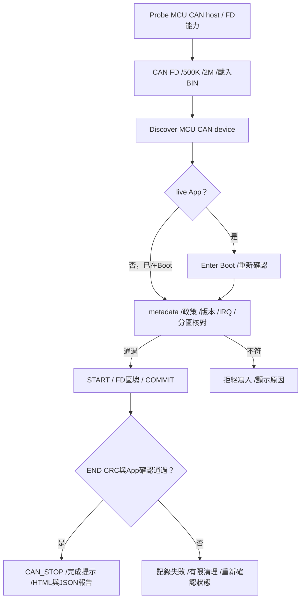

[知識庫首頁](https://released.github.io/) · [ISP Tool](index.html)

# CAN FD 操作

FD+BRS、速率、App 更新與通訊測試。

<!-- FD_UPDATE_BEGIN -->

## CAN FD App 更新操作

設定與責任範圍：

- Bus：nominal 500 kbit/s、data 2 Mbit/s、BRS、64-byte FD 資料幀。
- Tool／MCU CAN host：負責傳輸。
- MCU CAN device Boot：負責映像驗證與 Flash 寫入。
- F24 證據範圍：一般 App 寫入、END CRC、APP_READY、UART counter、初次 Boot 更新，以及 App → Enter Boot → 更新 → App 確認；重啟後七項 Host 錯誤計數差值均為零。
- RH850：沿用相同 Tool 操作；EVM 接線、256-byte Flash page 與實測耗時見 [RH850工程](https://released.github.io/slide_boot_loader_for_RH850/can-fd-device.html#guide-can-device-5)／[更新耗時](https://released.github.io/slide_boot_loader_for_RH850/experiments.html#rh850-update-timing)。
- 未涵蓋範圍：長時間連續更新、queue 壓力與故障／斷電恢復。

### 準備與設定

| 項目 | 核對內容 |
| --- | --- |
| PC Tool | 使用支援 FD burst 的 FirmwareUpgradeTool |
| MCU CAN host | F24 Bridge App 宣告 CAN FD bit1 與 FD burst bit13；Host Boot 維持原有版本 |
| MCU CAN device | 配對的 CAN FD Boot／App；初裝 Boot 使用燒錄器 |
| Bus | 實際 transceiver、分析儀、供電、共地及終端適用於此 FD 設定 |
| Tool CAN TAB | CAN FD、Nominal 500K、Data 2M；Standard request0x700／response0x701 |
| 更新 BIN | `RL78_F24_Boot_loader_CAN_FD_app_update.bin`，metadata mode2、nominal mask4、data mask2 |
| PC 到 Host Link | 可先用115200；此速度與 CAN nominal／data phase 分開設定 |

若 host 缺少 bit13，Tool 在寫入前拒絕更新。
使用 [Misc Host App 更新](https://released.github.io/slide_simple_renesas_isp_tool/#host-bridge-firmware)
載入 `RL78_F24_Bridge_app_bridge_update.bin`，完成後明確 RUN、重新 Probe 核對能力。
此流程更新 Host App，不改 Host Boot。

### 操作順序與結果

| 順序 | 操作 | 核對結果／未符合時 |
| --- | --- | --- |
| 1 | Open + Probe Host | Host 身分及能力有效；失敗時先檢查 COM／Host Link |
| 2 | CAN FD／500K／2M，載入 FD update BIN | Metadata／CRC 有效，介面與 live device 設定一致 |
| 3 | Discover Target | 顯示 live Boot 或 App；無回覆時檢查兩端 FD timing／接線 |
| 4 | live App 時按 Enter Boot | 重新確認 Boot；已在 Boot 時不需 ENTER |
| 5 | Start Device Update | metadata／政策／版本／IRQ／分區通過才進行區塊寫入 |
| 6 | 等待 END 與 App 確認 | 全映像 CRC、APP_READY 與 live 身分比對通過 |
| 7 | 閱讀完成提示及 Firmware update report | CAN_STOP ACK 後清除 target session，保留 Host COM |

接收使用 RXMB0 中斷與 8 筆 RAM queue；Boot／App 向量與 Flash 交接詳見
[FD device 接收與中斷](https://released.github.io/slide_boot_loader_for_RL78/#can-fd-device-rx)。
CAN FD 的 IRQ owner、HANDOFF、更新完成與返回 Boot 標記，依 [RAM 交接契約](https://released.github.io/slide_boot_loader_for_RL78/porting.html#guide-porting-5) 保存及消費；Flash CRC 通過後仍需完成 App 確認。
實板核對時保留 Tool Log、Firmware update report 與 device UART Log，分別確認：

| 階段 | 可觀察結果 |
| --- | --- |
| Boot 安裝／Discover | 使用 programmer 安裝 Boot HEX；Tool 顯示 live Boot、FD 模式與相符的 MCU／分區 |
| App 更新 | 載入 FD App update BIN；metadata／CRC／路由核對通過後才開始更新 |
| END 與 App 啟動 | Tool 確認 APP_READY 與 live 版本／build／size；UART 顯示 `CAN update: completed` |
| App 接收路徑 | UART 顯示 `CAN RX: RXMB0 interrupt -> RAM queue=8 -> main; vector=0x4C`，並持續輸出 V1／V2 counter |
| 再次更新 | 再次 Discover App → Enter Boot → 更新；若 ENTER 已逾時回 App，重新 Discover／Enter Boot |

有效 App 的 ENTER session 在 START 前使用30秒 inactivity。
若已返回 App，重新 Discover → Enter Boot，再開始更新；開始寫入後逾時不會直接跳入未完成映像。
START 本身不擦除 Flash，區塊 COMMIT 驗證通過後才由 Flash driver 寫入。

報告及成功／失敗欄位沿用 [更新確認與驗證紀錄](https://released.github.io/slide_simple_renesas_isp_tool/#update-confirmation)。
END 後的等待與查詢時序見 [重啟等待與 App 確認](https://released.github.io/slide_simple_renesas_isp_tool/#app-restart-confirmation)；
完成提示與報告同時保留映像驗證結果及 Host 計數警告。
Metadata 的逐欄內容見 [共用欄位指南](https://released.github.io/slide_simple_renesas_isp_tool/#tool-ui-fields)，
不以離線 BIN 資訊代替 live device 身分。

### 三幀區塊與 Host Link

每個區塊最多64個有效映像 bytes。
控制與 ACK 也使用 FD+BRS；控制 payload 保留各命令原有長度。
下列 LE 值皆為 little-endian，offset 以 App BIN 開頭為0。

| CAN ID／payload | Byte位置 | 意義 |
| --- | --- | --- |
| 0x700 BEGIN，8 bytes | 0 | 0x0B |
| 同上 | 1..3 | 區塊 offset，LE24、64-byte對齊 |
| 同上 | 4..7 | 實際有效區塊資料的 CRC32 |
| 0x720 DATA，64 bytes、wire DLC15 | 0..N-1 | N=min(64,image_size-offset) 個映像 bytes |
| 同上 | N..63 | 尾塊不足64時固定補FF；Boot逐byte檢查，不計入區塊 CRC |
| 0x700 COMMIT，8 bytes | 0／1..3／4..7 | 0x0C／相同offset／相同CRC |
| 0x701 ACK，8 bytes | 0／1／2..3／4..7 | 0x0C／status／LE16區塊序號／LE32下個絕對寫入address |

完整區塊使用 BEGIN8 + DATA64 + COMMIT8，共3幀。
Host Link command22 的 version2 將它們放入101-byte payload，仍低於128-byte上限。
Header12 bytes之後，每筆為 LE16 standard ID、wire DLC、decoded-length data；
version2 的所有幀及預期回覆均為 FD+BRS，header byte9固定0x0C。
此擴充僅接受 DLC0..8 或15（64bytes）；Classical version1／bit12保持原有格式。
Host 只解碼與傳輸幀，不解讀 BEGIN、Flash address 或 device metadata。

同一區塊可因明確逾時／CRC／sequence結果有限重送。
Boot接受相同資料的重複幀，拒絕衝突幀，最近已提交區塊的重送不會再次寫入。
線路中斷後不自動續寫；重新連線並確認 device 狀態後再操作。
### 更新流程總覽

<!-- FD_UPDATE_END -->

[CAN FD 通訊測試](custom-transfer.html#can-fd-custom-transfer)／[RL78 工程與實驗索引](../slide_boot_loader_for_RL78/can-fd-device.html)／[RH850 工程與實驗索引](../slide_boot_loader_for_RH850/can-fd-device.html)。

---

[Tool 首頁](index.html) · [共用接線與更新流程](serial-isp.html) · [結果與報告](status-and-reports.html)
