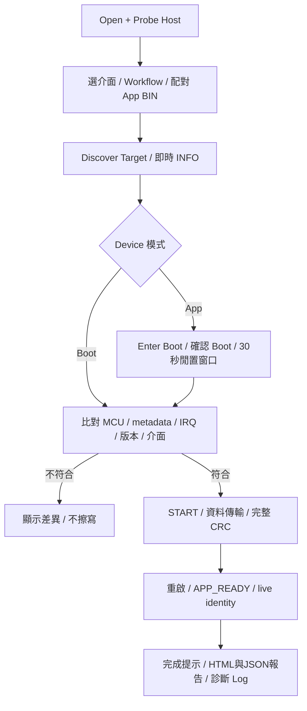

[知識庫首頁](https://released.github.io/) · [Simple Renesas ISP Tool 與 MCU bridge 操作](index.html)

<a id="article_top"></a>

# UART／Xmodem／I2C 操作

接線、可調通訊設定、App 更新及串列通訊測試。

<!-- UART_TOOL_GUIDE_BEGIN -->

- I2C／UART 的 `Connection Details...` 提供 Host 與各 MCU 範例腳位、共地／電壓條件及 Device 速度／位址要求；可離線查看，操作執行中停用。主畫面保留必要接線提醒。
- Custom Transfer 使用 Discover／Transfer Test，不需要 BIN，也不寫入 Flash。
<a id="uart-device-operation"></a>
<a id="serial-device-operation"></a>

## UART／Xmodem／I2C device 操作

Tool 只開啟 bridge 的 Host Link COM，再由 bridge UART1 或 IICA0 與 MCU device 通訊。
Device UART0 獨立提供診斷文字，供 terminal 觀察。

RL78 F13／F24／G16／G22 與 RH850 各有獨立的 UART、Xmodem、I2C Boot／App／Transfer 工程。
這些串列工程已通過離線建置及程式模型測試；實際接線、中斷、Flash、重啟與斷電恢復另作實板驗證。

F24 I2C 的原始 App 及 8..247 KiB 容量測試映像已有一般更新與重啟後 App 確認資料；
條件與耗時見[F24 I2C 更新量測](#f24-i2c-update-measurements)。其他平台、速度及故障恢復分別驗證。

Boot 流程與協定格式可依介面直接查閱：

| 平台 | UART | I2C | Xmodem | 共用契約 |
| --- | --- | --- | --- | --- |
| RL78 | [Boot／Format](https://released.github.io/slide_boot_loader_for_RL78/uart-device.html) | [Boot／Format](https://released.github.io/slide_boot_loader_for_RL78/i2c-device.html) | [Boot／Format](https://released.github.io/slide_boot_loader_for_RL78/xmodem-device.html) | [Frame／INFO／Status](https://released.github.io/slide_boot_loader_for_RL78/serial-device.html#guide-serial-device-5) |
| RH850 | [Boot／Format](https://released.github.io/slide_boot_loader_for_RH850/uart-device.html) | [Boot／Format](https://released.github.io/slide_boot_loader_for_RH850/i2c-device.html) | [Boot／Format](https://released.github.io/slide_boot_loader_for_RH850/xmodem-device.html) | [Frame／INFO／Status](https://released.github.io/slide_boot_loader_for_RH850/serial-device.html#guide-serial-device-5) |

### 選擇介面與 Workflow

| Tool tab | Workflow | Device 使用的工程 | 用途 |
| --- | --- | --- | --- |
| UART / Xmodem | UART ISP | UART Boot／App | framed ISP 更新 |
| UART / Xmodem | Custom Transfer | UART Transfer | PING、96-byte ECHO、counters，不擦寫 Flash |
| UART / Xmodem | XMODEM-CRC | Xmodem Boot／App | ISP control 加 XMODEM-CRC128 資料傳輸 |
| UART / Xmodem | Xmodem Transfer | Xmodem Transfer | 上述診斷加389-byte CRC32 sink，不擦寫 Flash |
| I2C | I2C ISP | I2C Boot／App | STOP mailbox ISP 更新 |
| I2C | Custom Transfer | I2C Slave Transfer | mailbox 的 PING、ECHO、counters，不擦寫 Flash |
| I2C | G16 Reference (read-only) | 對應 reference sample | 唯讀探索；不開放 erase／write／jump |

Xmodem 位於 **UART / Xmodem → Workflow**，不是另一個 COM 或獨立 tab。
Device 每份 Boot 只支援其所屬的介面／協定；UART0 診斷輸出不屬於第二種更新介面。

### 接線與速度

| 通道 | 設定與接法 |
| --- | --- |
| PC ↔ bridge UART0 | Host Link binary，預設115200；Host Baud 與 device 速度獨立 |
| bridge UART1 ↔ device UART1 | Bridge TX P74 接 device RX；bridge RX P75 接 device TX；Device baud 可選或輸入，8-N-1，範例預設115200 |
| bridge IICA0 ↔ device I2C Slave | Bridge SCL P62／SDA P63 接 device SCL／SDA；設定未左移的7-bit address與host宣告的速度，範例預設0x20／100kHz |
| device UART0 ↔ terminal | 診斷文字與 V1／V2 counter；115200、8-N-1 |
| 所有連線 | 共地、核對 I/O 電壓；I2C 使用適當上拉，不將不相容電位直接相接 |

| Device board | UART1 TX／RX | UART0 Log TX／RX | IICA0 SCL／SDA |
| --- | --- | --- | --- |
| F13，R5F10BMG | P74／P75 | P15／P16 | P62／P63 |
| F24，R7F124FPJ5xFB | P74／P75 | P15／P16 | P62／P63 |
| G16，R5F121BCAFP | P11／P10 | P03／P04 | P60／P61 |
| G22，R7F102GGE2DFB | P00／P01 | P12／P11 | P60／P61 |

F13 UART1：CN1 pin35／34；F24 UART1：CN1 pin42／41。兩者 UART0 TX P15 為 CN2 pin5，地可接 TP2／VSS。
F13／F24 UART1 使用 PIOR42=1；G16 使用 SAU0 channels2／3 與對應 PIOR，G22 使用其工程的 SAU0 路由。

接線依據：F13 target board R20UT2272XJ0200 第2頁、F24 target board R12UZ0100XJ0101 第2頁、
G16 FPB schematic R12TU0180EJ、G22 FPB schematic R20UT5122EJ。
接頭方向與焊橋依各板原理圖核對；表內腳位與韌體 adapter 對照，不表示已量測實體波形。
RH850 的 RLIN31／RIIC1、獨立 Log 及 EVM 腳位集中於 [RH850 平台配置](https://released.github.io/slide_boot_loader_for_RH850/serial-device.html#guide-serial-device-1)。

### 工程與產物

下表為 RL78 工程命名，MCU 取 F13、F24、G16 或 G22；每格代表各 MCU 的獨立工程。
RH850 工程名稱與安裝檔集中於 [RH850 工程與建置](https://released.github.io/slide_boot_loader_for_RH850/serial-device.html#guide-serial-device-2)。

| 協定 | Boot | App | Custom Transfer |
| --- | --- | --- | --- |
| UART | RL78_＜MCU＞_ISP_Boot_loader_UART | Boot 名稱加 _app | RL78_＜MCU＞_UART_Transfer |
| Xmodem | RL78_＜MCU＞_ISP_Boot_loader_Xmodem | Boot 名稱加 _app | RL78_＜MCU＞_Xmodem_Transfer |
| I2C | RL78_＜MCU＞_ISP_Boot_loader_I2C | Boot 名稱加 _app | RL78_＜MCU＞_I2C_Slave_Transfer |

Boot／App／Transfer 各自包含來源碼、設定與建置工具，可獨立編譯。
板上配對的 Boot／App 需使用相容的 Metadata、IRQ、Flash 與通訊契約。
在所選工程根目錄執行：

```powershell
powershell -NoProfile -ExecutionPolicy Bypass -File .\build.ps1
```

使用既有 CS+ 與 Windows PowerShell；RL78 使用 CC-RL，RH850 使用 CC-RH。
App 設定由 app_image_config.h、app_irq_handlers.h 編輯，不需要 Python 或 JSON 編輯器。

| 產物 | 使用方式 |
| --- | --- |
| RL78 Boot DefaultBuild/boot0000_1FFF.hex | 燒錄器安裝8-KiB Boot；RH850 安裝檔見上述平台建置章節 |
| App DefaultBuild/＜App工程名＞_update.bin | Tool 載入；包括向量、metadata、程式／padding、末端CRC32 |
| App DefaultBuild/app_build_report.html | 瀏覽器核對實際 BIN 的 metadata／IRQ／CRC／雜湊 |
| Transfer DefaultBuild/＜Transfer工程名＞.hex | 燒錄器安裝獨立通訊測試程式；不放入 App 更新欄 |

分區、容量、metadata 與 ISR 編輯集中於 [串列 device 工程配置](https://released.github.io/slide_boot_loader_for_RL78/#serial-device-engineering)。
初次 Boot 安裝及 Flash 尾端保留區另見 [Boot 安裝與 App 容量](https://released.github.io/slide_boot_loader_for_RL78/#device-debug-monitor)。

### App 更新操作

| 步驟 | 操作與核對 |
| --- | --- |
| 1 | 燒錄器安裝配對 Boot；接妥資料介面，另以 UART0 觀察 Log |
| 2 | 選 bridge COM，按 **Open + Probe Host**；核對該介面的 port 與能力 |
| 3 | 選對 tab／Workflow／port，依Boot／App通訊契約設定Device baud或I2C位址／速度；見[更新必要條件](#serial-update-requirements) |
| 4 | 載入配對 App 的 _update.bin；核對離線 MCU、介面／協定、CRC與版本政策 |
| 5 | **Discover Target** 讀即時 INFO；有效 App 會回讀全部256-byte installed metadata |
| 6 | 回報 App 時按 **Enter Boot**；已在 Boot 則直接進下一步 |
| 7 | **Compare Metadata／Preflight** 核對後，按 **Start Device Update** 並確認 |
| 8 | 完整映像 CRC與 App 確認通過後顯示完成；**Open Last Report** 可開啟 HTML，UART0 可觀察 counter |

有效 App 進入 Boot 後，若30秒沒有完整 ISP request、且更新尚未開始，會回到 App。
此時重新 Discover Target → Enter Boot；active 更新期間不套用這個閒置跳轉。

<a id="serial-update-requirements"></a>

#### 通訊設定與更新必要條件

UART／Xmodem 的 **Device baud** 可輸入十進位300..2000000，或選用常見值。
Bridge須宣告numeric-rate能力並接受該值；F24 host會拒絕分頻誤差超過2%的設定。
I2C位址使用0x08..0x77，保留位址不開放；速度依port能力提供100／400kHz。
這些值保存於INI；修改port、baud、位址或速度後，重新Discover Target。
Tool設定的是bridge端，不會自動改寫device的周邊設定，也不作slave address掃描。

| 核對項目 | 需要對應的內容 |
| --- | --- |
| 資料介面與協定 | Workflow、Boot、App及BIN的protocol／transport一致；Xmodem使用CRC／128-byte block，I2C使用STOP mailbox |
| UART baud／格式 | Tool Device baud、Boot／App UART分頻、live INFO rate與BIN metadata+0x70一致；8-N-1，與Host Baud／診斷Log獨立 |
| I2C位址 | Tool選取的7-bit address、Boot／App slave設定與BIN metadata+0x34一致；例如device為0x20時，Tool填0x20而非0x40 |
| I2C速度 | 所選100／400kHz、Boot／App編譯rate、live INFO與BIN metadata+0x30一致；同時核對上拉、負載與slave時序 |
| MCU與Flash配置 | BIN與live INFO的family／part／target、App起點／容量、Boot保留區、擦除單位一致 |
| 映像與IRQ契約 | metadata格式、CRC32、向量／IRQ ABI有效；App要求的minimum Boot不高於已安裝Boot |
| App版本政策 | 依有效installed App的policy判斷；啟用時一般更新允許同版／新版，維護降版使用獨立確認操作 |

I2C INFO不回報slave address；Tool以實際選取的交易位址綁定session，再核對讀回的metadata，並非從INFO推測位址。
移植時，在配對Boot的 `isp_transport_config.h` 設定 `ISP_UART_BAUD`／`ISP_POLICY_UART_BAUD`，
或 `ISP_BUS_RATE`／`ISP_I2C_ADDRESS`／`ISP_LINK_PARAMETER_0`／`ISP_LINK_PARAMETER_1`；
同步調整board adapter的分頻、slave位址與時序，再重建Boot／App並安裝配對Boot。
產物與建置位置見[串列工程配置](https://released.github.io/slide_boot_loader_for_RL78/#serial-device-engineering)。
範例目前維持115200與0x20／100kHz；其他設定的電氣／實板驗證依實際專案進行。



### Custom Transfer 與 Xmodem

安裝所選 standalone Transfer HEX 後，選表中的 Transfer workflow，依序 **Discover Test Target → Transfer Test**。
這些測試不使用 App BIN、不擦寫 Flash，也不回報 installed Boot／App metadata。

Xmodem Transfer 先以 command0x24 宣告389 useful bytes及 CRC32，再進行128-byte block接收；
最後不足128 bytes以1A padding，完成後回到 framed control，讀取 counters。
CRC16驗證每個區塊，CRC32驗證 useful bytes；診斷用 RAM sink不啟動 Flash或reset。

<a id="f24-i2c-transfer"></a>

#### F24 I2C Custom Transfer

此流程使用 `RL78_F24_I2C_Slave_Transfer`，驗證 bridge 與 device 的雙向通訊。
資料使用 I2C，診斷文字使用 device UART0；腳位集中於本章「接線與速度」。

| 步驟 | 操作 | 預期結果 |
| --- | --- | --- |
| 1 | 安裝 Transfer HEX，另開 device UART0 terminal | 出現 I2C Custom Transfer 啟動文字；bus idle 時可用 z/Z 一般重置 |
| 2 | 選 bridge COM，按 Open + Probe Host | Host 身分及 I2C 能力有效 |
| 3 | 選 I2C／Custom Transfer，核對 port、100 kHz、7-bit 0x20 | 設定與所安裝範例一致；不需要 App BIN |
| 4 | 按 Discover Test Target | Device LIVE 顯示 F24／Custom Transfer；不提供 Boot／installed App 資料 |
| 5 | 按 Transfer Test | PING、96-byte ECHO、counters 及最後 INFO 重讀均通過 |

封包文字與測試結果可分別核對：

- `seq` 隨 request 遞增，RX／TX 的 sequence、command、長度須對應。
- PING 使用前三個測試 bytes；96-byte ECHO 使用 `i XOR 0xA5`。前兩列為 `A5 A4 A7 A6 A1 A0 A3 A2`、`AD AC AF AE A9 A8 AB AA`。
- Payload 每 8 bytes 換行，最後不足 8 bytes 仍完整顯示，空資料顯示 `data=[]`；每筆 request 使用固定圖樣。
- STATS 是 device 本次執行的累積值；Discover 或額外查詢會增加 requests。正常測試不增加 errors／written，trace 不取代 Tool 的 CRC 與內容比對。
- 此流程不發出 Flash 更新命令。Boot／App 更新使用 I2C ISP workflow。

<a id="f24-i2c-update"></a>

#### F24 I2C App 更新

安裝 `RL78_F24_ISP_Boot_loader_I2C` 的 Boot HEX，更新檔使用配對
`RL78_F24_ISP_Boot_loader_I2C_app` 的 `_update.bin` 或同次建置產生的容量測試 BIN。

1. 選 **I2C → I2C ISP**，核對 port、速度與 7-bit address，再載入 BIN。
2. **Discover Target** 讀取即時狀態；Device 已在 App 時按 **Enter Boot**，等待 Boot 確認。
3. **Compare Metadata／Preflight** 通過後，執行 **Start Device Update**。
4. Worker staging 完整 metadata，START 通過後依序傳送 64-byte WRITE，最後由 END 驗證完整映像。
5. END 回覆成功後等待重啟；App ready 與全部 256-byte installed metadata 相符，才確認更新完成。
6. 核對報告及 UART0 App 啟動／counter。若結果未確認，保留原始錯誤並重新讀取狀態，不重複 erase／WRITE／END 來推定成功。

<!-- F24_I2C_MEASURED_BEGIN -->
<a id="f24-i2c-update-measurements"></a>

#### F24 I2C App 更新量測

量測條件：F24 device R7F124FPJ5xFB，F24 bridge，I2C 100 kHz／7-bit 0x20，Host Link 115200。
Tool 0.1.0.138；Host FW 1.8.1／build 20261023。表格由六份選定更新報告的實際欄位整理，時間單位為秒。

| App BIN | bytes | WRITE | END CRC | App 確認 | 總耗時 | 結果與資料 |
| --- | --- | --- | --- | --- | --- | --- |
| 原始 App | 6960 | 12.566 | 0.203 | 1.990 | 15.666 | [PASS／摘要](https://released.github.io/slide_simple_renesas_isp_tool/data/f24_i2c_6960b.html) |
| 8 KiB | 8192 | 14.711 | 0.186 | 2.074 | 17.890 | [PASS／摘要](https://released.github.io/slide_simple_renesas_isp_tool/data/f24_i2c_8192b.html) |
| 24 KiB | 24576 | 44.282 | 0.325 | 1.994 | 47.493 | [PASS／摘要](https://released.github.io/slide_simple_renesas_isp_tool/data/f24_i2c_24576b.html) |
| 56 KiB | 57344 | 99.547 | 0.541 | 2.039 | 103.055 | [PASS／摘要](https://released.github.io/slide_simple_renesas_isp_tool/data/f24_i2c_57344b.html) |
| 120 KiB | 122880 | 215.953 | 0.998 | 2.806 | 220.635 | [PASS／摘要](https://released.github.io/slide_simple_renesas_isp_tool/data/f24_i2c_122880b.html) |
| 247 KiB | 252928 | 439.099 | 1.850 | 4.536 | 446.359 | [PASS／摘要](https://released.github.io/slide_simple_renesas_isp_tool/data/f24_i2c_252928b.html) |

- 六份映像均取得 START／END 成功回覆、APP_READY，並核對全部 256-byte installed metadata；獨立 UART0 Log 有對應的 boot-validated 啟動文字及後續 counter。
- 總耗時採報告 elapsed_ms，包含 Metadata、START、WRITE、END CRC、App 確認及流程開銷；不採載入 BIN 畫面保留的前次 Result／Elapsed。
- 120／247 KiB 在重啟後唯讀確認期間分別觀察到 2／7 次 I2C_NACK，之後均確認 App。報告 link_retries 為 0 不代表所有 I2C 查詢一次成功。
- Host counter assessment 為 UNAVAILABLE，無法據此宣稱 bus 無錯誤；這與映像／App 確認成功分開判斷。
- 最大測試 App 為 247 KiB，未進入尾端 1 KiB 保留區。結果限此映像與接線條件；冷啟動、斷電恢復、故障注入、其他 MCU 或速度另行驗證。
<!-- F24_I2C_MEASURED_END -->

<a id="i2c-image-waits"></a>

#### 等待時間與映像大小

| 階段 | 等待依據 | 判讀方式 |
| --- | --- | --- |
| ENTER request／reply | 一般 ISP request 的回覆期限 | App 先完整回覆，再 reset；incoming BIN 尚未傳送，不依新 BIN 大小延長 |
| ENTER 成功回覆後 | Live INFO 的已安裝 App 大小，估計兩次驗證 | 未知大小保留 6000 ms；不是使用目前載入的新 BIN |
| END request／reply | Device 完整映像驗證及 END 回覆期限 | 保留實際 status、ACK 與耗時；逾時不重送 END |
| END 成功回覆後 | 新映像大小及實測 END 驗證耗時 | 先保留重啟靜默時間，再查詢 App ready／metadata |

- 重啟靜默排程以每 KiB 8 ms 加 500 ms 餘裕估計，限制於 1000..6000 ms；這是查詢排程，不是硬體時間保證，也不改變 wire timeout。
- 靜默期間不送 device 查詢；後續確認使用 12 秒預算，完成的 health probes 之間至少間隔 100 ms，等待可取消。
- 已安裝 8 KiB App、載入 24 KiB BIN 時，Enter Boot 仍依已安裝 8 KiB 排程。新映像通過 END 後，才以 24 KiB 計算重啟等待。
- I2C reply deadline 表示尚未確認命令回覆，不等同 device 回傳 Flash error；需分開核對 request、reply、reset 與 App 確認階段。

<a id="i2c-test-bin-sequence"></a>

#### 容量測試 BIN

App 工程的 `generate_test_bins.ps1`／建置後步驟依該次 `_update.bin` 產生 `test_bins/auto`。
測試檔保留程式與向量，以 FF 擴充容量，更新映像長度及末端 CRC。

| 核對項目 | 意義 |
| --- | --- |
| `flash032KiB_app024KiB` | 測試預算 32 KiB 減去 8 KiB Boot，App BIN 為 24 KiB；不改寫實際 MCU Flash geometry |
| F24 最大 App | 256 KiB Flash 減 8 KiB Boot 與尾端 1 KiB 保留區，為 247 KiB |
| `manifest.csv` | 列出來源 BIN 雜湊、每份測試 BIN 長度／CRC／雜湊與範圍 |
| 驅動或 runtime 修正後 | 重建 App 及容量測試 BIN；只同步來源或只重建 Boot，不會更新舊 App 執行內容 |

建議順序為原始 App BIN → 較小容量 → 逐級擴大至可用上限，每次核對 END、App ready 與 installed metadata。
同路徑檔案重新產生後，需在 Tool 再次 **Load Update Image**；已載入的離線快取不會隨磁碟檔案自動更新。
各容量的實板結果依實際 BIN 分別確認，不能由較小容量或舊映像的成功推定。

<a id="serial-device-diagnostics"></a>

### Device 串列診斷

<a id="serial-uart0-console"></a>

#### UART0 本機操作與封包文字

- F13／F24 I2C App 與 Custom Transfer，以獨立 UART0 提供診斷文字；I2C 傳送二進位協定。
- Terminal 使用 115200、8-N-1；傳送 `z` 或 `Z` 可要求一般 MCU 重置。App 重啟仍經過原本的 Boot 驗證流程；進入更新模式使用 Tool 的 Enter Boot。
- 有效封包顯示 `RX`／`TX`、16-bit `seq`、`cmd`、`len` 與完整 payload。回覆需對應相同 sequence；Tool 另外檢查 CRC 與回傳資料。
- PING／ECHO 測試資料為 `i XOR 0xA5`，例如 `A5 A4 A7 A6`；sequence 隨 request 遞增，資料本身維持固定測試圖樣。
- 文字輸出在主迴圈進行；I2C 的 TX trace 等到完整回覆經最後 NACK／STOP 確認。CRC 錯誤或不完整的 frame 不會成為有效封包 trace。
- `TRACE ISP LOG_DROP` 表示診斷文字被丟棄，不能據此推定資料傳輸遺失。F13／F24 使用獨立有上限的文字佇列。
- I2C 回覆未被完整讀取時，mailbox 在最後活動後 2 秒放棄交易。該回覆不算成功傳送，待輸出的相關 trace 以文字丟棄處理，待執行的 ENTER 動作也會取消。
- 交易已放棄、資料 bus idle 且沒有更新作業時，UART0 `z/Z` 可要求一般重置；不需要先完成另一筆通訊。bus 仍忙碌時持續等待，逾時本身不會自動重置 MCU。

此處本機控制說明適用於 F13／F24 I2C App 與 Transfer。

Transfer Test 分開記錄 PING／ECHO／counter（Xmodem 另含 CRC128 streaming）與最後 live INFO 重讀結果。
子測試通過後若 INFO 重讀失敗，整體作業仍為失敗。操作名稱及錯誤檢查方向依實際 I2C／UART／Xmodem 介面顯示；原始錯誤保留於 Log 與錯誤明細。

支援診斷能力的 UART／Xmodem App 或 Transfer，在 Discover、Transfer Test及更新後確認 App時，
Tool會顯示 `Device UART observations`。這是 Device本次執行的快照，不是每次更新的差值。
`Bridge UART1 observations` 則來自 bridge；兩者分開記錄，不互相代替。

| 欄位 | 意義與核對方向 |
| --- | --- |
| RX errors | Device UART接收硬體錯誤；核對baud、電壓、共地與訊號 |
| RX drops | Device接收queue已滿而丟棄的新資料；核對主迴圈處理、長時間關閉IRQ與傳送節奏 |
| TX timeouts | Device本機傳送未在界限內完成；與對端未收到ACK是不同觀察點 |
| RX peak／pending | 本次執行的queue最高使用量／讀取快照當下的待處理bytes |

未宣告診斷能力時，Tool不送出診斷命令，也不以零值代替未提供的資訊。
Boot更新與I2C mailbox維持各自能力；不因缺少UART診斷而拒絕更新。
封包欄位集中於[串列診斷格式](https://released.github.io/slide_boot_loader_for_RL78/serial-device.html#serial-uart-diagnostics)。

### 判讀、取消與報告

| 訊息／情況 | 核對方向 |
| --- | --- |
| 看不到可用 port | 重新 Probe；核對 bridge 是否宣告 UART forwarding／I2C能力及選取 port |
| Check BIN update interface / protocol | 選擇配對 BIN與 Workflow；不直接改副檔名或metadata bytes |
| MCU／Flash／IRQ ABI／minimum Boot mismatch | 查看 Compare Metadata；重建配對工程 |
| I2C busy／reply未完成 | 核對位址、上拉與完整111-byte read；Tool只讀取等待，不重送寫入指令 |
| XMODEM handshake／block／EOT未確認 | 保存 Log；分別核對 C、ACK／NAK與完整CRC；EOT只送一次 |
| END通過但 APP_READY未確認 | 保留報告並核對 App初始化、電源與Log；不自動重寫或重送END |
| Cancel | Worker清理 device／bridge交易；UI不自行關閉另一條COM |

成功、失敗、取消都產生 JSON／HTML report；Tool不自動開啟瀏覽器。
報告欄位與開啟方式見 [Firmware update report](https://released.github.io/slide_simple_renesas_isp_tool/#update-html-report)；
<!-- UART_TOOL_GUIDE_END -->

<a id="4-i2c-master"></a>

## I2C：G16 Reference 探索

選擇 G16 Reference workflow 時，可依指定 port／address 讀取參考裝置資訊。
UART／Xmodem／I2C App 更新與 Custom Transfer 見本頁的[串列 device 操作](#serial-device-operation)。

1. Probe Host → I2C Master → IICA0／100kHz。
2. Slave 使用7-bit位址 `0x09`。
3. `Probe G16 Reference` 讀取 inquiry／signature／area。
4. Port、rate 或 address 調整後重新 Probe。

探索回覆用於核對連線與參考資訊。
此模式提供探索及 BIN CRC16 檢查，Start Firmware Update 顯示 BLOCKED。

---

[上一主題：CAN 更新逐層導讀](can-protocol.html) · [指南入口](index.html) · [下一主題：Custom Transfer 通訊驗證](custom-transfer.html)
